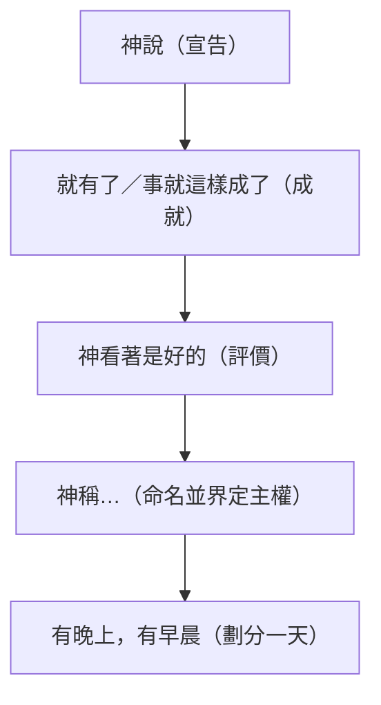

# 創世記 第1章

<!-- chapter-navigation:start -->
|  | [回目錄](../01%20創世記/全書目錄及綱要.md) | [下一章](../01%20創世記/第2章.md) |
| :--- | :---: | ---: |
<!-- chapter-navigation:end -->

1. 起初，神[[創造（從無到有）|創造]]天地。
2. 地是[[空虛混沌的原意|空虛混沌]]，淵面黑暗；[[神的靈的角色|神的靈]]運行在水面上。
3. [[神的話（創造媒介）|神說]]：要有光，就有了光。
4. 神看光是好的，就把[[光與黑暗的分別|光暗分開]]了。
5. [[神命名與主權|神稱光為晝，稱暗為夜]]。有晚上，有早晨，這是頭一日。
6. [[神的話（創造媒介）|神說]]：諸水之間要有空氣，將水分為上下。
7. 神就造出空氣，將空氣以下的水、空氣以上的水分開了。事就這樣成了。
8. [[神命名與主權|神稱空氣為天]]。有晚上，有早晨，是第二日。
9. [[神的話（創造媒介）|神說]]：天下的水要聚在一處，使旱地露出來。事就這樣成了。
10. [[神命名與主權|神稱旱地為地，稱水的聚處為海]]。神看著是好的。
11. [[神的話（創造媒介）|神說]]：地要發生青草和結種子的菜蔬，並結果子的樹木，[[各從其類]]，果子都包著核。事就這樣成了。
12. 於是地發生了青草和結種子的菜蔬，各從其類；並結果子的樹木，各從其類；果子都包著核。神看著是好的。
13. 有晚上，有早晨，是第三日。
14. [[神的話（創造媒介）|神說]]：天上要有[[光體作記號定節令|光體]]，可以分晝夜，作記號，定節令、日子、年歲，
15. 並要發光在天空，普照在地上。事就這樣成了。
16. 於是神造了兩個大光，大的管晝，小的管夜，又造眾星，
17. 就把這些光擺列在天空，普照在地上，
18. 管理晝夜，分別明暗。神看著是好的。
19. 有晚上，有早晨，是第四日。
20. [[神的話（創造媒介）|神說]]：水要多多滋生有生命的物；要有雀鳥飛在地面以上，天空之中。
21. 神就造出大魚和水中所滋生各樣有生命的動物，各從其類；又造出各樣飛鳥，各從其類。神看著是好的。
22. 神就賜福給這一切，說：滋生繁多，充滿海中的水；雀鳥也要多生在地上。
23. 有晚上，有早晨，是第五日。
24. [[神的話（創造媒介）|神說]]：地要生出活物來，各從其類；牲畜、昆蟲、野獸，各從其類。事就這樣成了。
25. 於是神造出野獸，各從其類；牲畜，各從其類；地上一切昆蟲，各從其類。神看著是好的。
26. [[神的話（創造媒介）|神說]]：我們要照著我們的[[形像與樣式|形像]]、按著我們的[[形像與樣式|樣式]]造[[人]]，使他們[[治理與管理|管理]]海裡的魚、空中的鳥、地上的牲畜，和全地，並地上所爬的一切昆蟲。
27. 神就照著自己的形像造人，乃是照著他的形像[[人的尊嚴與神的形像|造男造女]]。
28. 神就賜福給他們，又對他們說：要[[生養眾多與治理|生養眾多]]，遍滿地面，[[生養眾多與治理|治理]]這地，也要[[治理與管理|管理]]海裡的魚、空中的鳥，和地上各樣行動的活物。
29. [[神的話（創造媒介）|神說]]：看哪，我將遍地上一切結種子的菜蔬和一切樹上所結有核的果子全賜給你們作[[原初素食與受造界和平|食物]]。
30. 至於地上的走獸和空中的飛鳥，並各樣爬在地上有生命的物，我將青草賜給他們作[[原初素食與受造界和平|食物]]。事就這樣成了。
31. 神看著一切所造的都[[神看為好（甚好）|甚好]]。有晚上，有早晨，是第六日。

---

## 本章知識節點

### 神學
- [[創造（從無到有）]]
- [[神的靈的角色]]
- [[神的話（創造媒介）]]
- [[三位一體在創造中的隱現]]
- [[光與黑暗的分別]]
- [[形像與樣式]]
- [[人的尊嚴與神的形像]]

### 背景／結構
- [[空虛混沌的原意]]
- [[六日復造的結構]]
- [[光體作記號定節令]]
- [[與古代近東創世神話的對比]]

### 原文／文化
- [[各從其類]]
- [[治理與管理]]
- [[神命名與主權]]
- [[穹蒼（raqia）]]

### 主題
- [[生養眾多與治理]]
- [[神看為好（甚好）]]
- [[原初素食與受造界和平]]
- [[六日創造與信徒重生經歷]]

### 互文
- [[詩篇33篇神話語創造]]
- [[約翰福音1章道與創造]]
- [[詩篇8篇人的治理權柄]]
- [[創世記9章洪水後准吃肉]]

### 解經爭議
- [[創世記1章第1-2節間隔問題]]
- [[創造日長度問題]]

---

## 本章整理

### 起初的創造與未成形的地（v1-2）

整章以「起初，神創造天地」為基礎。四家註釋來源都指出，這句話宣告神是萬物的創造主：祂不必像古代神話中的神明那樣與混亂勢力爭戰，也不是只能拿現成材料來加工的工匠。

這種不把大自然當作神明、沒有神明爭戰、並且以人為受造中心的觀點，正是創世記[[與古代近東創世神話的對比|對古代近東創世神話]]的一大突破。

第1節的「[[創造（從無到有）|創造]]」使用動詞 בָּרָא（H1254A），意思就是「創造」，宣告神完成的創造之工。

各家註釋（BH、CT、GT）綜合整本聖經與該詞在舊約中的用法，進一步理解為神「從無到有」（ex nihilo）的獨特創造。

這裡的「起初」跟約翰福音的「太初」不太一樣。

GT 和 CT 的註釋都說，本節的「起初」是指**時間的起點**（時間本身也是被造出來的）。

約翰福音 1:1 的「太初」則是指基督超越時空、本來就一直存在的本質（見[[約翰福音1章道與創造|約1:1-3]]）。

「神」（אֱלֹהִים，H430）在文法上為複數名詞，但動詞「創造」（בָּרָא）卻使用單數形式，呈現『神（複數）創造（單數）』的獨特結構。

註釋家多探討這種搭配，看法有兩種：

- 部分學者認為此處隱含[[三位一體在創造中的隱現|三位一體]]的啟示。
- 部分學者視為表達神無限尊榮的尊嚴複數。

單靠這個文法特徵，還不能直接證明哪一種神學解釋才是對的。

第2節宣告「[[神的靈的角色|神的靈]]運行在水面上」；「運行」（מְרַחֶפֶת，字根 רָחַף H7363，盤旋／盤繞）描寫靈的臨在。

KC、BH 與精讀本等註釋進一步結合古代意象，看見如同母鳥展翅盤旋、覆育雛鳥般充滿生命力與親切的照料。

接著第2節提到的「[[空虛混沌的原意|空虛混沌]]」該怎麼解釋，是本章的第一個[[創世記1章第1-2節間隔問題|解經分歧]]。

原文的確用了「空虛」與『混沌（空無）』這兩個詞，但「地是」這個動詞，在原文裡無法確定該翻譯成「是」還是「變成」。

所以不能只靠這個字來證明所謂的『缺口說』（認為創造過程中有時間間隔）。

各家學者的看法並不相同：

| 立場 | 對「空虛混沌」的解讀 | 主要代表 |
| --- | --- | --- |
| 間隔／復造說 | 神一開始造的地球很美好，後來因為遭遇審判才變荒涼；第3節之後是神的『重新恢復與創造』 | CT（黃迦勒）；GT 中的丁良才、李道生 |
| 初始未成形說 | 地球一開始就是還沒成形、不適合居住的狀態，神接著才把它分別出來並充滿生命，這並不是審判的結果 | GT 中的丁道爾、啟導本、精讀本、雷氏（精讀本與雷氏明文反對『缺口說』）；BH |
| 立場轉變 | 早期曾因為「未成形」這個詞而認為有審判間隔，後來改認為神可以先造出未成形的物質，再繼續塑造它 | KC |

> [!note] 來源說明
> 『復造說』不能整個算在 CT／GT 頭上。
>
> GT 是一套包含多家看法的合訂本，裡面的意見並不一致：
> 丁良才、李道生支持間隔／復造說，但丁道爾、啟導本、精讀本、雷氏卻主張地球一開始就是未成形、隨即被神安排出秩序。其中精讀本與雷氏還明確反對「缺口」的讀法。

### 前三天：神用話語帶來秩序與界線（v3-13）

前三天的主題是「分別」。神做了三次分開的動作：分開光與暗、分開上下方的水、分開海與陸地。

神所造用以分開上下之水的「[[穹蒼（raqia）|穹蒼]]」（רָקִיעַ，H7549），原文基本意思為廣闊的空間。

經文清楚說明其功能在於劃分上下之水，並作為日月星辰陳列的天空；至於古代近東如何理解天空的結構，則是學者結合歷史背景所作的延伸討論。

精讀本與雷氏都點出了這三次的劃分。後來保羅也用光與暗的分別，來比喻信與不信、正義與不義的差別（見林後6:14）。

推動這一切創造的是[[神的話（創造媒介）|神說]]。從第3節開始，「神說」這兩個字不斷出現，就像詩篇裡寫的：「他說有，就有，命立，就立」（見[[詩篇33篇神話語創造|詩33:6、9]]），希伯來書11:3 也說宇宙是藉著神的話造成的。

丁道爾強調，「說」這個字排除了宇宙是自己跑出來的、或是神明打鬥產生的、又或者是神明生出來的等錯誤說法。

神也為造出來的東西命名：稱光為晝、暗為夜、空氣為天、旱地為地與海。

許多註釋（CT、啟導本、精讀本、雷氏、KC、BH）都指出，在當時的閃族文化裡，[[神命名與主權|為事物命名就代表擁有它的主權和所有權]]（見王下23:34）。

每一天的創造過程大約都遵循著相同的節奏。

精讀本把神的創造過程歸納為五個步驟：

不過這個節奏有兩個例外，正好是學者解經時的觀察重點：第一，命名的動作只出現在前三天；第二，唯獨**第二天沒有單獨說「神看著是好的」**。

CT 推測這可能是因為天空中有屬靈的邪惡勢力居住（見弗6:12）。

KC 則認為第31節最後的「甚好」已經把第二天一起包含進去了。

到了第三天，神命令地上長出植物與果樹，並且要「[[各從其類]]」。

「[[各從其類]]」在原文中使用 מִין（H4327），在本章一共出現十次，強調受造界各有其界限、秩序與多樣性。註釋家進一步探討聖經中的『類』與現代生物學分類之關係。

### 後三天：神讓萬物充滿世界（v14-25）

如果說前三天是預備好舞台，那麼後三天就是讓各種生物住進去。

第四天神造了「[[光體作記號定節令|光體]]」來分開日夜、作記號、定節令與年歲。這裡有一個很明顯的**去神話化**寫法：

GT 收錄的《舊約背景註釋》指出，這一段刻意避開了「日」和「月」這兩個字（因為那正是當時周遭國家太陽神和月神的名字），只稱呼它們為「兩個大光」。

BH 也一再強調，古代近東常把日月星辰神化，但這裡把它們寫成神所造、為神的旨意服務的受造物，不是神。

KC 說，日月星辰受神管理，神也按名字認識它們（賽40:26），它們絕不該被敬拜。

KC 引用的申命記4:19 警告以色列人，抬頭看見日月星辰時，不要被勾引去敬拜事奉它們；17:3 則說，去拜日頭、月亮或天象，是主不曾吩咐的。

第21節的「大魚」（הַתַּנִּינִם，字根 תַּנִּין H8577）在古代近東神話中常被描繪為與神明爭戰的海中巨獸；但在創世記中，牠們同樣只是神所造之物。

丁道爾（GT）指出，『大魚』這個字對迦南人是個不吉祥的字，代表世界起頭時與巴力對抗的深淵強權；但在這裡，牠們不過是龐大的受造物，和其他生物一同領受神的祝福（22節）。

BH 也說，古代近東文化裡的海中生物常象徵混沌，並與神明連在一起；在這段經文裡，牠們卻是神有秩序的創造的一部分，顯出神掌管一切。

第五天，神用話語讓水中和空中充滿生物，並且第一次向受造物「賜福」，要牠們繁衍充滿。

第六天神造了地上的動物，分為牲畜、昆蟲（爬行動物）和野獸三類，丁道爾指出這些原文分別對應著家畜、貼著地面的小動物，以及自由漫遊的野生動物。

後三天與前三天互相呼應，結構上是『充滿』對應『分別』，不是毫無關聯的流水帳。

GT 引用的丁良才把它排成了對照表，並說：「前三日的工是預備後三日的工，後三日的工是成全前三日的工」。

KC 也逐天對應了起來（第四天對應第一天、第五天對應第二天、第六天對應第三天）：

| 前三天：劃分界線 | 後三天：充滿生命 |
| --- | --- |
| 第一天　光（v3-5） | 第四天　光體：日、月、星（v14-19） |
| 第二天　天空、上下方的水（v6-8） | 第五天　水族、鳥類（v20-23） |
| 第三天　陸地、植物（v9-13） | 第六天　動物、人類（v24-31） |

這正是[[六日復造的結構|六日創造前後呼應的結構]]所要強調的：創造有秩序、有界限、有目的，並非一場混亂的意外。

### 第六天的高峰：照著神的形像造人（v26-31）

第26到31節是整章的最高潮。神在造人時的說法和其他受造物不同——「我們要照著我們的形像……造人」。

很多學者指出「我們」這個詞暗示了神格中的商議與[[三位一體在創造中的隱現|三位一體]]。

精讀本列出了四種不同的解讀方式，最後選擇了三位一體。

賈斯樂與郝威則提醒，原文文法上的複數不一定能直接證明三位一體，只有到了新約（如約1:1等）才清楚見證了聖子、聖靈都有參與創造。

原文中，「[[形像與樣式|形像]]」出現了三次，「樣式」出現了一次。這表示經文確實用了兩個不同的名詞，但沒有把它們硬分成『內在性格』與『外在體格』；這種分法只是 CT 的其中一種解釋。

串珠、啟導本、KC、BH 則比較廣泛地強調，人類因此『像神卻不是神』，能夠與神交流，並在地上作為神的代表。

丁良才說，照著神的形像造的人，有永不死的靈，也有自知、想像、理想和自主的能力；人原來是正直、聖潔的，這兩樣因犯罪而失去了，但凡信靠耶穌的人仍能得回（西3:10；弗4:23-24）。

神「照著他的形像[[人的尊嚴與神的形像|造男造女]]」。

丁道爾指出，耶穌把這句話當作婚姻的兩大基礎之一（見可10:6-7），這也預示了新約中男女在靈性上的平等（見加3:28）。

因此，KC、BH、GT 都強調要尊重每一個人。

GT 說，人無分男女，都是照神的『形像和樣式』造的，有人格、理性和道德意識，會思想、有感情、有意志，所以應該受到尊重，也應自尊。

《聖經精讀本》也指出，男人和女人是平等的存在。

接著神交託給人類[[生養眾多與治理|生養眾多、遍滿、治理地球]]的任務，以及[[治理與管理|管理]]海、空、地上的動物（這呼應了[[詩篇8篇人的治理權柄|詩篇第8篇]]）。

第28節神將託付賜給全人類，以兩個動詞宣告治理使命：「制伏」（כָּבַשׁ，H3533）這地，並「管理」（רָדָה，H7287）海空地上的各樣活物。

至於我們該怎麼使用這份權柄，啟導本稱之為神與人所立管理地球的「大憲章」，但也明確表示不可濫用、浪費或破壞環境。

BH 則進一步指出，治理的意思是負責任的管理，不是剝削，榜樣是那位服事並為百姓犧牲的耶穌基督（可10:42-45）。

最後神安排了食物：蔬菜水果給人吃，青草給動物吃（也就是[[原初素食與受造界和平|人類墮落前大家都是吃素的]]）。

CT、丁良才、KC、精讀本都指出，當時的世界沒有流血與捕食，直到大洪水之後神才准許人類吃肉（見[[創世記9章洪水後准吃肉|創9:3]]）；這種不流血的和平，未來將在彌賽亞的國度裡重現。

至此神看著一切所造的都[[神看為好（甚好）|甚好]]。

在前面六次宣告「神看著是好的」（טוֹב，H2896A）之後，第31節在造人完畢時總結為「都甚好」（טוֹב מְאֹד，H2896A 搭配 H3966），為創造的六日劃下完美的句點。

丁良才在第31節下說，聖經論神的作為有四層：浩大的（詩111:2；啟15:3）、奇妙的（啟15:3；詩139:14）、完全的（申32:4），最後是『甚好』的。

### 總結與應用：創造的節奏與意義

原文裡的「創造」（*bara*）在本章出現在三個地方、總共五次：第1節和第21節各一次，第27節連續用了三次。

CT、GT（丁良才、精讀本）與雷氏把這三個地方整理為物質、生命、人類的三次大躍進。

| 「創造」出現的位置 | 造了什麼 | 意義上的飛躍 |
| --- | --- | --- |
| 1 節 | 天地（物質宇宙） | 從無 → 物質 |
| 21 節 | 大魚與水中動物（動物生命） | 物質 → 生命 |
| 27 節 | 人類 | 生命 → 人類 |

另外，本章也七次使用了另一個表示「造／做」的字 *asah*。

不過，除了 bara 以外的『造』並不全都是 asah，本章其實還用了其他的動詞。

CT 與 KC 更把這六天的順序，看作是[[六日創造與信徒重生經歷|信徒生命重生的縮影]]：

- 第一天：聖靈運行與蒙光照
- 第二天：分別屬天與屬地
- 第三天：脫離死亡、心田結出果實
- 第四天：站穩屬天的地位發光
- 第五天：勝過環境的考驗
- 第六天：生命成熟、彰顯神的形像並掌權

KC 也把整章看成是神終極計畫的縮影：神把大自然交給亞當夫婦，未來也要把萬有交給「末後的亞當」基督與教會，基督最終必成為宇宙的中心。

至於[[創造日長度問題|六天裡的「一天」到底有多長]]，BH 提出了『普通的二十四小時』與『一段漫長的時期』兩種看法：有人把它看成字面的二十四小時，理由是經文說『有晚上，有早晨』，許多保守派學者持這種看法；也有人把它看成象徵較長的時期。

KC、CT、GT 等學者則比較偏向普通的二十四小時。

KC 的理由有兩個：經文說『有晚上，有早晨』；而『日』這個字單獨使用時，在創世記裡都是一般意義的一天（創8:22；29:7）。

KC 並引出埃及記20:11，說神是在六日之內創造天地。

### 關鍵神學點

1. **[[創造（從無到有）]]**：宣告神是萬有的絕對主宰，天地由神話語而成，非神明爭戰或物質演化產物。
2. **[[人的尊嚴與神的形像]]**：男女皆按神的形像與樣式受造，享有平等的屬靈尊嚴，並承擔管理受造界的管家使命。
3. **[[神看為好（甚好）]]**：受造界起初完美有序，物質本身原為美善，顯明創造主豐盛的智慧與恩典。
4. **[[六日復造的結構]]**：前三日劃定界線（光、穹蒼、旱地海面），後三日充滿生命（光體、水族飛鳥、陸生動物與人類），呈現井然有序的創造設計。

**參考資料**
https://biblehub.com/study/genesis/1.htm
https://www.kingcomments.com/en/bible-studies/Gen/1
https://www.ccbiblestudy.org/Old%20Testament/01Gen/01CT01.htm
https://www.ccbiblestudy.org/Old%20Testament/01Gen/01GT01.htm
https://github.com/STEPBible/STEPBible-Data

<!-- appendix-links:start -->
## 附錄

### 相關地圖
- [[appendix/fhl_maps/maps/006|〈創圖一〉洪水前的各地示意圖]]
- [[appendix/fhl_maps/maps/009|〈創圖四〉亞伯拉罕的生平]]
<!-- appendix-links:end -->

<!-- chapter-navigation:start -->
|  | [回目錄](../01%20創世記/全書目錄及綱要.md) | [下一章](../01%20創世記/第2章.md) |
| :--- | :---: | ---: |
<!-- chapter-navigation:end -->
