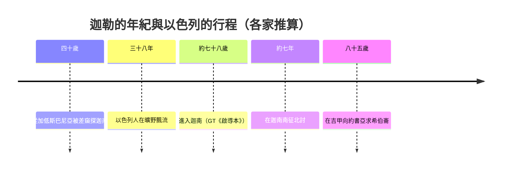

# 約書亞記 第14章

<!-- chapter-navigation:start -->
| [前一章](../06%20約書亞記/第13章.md) | [回目錄](../06%20約書亞記/全書目錄及綱要.md) | [下一章](../06%20約書亞記/第15章.md) |
| :--- | :---: | ---: |
<!-- chapter-navigation:end -->

1. 以色列人在[[迦南地]]所得的[[產業（na.cha.lah）|產業]]，就是祭司[[以利亞撒]]和嫩的兒子[[約書亞]]，並[[分地的十位支派首領|以色列各支派的族長]]所分給他們的，都記在下面，
2. 是照耶和華藉[[摩西]]所吩咐的，把產業[[拈鬮分地（go.ral）|拈鬮]]分給九個半支派。
3. 原來，[[摩西]]在約但河東已經[[兩支派半求河東之地為業|把產業分給那兩個半支派]]，只是在他們中間沒有把產業分給[[利未支派|利未人]]。
4. 因為[[收納以法蓮與瑪拿西|約瑟的子孫是兩個支派]]，就是[[瑪拿西]]和[[以法蓮]]，所以沒有把地分給[[利未支派|利未人]]，但[[利未人的四十八座城|給他們城邑居住]]，並城邑的[[郊野（mig.rash）|郊野]]，可以牧養他們的牲畜，安置他們的財物。
5. 耶和華怎樣吩咐[[摩西]]，以色列人就照樣行，把地分了。
6. 那時，[[猶大支派|猶大人]]來到[[吉甲]]見[[約書亞]]，有[[基尼洗人|基尼洗族]]耶孚尼的兒子[[迦勒]]對約書亞說：耶和華在[[加低斯]]巴尼亞指著我與你對[[神人（ish ha.e.lo.him）|神人]][[摩西]]所說的話，你都知道了。
7. 耶和華的僕人[[摩西]]從[[加低斯]]巴尼亞打發我[[十二探子窺探迦南地|窺探這地]]，那時我正四十歲；我按著心意回報他。
8. 然而，同我上去的眾弟兄使百姓的心消化；但我[[專心跟從主與另一個心志|專心跟從]]耶和華─我的神。
9. 當日[[摩西]]起誓說：你腳所踏之地定要歸你和你的子孫永遠為業，因為你[[專心跟從主與另一個心志|專心跟從]]耶和華─我的神。
10. 自從耶和華對[[摩西]]說這話的時候，耶和華照他所應許的使我存活[[征服迦南歷時約七年|這四十五年]]；其間以色列人在曠野行走。看哪，現今我八十五歲了，
11. 我還是強壯，像[[摩西]]打發我去的那天一樣；無論是爭戰，是[[出入（領袖用語）|出入]]，我的力量那時如何，現在還是如何。
12. 求你將耶和華那日應許我的這山地給我；那裡有[[亞衲族與偉人拿非林|亞衲族]]人，並寬大堅固的城，你也曾聽見了。[[或者（u.lay）|或者]]耶和華照他所應許的與我同在，我就把他們[[趕出（ya.rash）|趕出去]]。
13. 於是[[約書亞]]為耶孚尼的兒子[[迦勒]]祝福，將[[希伯崙]]給他為業。
14. 所以[[希伯崙]]作了[[基尼洗人|基尼洗族]]耶孚尼的兒子[[迦勒]]的產業，[[直到今日]]，因為他[[專心跟從主與另一個心志|專心跟從]]耶和華─以色列的神。
15. [[希伯崙]]從前名叫[[基列亞巴]]；亞巴是[[亞衲族與偉人拿非林|亞衲族]]中最尊大的人。於是[[國中太平（sha.qat）|國中太平]]，沒有爭戰了。

---

## 本章知識節點

### 事件
- [[迦勒求得希伯崙]]
- [[十二探子窺探迦南地]]

### 歷史
- [[征服迦南歷時約七年]]
- [[收納以法蓮與瑪拿西]]
- [[加低斯巴尼亞事件]]

### 主題
- [[拈鬮分地（go.ral）]]
- [[分地的十位支派首領]]
- [[利未人的四十八座城]]
- [[直到今日]]

### 原文
- [[或者（u.lay）]]
- [[郊野（mig.rash）]]
- [[國中太平（sha.qat）]]
- [[出入（領袖用語）]]
- [[神人（ish ha.e.lo.him）]]

### 神學
- [[專心跟從主與另一個心志]]

### 人物
- [[迦勒]]
- [[以利亞撒]]
- [[亞巴（亞衲族）]]
- [[基尼洗人]]

### 地點
- [[希伯崙]]
- [[基列亞巴]]
- [[吉甲]]

### 背景
- [[亞衲族與偉人拿非林]]

---

## 本章整理

### 誰來分、怎麼分（v1-5）

第13章交代了河東，從這一章起輪到約但河西。

KC 說，從本章一直到第19章，記的不是一份乾巴巴的清單；它也點出分地的地點分成兩處：猶大和約瑟的兩個支派在吉甲受分，其餘七個支派要到示羅才拈鬮（書18-19）。

第1節先寫主持分地的人：「祭司[[以利亞撒]]和嫩的兒子[[約書亞]]，並以色列[[分地的十位支派首領|各支派的族長]]」。

GT《丁道爾》提醒，這是以利亞撒頭一次出現在約書亞記；他在約書亞受任命時就在場，有責任用烏陵和土明判斷神的旨意來引導約書亞（民27:19-22）。

GT《綜合解讀》因此推測拈鬮可能就由他主持，GT《約書亞記研經資料》也說一般認為他就是主持拈鬮抽籤的人。

KC 注意到經文把以利亞撒排在約書亞前面，並說各支派族長在場監督，任何偏袒哪個支派的懷疑就沒有機會出現。

BH 的說法相近：族長們以代表和見證人的身分參與，使各宗族承認分得的地。

第2節說產業是「[[拈鬮分地（go.ral）|拈鬮]]」分給九個半支派的。

GT《丁道爾》說在約書亞記這裡是頭一次提到鬮，經文從未仔細說明它怎麼使用。

至於拈鬮決定的是什麼，GT《綜合解讀》說：「拈鬮」決定各支派的位置，地域的大小卻是根據支派的人口分配（民26:53-56）。

BH 從另一面看：拈鬮使最強的支派或最有影響力的領袖不能自己決定自己的分。

第3至4節解釋一筆數字帳。[[利未支派|利未人]]沒有分地，但「[[收納以法蓮與瑪拿西|約瑟的子孫是兩個支派]]」。

GT《綜合解讀》把帳算清楚：約瑟代替犯罪的長子流便承受雙份，多算了一個支派；利未支派散居在以色列中、沒有分地，少算了一個支派，所以參與分地的支派總數仍然是十二個。

利未人得的是「[[利未人的四十八座城|城邑居住]]，並城邑的[[郊野（mig.rash）|郊野]]」，STEP 語言資料顯示「郊野」是 u./Mig.re.shei./Hem（H4054，簡要詞典義 mig.rash: pasture）。

GT《聖經精讀本》說利未人得到了包括6個逃城的48個城邑。

GT《約書亞記研經資料》則認為第4節後半指的應該是「逃城」的設立。

第5節一句話說「把地分了」。

GT《聖經精讀本》提醒別被這句話騙了：它用一句話扼要總結到書19:51 的內容，看起來分配進行得既簡單又容易，實際上過程中發生了許多波折，猶大、以法蓮與瑪拿西半支派分完以後，分配工作暫停了一段，約書亞還要責備那些態度消極的支派（書18:3）。

### 八十五歲的迦勒（v6-12）

分地還沒開始拈鬮，猶大人先來到[[吉甲]]，裡面站出來說話的是[[迦勒]]。

KC 說，來的是猶大人，我們聽到的卻只有一個人的心願。經文特別稱他是「[[基尼洗人|基尼洗族]]耶孚尼的兒子」。

GT《約書亞記研經資料》說基尼洗族並非以色列人的部族，與基尼人、俄陀聶族相關。

KC 說他的祖先大概是後來加入神百姓中間的，也可能是猶大裡的一個家族。

BH 說他雖被稱為基尼洗人，已經完全併入猶大。

KC 由此說了一句很重的話：許多不是在神百姓中長大的人，往往比在其中長大的人更渴慕屬靈的福分。

迦勒先把約書亞拉回四十五年前：「耶和華在加低斯巴尼亞指著我與你對[[神人（ish ha.e.lo.him）|神人]]摩西所說的話，你都知道了。」那是[[加低斯巴尼亞事件|加低斯巴尼亞]]的事，他與約書亞同在[[十二探子窺探迦南地|窺探這地]]的十二人之中。

他說自己「按著心意回報」，GT《綜合解讀》解作實話實說，既不是因為懼怕人、也不是為了討好人。

BH 說他回報時並不否認迦南人的強大，只是用神的應許來解讀那些事實。

第8節他用兩個對比的說法形容當年：同去的弟兄「使百姓的心消化」，他卻「[[專心跟從主與另一個心志|專心跟從]]耶和華」。

STEP 語言資料顯示，「專心跟從」是 mi.Le.ti 'a.cha.Rei（H4390 ma.le: to fill 加 H310A a.char: after），與民14:24 神稱讚迦勒時用的是同一組字。

「心消化」在本節是 him.Siv（H4529，簡要詞典義 ma.sah: to liquefy），和申1:28 摩西回顧同一件事時用的 H4549 ma.sas 是不同的字。

GT《丁道爾》說「跟隨耶和華」這說法曾用在迦勒和約書亞身上（民32:12、申1:36），與不肯跟隨耶和華的以色列人形成對比。

接著是兩個年紀。這兩個數字也是各家推算[[征服迦南歷時約七年|征服迦南年數]]的根據：

CT 與 GT《綜合解讀》都把「這四十五年」拆成曠野的三十八年加上征服的七年。

GT《啟導本》說從他的年紀可知征戰應有六、七年之久。

GT《研經資料》另外指出，當時游牧民族平均壽命約四十歲，迦勒能活到八十五歲，可以視為是神特殊的恩典。

迦勒說耶和華「使我存活這四十五年」，這話背後是一整代人的死亡。

CT 說當年二十歲以上的人「僅有他們兩個得以活著進入迦南地」，指的就是迦勒和約書亞。

GT《聖經精讀本》也說他是「踏上迦南地的兩個生存者之一」。

KC 說同年紀的人都已死在曠野，只有他和約書亞是例外。

BH 則描寫此刻的場面：迦勒站在約書亞面前，兩人同是曠野那一代存活下來的人。

第11節迦勒說「我還是強壯」，無論是爭戰，是[[出入（領袖用語）|出入]]，力量都和當年一樣。

GT《研經資料》說「出入」原文直譯是「是出，是入」。

CT 解作「爭戰」是上戰場，「出入」是在家日常生活。

KC 說他的力量不在過去的勝利，他沒有靠講很久以前的故事過日子，而是仍然滿有力量要去得新的勝利。

第12節是請求本身：「求你將耶和華那日應許我的這山地給我；那裡有亞衲族人，並寬大堅固的城」。迦勒挑的是有巨人與堅城的山區，GT《研經資料》說：「迦勒求的不是容易攻打的肥沃平原」。

這句話後半有一個小字：「[[或者（u.lay）|或者]]耶和華照他所應許的與我同在，我就把他們[[趕出（ya.rash）|趕出去]]。」STEP 語言資料顯示「或者」是 'u.Lai（H194，u.lay: perhaps）。

KC、BH 與 CT 都把它讀成謙卑的倚靠，CT 與 KC 並明說迦勒沒有懷疑。

KC 的說法是，他不靠自己的力量，但只要耶和華與他同在，結果毫無疑問。

### 希伯崙歸迦勒（v13-15）

約書亞為迦勒祝福，「將[[希伯崙]]給他為業」，這件事另見[[迦勒求得希伯崙]]。

CT 解釋「給他」的意思：是把征服希伯崙的任務交給他，相當於拈鬮分給他，因為神的應許和拈鬮都是神的旨意，其他支派可能也都畏懼[[亞衲族與偉人拿非林|亞衲族]]，樂觀其成。

第14節說希伯崙作了迦勒的產業「[[直到今日]]」，CT 說「今日」指約書亞記書成之日。

希伯崙這座城本身有很長的故事。

GT《研經資料》說它在耶路撒冷南方30公里左右，亞伯拉罕曾在此築壇（創13:18），大衛作王的前七年以它為首都（撒下5:5）。

KC 把它讀成兩層：一方面這座城與死亡相連，撒拉死在那裡、亞伯拉罕在那裡埋葬她（創23:2、19）；另一方面 KC 把「希伯崙」解作「相交」，約瑟從希伯崙被父親差去找哥哥們（創37:14），大衛在希伯崙被各支派立為王（撒下5:3）。

第15節補上舊名：希伯崙從前名叫[[基列亞巴]]，「[[亞巴（亞衲族）|亞巴]]是亞衲族中最尊大的人」。

CT 說亞巴是亞衲族始祖，基列亞巴是他佔據此城時起的名字，迦勒取得後又改回叫希伯崙。

本章最後一句「於是[[國中太平（sha.qat）|國中太平]]，沒有爭戰了」，和書11:23 的結語一字不差，這引出這段故事在時間上放在哪裡的問題：

| 來源 | 看法 |
|---|---|
| CT 備註 | 有人認為第6至15節是書11:21-23 的詳細解釋，事情應發生在爭戰結束之前、分配土地之際 |
| GT《丁道爾》 | 迦勒的故事要詳述書11 的戰役，屬於征服南方之役的一部分 |
| GT《綜合解讀》 | 表明攻取希伯侖是征服迦南的最後一戰（書11:23） |
| GT《研經資料》 | 這句可能是作者抄錄希伯崙古名時一併抄下的文字，在此為爭戰暫時畫下句點，準備開始分地 |
| BH | 這裡的太平不是說所有仇敵都消失了，而是以色列得到安定，可以定居、敬拜、順服 |

GT《綜合解讀》最後把這一章放回整個分地段來看：以色列人分配地業正是從迦勒開始，到約書亞結束（書19:49-50），這兩位專心跟從神的老人首尾呼應。

GT《雷氏研讀本》與《啟導本》也預告了後續：希伯崙後來給了利未人，成為逃城之一，迦勒自己住在城外的郊野地帶（書21:11-12）。

**參考資料**
https://www.ccbiblestudy.org/Old%20Testament/06Josh/06CT14.htm
https://www.ccbiblestudy.org/Old%20Testament/06Josh/06GT14.htm
https://www.kingcomments.com/en/bible-studies/Jos/14
https://biblehub.com/study/joshua/14.htm
https://github.com/STEPBible/STEPBible-Data

<!-- appendix-links:start -->
## 附錄

### 相關地圖
- [[appendix/fhl_maps/maps/033|〈書圖六〉猶大支派最初的地業]]
<!-- appendix-links:end -->

<!-- chapter-navigation:start -->
| [前一章](../06%20約書亞記/第13章.md) | [回目錄](../06%20約書亞記/全書目錄及綱要.md) | [下一章](../06%20約書亞記/第15章.md) |
| :--- | :---: | ---: |
<!-- chapter-navigation:end -->
