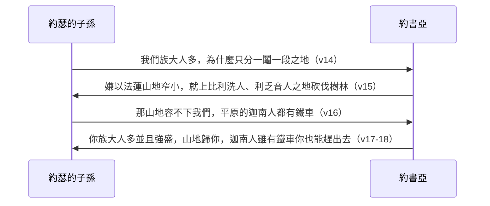

# 約書亞記 第17章

<!-- chapter-navigation:start -->
| [前一章](../06%20約書亞記/第16章.md) | [回目錄](../06%20約書亞記/全書目錄及綱要.md) | [下一章](../06%20約書亞記/第18章.md) |
| :--- | :---: | ---: |
<!-- chapter-navigation:end -->

1. [[瑪拿西]]是[[約瑟]]的[[長子名分|長子]]，他的支派[[拈鬮分地（go.ral）|拈鬮]]所得之地記在下面。至於瑪拿西的長子基列之父（父或作：主）[[瑪吉]]，因為是勇士就得了基列和[[巴珊]]。
2. [[瑪拿西]]其餘的子孫，按著[[家室與宗族|宗族]][[拈鬮分地（go.ral）|拈鬮分地]]，就是[[亞比以謝（瑪拿西宗族）|亞比以謝]]子孫，希勒子孫，亞斯列子孫，示劍子孫，希弗子孫，示米大子孫；這些按著宗族，都是[[約瑟]]兒子瑪拿西子孫的男丁。
3. 瑪拿西的玄孫，[[瑪吉]]的曾孫，基列的孫子，希弗的兒子[[西羅非哈的女兒|西羅非哈]]沒有兒子，只有女兒。他的女兒名叫瑪拉、挪阿、曷拉、密迦、得撒；
4. 他們來到祭司[[以利亞撒]]和嫩的兒子[[約書亞]]並[[分地的十位支派首領|眾首領]]面前，說：耶和華曾吩咐摩西在我們弟兄中分給我們[[產業（na.cha.lah）|產業]]。於是約書亞照耶和華所吩咐的，在他們伯叔中，把產業分給他們。
5. 除了[[約但河]]東的[[基列]]和[[巴珊]]地之外，還有十分地歸[[瑪拿西]]，
6. 因為[[瑪拿西]]的孫女們在瑪拿西的孫子中得了[[產業（na.cha.lah）|產業]]。[[基列]]地是屬瑪拿西其餘的子孫。
7. [[瑪拿西]]的境界：從亞設起，到[[示劍（城）|示劍]]前的[[密米他]]，往北到[[隱他普亞]]居民之地。
8. [[他普亞]]地歸[[瑪拿西]]，只是瑪拿西境界上的他普亞城歸[[以法蓮]]子孫。
9. 其界下到[[加拿河]]的南邊。在[[瑪拿西]]城邑中的這些城邑都歸[[以法蓮]]。瑪拿西的地界是在河北直通到[[大海（地中海）|海]]為止；
10. 南歸[[以法蓮]]，北歸[[瑪拿西]]，以[[大海（地中海）|海]]為界；北邊到[[亞設（有福）|亞設]]，東邊到[[以薩迦（價值）|以薩迦]]。
11. [[瑪拿西]]在[[以薩迦（價值）|以薩迦]]和[[亞設（有福）|亞設]]境內，有[[伯善]]和屬伯善的鎮市，[[以伯蓮]]和屬以伯蓮的鎮市，[[多珥]]的居民和屬多珥的鎮市；又有三處山岡，就是[[隱多珥]]和屬隱多珥的鎮市；[[他納]]的居民和屬他納的鎮市，[[米吉多]]的居民和屬米吉多的鎮市。
12. 只是[[瑪拿西]]子孫不能[[趕出（ya.rash）|趕出]]這些城的居民，[[迦南人]]偏要住在那地。
13. 及至以色列人強盛了，就使[[迦南人]][[苦工（mas）|做苦工]]，沒有把他們全然[[趕出（ya.rash）|趕出]]。
14. [[約瑟]]的子孫對[[約書亞]]說：耶和華到如今既然賜福與我們，我們也族大人多，你為什麼僅將一鬮一段之地分給我們為業呢？
15. [[約書亞]]說：你們如果族大人多，嫌[[以法蓮山地]]窄小，就可以上[[比利洗人]]、[[利乏音人]]之地，在樹林中砍伐樹木。
16. [[約瑟]]的子孫說：那山地容不下我們，並且住平原的[[迦南人]]，就是住[[伯善]]和屬伯善的鎮市，並住[[耶斯列平原]]的人，都有[[鐵車]]。
17. [[約書亞]]對[[約瑟]]家，就是[[以法蓮]]和[[瑪拿西]]人，說：你是族大人多，並且強盛，不可僅有一鬮之地，
18. 山地也要歸你，雖是樹林，你也可以砍伐；靠近之地必歸你。[[迦南人]]雖有[[鐵車]]，雖是強盛，你也能把他們[[趕出（ya.rash）|趕出]]去。

---

## 本章知識節點

### 人物
- [[瑪拿西]]
- [[瑪吉]]
- [[亞比以謝（瑪拿西宗族）]]
- [[西羅非哈的女兒]]
- [[迦南人]]
- [[比利洗人]]
- [[利乏音人]]

### 事件
- [[約瑟子孫嫌分地太少]]
- [[迦勒求得希伯崙]]

### 解經爭議
- [[三處山岡指哪三處]]
- [[瑪拿西半支派為何留在河東]]

### 文化
- [[鐵車]]

### 地點
- [[以法蓮山地]]
- [[耶斯列平原]]
- [[伯善]]
- [[以伯蓮]]
- [[隱多珥]]
- [[隱他普亞]]
- [[他納]]
- [[米吉多]]
- [[多珥]]

### 原文
- [[趕出（ya.rash）]]
- [[苦工（mas）]]

### 主題
- [[女兒承受產業的條例]]
- [[未得之地]]
- [[長子名分]]

---

## 本章整理

### 瑪拿西的兩半（v1-6）

上一章先寫了弟弟以法蓮，這一章才輪到哥哥。經文一開頭就說「[[瑪拿西]]是[[約瑟]]的[[長子名分|長子]]」，STEP語言資料：這裡是 be.Khor（H1060，firstborn）。CT 說這是指肉身出生的次序，長子的名分卻被雅各改歸[[以法蓮]]（創48:17-20）；KC 也說以法蓮被算作長子，所以先得產業。GT《約書亞記綜合解讀》則提醒另一面：以法蓮只是影響力更大，瑪拿西作為約瑟的長子仍然分得兩分產業，約但河東、河西都有地。

河東那一份屬於[[瑪吉]]，經文說他「因為是勇士，就得了[[基列]]和[[巴珊]]」。STEP語言資料：「勇士」是 'ish mil.cha.Mah（H376G＋H4421，man of war），GT《約書亞記研經資料》也說原文是「戰士」。瑪吉的身分，各家說法不一。CT 說瑪吉是瑪拿西唯一的兒子，KC 也說他看來是瑪拿西唯一的兒子（創50:23）；GT《研經資料》卻說代上7:14 記載瑪吉並非瑪拿西的長子，可能是後來被立為長子。GT《研經資料》又問：瑪吉此時應已去世，怎麼說他因為是戰士而得地？它的答案是參照民32:39-40，意思是瑪吉的後代都驍勇善戰。至於「基列之父」，GT《研經資料》說這個基列是瑪吉的兒子（代上7:14）；STEP 則把這裡的 ha./gil.'Ad 標作 H1568H，形態是族名的複數，BH 用的譯文也是 father of the Gileadites（基列人之父）。

為什麼瑪吉一族留在河東，KC 有一個推想：流便、迦得要河東是因為牲畜多，瑪吉經文雖沒說，大概也有許多牲畜，他是戰士，對流便、迦得是一大助力。GT《聖經精讀本》說瑪吉的子孫征服巴珊與基列之後，又帶頭渡過約但河幫助兄弟支派；GT《綜合解讀》說瑪吉一族戰鬥能力強，所以承擔防守邊界巴珊的任務。這個問題另見[[瑪拿西半支派為何留在河東]]。

河西那一份按[[家室與宗族|宗族]][[拈鬮分地（go.ral）|拈鬮]]，列了六個宗族：[[亞比以謝（瑪拿西宗族）|亞比以謝]]、希勒、亞斯列、示劍、希弗、示米大。CT 與 GT《串珠聖經注釋》都說他們是基列的子孫，也就是瑪拿西的六個曾孫。亞比以謝後來出了一位有名的人物：KC 與 BH 都說基甸屬於這一族（士6:11）。這裡的「示劍」是人名，STEP 把它標作 She.khem（H7928G），和第7節的城名 she.Khem（H7927G）是不同的編號，GT《研經資料》也特別注明這個人名的原文編號是 SH 7928。

六個宗族裡的希弗，傳到西羅非哈沒有兒子，只有五個女兒。[[西羅非哈的女兒]]來到[[以利亞撒]]、[[約書亞]]和[[分地的十位支派首領|眾首領]]面前，引用摩西時代的判例（民27:1-11）要求[[產業（na.cha.lah）|產業]]，約書亞就照耶和華所吩咐的分給她們。CT 與 GT《啟導本》說，依希伯來法律，父親的財產只可以分給兒子，摩西死前因西羅非哈的女兒提出抗辯，才確立了有條件的女子繼承權，條件是她們只嫁給本族人（民27:6、36:10）。這就是[[女兒承受產業的條例]]。

各家看重的地方不同。KC 注意到她們刻意選擇在河西「我們弟兄中」得地，而不是跟另一半支派留在河東，並說她們有雙重的信心：神有東西給我們，我們不要錯過；處境不好，也攔不住我們去求。KC 還點出一個細節：書中約書亞和以利亞撒四次並提（書14:1、17:4、19:51、21:1），以利亞撒總是在前。GT《聖經精讀本》說她們沒有放棄自己的權利與責任，堂堂正正地行了當行之事；CT 的話中之光由此說，任何合理的要求，不可用「事無先例」來拒絕。

第5節說瑪拿西在河西有「十分地」。STEP語言資料：「分」是 chav.lei（H2256M，簡要詞典義 che.vel: cord），第14節「一段之地」也是同一個字。這十分怎麼算，各家的說法大同小異：

| 來源 | 十分地的算法 |
|---|---|
| CT | 六個宗族裡，希弗那一份因為沒有男丁，分給五個女兒，合計十份；大小並不相等，因為還要看宗族人數 |
| GT《啟導本》、《串珠》、《聖經精讀本》 | 五份給希弗以外的五個宗族，五份給西羅非哈的五個女兒 |
| GT《綜合解讀》 | 瑪拿西全部是十二分：河東基列和巴珊兩分給瑪姬和睚珥兩個宗族（申3:14-15），河西十分 |
| KC | 五個兒子各一份，加上希弗那一份，再把希弗那份分成五份給五個女兒，共十份 |

GT《啟導本》說，在這事上男女是十分平等的。

### 瑪拿西的地界與城（v7-13）

瑪拿西的境界「從亞設起，到[[示劍（城）|示劍]]前的[[密米他]]，往北到[[隱他普亞]]居民之地」。這裡的「亞設」是什麼，兩家不同：CT 說是指亞設支派所分得之地的境界，在瑪拿西的西北；BH 說這是邊界上的一個點，不是北方的亞設支派。GT《串珠》說示劍前的密米他是瑪拿西的南界，「前」的意思是「東」；又說和合本的「北」原文是「南」，STEP語言資料：這個字是 hai./ya.Min（H3225H，簡要詞典義 right: south）。

南邊和以法蓮的界線交錯得厲害。「[[他普亞]]地歸瑪拿西，只是瑪拿西境界上的他普亞城歸以法蓮子孫」，界線再下到[[加拿河]]，「南歸以法蓮，北歸瑪拿西，以[[大海（地中海）|海]]為界」，北邊到[[亞設（有福）|亞設]]，東邊到[[以薩迦（價值）|以薩迦]]。GT《綜合解讀》說以法蓮在瑪拿西境內有他普亞城，是因為兩個支派本來就同屬「一鬮一段之地」。GT 所引華爾頓《約書亞記背景注釋》與《研經資料》都說，這一段對瑪拿西範圍的描述頗為含糊，領土有時亦會重疊。KC 從大處看：猶大得了整個南部，以法蓮和瑪拿西得了整個北部，一直到後來的加利利，可見約瑟子孫的特殊地位；GT《啟導本》說瑪拿西分得的地之大僅次於猶大，且肥沃過之。

第11節另列了瑪拿西在以薩迦和亞設境內的城：[[伯善]]、[[以伯蓮]]、[[多珥]]、[[隱多珥]]、[[他納]]、[[米吉多]]。GT《聖經精讀本》說亞設與以薩迦是在瑪拿西之後才分得產業（書19:17-31），所以這裡不是照分地的先後記錄；GT《綜合解讀》說「亞設和以薩迦境內」可能代指亞柯平原和耶斯列平原。KC 說，神讓各支派有自己不能被奪去的產業，又讓他們彼此交錯，好使兄弟支派之間保持熟悉與交通。GT 所引華爾頓說這些城除多珥以外，全在以斯德倫平原上。同一節還有一句「又有三處山岡」，CT 說是指隱多珥、他納、米吉多三座山崗上的城，GT《雷氏研讀本》與 BH 則把它連到多珥，見[[三處山岡指哪三處]]。

然後是缺口：「只是瑪拿西子孫不能[[趕出（ya.rash）|趕出]]這些城的居民，[[迦南人]]偏要住在那地。」STEP語言資料：「偏要」是 va/i.Yo.'el（H2974，簡要詞典義 ya.al: be willing，本節譯義 he was determined）；GT《研經資料》引猶太版英文聖經，作「stubbornly remained」（固執地留下）。到了以色列人強盛了，他們「使迦南人[[苦工（mas）|做苦工]]，沒有把他們全然趕出」。STEP語言資料：「全然趕出」是 ve./ho.Resh lo' ho.ri.Sh/o，同一個動詞 ya.rash（H3423H）先用不定詞、再用完成式，CT 也說原文是兩個相同的字。CT 又說「作苦工」原文是「進貢」。

這些城都是[[未得之地]]。GT《啟導本》說分給瑪拿西的這些鎮市這時尚未取得。至於原因，各家著眼點不一：

- CT：瑪拿西子孫沒有堅決執行神的命令（申7:1-2），只求偏安一時，造成日後的網羅與災難（書23:13）；第13節說「以色列人」，表示這是各支派普遍的現象，動機是貪圖眼前的好處。
- GT《聖經精讀本》：住在伯善到米吉多之間的迦南人擁有鐵製兵器，還沒走出青銅器文化的瑪拿西子孫抵擋不住；但征服初期他們曾一馬當先（書4:12），如今不能驅逐殘餘勢力，首先是因為信仰懈怠了。
- GT《綜合解讀》：一面是迦南人偏要住，一面是瑪拿西人半推半就；他們捨不得全然趕出迦南人，後來自己卻因違背神的約，被神趕出了應許之地（王下18:11-12）。
- KC：瑪拿西沒有取得這些城，是因為缺少力量，也就是缺少信心。
- BH：迦南人的抵抗是真的，卻也顯出以色列信心與順服的不完全；保留迦南人作勞力，是把經濟利益放在全心順服之上（士1:27-28）。

### 約瑟子孫嫌地少（v14-18）

地分完了，[[約瑟子孫嫌分地太少]]。這段對話一來一往兩回合：

他們的抱怨有沒有道理，GT 收的幾家都說沒有。GT《綜合解讀》說「一鬮一段之地」聽起來很少，其實是迦南最大、也是最肥沃的地段；GT《研經資料》算了人數：以法蓮32,500人，瑪拿西半支派26,350人，加起來還少於猶大的76,500人和以薩迦的64,300人（民26:22-37）。GT《聖經精讀本》說他們是不願去開墾分給自己的土地。KC 說他們嘴上講的是人多，真正的難處是樹林和還沒趕出的仇敵。BH 的讀法比較寬：抱怨反映了人口增長的實際壓力，約書亞並沒有否認他們的需要。

約書亞給的答案是兩件事。第一件是上[[以法蓮山地]]，在[[比利洗人]]、[[利乏音人]]之地開墾樹林。STEP語言資料：「砍伐」是 u./ve.re.Ta（H1254A），GT《研經資料》說原文沒有「樹木」，只是「砍伐」「開墾」的意思；GT《綜合解讀》說約瑟家的地都沒有記錄很多城邑，可能因為當時這裡大部分是森林。第二件是下平原，把[[耶斯列平原]]和伯善那些有[[鐵車]]的迦南人趕出去。CT 說鐵車大概是木製的戰車，只有車軸用鐵；GT《研經資料》說此時以色列人還在青銅器時代晚期；GT《綜合解讀》則說，以色列人只要照著神所吩咐的去行，照樣能「砍斷他們馬的蹄筋，用火焚燒他們的車輛」（書11:9，見[[砍斷馬的蹄筋與焚燒車輛]]）。CT 的話中之光把兩件事並在一起：「山地有樹林，代表天然的難處；平地有鐵車，代表人為的難處。」

> [!note] 約書亞沒有多給地
> GT《綜合解讀》與 BH 都提到約書亞自己就屬以法蓮支派，GT《綜合解讀》說他卻沒有遷就同族。GT《綜合解讀》也說「不可僅有一鬮之地」的意思可能是「你們不是僅有一鬮之地」，而是有一大片山地和相鄰區域。KC 說：「So they don’t get more land, but they can make the land they have been given habitable by removing obstacles.」（所以他們沒有得到更多的地，但可以除去障礙，使已經分到的地能夠住人。）

GT《綜合解讀》與《研經資料》都把這一段和書14 對照：猶大支派八十五歲的迦勒憑信心爭取最危險的希伯崙（見[[迦勒求得希伯崙]]），約瑟的子孫卻只想分好處。GT《綜合解讀》又說，約瑟的子孫後來越來越驕傲（士8:1），不斷招來災難（士12:1-6）。

**參考資料**
https://www.ccbiblestudy.org/Old%20Testament/06Josh/06CT17.htm
https://www.ccbiblestudy.org/Old%20Testament/06Josh/06GT17.htm
https://www.kingcomments.com/en/bible-studies/Jos/17
https://biblehub.com/study/joshua/17.htm
https://github.com/STEPBible/STEPBible-Data

<!-- appendix-links:start -->
## 附錄

### 相關地圖
- [[appendix/fhl_maps/maps/032|〈書圖五〉約但河東兩個半支派的領土]]
- [[appendix/fhl_maps/maps/034|〈書圖七〉以法蓮和瑪拿西（西）半支派最初的地業]]
- [[appendix/fhl_maps/maps/038|〈書圖十一〉利未人的城和十二個支派的地業]]
<!-- appendix-links:end -->

<!-- chapter-navigation:start -->
| [前一章](../06%20約書亞記/第16章.md) | [回目錄](../06%20約書亞記/全書目錄及綱要.md) | [下一章](../06%20約書亞記/第18章.md) |
| :--- | :---: | ---: |
<!-- chapter-navigation:end -->
