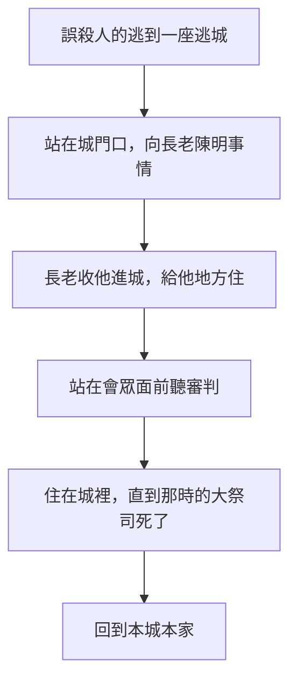

# 約書亞記 第20章

<!-- chapter-navigation:start -->
| [前一章](../06%20約書亞記/第19章.md) | [回目錄](../06%20約書亞記/全書目錄及綱要.md) | [下一章](../06%20約書亞記/第21章.md) |
| :--- | :---: | ---: |
<!-- chapter-navigation:end -->

1. 耶和華曉諭約書亞說：
2. 你吩咐以色列人說：你們要照著我藉摩西所曉諭你們的，為自己設立[[逃城]]，
3. 使那無心而誤殺人的，可以逃到那裡。這些城可以作你們逃避[[報血仇的（ga.al）|報血仇人]]的地方。
4. 那殺人的要逃到這些城中的一座城，站在[[城門口公共場合|城門口]]，將他的事情說給城內的[[以色列的長老|長老]]們聽。他們就把他收進城裡，給他地方，使他住在他們中間。
5. 若是[[報血仇的（ga.al）|報血仇的]]追了他來，[[以色列的長老|長老]]不可將他交在報血仇的手裡；因為他是素無仇恨，無心殺了人的。
6. 他要住在那城裡，站在[[全會眾|會眾]]面前聽審判，等到那時的大祭司死了，殺人的才可以回到本城本家，就是他所逃出來的那城。
7. 於是，以色列人在拿弗他利山地[[分別為聖|分定]][[加利利]]的[[基低斯]]；在[[以法蓮山地]]分定[[示劍（城）|示劍]]；在猶大山地分定[[基列亞巴]]（基列亞巴就是[[希伯崙]]）；
8. 又在約但河外耶利哥東，從流便支派中，在曠野的[[平原（mi.shor）|平原]]，設立[[比悉]]；從迦得支派中設立基列的[[拉末]]；從瑪拿西支派中設立[[巴珊]]的[[哥蘭]]。
9. 這都是為以色列眾人和在他們中間[[寄居的]]外人所分定的地邑，使誤殺人的都可以逃到那裡，不死在[[報血仇的（ga.al）|報血仇人]]的手中，等他站在[[全會眾|會眾]]面前聽審判。

---

## 本章知識節點

### 互文
- [[逃城|逃城：出21、民35、申4、申19 到書20]]

### 神學
- [[謀殺與誤殺的區分]]
- [[大祭司死了誤殺者才得釋放]]
- [[分別為聖]]

### 原文
- [[報血仇的（ga.al）]]
- [[寄居的]]

### 主題
- [[預備往逃城的道路]]
- [[寄居的與本地人同歸一例]]

### 事件
- [[摩西分定河東三座逃城（ba.dal）]]

### 地點
- [[加利利]]
- [[基低斯]]
- [[示劍（城）]]
- [[希伯崙]]
- [[比悉]]
- [[拉末]]
- [[哥蘭]]

---

## 本章整理

地分完了，神接著要以色列人分出六座城。這一章只有九節，內容幾乎全是摩西早已說過的：出21:13 給了逃城的雛形，民35 定下六座城的制度，申4:41-43 摩西點名河東三座，申19 交代河西三座與修路。GT《聖經精讀本》說約書亞曾長伴摩西身邊，比任何人都清楚這些規矩，本章則記約書亞直接從神領受這道命令。這一章的新東西是名單：六座城在這裡全部寫在一處。

### 照著藉摩西所曉諭的（v1-2）

耶和華對約書亞說：「你們要照著我藉摩西所曉諭你們的，為自己設立[[逃城]]」。CT 說分配完地業之後，神接著命令約書亞設立逃城。GT 有一段話把這一章放在整卷書裡看：十三至十九章是神把地業賜給十二支派，二十至二十一章是十二支派把地的一部分獻給神。

STEP語言資料顯示「逃城」原文是 'a.Rei ha./mik.Lat，mik.Lat（H4733）簡要詞典義 refuge；GT《約書亞記研經資料》說它的意思是「避難所」「收容所」，所以許多譯本譯作庇護城。GT《約書亞記綜合解讀》注意到「為自己」這三個字：逃城不是為某些犯罪的人設立的，而是為所有的百姓設立的，因為人人都有可能犯罪。GT《聖經精讀本》說古代腓尼基、敘利亞、希臘、羅馬也有保護偶然犯罪之人的場所，聖經的逃城制度比它們更有體系。

### 誰可以進去，怎樣進去，住到什麼時候（v3-6）

第3節先說對象：「無心而誤殺人的」。STEP語言資料顯示「誤」是 bi/sh.ga.Gah（H7684，unintentionally），「無心」是 bi/v.li- Da.'at（H1097 加 H1847，沒有知識）。第5節再補一個判準：「素無仇恨」。STEP語言資料顯示這裡用的是動詞 so.Ne'（H8130，to hate，Qal 分詞），後面接 mi./te.Mol shil.Shom（從昨天、前天），字面是從昨天、前天以來沒有恨他；CT 的〔原文字義〕則注記「仇恨」二字原文無此字。兩者並看，原文在這裡用的是動詞「恨」。這是[[謀殺與誤殺的區分]]的老規矩。GT 所引《丁道爾》說律法把事先計畫的有意謀殺和無心誤殺分開，誤殺若被處死，就是流無辜人的血、污穢了地；KC 的說法最短：「In one case there is only a guilty hand, in the other case there is also a guilty heart.」（一種情況只有手有罪，另一種連心也有罪。）

追趕他的人是[[報血仇的（ga.al）|報血仇的]]。CT 說這是本著以命償命的原則、為死者報仇的至近親屬。GT《約書亞記綜合解讀》與《研經資料》都指出，這個字原文是「贖回」，同一個人也負責贖回親屬的產業，所以又被譯作「至近的親屬」（得3:9），甚至是救贖主（詩78:35）。BH 說逃城的作用是限制這個角色，把審判交在會眾手中。

第4至6節寫的是一道程序。逃到的人要站在[[城門口公共場合|城門口]]，把事情說給城內的[[以色列的長老|長老]]聽；CT 說城門口通常有審判官或長老處理案件（得4:1；撒下15:2），KC 與 BH 也都說城門是城裡施行公義的地方。長老把他收進城，報血仇的追來，也不可把他交出去。他要「站在[[全會眾|會眾]]面前聽審判」，CT 說會眾指陪審的公眾（民35:24）；GT《研經資料》說第9節原文只有「直他站在會眾面前」，沒有「聽審判」一詞，意思仍是接受公開審判。

收進城和聽審判是兩步，兩家對第一步的說法不同。CT 說收進城裡只是暫時得到安全的保護，等候進一步公正的審判；GT《聖經精讀本》則說城門口的長老先作一次判斷，只有被判斷是誤殺的人才能進入城中，進城以後還要在百姓面前接受公正的審判。CT 又說，最後若被判定是故意殺人，就要被治死（民35:31）。圖上只畫了誤殺的那一條路。

最難懂的是第6節的期限：「等到那時的大祭司死了，殺人的才可以回到本城本家」（見[[大祭司死了誤殺者才得釋放]]）。STEP語言資料顯示這裡是 'ad- mOt ha./ko.Hen ha./ga.Dol，直到那大祭司死。GT 所引《丁道爾》說大祭司代表全國，尤其是在罪孽和獻祭方面（利16），他的死象徵誤殺者所造成之罪的結束；CT 說大祭司之死預表基督救贖之死。KC 走得更遠，說大祭司的死在預言上指主耶穌結束在天上聖所為教會的服事，之後要與以色列重新連結。GT 另外記下一個猶太傳統：大祭司的母親會給避難者送食物和衣服，好讓他們盼望大祭司長壽，不至於禱告他早死。

### 六座城（v7-9）

第7節的動詞值得留意。STEP語言資料顯示「分定」是 va/i.yak.Di.shu（H6942J，qa.dash），GT《研經資料》說原文是「分別為聖」「奉獻出」（見[[分別為聖]]）；KC 也說這些城為了神所定的目的，從其他城中分別出來。第9節說這些城是「為以色列眾人和在他們中間[[寄居的]]外人所分定的」，那裡的「分定」是另一個字 mu.'a.Dah（H4152，designated）。

| 城 | 位置 | 支派 | CT 給的字義 |
|---|---|---|---|
| [[基低斯]] | 加利利，拿弗他利山地 | 拿弗他利 | 聖潔，聖所 |
| [[示劍（城）]] | 以法蓮山地 | 以法蓮（CT 說屬瑪拿西境界） | 肩膀，力量 |
| [[希伯崙]] | 猶大山地 | 猶大 | 聯合，朋友，交通 |
| [[比悉]] | 約但河東，曠野的平原 | 流便 | 金礦，遠方的營寨 |
| [[拉末]] | 基列 | 迦得 | 高度，高原 |
| [[哥蘭]] | 巴珊 | 瑪拿西 | 他們的喜悅，他們的囚禁 |

河西三座從北到南，河東三座從南到北，KC 特別注意到這個相反的次序。GT《啟導本》說六座城在約但河東西兩岸的北、中、南都有，分屬六個不同的支派。河西北方的基低斯在[[加利利]]；中間的示劍，CT 說屬瑪拿西境界（書17:7），GT《啟導本》則算在以法蓮；南方的基列亞巴就是希伯崙，GT《聖經精讀本》說希伯崙原屬迦勒，被選作逃城時迦勒甘心讓給了利未支派。河東三座就是申4:43 摩西點名的那三座（見[[摩西分定河東三座逃城（ba.dal）]]），BH 說拉末後來成了以色列與亞蘭爭戰的要地（王上22:3-4）。

城要走得到，也要看得見（見[[預備往逃城的道路]]）。GT《聖經精讀本》說這些逃城都位於山頂，即使在遠處也能望見；KC 也說河西三座都在山地，對所有人都是看得見的恩典記號。GT《約書亞記綜合解讀》與 CT 都說，道路修好、路標寫清，任何一個地方的人都可以在一天之內逃到附近的逃城；GT 所引馬唐納《約書亞記》列出細節：路要三十二肘闊、清除障礙、河上要有橋、每個轉彎都寫上「避難所」。

寄居的外人也在保護之內。CT 說寄居的外邦人同樣可以獲得逃城的豁免權；BH 引利24:22，說神的供應同樣適用於本地人和寄居的外人（見[[寄居的與本地人同歸一例]]）。

### 城名的讀法，與還沒有添上的三座

CT 與 KC 都從城名讀出靈意，兩家取的字義不完全一樣。CT 的〔靈訓要義〕把六座城排成救恩的豐盛：基低斯是聖潔、示劍是力量、希伯崙是聯合、比悉是堡壘、拉末是高舉、哥蘭是喜樂；它的〔話中之光〕又一度把希伯崙讀成「朋友」。KC 只解河西三座：基低斯是 holy，在主耶穌住了三十年的加利利；示劍是 shoulder，近旁就是主耶穌與撒瑪利亞婦人說話的雅各井（約4:5-6）；希伯崙是 fellowship。KC 也把整個制度應用到地方教會，說每個地方教會都可以是這樣的逃城。

GT 所引《丁道爾》留下一個比較冷靜的觀察。申19:8-9 說神若擴張以色列的境界，「就要在這三座城之外，再添三座城」，而本章河西只指定了三座；它引波爾金說，這可以肯定書13:1 所提的全地尚未完全征服（見[[未得之地]]）。逃城的名單寫齊了，申19 預留的那三座卻沒有出現。

**參考資料**
https://www.ccbiblestudy.org/Old%20Testament/06Josh/06CT20.htm
https://www.ccbiblestudy.org/Old%20Testament/06Josh/06GT20.htm
https://www.kingcomments.com/en/bible-studies/Jos/20
https://biblehub.com/study/joshua/20.htm
https://github.com/STEPBible/STEPBible-Data

<!-- appendix-links:start -->
## 附錄

### 相關地圖
- [[appendix/fhl_maps/maps/038|〈書圖十一〉利未人的城和十二個支派的地業]]
<!-- appendix-links:end -->

<!-- chapter-navigation:start -->
| [前一章](../06%20約書亞記/第19章.md) | [回目錄](../06%20約書亞記/全書目錄及綱要.md) | [下一章](../06%20約書亞記/第21章.md) |
| :--- | :---: | ---: |
<!-- chapter-navigation:end -->
