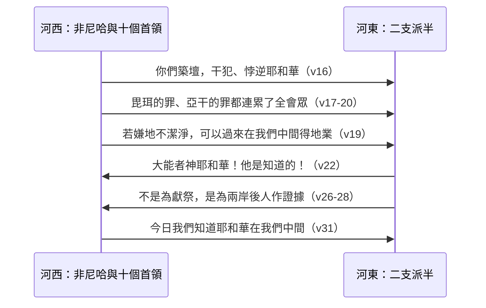

# 約書亞記 第22章

<!-- chapter-navigation:start -->
| [前一章](../06%20約書亞記/第21章.md) | [回目錄](../06%20約書亞記/全書目錄及綱要.md) | [下一章](../06%20約書亞記/第23章.md) |
| :--- | :---: | ---: |
<!-- chapter-navigation:end -->

1. 當時，約書亞召了[[流便]]人、[[迦得（萬幸）|迦得人]]，和[[瑪拿西]]半支派的人來，
2. 對他們說：耶和華僕人摩西所吩咐你們的，你們都遵守了；我所吩咐你們的，你們也都聽從了。
3. 你們這許多日子，總沒有撇離你們的弟兄，直到今日，並守了耶和華─你們神所吩咐你們當守的。
4. 如今耶和華─你們神照著他所應許的，使你們弟兄[[安息|得享平安]]，現在可以轉回你們的帳棚，到耶和華的僕人摩西[[兩支派半求河東之地為業|在約但河東所賜你們為業之地]]。
5. 只要切切的謹慎遵行耶和華僕人摩西所吩咐你們的誡命律法，[[你要盡心盡性盡力愛耶和華（a.hav）|愛耶和華]]─你們的神，行他一切的道，守他的誡命，[[專靠（da.veq）|專靠]]他，盡心盡性事奉他。
6. 於是約書亞為他們祝福，打發他們去，他們就回自己的帳棚去了。
7. [[瑪拿西]]那半支派，摩西早已在[[巴珊]]分給他們地業。這半支派，約書亞在[[約但河]]西，在他們弟兄中，分給他們地業。約書亞打發他們回帳棚的時候為他們祝福，
8. 對他們說：你們帶許多財物，許多牲畜和金、銀、銅、鐵，並許多衣服，回你們的帳棚去，要將你們從仇敵奪來的物，[[戰利品的分配辦法|與你們眾弟兄同分]]。
9. 於是[[流便]]人、[[迦得（萬幸）|迦得人]]、[[瑪拿西]]半支派的人從[[迦南地]]的[[示羅]]起行，離開以色列人，回往他們得為業的[[基列]]地，就是照耶和華藉摩西所吩咐的得了為業之地。
10. [[流便]]人、[[迦得（萬幸）|迦得人]]，和[[瑪拿西]]半支派的人到了靠近[[約但河]]的[[基利綠|一帶]][[迦南地]]，就在約但河那裡[[證壇|築了一座壇]]；那壇看著高大。
11. 以色列人聽說[[流便]]人、[[迦得（萬幸）|迦得人]]、[[瑪拿西]]半支派的人靠近[[約但河]]邊，在[[迦南地]]屬以色列人的那邊築了一座壇。
12. [[全會眾]]一聽見，就聚集在[[示羅]]，要上去攻打他們。
13. 以色列人打發祭司[[以利亞撒]]的兒子[[非尼哈]]，往[[基列]]地去見[[流便]]人、[[迦得（萬幸）|迦得人]]、[[瑪拿西]]半支派的人；
14. 又打發十個首領與[[非尼哈]]同去，就是以色列每支派的一個首領，都是以色列軍中的統領。
15. 他們到了[[基列]]地，見[[流便]]人、[[迦得（萬幸）|迦得人]]，和[[瑪拿西]]半支派的人，對他們說：
16. 耶和華[[全會眾]]這樣說，你們今日轉去不跟從耶和華，[[犯了罪（ma.al）|干犯]]以色列的神，為自己築一座壇，[[悖逆（ma.rad）|悖逆]]了耶和華，這犯的是什麼罪呢？
17. 從前拜[[巴力毘珥|毘珥]]的罪孽還算小嗎？雖然瘟疫臨到耶和華的[[全會眾|會眾]]，到今日我們還沒有洗淨這罪。
18. 你們今日竟轉去不跟從耶和華嗎？你們今日既[[悖逆（ma.rad）|悖逆]]耶和華，明日他必向[[全會眾|以色列全會眾]]發怒。
19. 你們所得為業之地，若嫌不潔淨，就可以過到耶和華之地，就是[[會幕（帳幕整體）|耶和華的帳幕]]所住之地，在我們中間得地業。只是不可[[悖逆（ma.rad）|悖逆]]耶和華，也不可得罪我們，在[[立他名的居所（中央聖所）|耶和華─我們神的壇以外]]為自己築壇。
20. 從前[[謝拉]]的曾孫[[亞干]]豈不是在那[[滅絕（herem）|當滅的物]]上[[犯了罪（ma.al）|犯了罪]]，就有忿怒臨到[[全會眾|以色列全會眾]]嗎？那人在所犯的罪中[[一人犯罪全營受累|不獨一人死亡]]。
21. 於是[[流便]]人、[[迦得（萬幸）|迦得人]]、[[瑪拿西]]半支派的人回答以色列軍中的統領說：
22. [[大能者神耶和華]]！大能者神耶和華！他是知道的！以色列人也必知道！我們若有[[悖逆（ma.rad）|悖逆]]的意思，或是[[犯了罪（ma.al）|干犯]]耶和華（願你今日不保佑我們），
23. 為自己築壇，要轉去不跟從耶和華，或是要將[[燔祭]]、素祭、[[平安祭]]獻在壇上，願耶和華親自討我們的罪。
24. 我們行這事並非無故，是特意做的，說：恐怕日後你們的子孫對我們的子孫說：你們與耶和華─以色列的神有何關涉呢？
25. 因為耶和華把[[約但河]]定為我們和你們這[[流便]]人、[[迦得（萬幸）|迦得人]]的交界，你們與耶和華無分了。這樣，你們的子孫就使我們的子孫不再敬畏耶和華了。
26. 因此我們說：不如為自己築一座壇，不是為獻[[燔祭]]，也不是為獻別的祭，
27. 乃是為你我中間和你我後人中間作證據，好叫我們也在耶和華面前獻[[燔祭]]、[[平安祭]]，和別的祭事奉他，免得你們的子孫日後對我們的子孫說，你們與耶和華無分了。
28. 所以我們說：日後你們對我們，或對我們的後人這樣說，我們就可以回答說，你們看我們列祖所築的壇是耶和華壇的[[山上的樣式|樣式]]；這並不是為獻[[燔祭]]，也不是為獻別的祭，乃是為作你我中間的證據。
29. 我們在耶和華─我們神[[會幕（帳幕整體）|帳幕]]前的壇以外，另築一座壇，為獻[[燔祭]]、素祭，和別的祭，[[悖逆（ma.rad）|悖逆]]耶和華，今日轉去不跟從他，我們斷沒有這個意思。
30. 祭司[[非尼哈]]與[[會眾的首領|會中的首領]]，就是與他同來以色列軍中的統領，聽見[[流便]]人、[[迦得（萬幸）|迦得人]]、[[瑪拿西]]人所說的話，就都以為美。
31. 祭司[[以利亞撒]]的兒子[[非尼哈]]對[[流便]]人、[[迦得（萬幸）|迦得人]]、[[瑪拿西]]人說：今日我們知道耶和華在我們中間，因為你們沒有向他[[犯了罪（ma.al）|犯了這罪]]。現在你們救以色列人脫離耶和華的手了。
32. 祭司[[以利亞撒]]的兒子[[非尼哈]]與眾首領離了[[流便]]人、[[迦得（萬幸）|迦得人]]，從[[基列]]地回往[[迦南地]]，到了以色列人那裡，便將這事回報他們。
33. 以色列人以這事為美，就稱頌神，不再提上去攻打[[流便]]人、[[迦得（萬幸）|迦得人]]、毀壞他們所住的地了。
34. [[流便]]人、[[迦得（萬幸）|迦得人]]給壇起名叫[[證壇]]，意思說：這壇在我們中間證明耶和華是神。

---

## 本章知識節點

### 主題
- [[證壇]]
- [[立他名的居所（中央聖所）]]
- [[戰利品的分配辦法]]

### 原文
- [[大能者神耶和華]]
- [[悖逆（ma.rad）]]
- [[犯了罪（ma.al）]]
- [[迦累得]]

### 人物
- [[非尼哈]]
- [[流便]]
- [[迦得（萬幸）]]
- [[瑪拿西]]
- [[全會眾]]
- [[會眾的首領]]

### 神學
- [[一人犯罪全營受累]]
- [[假合一]]
- [[三大節期]]
- [[山上的樣式]]
- [[安息]]

### 事件
- [[兩支派半求河東之地為業]]

### 解經爭議
- [[河東之地是神的旨意還是神的允許]]

### 互文
- [[河東二支派半最先被擄（代上5：25-26）|後來最先被亞述擄去]]

### 背景
- [[巴力毘珥]]

### 地點
- [[基利綠]]
- [[約但河]]
- [[示羅]]

---

## 本章整理

地分完了，跟著弟兄過河打仗的河東軍兵終於可以回家。這一章講他們回家路上築的一座壇，以及這座壇差一點引起的內戰。

### 功成回家（v1-9）

[[流便]]人、[[迦得（萬幸）|迦得]]人和[[瑪拿西]]半支派早在河東拿到地業，卻照著在摩西面前的承諾，派人過[[約但河]]跟弟兄一起爭戰（見[[兩支派半求河東之地為業]]）。現在約書亞召他們來，稱讚他們兩件事都做到了：「耶和華僕人摩西所吩咐你們的，你們都遵守了；我所吩咐你們的，你們也都聽從了。」CT 把前一句接到民32:20-22，後一句接到書1:16-18；GT《約書亞記研經資料》也說22:1-6 與1:12-18 前後呼應。GT《約書亞記綜合解讀》說他們派了四萬人渡河，在河西征戰七年，沒有任何怨言，而且是「從迦南地的示羅起行」，一直到分地結束才走，盡忠到最後一刻。

約書亞說耶和華已經使他們的弟兄「得享平安」，GT《研經資料》說「平安」原文是「[[安息]]」。臨別時他交代了一連串的要求：謹慎遵行誡命律法，「[[你要盡心盡性盡力愛耶和華（a.hav）|愛耶和華]]─你們的神，行他一切的道，守他的誡命，[[專靠（da.veq）|專靠]]他，盡心盡性事奉他」。CT 說「專靠」是附著、黏住、緊靠，意指緊緊地依附祂，絲毫不分離；CT 與 GT《綜合解讀》都提醒，人很容易在事奉上盡力，卻用事奉代替了愛神的心。KC 把約書亞比作一位擔心的父親，在孩子要自立、離開家的保護時再三叮嚀；BH 說河東的支派離會幕遠，又和外邦人接觸密切，特別容易在信仰上妥協。

約書亞也讓他們帶著許多財物回去，吩咐要與留在河東的弟兄同分（見[[戰利品的分配辦法]]）。CT 說摩西曾定下條例，凡擄獲物前線與後方均分（民31:21-27）；GT 所引華爾頓說，分享掠物表示各支派在目標上團結一致。KC 注意到一個細節：這一次約櫃沒有在他們前面出去，它留在地上，他們回去時是背向約櫃。

### 約但河邊的大壇（v10-12）

他們走到約但河邊，「就在約但河那裡築了一座壇；那壇看著高大」，就是後來起名叫[[證壇]]的那一座。地點的「一帶」，STEP語言資料顯示是 ge.li.Lot（H1552），BH 把它當地名 Geliloth（見[[基利綠]]）；GT《研經資料》說它和書18:17 的基利綠（H1553）兩字相當接近，卻主張照字義譯成「一帶」比較妥當。CT 說壇築在約但河西岸；GT《研經資料》說它高大到河東也看得見，可能比示羅的還大；KC 說這座假壇比真的壇還大。

消息一傳開，「全會眾一聽見，就聚集在[[示羅]]，要上去攻打他們」。原因在律法只許一個敬拜中心（見[[立他名的居所（中央聖所）]]）。GT《研經資料》說人只能在耶和華指定的地方獻祭（利17:8-9；申12:4-5）；GT《聖經精讀本》說，在示羅的祭壇之外再修築第二座祭壇，就被視為偶像崇拜，凡參與的人都要受罰（申13:12-17）；GT《串珠》也引申13:12-15，說上去攻打是要懲治背逆耶和華的百姓，免得神降罰消滅全體會眾。GT《綜合解讀》說這一代的[[全會眾]]親身經歷了曠野飄流，對干犯神的罪非常敏感，即使對方是立下戰功的弟兄，也要放下屬地的感情。

### 非尼哈帶著首領去問罪（v13-20）

以色列人沒有立刻出兵，先打發祭司以利亞撒的兒子[[非尼哈]]，帶著[[會眾的首領|十個首領]]去[[基列]]地查問。KC 說他們不憑印象行事，要先查清楚（申13:14），就像神在審判所多瑪和蛾摩拉之前也是這樣做（創18:21）。GT《研經資料》與《丁道爾》說派非尼哈，可能因為[[以利亞撒]]已經年邁，也因為他在巴力毘珥事件中阻擋了以色列人拜偶像；CT 說十個首領是河西九個半支派各一個，加上瑪拿西半支派一個，「首領」重在民間的身分，「統領」重在軍中的身分。

代表團的話很重。他們說二支派半「[[犯了罪（ma.al）|干犯]]以色列的神」「[[悖逆（ma.rad）|悖逆]]了耶和華」。STEP語言資料顯示「干犯」是 ma.al（H4603），「悖逆」是 ma.rad（H4775），後者本章出現五次。GT《約書亞記雷氏研讀本》說第16節的「罪」跟第20節亞干的罪所用的字相同；GT《研經資料》說這個字在民5:12、27 是用來描述妻子對丈夫的不貞。為了說服對方，他們舉了兩件大家都記得的事：

| | 毘珥 | 亞干 |
|---|---|---|
| 經文 | 第17節「從前拜毘珥的罪孽還算小嗎？」 | 第20節「謝拉的曾孫亞干豈不是在那當滅的物上犯了罪」 |
| 原來的事 | 在什亭與摩押女子行淫、拜巴力毘珥，遭瘟疫死的有二萬四千人（民25:1-9） | 私藏耶利哥城當滅的物，首次攻打艾城失敗，被擊殺三十六人（書7:1-5） |
| KC 看見的危險 | 把真宗教和假宗教混在一起 | 貪愛屬世的東西 |
| 連累 | 瘟疫臨到耶和華的會眾 | 忿怒臨到以色列全會眾 |

[[巴力毘珥]]和[[亞干]]（他在[[滅絕（herem）|當滅的物]]上犯罪）的共同點，是罪連累了全體（見[[一人犯罪全營受累]]）。GT 所引馬唐納說，百姓從這裡學到罪汙損整個營，神要國民為個人的行為負責任；GT《聖經精讀本》說在以色列社會中，個人與整個會眾有不可分割的關係。對第17節「到今日我們還沒有洗淨這罪」，GT《串珠》的解釋是引致毗珥事件的罪根至今還未完全從百姓心中清除。

夾在兩個例子中間的，是一個代價很高的提議：「你們所得為業之地，若嫌不潔淨，就可以過到耶和華之地……在我們中間得地業。」BH 說這個提議既昂貴又真誠，河西的支派願意分出自己的產業；GT《綜合解讀》說這表明河西的支派在非尼哈出發之前已經一致同意，寧可捨棄自己的一部分土地。這句話也碰到河東之地的地位（見[[河東之地是神的旨意還是神的允許]]）：GT《串珠》說「不潔淨」指禮儀上不潔、不配敬拜神；GT《綜合解讀》說可能因為會幕不在河東，那裡還有基述人、瑪迦人居住；KC 認為二支派半本來就寧取約但河曠野的那一邊，神也就容他們回去；GT《雷氏》卻提醒，不要以為他們定居河東不是神的旨意，神已經把那地賜給他們。

### 二支派半的答辯（v21-29）

二支派半怎麼面對這番指控，各家的讀法不同。GT《研經資料》說他們面對代表團嚴厲而又武斷的責備，極為震驚和氣憤；CT 與 GT《聖經精讀本》則引箴15:1，說他們沒有因受誤會而發怒，柔和地回答，使對方怒氣消退；KC 也說他們沒有因指控而激動，回答得很平靜。他們開口先呼求：「[[大能者神耶和華]]！大能者神耶和華！他是知道的！以色列人也必知道！」STEP語言資料顯示是 'el、'E.lo.Him、Yah.weh 三個字連說兩次；GT《研經資料》與《丁道爾》說重複表示最高級，意思是耶和華是最偉大的神；GT《綜合解讀》說這表示非常震驚。接著他們發誓：若築壇是為了轉去不跟從耶和華，或是要在壇上獻[[燔祭]]、素祭、[[平安祭]]，「願耶和華親自討我們的罪」。

真正的理由在第24-28節。他們怕的是將來：約但河成了兩岸的交界，日後河西的子孫會對河東的子孫說「你們與耶和華無分了」，河東的子孫就不再敬畏耶和華。GT《綜合解讀》說「並非無故，是特意做的」原文是「是出於憂慮的緣故」。GT《聖經精讀本》說這段顯出他們關心三件事：信仰第一、團隊精神、子女教育；又說這份憂慮可以理解，因為約但河是天然障礙，不易往來，也很難期待沒經歷征服戰的後代有同樣火熱的團隊意識。

所以這座壇「不是為獻燔祭，也不是為獻別的祭，乃是為你我中間和你我後人中間作證據」，形狀是「耶和華壇的樣式」。STEP語言資料顯示「證據」是 'ed（H5707），「樣式」是 tav.Nit（H8403）。GT《丁道爾》說「證據」一字和兩方定出邊界後所立的紀念碑同字（創31:48-52，見[[迦累得]]）；「樣式」是複製品，神也曾把會幕的樣式顯給摩西照著建造（出25:9、40，見[[山上的樣式]]）。拉班在創31:48 說「今日這石堆作你我中間的證據」，本章二支派半的說法正是「作你我中間的證據」。

### 以為美，起名證壇（v30-34）

非尼哈和首領聽了，「就都以為美」。非尼哈說：「今日我們知道耶和華在我們中間，因為你們沒有向他犯了這罪。現在你們救以色列人脫離耶和華的手了。」CT 說這有兩層：東岸的人沒有做錯事，西岸的人也沒有受連累。GT《綜合解讀》說調查的結果證明是全會眾錯了，他們還是「都以為美」，因為此行是為了神在地上見證的合一，不是為自己。以色列人聽了回報就稱頌神，不再提攻打的事。最後流便人、迦得人給壇起名叫證壇，「意思說：這壇在我們中間證明耶和華是神」。第25節和第32-34節都只提流便人、迦得人，BH 說這兩支派是築壇的主要一方；GT《研經資料》則說也可能是因為瑪拿西還有一半在河西，被隔絕的危險比較小。

事情圓滿收場，各家對這座壇本身的評價卻不一樣：

| 來源 | 對證壇的看法 |
|---|---|
| GT《研經資料》 | 也是為了後代的靈性需要著想 |
| BH | 見證以色列在神面前的合一，不取代耶和華的聖所 |
| GT《雷氏》 | 不智也無知，神已規定男丁每年三次上聖所 |
| CT、GT《綜合解讀》 | 用心良苦，其實是多餘的行為 |
| KC | 用意好卻不正確，是虛構的合一 |

CT 與 GT《綜合解讀》的理由是神早已安排了合一的方法：男丁一年三次朝見（見[[三大節期]]，出23:17），利未人也分散在河東的支派中；人在神的話以外再加添什麼，即使出於好意，也是無知而危險的。KC 把它看作人造的[[假合一]]，並說非尼哈滿意他們的回答，不等於承認這座壇。GT《研經資料》則說河西的代表是為了以色列人一體來找河東，河東也是怕被撇棄才築壇，兩邊求的都是合一。CT、GT《綜合解讀》與 KC 都提到後話：河東的支派後來還是隨從偶像，最先被亞述擄去（見[[河東二支派半最先被擄（代上5：25-26）]]）。

**參考資料**
https://www.ccbiblestudy.org/Old%20Testament/06Josh/06CT22.htm
https://www.ccbiblestudy.org/Old%20Testament/06Josh/06GT22.htm
https://www.kingcomments.com/en/bible-studies/Jos/22
https://biblehub.com/study/joshua/22.htm
https://github.com/STEPBible/STEPBible-Data

<!-- chapter-navigation:start -->
| [前一章](../06%20約書亞記/第21章.md) | [回目錄](../06%20約書亞記/全書目錄及綱要.md) | [下一章](../06%20約書亞記/第23章.md) |
| :--- | :---: | ---: |
<!-- chapter-navigation:end -->
