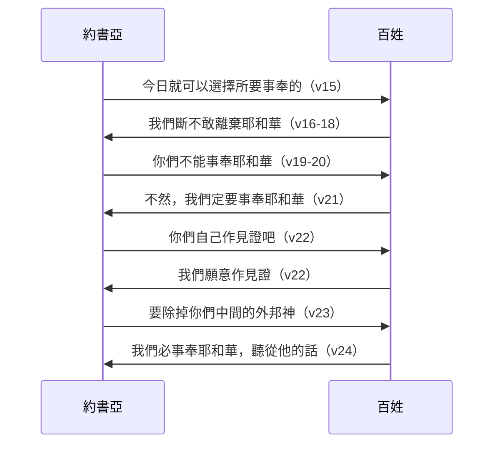

# 約書亞記 第24章

<!-- chapter-navigation:start -->
| [前一章](../06%20約書亞記/第23章.md) | [回目錄](../06%20約書亞記/全書目錄及綱要.md) |  |
| :--- | :---: | ---: |
<!-- chapter-navigation:end -->

1. [[約書亞]]將以色列的眾支派聚集在[[示劍（城）|示劍]]，召了[[以色列的長老]]、族長、[[審判官]]，並[[以色列人的官長|官長]]來，他們就站在神面前。
2. [[約書亞]]對眾民說：耶和華─以色列的神如此說：古時你們的列祖，就是[[亞伯拉罕]]和[[拿鶴]]的父親[[他拉]]，住在[[伯拉大河|大河]]那邊事奉別神，
3. 我將你們的祖宗[[亞伯拉罕]]從[[伯拉大河|大河]]那邊帶來，領他走遍迦南全地，又使他的子孫眾多，把[[以撒]]賜給他；
4. 又把[[雅各]]和[[以掃]]賜給[[以撒]]，將[[西珥]]山賜給以掃為業；後來雅各和他的子孫下到[[埃及]]去了。
5. 我差遣[[摩西]]、[[亞倫]]，並照我在[[埃及]]中所行的[[十災|降災]]與埃及，然後把你們領出來。
6. 我領你們列祖出[[埃及]]，他們就到了[[海（紅海）|紅海]]；埃及人帶領車輛馬兵追趕你們列祖到紅海。
7. 你們列祖哀求耶和華，他就使你們和[[埃及]]人中間黑暗了，又使[[海（紅海）|海]]水淹沒埃及人。我在埃及所行的事，你們親眼見過。你們在[[曠野]]也住了許多年日。
8. 我領你們到約但河東[[亞摩利人]]所住之地。他們與你們爭戰，我將他們交在你們手中，你們便得了他們的地為業；我也在你們面前將他們滅絕。
9. 那時，摩押王西撥的兒子[[巴勒]]起來攻擊以色列人，打發人召了比珥的兒子[[巴蘭（比珥的兒子）|巴蘭]]來咒詛你們。
10. 我不肯聽[[巴蘭（比珥的兒子）|巴蘭]]的話，所以他倒為你們連連祝福。這樣，我便救你們脫離[[巴勒]]的手。
11. 你們過了約但河，到了[[耶利哥]]；耶利哥人、[[亞摩利人]]、[[比利洗人]]、[[迦南人]]、[[赫人]]、[[革迦撒人]]、[[希未人]]、[[耶布斯人]]都與你們爭戰；我把他們交在你們手裡。
12. 我打發[[黃蜂]]飛在你們前面，將[[亞摩利人]]的二王從你們面前攆出，並不是用你的刀，也不是用你的弓。
13. 我賜給你們地土，非你們所修治的；我賜給你們城邑，非你們所建造的。你們就住在其中，又得吃非你們所栽種的葡萄園、橄欖園的果子。
14. 現在你們要[[敬畏神|敬畏耶和華]]，誠心實意地[[事奉與作奴僕同一字根（a.vad）|事奉]]他，將你們列祖在[[伯拉大河|大河]]那邊和在[[埃及]]所事奉的神除掉，去事奉耶和華。
15. 若是你們以[[事奉與作奴僕同一字根（a.vad）|事奉]]耶和華為不好，今日就可以選擇所要事奉的：是你們列祖在[[伯拉大河|大河]]那邊所事奉的神呢？是你們所住這地的[[亞摩利人]]的神呢？至於我和我家，我們必定事奉耶和華。
16. 百姓回答說：我們斷不敢離棄耶和華去[[事奉與作奴僕同一字根（a.vad）|事奉]]別神；
17. 因耶和華─我們的神曾將我們和我們列祖從[[埃及]]地的為奴之家領出來，在我們眼前行了那些大神蹟，在我們所行的道上，所經過的諸國，都保護了我們。
18. 耶和華又把住此地的[[亞摩利人]]都從我們面前趕出去。所以，我們必[[事奉與作奴僕同一字根（a.vad）|事奉]]耶和華，因為他是我們的神。
19. [[約書亞]]對百姓說：[[你們不能事奉耶和華]]；因為他是[[聖潔|聖潔的神]]，是[[忌邪的神]]，必不赦免你們的過犯罪惡。
20. 你們若離棄耶和華去[[事奉與作奴僕同一字根（a.vad）|事奉]]外邦神，耶和華在降福之後，必轉而降禍與你們，把你們滅絕。
21. 百姓回答[[約書亞]]說：不然，我們定要[[事奉與作奴僕同一字根（a.vad）|事奉]]耶和華。
22. [[約書亞]]對百姓說：你們選定耶和華，要[[事奉與作奴僕同一字根（a.vad）|事奉]]他，你們自己作見證吧！他們說：我們願意作見證。
23. [[約書亞]]說：你們現在要[[除掉外邦神|除掉你們中間的外邦神]]，專心歸向耶和華─以色列的神。
24. 百姓回答[[約書亞]]說：我們必[[事奉與作奴僕同一字根（a.vad）|事奉]]耶和華─我們的神，聽從他的話。
25. 當日，[[約書亞]]就[[示劍更新盟約|與百姓立約]]，在[[示劍（城）|示劍]]為他們立定[[律例（choq）|律例]]典章。
26. [[約書亞]]將這些話都寫在神的[[律法書放在約櫃旁|律法書]]上，又將[[立石為證|一塊大石頭]]立在[[摩利橡樹|橡樹]]下耶和華的聖所旁邊。
27. [[約書亞]]對百姓說：看哪，[[立石為證|這石頭]]可以向我們作見證；因為是聽見了耶和華所吩咐我們的一切話，倘或你們背棄你們的神，這石頭就可以向你們作見證（倘或云云：或作所以要向你們作見證，免得你們背棄耶和華─你們的神）。
28. 於是[[約書亞]]打發百姓各歸自己的地業去了。
29. 這些事以後，耶和華的僕人嫩的兒子[[約書亞]]，正一百一十歲，就死了。
30. 以色列人將他葬在他地業的境內，就是在[[以法蓮山地]]的[[亭拿西拉]]，在[[迦實山]]的北邊。
31. [[約書亞]]在世和約書亞死後，那些知道耶和華為以色列人所行諸事的[[以色列的長老|長老]]還在的時候，以色列人[[事奉與作奴僕同一字根（a.vad）|事奉]]耶和華。
32. 以色列人從[[埃及]]所帶來[[約瑟骸骨葬於示劍|約瑟的骸骨]]，[[示劍（城）|葬埋在示劍]]，就是在[[雅各]]從前用[[客西達錢幣單位|一百塊銀子]]向示劍的父親、[[哈抹]]的子孫所買的那塊地裡；這就作了約瑟子孫的產業。
33. [[亞倫]]的兒子[[以利亞撒]]也死了，就把他葬在他兒子[[非尼哈]]所得、[[以法蓮山地]]的[[基比亞（以法蓮）|小山]]上。

---

## 本章知識節點

### 事件
- [[示劍更新盟約]]
- [[約書亞的告別辭]]

### 解經爭議
- [[你們不能事奉耶和華]]

### 主題
- [[立石為證]]
- [[律法書放在約櫃旁]]

### 地點
- [[示劍（城）]]
- [[迦實山]]
- [[基比亞（以法蓮）]]
- [[亭拿西拉]]

### 背景
- [[宗主條約]]
- [[摩利橡樹]]

### 歷史
- [[約瑟骸骨葬於示劍]]
- [[亞伯拉罕在示劍築壇]]

### 原文
- [[事奉與作奴僕同一字根（a.vad）]]
- [[黃蜂]]
- [[律例（choq）]]

### 神學
- [[除掉外邦神]]
- [[忌邪的神]]
- [[西乃之約]]

### 人物
- [[約書亞]]
- [[以利亞撒]]
- [[他拉]]

---

## 本章整理

書23 約書亞對首領說了臨別的話；這一章他把眾支派召到示劍，帶他們重新與耶和華立約，全書最後以三個葬禮作結。

### 聚集在示劍（v1）

約書亞「將以色列的眾支派聚集在[[示劍（城）|示劍]]，召了以色列的[[以色列的長老|長老]]、族長、[[審判官]]，並[[以色列人的官長|官長]]來，他們就站在神面前」。GT《約書亞記綜合解讀》說書23 是約書亞臨別前給領袖的贈言，本章是帶領全體百姓重新與神立約（見[[約書亞的告別辭]]）；KC 也說約書亞在前一章對長老說話，本章要對全體百姓說話。

為什麼選在示劍，CT 與 GT《約書亞記綜合解讀》說這裡是亞伯拉罕進迦南後第一次築壇、神第一次與他立約的地方（創12:6-7，見[[亞伯拉罕在示劍築壇]]），雅各回來也在這裡清除偶像（創35:4），以色列人進迦南後又在這裡的兩座山上宣告祝福和咒詛（書8:30-35）。GT《約書亞記研經資料》則覺得奇怪，約書亞記裡以色列人通常在吉甲、示羅集會；GT 所引華爾頓說，約書亞攻取的城市名單裡沒有示劍，以色列人可能沒有經過重大爭戰就取得這城。「站在神面前」，CT 與 GT《綜合解讀》說是站在約櫃面前，約櫃已從示羅運到這裡。

### 神說：是我做的（v2-13）

約書亞開口是「耶和華─以色列的神如此說」，接下來整段都用神的第一人稱。起點不在出埃及，而在更早：「古時你們的列祖，就是亞伯拉罕和拿鶴的父親他拉，住在大河那邊事奉別神」。CT 說這大河指幼發拉底河（見[[伯拉大河]]）。GT《聖經精讀本》說[[他拉]]一家所事奉的別神，就是當時米所波大米人普遍崇拜的月神；GT 所引華爾頓說，這證明[[亞伯拉罕]]並沒有承襲某個古代一神信仰的傳統。CT 說不是亞伯拉罕有信心、有智慧脫離偶像，而是神主動揀選他；KC 說約書亞提起亞伯拉罕的偶像崇拜，是要指出偶像不只在他們周圍，也在他們的本性裡。

GT《綜合解讀》把這段歷史分成四個階段，並指出神在其中不住地說「我」：

| 階段 | 經文 | 神說自己做的事 |
|---|---|---|
| 選召列祖 | 第2-4節 | 我帶亞伯拉罕來、領他走遍迦南、把以撒賜給他、把雅各和以掃賜給以撒 |
| 出埃及 | 第5-7節 | 我差遣摩西、亞倫，降災與埃及，把你們領出來 |
| 河東得勝 | 第8-10節 | 我領你們到亞摩利人之地，我不肯聽巴蘭的話，救你們脫離巴勒的手 |
| 進迦南 | 第11-13節 | 我把他們交在你們手裡，打發黃蜂，賜給你們地土和城邑 |

這四段裡的人物和地方，大多在前面的書卷出現過：[[以撒]]、[[雅各]]與[[以掃]]，以掃得了[[西珥]]山；[[摩西]]、[[亞倫]]和降在[[埃及]]的[[十災|災]]，[[海（紅海）|紅海]]邊的追兵與[[曠野]]的許多年日；約但河東的[[亞摩利人]]，請[[巴蘭（比珥的兒子）|巴蘭]]來咒詛的摩押王[[巴勒]]；最後是[[耶利哥]]，以及[[比利洗人]]、[[迦南人]]、[[赫人]]、[[革迦撒人]]、[[希未人]]、[[耶布斯人]]。GT《丁道爾聖經注釋》說這張國家清單和書3:10 相同。

第12節的「[[黃蜂]]」，各家解法不同。CT 與 GT《串珠》說是寓意，表明從神來的驚恐或神的幫助；GT《丁道爾》與《研經資料》列出埃及、真的昆蟲、驚駭幾種說法，認為驚駭最能解釋；GT《聖經精讀本》卻認為按字面理解比較穩妥；GT《綜合解讀》說「黃蜂」與「埃及」的原文發音相近，可能是雙關語，指劫掠迦南地的埃及軍隊。這一段收在第13節：「我賜給你們地土，非你們所修治的；我賜給你們城邑，非你們所建造的。」GT《丁道爾》與《研經資料》說這和申6:10-11 相呼應。

### 選擇所要事奉的（v14-15）

「現在你們要敬畏耶和華，誠心實意地事奉他，將你們列祖在大河那邊和在埃及所事奉的神除掉，去事奉耶和華。」（見[[敬畏神]]）CT 說「[[事奉與作奴僕同一字根（a.vad）|事奉]]」在第14-15節共提到七次；GT《丁道爾》與《研經資料》說七次之中四次指當代的以色列人，兩次提到列祖在大河那邊所事奉的神，最後以約書亞自己和他的家作總結。GT《綜合解讀》把三種別神分開來看：列祖在大河那邊的神代表祖先傳統，埃及的神代表先進文明，亞摩利人的神代表現實利益。

CT 稱第15節是聖經名句：「若是你們以事奉耶和華為不好，今日就可以選擇所要事奉的……至於我和我家，我們必定事奉耶和華。」GT《研經資料》說這是約書亞以退為進的表達方式，他先表明自己和家人的選擇，引導百姓跟隨；GT《綜合解讀》說只有被神領出埃及的百姓，才有自由和權力來選擇所要事奉的神。KC 說約書亞年紀老了，為他的家仍然像從前一樣爭戰，並把這句話接到徒16:31「你和你一家都必得救」。

### 三次「必事奉」（v16-24）

百姓說「我們斷不敢離棄耶和華去事奉別神」，理由是神領他們出埃及、一路保護、又趕出亞摩利人（第16-18節）。約書亞卻回答「[[你們不能事奉耶和華]]；因為他是[[聖潔|聖潔的神]]，是[[忌邪的神]]，必不赦免你們的過犯罪惡」。這句話各家讀法不同：CT 讀出要對付罪惡，也讀出因信稱義的原則；GT《研經資料》說是激將法；KC 說約書亞並不是說神不赦免人，而是說神不能用半心事奉。GT《聖經精讀本》注意到本章的形式：約書亞說一次，百姓答一次，來回四輪。

GT《研經資料》說約書亞要他們拿出實際行動來表明心意：「你們現在要[[除掉外邦神|除掉你們中間的外邦神]]，專心歸向耶和華」。GT《綜合解讀》把它和創35 對照：雅各在示劍要全家除掉外邦神，他們立刻交出神像，埋在示劍的橡樹底下；約書亞在示劍提出同樣的要求，百姓卻只回答「我們必事奉耶和華」，這可能暗示有些人沒有徹底清除偶像。KC 也說後來證明他們並沒有除掉。

### 立約與立石（v25-28）

「當日，約書亞就與百姓立約，在示劍為他們立定[[律例（choq）|律例]]典章」（見[[示劍更新盟約]]）。STEP語言資料顯示「立約」是 va/i.yikh.Rot ... be.Rit（H3772H，簡要詞典義 ka.rat: to cut: make(covenant)，加 H1285）。GT《雷氏》說本章採用[[宗主條約]]的慣用形式：前言、歷史序言、主要條款，以及契約的抄寫和存放；GT《啟導本》說這是重訂昔日在西奈山的約（見[[西乃之約]]）；GT《聖經精讀本》說約書亞並不是提出新的律法條款，乃是重申了摩西的律法。

約書亞把這些話寫在神的[[律法書放在約櫃旁|律法書]]上，又把一塊大石頭立在[[摩利橡樹|橡樹]]下（見[[立石為證]]）。CT 說這棵橡樹極可能就是亞伯拉罕在示劍築壇時的那一棵（創12:6-7）；CT、GT《啟導本》與《研經資料》都說這是以色列人進迦南後第七次立石作見證。STEP語言資料顯示第27節「作見證」是 le./'e.Dah（H5713A）。CT 說石頭「聽見了耶和華」是擬人式的筆法；KC 說約書亞過世以後，這石頭仍然提醒人神聽見了一切。

### 三個葬禮（v29-33）

KC 說這卷書以三個葬禮結束。第一個是[[約書亞]]：「耶和華的僕人嫩的兒子約書亞，正一百一十歲，就死了」，葬在[[以法蓮山地]]的[[亭拿西拉]]，在[[迦實山]]的北邊。KC 說這是約書亞第一次、也是唯一一次被稱為「耶和華的僕人」；GT《丁道爾》與《研經資料》說這頭銜和摩西一樣，一百一十歲也和約瑟去世的年紀一樣（創50:26）。GT《丁道爾》又注意到，「境內」的原文就是書12-19 分地時出現五十多次的「邊界」，約書亞是最後一個去自己地業的人。第31節說，約書亞在世和那些知道耶和華作為的長老還在的時候，以色列人事奉耶和華；GT《研經資料》說這也暗示長老死後，就是士師記所描述的混亂狀況。

第二個是約瑟：以色列人把從埃及帶來的[[約瑟骸骨葬於示劍|約瑟的骸骨]]葬在示劍，就是雅各從前用[[客西達錢幣單位|一百塊銀子]]向[[哈抹]]的子孫所買的那塊地（創33:19）。GT《丁道爾》說這把約書亞記和創世記連起來，成為一個大時代的總結；KC 說約瑟骸骨的埋葬顯出這卷書並不是以死亡作結，因為它指向復活的盼望（來11:22）。

第三個是[[以利亞撒]]，葬在他兒子[[非尼哈]]所得、以法蓮山地的[[基比亞（以法蓮）|小山]]上。STEP語言資料顯示「小山」是 be./giv.'At（H1390H，簡要詞典義 giv.ah: Gibeah）。KC 說以利亞撒的死，表示這位大祭司為得地而有的服事也告一段落；GT《綜合解讀》說神不再指定約書亞的接班人，而是讓非尼哈接替父親作大祭司，到了士師時代，神要用完全不同的方式帶領祂的百姓。

**參考資料**
https://www.ccbiblestudy.org/Old%20Testament/06Josh/06CT24.htm
https://www.ccbiblestudy.org/Old%20Testament/06Josh/06GT24.htm
https://www.kingcomments.com/en/bible-studies/Jos/24
https://biblehub.com/study/joshua/24.htm
https://github.com/STEPBible/STEPBible-Data

<!-- appendix-links:start -->
## 附錄

### 相關地圖
- [[appendix/fhl_maps/maps/016|〈創圖十一〉猶大和約瑟的生平]]
<!-- appendix-links:end -->

<!-- chapter-navigation:start -->
| [前一章](../06%20約書亞記/第23章.md) | [回目錄](../06%20約書亞記/全書目錄及綱要.md) |  |
| :--- | :---: | ---: |
<!-- chapter-navigation:end -->
