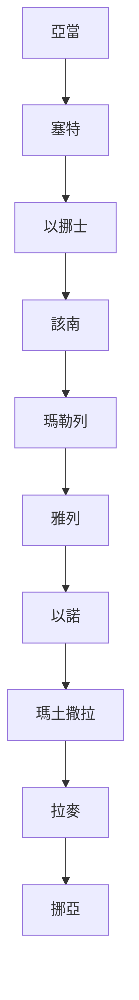
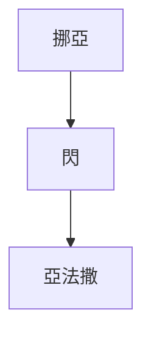
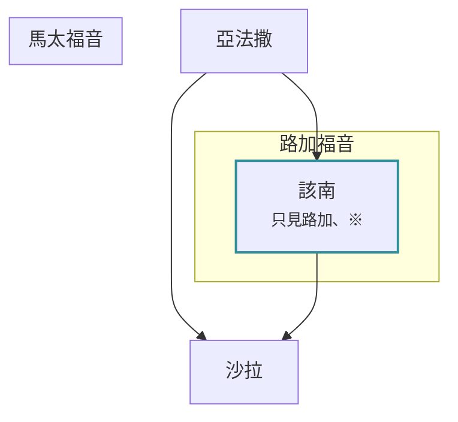
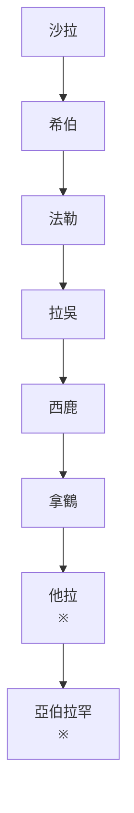
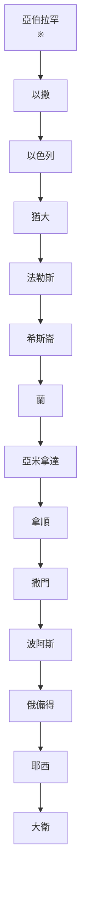
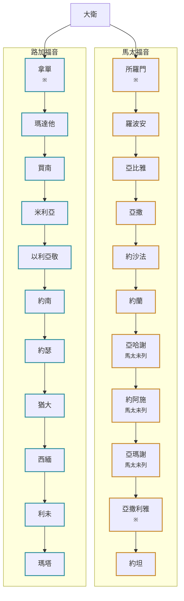
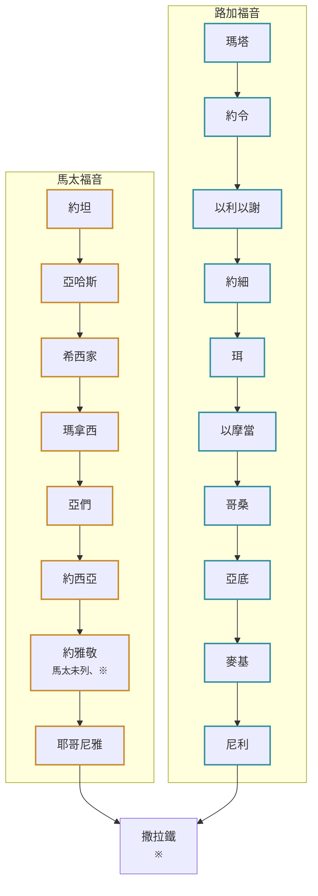
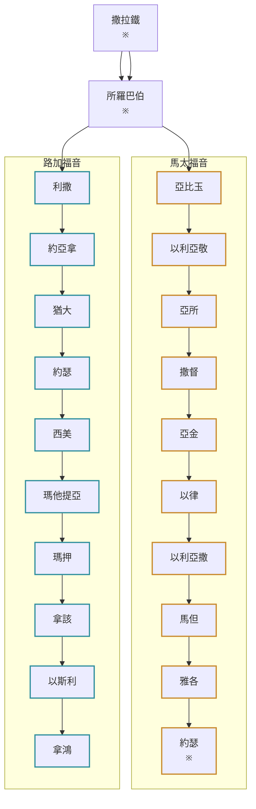
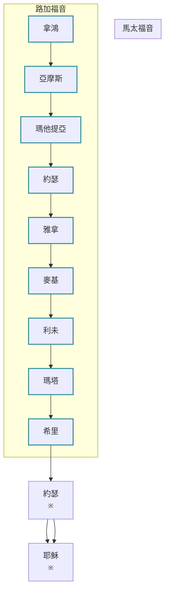

# 從亞當到耶穌的家譜

這一頁把聖經裡從亞當到耶穌的家譜接成一條不斷的線。每一代都附上經節。經文之間記載不同的地方，照經文原樣標出來，不替經文調和。註釋家和其他資料的說法，放在經文後面，各家並陳。

- **一條線，再分成兩條。** 大衛以前只有一條線。大衛以後，馬太福音經所羅門往下，路加福音經拿單往下，圖上用兩種顏色分開。兩條線在撒拉鐵、所羅巴伯走到同樣的名字，最後都到約瑟。
- **標記。** 「馬太未列」表示這一代舊約有記載，馬太的家譜沒有列出；「只見路加」表示這一代只有路加記載。
- **※** 表示這裡有經文記載不同的地方，說明在「經文記載不同的地方」一節。
- **旁支。** 這一頁只列主線和旁支的索引。每個人的父母、兒女、經文全文，可以在互動網站上搜尋、展開。歷代志上第 1–9 章的人，也可以連到族譜頁。

[互動網站](<appendix/website/全聖經/亞當到耶穌/dist/index.html>)

## 主線分段圖

### 亞當到挪亞

[在網站上看這一段](<appendix/website/全聖經/亞當到耶穌/dist/index.html#p=%E4%BA%9E%E7%95%B6>)

### 挪亞到亞法撒

[在網站上看這一段](<appendix/website/全聖經/亞當到耶穌/dist/index.html#p=%E6%8C%AA%E4%BA%9E>)

### 亞法撒到沙拉

[在網站上看這一段](<appendix/website/全聖經/亞當到耶穌/dist/index.html#p=%E4%BA%9E%E6%B3%95%E6%92%92>)

### 沙拉到亞伯拉罕

[在網站上看這一段](<appendix/website/全聖經/亞當到耶穌/dist/index.html#p=%E6%B2%99%E6%8B%89>)

### 亞伯拉罕到大衛

[在網站上看這一段](<appendix/website/全聖經/亞當到耶穌/dist/index.html#p=%E4%BA%9E%E4%BC%AF%E6%8B%89%E7%BD%95>)

### 大衛到被擄之一

[在網站上看這一段](<appendix/website/全聖經/亞當到耶穌/dist/index.html#p=%E5%A4%A7%E8%A1%9B>)

### 大衛到被擄之二

[在網站上看這一段](<appendix/website/全聖經/亞當到耶穌/dist/index.html#p=%E7%B4%84%E5%9D%A6>)

### 被擄到耶穌之一

[在網站上看這一段](<appendix/website/全聖經/亞當到耶穌/dist/index.html#p=%E6%92%92%E6%8B%89%E9%90%B5>)

### 被擄到耶穌之二

[在網站上看這一段](<appendix/website/全聖經/亞當到耶穌/dist/index.html#p=%E7%B4%84%E7%91%9F%23%E9%A6%AC%E5%88%A9%E4%BA%9E%E7%9A%84%E4%B8%88%E5%A4%AB>)

## 世代對照表

### 亞當到挪亞

| 代數 | 人名 | 創5:1-32 | 代上1:1-4 | 路3:23-38 |
|---|---|---|---|---|
| 1 | [[歷代志上的完整人物支線圖#亞當到挪亞\|亞當]] | 亞當 | 亞當 | 亞當 |
| 2 | [[歷代志上的完整人物支線圖#亞當到挪亞\|塞特]] | 塞特 | 塞特 | 塞特 |
| 3 | [[歷代志上的完整人物支線圖#亞當到挪亞\|以挪士]] | 以挪士 | 以挪士 | 以挪士 |
| 4 | [[歷代志上的完整人物支線圖#亞當到挪亞\|該南]] | 該南 | 該南 | 該南 |
| 5 | [[歷代志上的完整人物支線圖#亞當到挪亞\|瑪勒列]] | 瑪勒列 | 瑪勒列 | 瑪勒列 |
| 6 | [[歷代志上的完整人物支線圖#亞當到挪亞\|雅列]] | 雅列 | 雅列 | 雅列 |
| 7 | [[歷代志上的完整人物支線圖#亞當到挪亞\|以諾]] | 以諾 | 以諾 | 以諾 |
| 8 | [[歷代志上的完整人物支線圖#亞當到挪亞\|瑪土撒拉]] | 瑪土撒拉 | 瑪土撒拉 | 瑪土撒拉 |
| 9 | [[歷代志上的完整人物支線圖#亞當到挪亞\|拉麥]] | 拉麥 | 拉麥 | 拉麥 |
| 10 | [[歷代志上的完整人物支線圖#亞當到挪亞\|挪亞]] | 挪亞 | 挪亞 | 挪亞 |

### 挪亞到亞法撒

| 代數 | 人名 | 創5:1-32 | 創11:10-26 | 代上1:1-4 | 代上1:17-27 | 路3:23-38 |
|---|---|---|---|---|---|---|
| 10 | [[歷代志上的完整人物支線圖#亞當到挪亞\|挪亞]] | 挪亞 |  | 挪亞 |  | 挪亞 |
| 11 | [[歷代志上的完整人物支線圖#亞當到挪亞\|閃]] |  | 閃 |  | 閃 | 閃 |
| 12 | [[歷代志上的完整人物支線圖#閃的後代\|亞法撒]] |  | 亞法撒 |  | 亞法撒 | 亞法撒 |

### 亞法撒到沙拉｜馬太線

| 代數 | 人名 | 創11:10-26 | 代上1:17-27 | 路3:23-38 |
|---|---|---|---|---|
| 12 | [[歷代志上的完整人物支線圖#閃的後代\|亞法撒]] | 亞法撒 | 亞法撒 | 亞法撒 |
| 13 | [[歷代志上的完整人物支線圖#閃的後代\|沙拉]] | 沙拉 | 沙拉 | 沙拉 |

### 亞法撒到沙拉｜路加線

| 代數 | 人名 | 創11:10-26 | 代上1:17-27 | 路3:23-38 |
|---|---|---|---|---|
| 12 | [[歷代志上的完整人物支線圖#閃的後代\|亞法撒]] | 亞法撒 | 亞法撒 | 亞法撒 |
| 13 | 該南（只見路加） [[#亞法撒和沙拉之間的該南\|※]] |  |  | 該南 |
| 14 | [[歷代志上的完整人物支線圖#閃的後代\|沙拉]] | 沙拉 | 沙拉 | 沙拉 |

### 沙拉到亞伯拉罕

| 代數 | 人名 | 創11:10-26 | 代上1:17-27 | 太1:2-16 | 路3:23-38 |
|---|---|---|---|---|---|
| 馬太13／路加14 | [[歷代志上的完整人物支線圖#閃的後代\|沙拉]] | 沙拉 | 沙拉 |  | 沙拉 |
| 馬太14／路加15 | [[歷代志上的完整人物支線圖#閃的後代\|希伯]] | 希伯 | 希伯 |  | 希伯 |
| 馬太15／路加16 | [[歷代志上的完整人物支線圖#閃的後代\|法勒]] | 法勒 | 法勒 |  | 法勒 |
| 馬太16／路加17 | [[歷代志上的完整人物支線圖#閃到亞伯拉罕\|拉吳]] | 拉吳 | 拉吳 |  | 拉吳 |
| 馬太17／路加18 | [[歷代志上的完整人物支線圖#閃到亞伯拉罕\|西鹿]] | 西鹿 | 西鹿 |  | 西鹿 |
| 馬太18／路加19 | [[歷代志上的完整人物支線圖#閃到亞伯拉罕\|拿鶴]] | 拿鶴 | 拿鶴 |  | 拿鶴 |
| 馬太19／路加20 | [[歷代志上的完整人物支線圖#閃到亞伯拉罕\|他拉]] [[#他拉幾歲生亞伯蘭\|※]] | 他拉 | 他拉 |  | 他拉 |
| 馬太20／路加21 | [[歷代志上的完整人物支線圖#閃到亞伯拉罕\|亞伯拉罕]] [[#他拉幾歲生亞伯蘭\|※]] | 亞伯蘭 | 亞伯蘭 | 亞伯拉罕 | 亞伯拉罕 |

### 亞伯拉罕到大衛

| 代數 | 人名 | 創11:10-26 | 代上1:17-27 | 得4:18-22 | 代上2:5-15 | 太1:2-16 | 路3:23-38 |
|---|---|---|---|---|---|---|---|
| 馬太20／路加21 | [[歷代志上的完整人物支線圖#閃到亞伯拉罕\|亞伯拉罕]] [[#他拉幾歲生亞伯蘭\|※]] | 亞伯蘭 | 亞伯蘭 |  |  | 亞伯拉罕 | 亞伯拉罕 |
| 馬太21／路加22 | [[歷代志上的完整人物支線圖#亞伯拉罕的兒子\|以撒]] |  |  |  |  | 以撒 | 以撒 |
| 馬太22／路加23 | [[歷代志上的完整人物支線圖#亞伯拉罕的兒子\|以色列]] |  |  |  |  | 雅各 | 雅各 |
| 馬太23／路加24 | [[歷代志上的完整人物支線圖#以色列的十二個兒子\|猶大]] |  |  |  |  | 猶大 | 猶大 |
| 馬太24／路加25 | [[歷代志上的完整人物支線圖#猶大的五個兒子\|法勒斯]] |  |  | 法勒斯 | 法勒斯 | 法勒斯 | 法勒斯 |
| 馬太25／路加26 | [[歷代志上的完整人物支線圖#猶大的五個兒子\|希斯崙]] |  |  | 希斯崙 | 希斯崙 | 希斯崙 | 希斯崙 |
| 馬太26／路加27 | [[歷代志上的完整人物支線圖#蘭到大衛\|蘭]] |  |  | 蘭 | 蘭 | 亞蘭 | 亞蘭 |
| 馬太27／路加28 | [[歷代志上的完整人物支線圖#蘭到大衛\|亞米拿達]] |  |  | 亞米拿達 | 亞米拿達 | 亞米拿達 | 亞米拿達 |
| 馬太28／路加29 | [[歷代志上的完整人物支線圖#蘭到大衛\|拿順]] |  |  | 拿順 | 拿順 | 拿順 | 拿順 |
| 馬太29／路加30 | [[歷代志上的完整人物支線圖#蘭到大衛\|撒門]] |  |  | 撒門 | 撒門 | 撒門 | 撒門 |
| 馬太30／路加31 | [[歷代志上的完整人物支線圖#蘭到大衛\|波阿斯]] |  |  | 波阿斯 | 波阿斯 | 波阿斯 | 波阿斯 |
| 馬太31／路加32 | [[歷代志上的完整人物支線圖#蘭到大衛\|俄備得]] |  |  | 俄備得 | 俄備得 | 俄備得 | 俄備得 |
| 馬太32／路加33 | [[歷代志上的完整人物支線圖#蘭到大衛\|耶西]] |  |  | 耶西 | 耶西 | 耶西 | 耶西 |
| 馬太33／路加34 | [[歷代志上的完整人物支線圖#蘭到大衛\|大衛]] |  |  | 大衛 | 大衛 | 大衛 | 大衛 |

### 大衛到被擄｜馬太線

| 代數 | 人名 | 得4:18-22 | 代上2:5-15 | 代上3:10-19 | 太1:2-16 | 路3:23-38 |
|---|---|---|---|---|---|---|
| 33 | [[歷代志上的完整人物支線圖#蘭到大衛\|大衛]] | 大衛 | 大衛 |  | 大衛 | 大衛 |
| 34 | [[歷代志上的完整人物支線圖#大衛的兒子\|所羅門]] [[#大衛以後分成兩條\|※]] |  |  | 所羅門 | 所羅門 |  |
| 35 | [[歷代志上的完整人物支線圖#從所羅門到約西亞：猶大的王\|羅波安]] |  |  | 羅波安 | 羅波安 |  |
| 36 | [[歷代志上的完整人物支線圖#從所羅門到約西亞：猶大的王\|亞比雅]] |  |  | 亞比雅 | 亞比雅 |  |
| 37 | [[歷代志上的完整人物支線圖#從所羅門到約西亞：猶大的王\|亞撒]] |  |  | 亞撒 | 亞撒 |  |
| 38 | [[歷代志上的完整人物支線圖#從所羅門到約西亞：猶大的王\|約沙法]] |  |  | 約沙法 | 約沙法 |  |
| 39 | [[歷代志上的完整人物支線圖#從所羅門到約西亞：猶大的王\|約蘭]] |  |  | 約蘭 | 約蘭 |  |
| 40 | [[歷代志上的完整人物支線圖#從所羅門到約西亞：猶大的王\|亞哈謝]]（馬太未列） |  |  | 亞哈謝 |  |  |
| 41 | [[歷代志上的完整人物支線圖#從所羅門到約西亞：猶大的王\|約阿施]]（馬太未列） |  |  | 約阿施 |  |  |
| 42 | [[歷代志上的完整人物支線圖#從所羅門到約西亞：猶大的王\|亞瑪謝]]（馬太未列） |  |  | 亞瑪謝 |  |  |
| 43 | [[歷代志上的完整人物支線圖#從所羅門到約西亞：猶大的王\|亞撒利雅]] [[#「約蘭生烏西雅」中間的三位王\|※]] |  |  | 亞撒利雅 | 烏西雅 |  |
| 44 | [[歷代志上的完整人物支線圖#從所羅門到約西亞：猶大的王\|約坦]] |  |  | 約坦 | 約坦 |  |
| 45 | [[歷代志上的完整人物支線圖#從所羅門到約西亞：猶大的王\|亞哈斯]] |  |  | 亞哈斯 | 亞哈斯 |  |
| 46 | [[歷代志上的完整人物支線圖#從所羅門到約西亞：猶大的王\|希西家]] |  |  | 希西家 | 希西家 |  |
| 47 | [[歷代志上的完整人物支線圖#從所羅門到約西亞：猶大的王\|瑪拿西]] |  |  | 瑪拿西 | 瑪拿西 |  |
| 48 | [[歷代志上的完整人物支線圖#從所羅門到約西亞：猶大的王\|亞們]] |  |  | 亞們 | 亞們 |  |
| 49 | [[歷代志上的完整人物支線圖#從所羅門到約西亞：猶大的王\|約西亞]] |  |  | 約西亞 | 約西亞 |  |
| 50 | [[歷代志上的完整人物支線圖#從所羅門到約西亞：猶大的王\|約雅敬]]（馬太未列） [[#約西亞和耶哥尼雅中間的約雅敬\|※]] |  |  | 約雅敬 |  |  |
| 51 | [[歷代志上的完整人物支線圖#從所羅門到約西亞：猶大的王\|耶哥尼雅]] |  |  | 耶哥尼雅 | 耶哥尼雅 |  |
| 52 | [[歷代志上的完整人物支線圖#被擄以後的大衛子孫\|撒拉鐵]] [[#撒拉鐵和所羅巴伯的父親與兒子\|※]] |  |  |  | 撒拉鐵 | 撒拉鐵 |

### 大衛到被擄｜路加線

| 代數 | 人名 | 得4:18-22 | 代上2:5-15 | 太1:2-16 | 路3:23-38 |
|---|---|---|---|---|---|
| 34 | [[歷代志上的完整人物支線圖#蘭到大衛\|大衛]] | 大衛 | 大衛 | 大衛 | 大衛 |
| 35 | [[歷代志上的完整人物支線圖#大衛的兒子\|拿單]] [[#大衛以後分成兩條\|※]] |  |  |  | 拿單 |
| 36 | 瑪達他 |  |  |  | 瑪達他 |
| 37 | 買南 |  |  |  | 買南 |
| 38 | 米利亞 |  |  |  | 米利亞 |
| 39 | 以利亞敬 |  |  |  | 以利亞敬 |
| 40 | 約南 |  |  |  | 約南 |
| 41 | 約瑟 |  |  |  | 約瑟 |
| 42 | 猶大 |  |  |  | 猶大 |
| 43 | 西緬 |  |  |  | 西緬 |
| 44 | 利未 |  |  |  | 利未 |
| 45 | 瑪塔 |  |  |  | 瑪塔 |
| 46 | 約令 |  |  |  | 約令 |
| 47 | 以利以謝 |  |  |  | 以利以謝 |
| 48 | 約細 |  |  |  | 約細 |
| 49 | 珥 |  |  |  | 珥 |
| 50 | 以摩當 |  |  |  | 以摩當 |
| 51 | 哥桑 |  |  |  | 哥桑 |
| 52 | 亞底 |  |  |  | 亞底 |
| 53 | 麥基 |  |  |  | 麥基 |
| 54 | 尼利 |  |  |  | 尼利 |
| 55 | [[歷代志上的完整人物支線圖#被擄以後的大衛子孫\|撒拉鐵]] [[#撒拉鐵和所羅巴伯的父親與兒子\|※]] |  |  | 撒拉鐵 | 撒拉鐵 |

### 被擄到耶穌｜馬太線

| 代數 | 人名 | 代上3:10-19 | 太1:2-16 | 路3:23-38 |
|---|---|---|---|---|
| 52 | [[歷代志上的完整人物支線圖#被擄以後的大衛子孫\|撒拉鐵]] [[#撒拉鐵和所羅巴伯的父親與兒子\|※]] |  | 撒拉鐵 | 撒拉鐵 |
| 53 | [[歷代志上的完整人物支線圖#被擄以後的大衛子孫\|所羅巴伯]] [[#撒拉鐵和所羅巴伯的父親與兒子\|※]] | 所羅巴伯 | 所羅巴伯 | 所羅巴伯 |
| 54 | 亞比玉 |  | 亞比玉 |  |
| 55 | 以利亞敬 |  | 以利亞敬 |  |
| 56 | 亞所 |  | 亞所 |  |
| 57 | 撒督 |  | 撒督 |  |
| 58 | 亞金 |  | 亞金 |  |
| 59 | 以律 |  | 以律 |  |
| 60 | 以利亞撒 |  | 以利亞撒 |  |
| 61 | 馬但 |  | 馬但 |  |
| 62 | 雅各 |  | 雅各 |  |
| 63 | 約瑟 [[#約瑟的父親\|※]] |  | 約瑟 | 約瑟 |
| 64 | 耶穌 [[#馬太的三個十四代\|※]] |  | 耶穌基督 | 耶穌基督 |

### 被擄到耶穌｜路加線

| 代數 | 人名 | 代上3:10-19 | 太1:2-16 | 路3:23-38 |
|---|---|---|---|---|
| 55 | [[歷代志上的完整人物支線圖#被擄以後的大衛子孫\|撒拉鐵]] [[#撒拉鐵和所羅巴伯的父親與兒子\|※]] |  | 撒拉鐵 | 撒拉鐵 |
| 56 | [[歷代志上的完整人物支線圖#被擄以後的大衛子孫\|所羅巴伯]] [[#撒拉鐵和所羅巴伯的父親與兒子\|※]] | 所羅巴伯 | 所羅巴伯 | 所羅巴伯 |
| 57 | 利撒 |  |  | 利撒 |
| 58 | 約亞拿 |  |  | 約亞拿 |
| 59 | 猶大 |  |  | 猶大 |
| 60 | 約瑟 |  |  | 約瑟 |
| 61 | 西美 |  |  | 西美 |
| 62 | 瑪他提亞 |  |  | 瑪他提亞 |
| 63 | 瑪押 |  |  | 瑪押 |
| 64 | 拿該 |  |  | 拿該 |
| 65 | 以斯利 |  |  | 以斯利 |
| 66 | 拿鴻 |  |  | 拿鴻 |
| 67 | 亞摩斯 |  |  | 亞摩斯 |
| 68 | 瑪他提亞 |  |  | 瑪他提亞 |
| 69 | 約瑟 |  |  | 約瑟 |
| 70 | 雅拿 |  |  | 雅拿 |
| 71 | 麥基 |  |  | 麥基 |
| 72 | 利未 |  |  | 利未 |
| 73 | 瑪塔 |  |  | 瑪塔 |
| 74 | 希里 |  |  | 希里 |
| 75 | 約瑟 [[#約瑟的父親\|※]] |  | 約瑟 | 約瑟 |
| 76 | 耶穌 [[#馬太的三個十四代\|※]] |  | 耶穌基督 | 耶穌基督 |

## 名字的意思

主線上每個名字的原文與字義，取自 STEP Bible 的詞典（STEPBible.org，CC BY 4.0；字義依 Abridged BDB 簡編，中文為本頁譯）。詞典只列這個名字常見的字面意思，不一定是經文當下的用意；經文自己交代名字來由的地方，另列在最後一欄。

| 人名 | 原文 | 字義 | 經文自己的說明 |
|---|---|---|---|
| [[歷代志上的完整人物支線圖#亞當到挪亞\|亞當]] | אָדָם（a.dam） | 紅色（red） | — |
| [[歷代志上的完整人物支線圖#亞當到挪亞\|塞特]] | שֵׁת（shet） | 補償（compensation） | 創4:25：「起名叫塞特，意思說：神另給我立了一個兒子代替亞伯」 |
| [[歷代志上的完整人物支線圖#亞當到挪亞\|以挪士]] | אֱנוֹשׁ（e.nosh） | 人（man） | — |
| [[歷代志上的完整人物支線圖#亞當到挪亞\|該南]] | קֵינָן（qe.nan） | 產業（possession） | — |
| [[歷代志上的完整人物支線圖#亞當到挪亞\|瑪勒列]] | מַהֲלַלְאֵל（ma.ha.lal.el） | 神的讚美（praise of God） | — |
| [[歷代志上的完整人物支線圖#亞當到挪亞\|雅列]] | יֶ֫רֶד（ye.red） | 下降（descent） | — |
| [[歷代志上的完整人物支線圖#亞當到挪亞\|以諾]] | חֲנוֹךְ（cha.nokh） | 被奉獻（dedicated） | — |
| [[歷代志上的完整人物支線圖#亞當到挪亞\|瑪土撒拉]] | מְתוּשֶׁ֫לַח（me.tu.she.lach） | 使標槍的人（man of the dart） | — |
| [[歷代志上的完整人物支線圖#亞當到挪亞\|拉麥]] | לֶ֫מֶךְ（le.mekh） | 有權勢的（powerful） | — |
| [[歷代志上的完整人物支線圖#亞當到挪亞\|挪亞]] | נֹחַ（no.ach） | 安息（rest） | 創5:29：「給他起名叫挪亞，說：這個兒子必為我們的操作和手中的勞苦安慰我們」 |
| [[歷代志上的完整人物支線圖#亞當到挪亞\|閃]] | שֵׁם（shem） | 名（name） | — |
| [[歷代志上的完整人物支線圖#閃的後代\|亞法撒]] | אַרְפַּכְשַׁד（ar.pakh.shad） | 我將像胸懷那樣衰竭：他咒詛奶瓶（I shall fail as the breast: he cursed the breast-bottle） | — |
| [[歷代志上的完整人物支線圖#閃的後代\|沙拉]] | שֶׁ֫לַח（she.lach） | 嫩芽（sprout） | — |
| [[歷代志上的完整人物支線圖#閃的後代\|希伯]] | עֵ֫בֶר（e.ver） | 那邊的地區（the region beyond） | — |
| [[歷代志上的完整人物支線圖#閃的後代\|法勒]] | פֶּ֫לֶג（pe.leg） | 分裂（division） | 創10:25：「一個名叫法勒【法勒就是分的意思】，因為那時人就分地居住」 |
| [[歷代志上的完整人物支線圖#閃到亞伯拉罕\|拉吳]] | רְעוּ（re.u） | 朋友（friend） | — |
| [[歷代志上的完整人物支線圖#閃到亞伯拉罕\|西鹿]] | שְׂרוּג（se.rug） | 枝子（branch） | — |
| [[歷代志上的完整人物支線圖#閃到亞伯拉罕\|拿鶴]] | נָחוֹר（na.chor） | 噴鼻息（snorting） | — |
| [[歷代志上的完整人物支線圖#閃到亞伯拉罕\|他拉]] | תֶּ֫רַח（te.rach） | 崗位（station） | — |
| [[歷代志上的完整人物支線圖#閃到亞伯拉罕\|亞伯拉罕]] | אַבְרָהָם（av.ra.ham） | 眾人的父（father of a multitude） | 創17:5：「你的名不再叫亞伯蘭，要叫亞伯拉罕，因為我已立你作多國的父」 |
| [[歷代志上的完整人物支線圖#亞伯拉罕的兒子\|以撒]] | יִצְחָק（yits.chaq） | 他笑（he laughs） | 創21:3：「亞伯拉罕給撒拉所生的兒子起名叫以撒」 創21:6：「撒拉說：神使我喜笑，凡聽見的必與我一同喜笑」 |
| [[歷代志上的完整人物支線圖#亞伯拉罕的兒子\|以色列]] | יִשְׂרָאֵל（yis.ra.el） | 神得勝（God prevails） | 創25:26：「因此給他起名叫雅各【就是抓住的意思】」 創32:28：「你的名不要再叫雅各，要叫以色列；因為你與神與人較力，都得了勝」 |
| [[歷代志上的完整人物支線圖#以色列的十二個兒子\|猶大]] | יְהוּדָה（ye.hu.dah） | 被稱讚（praised） | 創29:35：「這回我要讚美耶和華，因此給他起名叫猶大【就是讚美的意思】」 |
| [[歷代志上的完整人物支線圖#猶大的五個兒子\|法勒斯]] | פֶּ֫רֶץ（pe.rets） | 裂口（breach） | 創38:29：「因此給他起名叫法勒斯」 |
| [[歷代志上的完整人物支線圖#猶大的五個兒子\|希斯崙]] | חֶצְרוֹן（chets.ron） | 被牆圍繞（surrounded by a wall） | — |
| [[歷代志上的完整人物支線圖#蘭到大衛\|蘭]] | רָם（ram） | 高（high） | — |
| [[歷代志上的完整人物支線圖#蘭到大衛\|亞米拿達]] | עַמִּינָדָב（am.mi.na.dav） | 我的親族是高貴者（my kinsman is noble） | — |
| [[歷代志上的完整人物支線圖#蘭到大衛\|拿順]] | נַחְשׁוֹן（nach.shon） | 施魔法者（enchanter） | — |
| [[歷代志上的完整人物支線圖#蘭到大衛\|撒門]] | שַׂלְמָה（sal.mah） | 衣服（garment） | — |
| [[歷代志上的完整人物支線圖#蘭到大衛\|波阿斯]] | בֹּ֫עַז（bo.az） | 敏捷（fleetness） | — |
| [[歷代志上的完整人物支線圖#蘭到大衛\|俄備得]] | עוֹבֵד（o.ved） | 服事（serving） | — |
| [[歷代志上的完整人物支線圖#蘭到大衛\|耶西]] | יִשַׁי（yi.shay） | 我擁有（I possess） | — |
| [[歷代志上的完整人物支線圖#蘭到大衛\|大衛]] | דָּוִד（da.vid） | 蒙愛的（beloved） | — |
| [[歷代志上的完整人物支線圖#大衛的兒子\|所羅門]] | שְׁלֹמֹה（she.lo.moh） | 平安（peace） | — |
| [[歷代志上的完整人物支線圖#從所羅門到約西亞：猶大的王\|羅波安]] | רְחַבְעָם（re.chav.am） | 民已擴大（a people has enlarged） | — |
| [[歷代志上的完整人物支線圖#從所羅門到約西亞：猶大的王\|亞比雅]] | אֲבִיָּ֫הוּ, אֲבִיָּה（a.viy.yah） | 耶和華是（我的）父（Jehovah is (my) father） | — |
| [[歷代志上的完整人物支線圖#從所羅門到約西亞：猶大的王\|亞撒]] | אָסָא（a.sa） | 醫治者：傷害者（？）（healer: injurious (?)） | — |
| [[歷代志上的完整人物支線圖#從所羅門到約西亞：猶大的王\|約沙法]] | יְהוֹשָׁפָט（ye.ho.sha.phat） | 耶和華已審判（Jehovah has judged） | — |
| [[歷代志上的完整人物支線圖#從所羅門到約西亞：猶大的王\|約蘭]] | יוֹרָם（yo.ram） | 耶和華至高（Jehovah is exalted） | — |
| [[歷代志上的完整人物支線圖#從所羅門到約西亞：猶大的王\|亞哈謝]] | אֲחַזְיָ֫הוּ（a.chaz.yah） | 耶和華（雅胡）持守（擁有）（Jehovah (Yahu) holds (possesses)） | — |
| [[歷代志上的完整人物支線圖#從所羅門到約西亞：猶大的王\|約阿施]] | יוֹאָשׁ（yo.ash） | 主所賜（given by the Lord） | — |
| [[歷代志上的完整人物支線圖#從所羅門到約西亞：猶大的王\|亞瑪謝]] | אֲמַצְיָ֫הוּ（a.mats.yah） | 耶和華大能（Jehovah is mighty） | — |
| [[歷代志上的完整人物支線圖#從所羅門到約西亞：猶大的王\|亞撒利雅]] | עֲזַרְיָה（a.zar.yah） | 耶和華已幫助（Jehovah has helped） | — |
| [[歷代志上的完整人物支線圖#從所羅門到約西亞：猶大的王\|約坦]] | יוֹתָם（yo.tam） | 耶和華是完全的（Jehovah is perfect） | — |
| [[歷代志上的完整人物支線圖#從所羅門到約西亞：猶大的王\|亞哈斯]] | אָחָז（a.chaz） | 他已抓住（he has grasped） | — |
| [[歷代志上的完整人物支線圖#從所羅門到約西亞：猶大的王\|希西家]] | חִזְקִיָּהוּ（chiz.qiy.yah） | 耶和華是我的力量（Jehovah is my strength） | — |
| [[歷代志上的完整人物支線圖#從所羅門到約西亞：猶大的王\|瑪拿西]] | מְנַשֶּׁה（me.nash.sheh） | 使人忘記（causing to forget） | — |
| [[歷代志上的完整人物支線圖#從所羅門到約西亞：猶大的王\|亞們]] | אָמוֹן（a.mon） | 熟練的工匠（skilled workman） | — |
| [[歷代志上的完整人物支線圖#從所羅門到約西亞：猶大的王\|約西亞]] | יֹאשִׁיָּ֫הוּ（yo.shiy.yah） | 耶和華所醫治的人（whom Jehovah heals） | — |
| [[歷代志上的完整人物支線圖#從所羅門到約西亞：猶大的王\|約雅敬]] | יְהוֹיָקִים（ye.ho.ya.qim） | 耶和華扶起（Jehovah raises up） | — |
| [[歷代志上的完整人物支線圖#從所羅門到約西亞：猶大的王\|耶哥尼雅]] | יְכוֹנְיָה（ye.khon.yah） | 耶和華必建立（Jehovah will establish） | — |
| [[歷代志上的完整人物支線圖#被擄以後的大衛子孫\|撒拉鐵]] | שְׁאַלְתִּיאֵל（she.al.ti.el） | 我從神求來的（I have asked of God） | — |
| [[歷代志上的完整人物支線圖#被擄以後的大衛子孫\|所羅巴伯]] | זְרֻבָּבֶ֫ל（ze.rub.ba.vel） | 在巴比倫被播種（sown in Babylon） | — |
| 亞比玉 | Ἀβιούδ（Abioud） | 我的父是威嚴（my father is majesty） （取自對應的希伯來文名字 אֲבִיהוּד（Abihud）） | — |
| 以利亞敬 | Ἐλιακείμ（Eliakeim） | 神興起（God raises） （取自對應的希伯來文名字 אֶלְיָקִים（Eliakim）） | — |
| 亞所 | Ἀζώρ（Azōr） | — | — |
| 撒督 | Σαδώκ（Sadōk） | 公義的（righteous） （取自對應的希伯來文名字 צָדוֹק（Zadok）） | — |
| 亞金 | Ἀχείμ（Acheim） | — | — |
| 以律 | Ἐλιούδ（Elioud） | — | — |
| 以利亞撒 | Ἐλεάζαρ（Eleazar） | 神已幫助（God has helped） （取自對應的希伯來文名字 אֶלְעָזָר（Eleazar）） | — |
| 馬但 | Ματθάν（Matthan） | 禮物（a gift） （取自對應的希伯來文名字 מַתָּן（Mattan）） | — |
| 雅各 | Ἰακώβ（Iakōb） | 抓腳跟的人（heel holder） （取自對應的希伯來文名字 יַעֲקֹב（Jacob）） | — |
| 約瑟 | Ἰωσήφ（Iōsēph） | 耶和華已加添（Jehovah has added） （取自對應的希伯來文名字 יוֹסֵף（Joseph）） | — |
| 耶穌 | Ἰησοῦς（Iēsous） | — | 太1:21：「你要給他起名叫耶穌，因他要將自己的百姓從罪惡裡救出來」 |
| 該南 | Καϊνάν, Καϊνάμ（Kainan, Kainam） | — | — |
| [[歷代志上的完整人物支線圖#大衛的兒子\|拿單]] | נָתָן（na.tan） | 賜予者（giver） | — |
| 瑪達他 | Ματταθά（Mattatha） | 耶和華的賞賜（gift of Jehovah） （取自對應的希伯來文名字 מַתַּתָּה（Mattathah）） | — |
| 買南 | Μαϊνάν（Mainan） | — | — |
| 米利亞 | Μελεᾶς（Meleas） | — | — |
| 以利亞敬 | Ἐλιακείμ（Eliakeim） | 神興起（God raises） （取自對應的希伯來文名字 אֶלְיָקִים（Eliakim）） | — |
| 約南 | Ἰωνάν（Iōnan） | — | — |
| 約瑟 | Ἰωσήφ（Iōsēph） | 耶和華已加添（Jehovah has added） （取自對應的希伯來文名字 יוֹסֵף（Joseph）） | — |
| 猶大 | Ἰούδας（Ioudas） | 被稱讚（praised） （取自對應的希伯來文名字 יְהוּדָה（Judah）） | — |
| 西緬 | Συμεών（Sumeōn） | 被聽見（heard） （取自對應的希伯來文名字 שִׁמְעוֹן（Simeon or Shimeon）） | — |
| 利未 | Λευΐ（Leui） | 連於（joined to） （取自對應的希伯來文名字 לֵוִי（Levi）） | — |
| 瑪塔 | Ματθάτ, Μαθθάτ（Matthat, Maththat） | — | — |
| 約令 | Ἰωρείμ（Iōreim） | — | — |
| 以利以謝 | Ἐλιέζερ（Eliezer） | 神是幫助（God is help） （取自對應的希伯來文名字 אֱלִיעֶ֫זֶר（Eliezer）） | — |
| 珥 | Ἤρ（Ēr） | 醒來（awake） （取自對應的希伯來文名字 עֵר（Er）） | — |
| 以摩當 | Ἐλμωδάμ（Elmōdam） | — | — |
| 哥桑 | Κωσάμ（Kōsam） | — | — |
| 亞底 | Ἀδδί（Addi） | — | — |
| 麥基 | Μελχί（Melchi） | — | — |
| 尼利 | Νηρί（Nēri） | — | — |
| 利撒 | Ῥησά（Rhēsa） | — | — |
| 猶大 | Ἰωδά（Iōda） | — | — |
| 約瑟 | Ἰωσήχ（Iōsēch） | — | — |
| 西美 | Σεμεΐ（Semei） | — | — |
| 瑪他提亞 | Ματταθίας（Mattathias） | — | — |
| 瑪押 | Μαάθ（Maath） | — | — |
| 拿該 | Ναγγαί（Nangai） | — | — |
| 以斯利 | Ἐσλί（Esli） | — | — |
| 拿鴻 | Ναούμ（Naoum） | 安慰（comfort） （取自對應的希伯來文名字 נַחוּם（Nahum）） | — |
| 亞摩斯 | Ἀμώς（Amōs） | — | — |
| 瑪他提亞 | Ματταθίας（Mattathias） | — | — |
| 約瑟 | Ἰωσήφ（Iōsēph） | 耶和華已加添（Jehovah has added） （取自對應的希伯來文名字 יוֹסֵף（Joseph）） | — |
| 雅拿 | Ἰαννά（Ianna） | — | — |
| 麥基 | Μελχί（Melchi） | — | — |
| 利未 | Λευΐ（Leui） | 連於（joined to） （取自對應的希伯來文名字 לֵוִי（Levi）） | — |
| 瑪塔 | Ματθάτ, Μαθθάτ（Matthat, Maththat） | — | — |
| 希里 | Ἡλί（Hēli） | — | — |

## 經文記載不同的地方

### 大衛以後分成兩條

> [!quote] 經文
> - 太1:6：「大衛從烏利亞的妻子生所羅門」
> - 路3:31：「拿單是大衛的兒子」
> - 代上3:5：「大衛在耶路撒冷所生的兒子是示米亞、朔罷、拿單、所羅門」

大衛以後，馬太經所羅門往下，前半段都是猶大的王；路加經拿單往下，從拿單到尼利這一段只有路加記載。

兩條線到撒拉鐵、所羅巴伯走到同樣的名字，之後又分開，最後都到約瑟。經文沒有說明兩份家譜為什麼走不同的兒子。

**各家說法**

- **路加福音拾穗（GT）第三章**（《每日研經叢書》）：指出兩份家譜從亞伯拉罕到大衛一致，大衛以後幾乎完全不同。
  > 「由亞伯拉罕至大衛一段，二者皆互相吻合；至於大衛至約瑟一段，則差不多完全不同」
- **中文聖經註釋（CT）路加福音第三章**：認為馬太的所羅門一線是約瑟的祖先，路加的拿單一線是馬利亞的祖先（見下一則）。
  > 「那裏約瑟的祖先是大衛的另一個兒子所羅門，而這裏馬利亞的祖先是大衛的兒子拿單」
- **BibleHub Study, Luke 3**：同樣把馬太一線看成約瑟的王族世系。
  > 「Matthew records Joseph’s royal line through Solomon, while Luke traces David’s line through Nathan.」（馬太記的是約瑟經所羅門的王族世系，路加則經拿單追溯大衛的世系。）

來源：[路加福音拾穗（GT）第三章](https://www.ccbiblestudy.org/New%20Testament/42Luke/42GT03.htm)、[中文聖經註釋（CT）路加福音第三章](https://www.ccbiblestudy.org/New%20Testament/42Luke/42CT03.htm)、[BibleHub Study, Luke 3](https://biblehub.com/study/luke/3.htm)

### 約瑟的父親

> [!quote] 經文
> - 太1:16：「雅各生約瑟，就是馬利亞的丈夫。那稱為基督的耶穌是從馬利亞生的」
> - 路3:23：「依人看來，他是約瑟的兒子；約瑟是希里的兒子」

馬太寫「雅各生約瑟」，路加寫「約瑟是希里的兒子」。

兩卷寫到耶穌時都把約瑟和馬利亞分開來交代：馬太說耶穌「是從馬利亞生的」，路加說「依人看來，他是約瑟的兒子」。雅各和希里是什麼關係，經文沒有說明。

**各家說法**

- **中文聖經註釋（CT）路加福音第三章**：認為希里是馬利亞的父親，路加稱約瑟為希里的兒子，是女婿的稱呼。
  > 「希里是馬利亞的父親，就是約瑟的岳父。猶太人岳父與女婿的關係有如父子，直稱女婿為『兒子』」
- **馬太福音拾穗（GT）第一章**（艾基斯《新約聖經難題彙編》）：看法相同：馬太是約瑟的家譜，路加是馬利亞的家譜。
  > 「路加福音所記，是馬利亞的族譜，由希裡開始。希裡是約瑟的岳父，約瑟自己的父親是雅各」
- **KingComments, Luke 3**：也採馬利亞家譜的看法。
  > 「This can only mean that we have here the genealogy that runs through Mary, as is generally accepted.」（這只能表示，這裡是經過馬利亞的家譜，這也是一般所接受的看法。）
- **BibleHub Study, Luke 3**：也採馬利亞家譜的看法。
  > 「Luke’s genealogy is widely understood to follow Mary’s family line, naming Joseph in relation to Heli as his son-in-law according to genealogical custom.」（一般認為路加的家譜走的是馬利亞的家系，依家譜的慣例，把約瑟當作希里的女婿列出。）
- **路加福音拾穗（GT）第三章**（蘇佐揚《新約聖經難題》）：提醒這個看法缺少直接證據；同一段也介紹另一派認為兩份都是約瑟的家譜。
  > 「要證明希裏是馬利亞的父親和約瑟的岳父，並沒有充分的資料，只是大家都願意這樣去推測」
- **路加福音拾穗（GT）第三章**（《每日研經叢書》）：介紹另一種解釋：雅各和希里是同母異父的兄弟，約瑟在法律上算雅各的兒子、實際上是希里的兒子。這一段最後說：「對於家譜這個問題，我們只能夠承認我們的無知」。
  > 「根據猶太人的婚姻法（申廿五5以下），人死而無子嗣，他的兄弟在情況許可之下，得娶其遺孀為妻以綿延子息」

來源：[中文聖經註釋（CT）路加福音第三章](https://www.ccbiblestudy.org/New%20Testament/42Luke/42CT03.htm)、[馬太福音拾穗（GT）第一章](https://www.ccbiblestudy.org/New%20Testament/40Matt/40GT01.htm)、[KingComments, Luke 3](https://www.kingcomments.com/en/bible-studies/Lk/3)、[BibleHub Study, Luke 3](https://biblehub.com/study/luke/3.htm)、[路加福音拾穗（GT）第三章](https://www.ccbiblestudy.org/New%20Testament/42Luke/42GT03.htm)

### 亞法撒和沙拉之間的該南

> [!quote] 經文
> - [[01 創世記/第11章\|創11:12]]：「亞法撒活到三十五歲，生了沙拉」
> - 代上1:18：「亞法撒生沙拉」
> - 路3:35-36：「沙拉是該南的兒子；該南是亞法撒的兒子」

創世記和歷代志上都是亞法撒直接生沙拉，創世記還記了亞法撒生沙拉時是三十五歲。路加在兩人中間多了一位該南。

路3:37 另有一位該南，是以挪士的兒子，和這一位是不同的人。

**各家說法**

- **BibleHub Study, Luke 3**：指出該南出現在七十士譯本（希臘文舊約）的創世記家譜裡，希伯來文本沒有。另外三套註釋沒有討論這一點。
  > 「Though the Hebrew text of Genesis does not include him, Luke records the inherited genealogy that was known in the Greek Scriptures.」（創世記的希伯來文本沒有他，路加記的是希臘文聖經裡流傳的家譜。）

來源：[BibleHub Study, Luke 3](https://biblehub.com/study/luke/3.htm)

### 「約蘭生烏西雅」中間的三位王

> [!quote] 經文
> - 太1:8：「約蘭生烏西雅」
> - 代上3:11-12：「約蘭的兒子是亞哈謝；亞哈謝的兒子是約阿施；約阿施的兒子是亞瑪謝；亞瑪謝的兒子是亞撒利雅」
> - 王下15:13：「猶大王烏西雅【就是亞撒利雅】」

馬太從約蘭直接接到烏西雅。歷代志上在兩人中間還有亞哈謝、約阿施、亞瑪謝三代。

烏西雅在歷代志上寫作亞撒利雅，列王紀下直接註明「烏西雅【就是亞撒利雅】」。

**各家說法**

- **中文聖經註釋（CT）馬太福音第一章**：認為三代是刻意刪去的，原因或許和這幾位王拜偶像有關。
  > 「約蘭和亞撒利雅之間被刪除了三代(代上三11~12；王下十五13小字)，或係因為他們離棄神、拜偶像，而被咒詛的結果」
- **馬太福音拾穗（GT）第一章**（《啟導本聖經馬太福音註釋》）：認為「生」也可以指出自遠祖，所以中間可以隔代。
  > 「“生”這個字在原文不單指從父親生，也可以指出自很遠的祖先」
- **BibleHub Study, Matthew 1**：看法相同：家譜裡的父子關係可以跨過幾代。
  > 「Matthew omits Ahaziah, Joash, and Amaziah between Joram and Uzziah, using “father” in the sense of ancestor.」（馬太在約蘭和烏西雅之間略去亞哈謝、約阿施、亞瑪謝，把「父親」當作祖先的意思來用。）

來源：[中文聖經註釋（CT）馬太福音第一章](https://www.ccbiblestudy.org/New%20Testament/40Matt/40CT01.htm)、[馬太福音拾穗（GT）第一章](https://www.ccbiblestudy.org/New%20Testament/40Matt/40GT01.htm)、[BibleHub Study, Matthew 1](https://biblehub.com/study/matthew/1.htm)

### 約西亞和耶哥尼雅中間的約雅敬

> [!quote] 經文
> - 太1:11：「約西亞生耶哥尼雅和他的弟兄」
> - 代上3:15-16：「次子是約雅敬，三子是西底家，四子是沙龍。約雅敬的兒子是耶哥尼雅和西底家」

馬太寫約西亞生耶哥尼雅。歷代志上在兩人中間還有一代：約雅敬是約西亞的次子，耶哥尼雅是約雅敬的兒子。

**各家說法**

- **中文聖經註釋（CT）馬太福音第一章**：認為約雅敬這一代是刻意刪去的，原因或許和他與埃及王法老的關係有關。
  > 「約西亞和耶哥尼雅之間有一代被刪除(代上三15~16)，或係因為他和埃及王法老有關」
- **BibleHub Study, Matthew 1**：說明耶哥尼雅是約西亞的孫子。
  > 「Matthew compresses the royal genealogy here: Jeconiah was Josiah’s grandson through Jehoiakim.」（馬太在這裡把王族家譜壓縮了：耶哥尼雅是約西亞經約雅敬而來的孫子。）

來源：[中文聖經註釋（CT）馬太福音第一章](https://www.ccbiblestudy.org/New%20Testament/40Matt/40CT01.htm)、[BibleHub Study, Matthew 1](https://biblehub.com/study/matthew/1.htm)

### 撒拉鐵和所羅巴伯的父親與兒子

> [!quote] 經文
> - 太1:12-13：「耶哥尼雅生撒拉鐵；撒拉鐵生所羅巴伯；所羅巴伯生亞比玉」
> - 路3:27：「利撒是所羅巴伯的兒子；所羅巴伯是撒拉鐵的兒子；撒拉鐵是尼利的兒子」
> - 代上3:17-19：「毘大雅的兒子是所羅巴伯、示每。所羅巴伯的兒子是米書蘭、哈拿尼雅」
> - 拉3:2：「撒拉鐵的兒子所羅巴伯」
> - 該1:1：「猶大省長撒拉鐵的兒子所羅巴伯」

撒拉鐵的父親有兩種記載：馬太和歷代志上是耶哥尼雅，路加是尼利。

所羅巴伯的父親，以斯拉記、哈該書、馬太、路加都寫撒拉鐵，只有歷代志上寫毘大雅；歷代志上把撒拉鐵和毘大雅都列為耶哥尼雅的兒子。

所羅巴伯的兒子，三處寫的名字都不同：歷代志上是米書蘭、哈拿尼雅，馬太是亞比玉，路加是利撒。

**各家說法**

- **中文聖經註釋（CT）馬太福音第一章**：引申25:5-10 的婚姻法，認為可能是撒拉鐵早死沒有兒子，弟弟毘大雅娶了他的妻子生下所羅巴伯，名分上歸在撒拉鐵名下。
  > 「可能是撒拉鐵早亡無子，其弟毘大雅娶其妻而生所羅巴伯，歸他名下」
- **路加福音拾穗（GT）第三章**（蘇佐揚《新約聖經難題》）：介紹一種解釋：撒拉鐵是尼利的兒子、耶哥尼雅的外孫，在王位的承繼上算耶哥尼雅的兒子。
  > 「耶哥尼雅無子，可能其女嫁與尼利（路三章27節）而生撒拉鐵，撒拉鐵實際上是耶哥尼雅的外孫」
- **BibleHub Study, Luke 3**：只說可能和婚姻或法定繼承有關，沒有下定論。
  > 「His connection with Shealtiel reflects the complexity of ancient family records, possibly involving inheritance through marriage or legal descent.」（尼利和撒拉鐵的關係，反映古代家族紀錄的複雜，可能牽涉到經由婚姻或法定繼承而來的承繼。）

來源：[中文聖經註釋（CT）馬太福音第一章](https://www.ccbiblestudy.org/New%20Testament/40Matt/40CT01.htm)、[路加福音拾穗（GT）第三章](https://www.ccbiblestudy.org/New%20Testament/42Luke/42GT03.htm)、[BibleHub Study, Luke 3](https://biblehub.com/study/luke/3.htm)

### 馬太的三個十四代

> [!quote] 經文
> - 太1:17：「從亞伯拉罕到大衛共有十四代；從大衛到遷至巴比倫的時候也有十四代；從遷至巴比倫的時候到基督又有十四代」

馬太把家譜分成三段，每段都說是十四代。三段的分界是大衛和遷至巴比倫。

各段怎麼數成十四代，經文沒有說明。

**各家說法**

- **中文聖經註釋（CT）馬太福音第一章**：認為大衛同時算在第一段和第二段。
  > 「三個十四代共計四十二代，但實際僅列四十一代，因其中大衛一人身列第一個十四代之終，和第二個十四代之始」
- **馬太福音拾穗（GT）第一章**（《馬太福音雷氏研讀本》）：認為重複計算的是耶哥尼雅。
  > 「第12節把“耶哥尼雅”重複計算，使最後一組保持十四個名字（十四代）」
- **馬太福音拾穗（GT）第一章**（《啟導本聖經馬太福音註釋》）：認為十四可能來自大衛名字的希伯來字母數值。
  > 「這種安排極可能與大衛的希伯來文名字有關」
- **KingComments, Matthew 1**：照馬太的分段，看三段各代表以色列歷史的一個時期。
  > 「Forty-two generations are given from Abraham to the Messiah which are divided into three groups of fourteen」（從亞伯拉罕到彌賽亞列出了四十二代，分成三組，每組十四代。）

來源：[中文聖經註釋（CT）馬太福音第一章](https://www.ccbiblestudy.org/New%20Testament/40Matt/40CT01.htm)、[馬太福音拾穗（GT）第一章](https://www.ccbiblestudy.org/New%20Testament/40Matt/40GT01.htm)、[KingComments, Matthew 1](https://www.kingcomments.com/en/bible-studies/Mt/1)

### 他拉幾歲生亞伯蘭

> [!quote] 經文
> - [[01 創世記/第11章\|創11:26]]：「他拉活到七十歲，生了亞伯蘭、拿鶴、哈蘭」
> - [[01 創世記/第11章\|創11:32]]：「他拉共活了二百零五歲，就死在哈蘭」
> - [[01 創世記/第12章\|創12:4]]：「亞伯蘭出哈蘭的時候年七十五歲」
> - 徒7:4：「他父親死了以後，神使他從那裡搬到你們現在所住之地」

照字面算，他拉七十歲生亞伯蘭；亞伯蘭七十五歲出哈蘭時，他拉是一百四十五歲，之後還要再活六十年。司提反卻說，亞伯拉罕是在「他父親死了以後」才離開哈蘭。

年歲時間軸照創世記的字面，以他拉七十歲生亞伯蘭來畫。

**各家說法**

- **創世記拾穗（GT）第十一章**（丁良才《創世紀註釋》）：用徒7:4 和創11:32 推算，認為他拉一百三十歲才生亞伯蘭。
  > 「以此推算，他拉生亞伯蘭的時候就已經一百三十歲了」
- **創世記拾穗（GT）第十一章**（賈斯樂郝威《聖經難解經文詮釋手冊》）：認為創11:26 只說他拉七十歲以後開始生子，亞伯蘭不一定是長子，排在最前面，可能因為他是家中最傑出的兒子。
  > 「創十一章26節並不絕對意味他拉70歲時生了亞伯蘭，正確的解釋應是他拉活到70歲之後他生了三個兒子」

來源：[創世記拾穗（GT）第十一章](https://www.ccbiblestudy.org/Old%20Testament/01Gen/01GT11.htm)

## 年歲時間軸

<svg xmlns="http://www.w3.org/2000/svg" viewBox="0 0 900 750" role="img" aria-label="創世後年份時間軸">

<text class="caption" x="92" y="18">依和合本的年歲推算</text>
<line class="grid" x1="92.0" y1="49" x2="92.0" y2="712"/>
<text class="tick-label" x="92.0" y="730" text-anchor="middle">創世後 0 年</text>
<line class="grid" x1="157.0" y1="49" x2="157.0" y2="712"/>
<line class="grid" x1="222.0" y1="49" x2="222.0" y2="712"/>
<text class="tick-label" x="222.0" y="730" text-anchor="middle">創世後 400 年</text>
<line class="grid" x1="287.0" y1="49" x2="287.0" y2="712"/>
<line class="grid" x1="352.0" y1="49" x2="352.0" y2="712"/>
<text class="tick-label" x="352.0" y="730" text-anchor="middle">創世後 800 年</text>
<line class="grid" x1="417.0" y1="49" x2="417.0" y2="712"/>
<line class="grid" x1="482.0" y1="49" x2="482.0" y2="712"/>
<text class="tick-label" x="482.0" y="730" text-anchor="middle">創世後 1200 年</text>
<line class="grid" x1="547.0" y1="49" x2="547.0" y2="712"/>
<line class="grid" x1="612.0" y1="49" x2="612.0" y2="712"/>
<text class="tick-label" x="612.0" y="730" text-anchor="middle">創世後 1600 年</text>
<line class="grid" x1="677.0" y1="49" x2="677.0" y2="712"/>
<line class="grid" x1="742.0" y1="49" x2="742.0" y2="712"/>
<text class="tick-label" x="742.0" y="730" text-anchor="middle">創世後 2000 年</text>
<line class="grid" x1="807.0" y1="49" x2="807.0" y2="712"/>
<line class="grid" x1="872.0" y1="49" x2="872.0" y2="712"/>
<text class="tick-label" x="872.0" y="730" text-anchor="middle">創世後 2400 年</text>
<text fill="currentColor" x="82" y="58" text-anchor="end">亞當</text>
<line class="life life-main" x1="92.0" y1="54" x2="394.2" y2="54"/>
<circle class="dot-main" cx="134.2" cy="54" r="4"/>
<text fill="currentColor" x="82" y="84" text-anchor="end">塞特</text>
<line class="life life-main" x1="134.2" y1="80" x2="430.6" y2="80"/>
<circle class="dot-main" cx="168.4" cy="80" r="4"/>
<text fill="currentColor" x="82" y="110" text-anchor="end">以挪士</text>
<line class="life life-main" x1="168.4" y1="106" x2="462.5" y2="106"/>
<circle class="dot-main" cx="197.6" cy="106" r="4"/>
<text fill="currentColor" x="82" y="136" text-anchor="end">該南</text>
<line class="life life-main" x1="197.6" y1="132" x2="493.4" y2="132"/>
<circle class="dot-main" cx="220.4" cy="132" r="4"/>
<text fill="currentColor" x="82" y="162" text-anchor="end">瑪勒列</text>
<line class="life life-main" x1="220.4" y1="158" x2="511.2" y2="158"/>
<circle class="dot-main" cx="241.5" cy="158" r="4"/>
<text fill="currentColor" x="82" y="188" text-anchor="end">雅列</text>
<line class="life life-main" x1="241.5" y1="184" x2="554.2" y2="184"/>
<circle class="dot-main" cx="294.1" cy="184" r="4"/>
<text fill="currentColor" x="82" y="214" text-anchor="end">以諾</text>
<line class="life life-main" x1="294.1" y1="210" x2="412.8" y2="210"/>
<circle class="dot-main" cx="315.3" cy="210" r="4"/>
<text fill="currentColor" x="82" y="240" text-anchor="end">瑪土撒拉</text>
<line class="life life-main" x1="315.3" y1="236" x2="630.2" y2="236"/>
<circle class="dot-main" cx="376.1" cy="236" r="4"/>
<text fill="currentColor" x="82" y="266" text-anchor="end">拉麥</text>
<line class="life life-main" x1="376.1" y1="262" x2="628.6" y2="262"/>
<circle class="dot-main" cx="435.2" cy="262" r="4"/>
<text fill="currentColor" x="82" y="292" text-anchor="end">挪亞</text>
<line class="life life-main" x1="435.2" y1="288" x2="743.9" y2="288"/>
<circle class="dot-main" cx="597.7" cy="288" r="4"/>
<text fill="currentColor" x="82" y="318" text-anchor="end">閃</text>
<line class="life life-main" x1="597.7" y1="314" x2="792.7" y2="314"/>
<circle class="dot-main" cx="630.2" cy="314" r="4"/>
<text fill="currentColor" x="82" y="344" text-anchor="end">亞法撒</text>
<line class="life life-main" x1="630.9" y1="340" x2="773.2" y2="340"/>
<circle class="dot-main" cx="642.2" cy="340" r="4"/>
<text fill="currentColor" x="82" y="370" text-anchor="end">沙拉</text>
<line class="life life-main" x1="642.2" y1="366" x2="783.0" y2="366"/>
<circle class="dot-main" cx="652.0" cy="366" r="4"/>
<text fill="currentColor" x="82" y="396" text-anchor="end">希伯</text>
<line class="life life-main" x1="652.0" y1="392" x2="802.8" y2="392"/>
<circle class="dot-main" cx="663.0" cy="392" r="4"/>
<text fill="currentColor" x="82" y="422" text-anchor="end">法勒</text>
<line class="life life-main" x1="663.0" y1="418" x2="740.7" y2="418"/>
<circle class="dot-main" cx="672.8" cy="418" r="4"/>
<text fill="currentColor" x="82" y="448" text-anchor="end">拉吳</text>
<line class="life life-main" x1="672.8" y1="444" x2="750.4" y2="444"/>
<circle class="dot-main" cx="683.2" cy="444" r="4"/>
<text fill="currentColor" x="82" y="474" text-anchor="end">西鹿</text>
<line class="life life-main" x1="683.2" y1="470" x2="757.9" y2="470"/>
<circle class="dot-main" cx="692.9" cy="470" r="4"/>
<text fill="currentColor" x="82" y="500" text-anchor="end">拿鶴</text>
<line class="life life-main" x1="692.9" y1="496" x2="741.0" y2="496"/>
<circle class="dot-main" cx="702.4" cy="496" r="4"/>
<text fill="currentColor" x="82" y="526" text-anchor="end">他拉</text>
<line class="life life-main" x1="702.4" y1="522" x2="769.0" y2="522"/>
<circle class="dot-main" cx="725.1" cy="522" r="4"/>
<text fill="currentColor" x="82" y="552" text-anchor="end">亞伯拉罕</text>
<line class="life life-main" x1="725.1" y1="548" x2="782.0" y2="548"/>
<circle class="dot-main" cx="757.6" cy="548" r="4"/>
<text fill="currentColor" x="82" y="578" text-anchor="end">撒拉</text>
<line class="life life-other" x1="728.4" y1="574" x2="769.6" y2="574"/>
<text fill="currentColor" x="82" y="604" text-anchor="end">以實瑪利</text>
<line class="life life-other" x1="753.1" y1="600" x2="797.6" y2="600"/>
<text fill="currentColor" x="82" y="630" text-anchor="end">以撒</text>
<line class="life life-main" x1="757.6" y1="626" x2="816.1" y2="626"/>
<circle class="dot-main" cx="777.1" cy="626" r="4"/>
<text fill="currentColor" x="82" y="656" text-anchor="end">以色列</text>
<line class="life life-main" x1="777.1" y1="652" x2="824.9" y2="652"/>
<text fill="currentColor" x="82" y="682" text-anchor="end">約瑟</text>
<line class="life life-other" x1="806.7" y1="678" x2="842.4" y2="678"/>
<line class="event" x1="630.2" y1="49" x2="630.2" y2="712"/>
<text fill="currentColor" x="634.2" y="45">洪水</text>
<line class="axis" x1="92" y1="712" x2="872" y2="712"/>
</svg>

| 人名 | 生於 | 壽數 | 死於 | 經節 |
|---|---:|---:|---:|---|
| [[歷代志上的完整人物支線圖#亞當到挪亞\|亞當]] | 0 | 930 | 930 | [[01 創世記/第5章\|創5:3-5]] |
| [[歷代志上的完整人物支線圖#亞當到挪亞\|塞特]] | 130 | 912 | 1042 | [[01 創世記/第5章\|創5:3]]、[[01 創世記/第5章\|創5:6-8]] |
| [[歷代志上的完整人物支線圖#亞當到挪亞\|以挪士]] | 235 | 905 | 1140 | [[01 創世記/第5章\|創5:6]]、[[01 創世記/第5章\|創5:9-11]] |
| [[歷代志上的完整人物支線圖#亞當到挪亞\|該南]] | 325 | 910 | 1235 | [[01 創世記/第5章\|創5:9]]、[[01 創世記/第5章\|創5:12-14]] |
| [[歷代志上的完整人物支線圖#亞當到挪亞\|瑪勒列]] | 395 | 895 | 1290 | [[01 創世記/第5章\|創5:12]]、[[01 創世記/第5章\|創5:15-17]] |
| [[歷代志上的完整人物支線圖#亞當到挪亞\|雅列]] | 460 | 962 | 1422 | [[01 創世記/第5章\|創5:15]]、[[01 創世記/第5章\|創5:18-20]] |
| [[歷代志上的完整人物支線圖#亞當到挪亞\|以諾]] | 622 | 365 | 987 | [[01 創世記/第5章\|創5:18]]、[[01 創世記/第5章\|創5:21-23]] |
| [[歷代志上的完整人物支線圖#亞當到挪亞\|瑪土撒拉]] | 687 | 969 | 1656 | [[01 創世記/第5章\|創5:21]]、[[01 創世記/第5章\|創5:25-27]] |
| [[歷代志上的完整人物支線圖#亞當到挪亞\|拉麥]] | 874 | 777 | 1651 | [[01 創世記/第5章\|創5:25]]、[[01 創世記/第5章\|創5:28]]、[[01 創世記/第5章\|創5:30-31]] |
| [[歷代志上的完整人物支線圖#亞當到挪亞\|挪亞]] | 1056 | 950 | 2006 | [[01 創世記/第5章\|創5:28]]、[[01 創世記/第5章\|創5:32]]、[[01 創世記/第9章\|創9:29]] |
| [[歷代志上的完整人物支線圖#亞當到挪亞\|閃]] | 1556 | 600 | 2156 | [[01 創世記/第5章\|創5:32]]、[[01 創世記/第11章\|創11:10-11]] |
| [[歷代志上的完整人物支線圖#閃的後代\|亞法撒]] | 1658 | 438 | 2096 | [[01 創世記/第11章\|創11:10]]、[[01 創世記/第11章\|創11:12-13]] |
| [[歷代志上的完整人物支線圖#閃的後代\|沙拉]] | 1693 | 433 | 2126 | [[01 創世記/第11章\|創11:12]]、[[01 創世記/第11章\|創11:14-15]] |
| [[歷代志上的完整人物支線圖#閃的後代\|希伯]] | 1723 | 464 | 2187 | [[01 創世記/第11章\|創11:14]]、[[01 創世記/第11章\|創11:16-17]] |
| [[歷代志上的完整人物支線圖#閃的後代\|法勒]] | 1757 | 239 | 1996 | [[01 創世記/第11章\|創11:16]]、[[01 創世記/第11章\|創11:18-19]] |
| [[歷代志上的完整人物支線圖#閃到亞伯拉罕\|拉吳]] | 1787 | 239 | 2026 | [[01 創世記/第11章\|創11:18]]、[[01 創世記/第11章\|創11:20-21]] |
| [[歷代志上的完整人物支線圖#閃到亞伯拉罕\|西鹿]] | 1819 | 230 | 2049 | [[01 創世記/第11章\|創11:20]]、[[01 創世記/第11章\|創11:22-23]] |
| [[歷代志上的完整人物支線圖#閃到亞伯拉罕\|拿鶴]] | 1849 | 148 | 1997 | [[01 創世記/第11章\|創11:22]]、[[01 創世記/第11章\|創11:24-25]] |
| [[歷代志上的完整人物支線圖#閃到亞伯拉罕\|他拉]] | 1878 | 205 | 2083 | [[01 創世記/第11章\|創11:24]]、[[01 創世記/第11章\|創11:26]]、[[01 創世記/第11章\|創11:32]] |
| [[歷代志上的完整人物支線圖#閃到亞伯拉罕\|亞伯拉罕]] | 1948 | 175 | 2123 | [[01 創世記/第11章\|創11:26]]、[[01 創世記/第12章\|創12:4]]、[[01 創世記/第16章\|創16:16]]、[[01 創世記/第21章\|創21:5]]、[[01 創世記/第25章\|創25:7]] |
| 撒拉 | 1958 | 127 | 2085 | [[01 創世記/第17章\|創17:17]]、[[01 創世記/第23章\|創23:1]] |
| [[歷代志上的完整人物支線圖#亞伯拉罕的兒子\|以實瑪利]] | 2034 | 137 | 2171 | [[01 創世記/第16章\|創16:16]]、[[01 創世記/第25章\|創25:17]] |
| [[歷代志上的完整人物支線圖#亞伯拉罕的兒子\|以撒]] | 2048 | 180 | 2228 | [[01 創世記/第21章\|創21:5]]、[[01 創世記/第25章\|創25:26]]、[[01 創世記/第35章\|創35:28]] |
| [[歷代志上的完整人物支線圖#亞伯拉罕的兒子\|以色列]] | 2108 | 147 | 2255 | [[01 創世記/第25章\|創25:26]]、[[01 創世記/第47章\|創47:9]]、[[01 創世記/第47章\|創47:28]] |
| [[歷代志上的完整人物支線圖#以色列的十二個兒子\|約瑟]] | 2199 | 110 | 2309 | [[01 創世記/第41章\|創41:46]]、[[01 創世記/第41章\|創41:53]]、[[01 創世記/第45章\|創45:6]]、[[01 創世記/第47章\|創47:9]]、[[01 創世記/第50章\|創50:26]] |

- 閃的出生照創5:32「挪亞五百歲生了閃、含、雅弗」來畫；亞法撒的出生照創11:10「洪水以後二年，閃一百歲生了亞法撒」來畫。洪水那年挪亞六百歲，照這兩節算，閃生亞法撒時是一百零二歲，和「閃一百歲」差兩年。創5:32 把三個兒子寫在同一個年歲下，經文沒有說誰先出生。
- 他拉的兒子照創11:26「他拉活到七十歲，生了亞伯蘭、拿鶴、哈蘭」，以七十歲生亞伯蘭來畫。這樣算，亞伯蘭出哈蘭時他拉還活著，和司提反在徒7:4 的說法不同，詳見本頁經文記載不同的地方一節。
- 約瑟的出生是推算的：他見法老時三十歲，七個豐年過去、饑荒又過了二年，雅各下埃及見法老時一百三十歲，所以約瑟出生時雅各九十一歲。

## 旁支索引

| 家族 | 人數 | 經文 | 連結 |
|---|---:|---|---|
| 該隱的後代 | 8 | 創4:17-24。該隱一族一直寫到拉麥和他的三個兒子雅八、猶八、土八該隱。 | [網站](<appendix/website/全聖經/亞當到耶穌/dist/index.html#family=cain>) |
| 雅弗的後代 | 15 | 創10:2-5、代上1:5-7。挪亞的兒子雅弗一族。 | [網站](<appendix/website/全聖經/亞當到耶穌/dist/index.html#family=japheth>)、[[歷代志上的完整人物支線圖#亞當到挪亞\|族譜頁]] |
| 含的後代 | 31 | 創10:6-20、代上1:8-16。含的四個兒子古實、麥西、弗、迦南，名下有不少是民族名。 | [網站](<appendix/website/全聖經/亞當到耶穌/dist/index.html#family=ham>)、[[歷代志上的完整人物支線圖#亞當到挪亞\|族譜頁]] |
| 閃的其他兒子 | 8 | 創10:22-23、代上1:17。主線走亞法撒，閃的其他兒子列在這裡。 | [網站](<appendix/website/全聖經/亞當到耶穌/dist/index.html#family=shem>)、[[歷代志上的完整人物支線圖#閃的後代\|族譜頁]] |
| 約坍的後代 | 14 | 創10:25-30、代上1:19-23。希伯的兒子法勒在主線上，他的兄弟約坍生了十三個兒子。 | [網站](<appendix/website/全聖經/亞當到耶穌/dist/index.html#family=joktan>)、[[歷代志上的完整人物支線圖#閃的後代\|族譜頁]] |
| 他拉的另外兩個兒子 | 24 | 創11:26-29、創22:20-24。利百加是拿鶴的孫女，羅得是哈蘭的兒子。 | [網站](<appendix/website/全聖經/亞當到耶穌/dist/index.html#family=nahor>) |
| 以實瑪利的後代 | 15 | 創25:12-16、代上1:29-31。夏甲為亞伯拉罕生的兒子以實瑪利，有十二個兒子。 | [網站](<appendix/website/全聖經/亞當到耶穌/dist/index.html#family=ishmael>)、[[歷代志上的完整人物支線圖#亞伯拉罕的兒子\|族譜頁]] |
| 基土拉生的兒子 | 13 | 創25:1-4、代上1:32-33。 | [網站](<appendix/website/全聖經/亞當到耶穌/dist/index.html#family=keturah>)、[[歷代志上的完整人物支線圖#亞伯拉罕的兒子\|族譜頁]] |
| 以掃與以東 | 17 | 創36、代上1:35-54。以撒的另一個兒子以掃，就是以東。以東的諸王和族長多半另有記載，接不上以掃的一一列在網站上。 | [網站](<appendix/website/全聖經/亞當到耶穌/dist/index.html#family=esau>)、[[歷代志上的完整人物支線圖#亞伯拉罕的兒子\|族譜頁]] |
| 流便 | 9 | 創46:9、民26:5-11、代上5:1-10。 | [網站](<appendix/website/全聖經/亞當到耶穌/dist/index.html#family=reuben>)、[[歷代志上的完整人物支線圖#以色列的十二個兒子\|族譜頁]] |
| 西緬 | 16 | 創46:10、民26:12-14、代上4:24-43。 | [網站](<appendix/website/全聖經/亞當到耶穌/dist/index.html#family=simeon>)、[[歷代志上的完整人物支線圖#以色列的十二個兒子\|族譜頁]] |
| 利未 | 195 | 出6:16-25、民3、代上6。亞倫、摩西和歷代的大祭司都在這一支。 | [網站](<appendix/website/全聖經/亞當到耶穌/dist/index.html#family=levi>)、[[歷代志上的完整人物支線圖#以色列的十二個兒子\|族譜頁]] |
| 以薩迦 | 17 | 創46:13、民26:23-25、代上7:1-5。 | [網站](<appendix/website/全聖經/亞當到耶穌/dist/index.html#family=issachar>)、[[歷代志上的完整人物支線圖#以色列的十二個兒子\|族譜頁]] |
| 西布倫 | 5 | 創46:14、民26:26-27。 | [網站](<appendix/website/全聖經/亞當到耶穌/dist/index.html#family=zebulun>)、[[歷代志上的完整人物支線圖#以色列的十二個兒子\|族譜頁]] |
| 但 | 3 | 創46:23、民26:42-43。 | [網站](<appendix/website/全聖經/亞當到耶穌/dist/index.html#family=dan>)、[[歷代志上的完整人物支線圖#以色列的十二個兒子\|族譜頁]] |
| 拿弗他利 | 6 | 創46:24、民26:48-50、代上7:13。 | [網站](<appendix/website/全聖經/亞當到耶穌/dist/index.html#family=naphtali>)、[[歷代志上的完整人物支線圖#以色列的十二個兒子\|族譜頁]] |
| 迦得 | 11 | 創46:16、民26:15-18、代上5:11-17。 | [網站](<appendix/website/全聖經/亞當到耶穌/dist/index.html#family=gad>)、[[歷代志上的完整人物支線圖#以色列的十二個兒子\|族譜頁]] |
| 亞設 | 35 | 創46:17、民26:44-47、代上7:30-40。 | [網站](<appendix/website/全聖經/亞當到耶穌/dist/index.html#family=asher>)、[[歷代志上的完整人物支線圖#以色列的十二個兒子\|族譜頁]] |
| 約瑟（瑪拿西、以法蓮） | 46 | 創41:50-52、民26:28-37、代上7:14-29。 | [網站](<appendix/website/全聖經/亞當到耶穌/dist/index.html#family=joseph>)、[[歷代志上的完整人物支線圖#以色列的十二個兒子\|族譜頁]] |
| 便雅憫 | 49 | 創46:21、民26:38-41、代上7:6-12、代上8。掃羅家另有幾段記載接不上便雅憫，網站上另外列出。 | [網站](<appendix/website/全聖經/亞當到耶穌/dist/index.html#family=benjamin>)、[[歷代志上的完整人物支線圖#以色列的十二個兒子\|族譜頁]] |
| 猶大的其他兒子 | 18 | 創38、代上2:3-8、代上4:21-23。主線走法勒斯。 | [網站](<appendix/website/全聖經/亞當到耶穌/dist/index.html#family=judah>)、[[歷代志上的完整人物支線圖#猶大的五個兒子\|族譜頁]] |
| 希斯崙的其他兒子 | 73 | 代上2:9-55、代上4:1-20。主線走蘭。 | [網站](<appendix/website/全聖經/亞當到耶穌/dist/index.html#family=hezron>)、[[歷代志上的完整人物支線圖#蘭到大衛\|族譜頁]] |
| 大衛的其他兒女 | 22 | 撒下3:2-5、撒下5:13-16、代上3:1-9。主線走所羅門和拿單。 | [網站](<appendix/website/全聖經/亞當到耶穌/dist/index.html#family=david>)、[[歷代志上的完整人物支線圖#大衛的兒子\|族譜頁]] |
| 所羅巴伯的其他兒女 | 10 | 代上3:19-24。歷代志上的這一支寫到被擄歸回以後好幾代，人名都和馬太、路加不同。 | [網站](<appendix/website/全聖經/亞當到耶穌/dist/index.html#family=zerubbabel>)、[[歷代志上的完整人物支線圖#被擄以後的大衛子孫\|族譜頁]] |

經文只把一些人列在某段名單裡，沒有交代接在誰底下（多半是歷代志上各支派的名單）。網站的大圖把這些名單做成 16 塊名單牌子，用點線掛在該段經文所屬的支派或人物底下；經文沒有寫家譜的人（例如北國以色列的王、新約裡的一些家庭），放在同時代的主線人物旁邊，不畫連到主線的線。

## 新約家族

### 耶穌的家人

太1:16、太13:55、可6:3、約19:25。

| 人物 | 關係 | 經節 |
|---|---|---|
| [約瑟](<appendix/website/全聖經/亞當到耶穌/dist/index.html#p=%E7%B4%84%E7%91%9F%23%E9%A6%AC%E5%88%A9%E4%BA%9E%E7%9A%84%E4%B8%88%E5%A4%AB>) | 雅各的兒子 | 太1:16 |
| [約瑟](<appendix/website/全聖經/亞當到耶穌/dist/index.html#p=%E7%B4%84%E7%91%9F%23%E9%A6%AC%E5%88%A9%E4%BA%9E%E7%9A%84%E4%B8%88%E5%A4%AB>) | 希里的兒子 | 路3:23 |
| [約瑟](<appendix/website/全聖經/亞當到耶穌/dist/index.html#p=%E7%B4%84%E7%91%9F%23%E9%A6%AC%E5%88%A9%E4%BA%9E%E7%9A%84%E4%B8%88%E5%A4%AB>) | 大衛的後人 | 太1:20、路1:27 |
| [約瑟](<appendix/website/全聖經/亞當到耶穌/dist/index.html#p=%E7%B4%84%E7%91%9F%23%E9%A6%AC%E5%88%A9%E4%BA%9E%E7%9A%84%E4%B8%88%E5%A4%AB>) | 馬利亞的丈夫 | 太1:16、太1:18、太1:20、路1:27、路2:4-5 |
| [約瑟](<appendix/website/全聖經/亞當到耶穌/dist/index.html#p=%E7%B4%84%E7%91%9F%23%E9%A6%AC%E5%88%A9%E4%BA%9E%E7%9A%84%E4%B8%88%E5%A4%AB>) | 依人看來，耶穌的父親 | 路3:23 |
| [馬利亞](<appendix/website/全聖經/亞當到耶穌/dist/index.html#p=%E9%A6%AC%E5%88%A9%E4%BA%9E%23%E8%80%B6%E7%A9%8C%E7%9A%84%E6%AF%8D%E8%A6%AA>) | 約瑟的妻子 | 太1:16、太1:18、太1:20、路1:27、路2:4-5 |
| [馬利亞](<appendix/website/全聖經/亞當到耶穌/dist/index.html#p=%E9%A6%AC%E5%88%A9%E4%BA%9E%23%E8%80%B6%E7%A9%8C%E7%9A%84%E6%AF%8D%E8%A6%AA>) | 耶穌的母親 | 太1:16、太1:18、路1:30-31、太13:53-55、約2:1、徒1:14 |
| [馬利亞](<appendix/website/全聖經/亞當到耶穌/dist/index.html#p=%E9%A6%AC%E5%88%A9%E4%BA%9E%23%E8%80%B6%E7%A9%8C%E7%9A%84%E6%AF%8D%E8%A6%AA>) | 雅各的母親 | 可6:3 |
| [馬利亞](<appendix/website/全聖經/亞當到耶穌/dist/index.html#p=%E9%A6%AC%E5%88%A9%E4%BA%9E%23%E8%80%B6%E7%A9%8C%E7%9A%84%E6%AF%8D%E8%A6%AA>) | 約西的母親 | 可6:3 |
| [馬利亞](<appendix/website/全聖經/亞當到耶穌/dist/index.html#p=%E9%A6%AC%E5%88%A9%E4%BA%9E%23%E8%80%B6%E7%A9%8C%E7%9A%84%E6%AF%8D%E8%A6%AA>) | 西門的母親 | 可6:3 |
| [馬利亞](<appendix/website/全聖經/亞當到耶穌/dist/index.html#p=%E9%A6%AC%E5%88%A9%E4%BA%9E%23%E8%80%B6%E7%A9%8C%E7%9A%84%E6%AF%8D%E8%A6%AA>) | 猶大的母親 | 可6:3 |
| [馬利亞](<appendix/website/全聖經/亞當到耶穌/dist/index.html#p=%E9%A6%AC%E5%88%A9%E4%BA%9E%23%E8%80%B6%E7%A9%8C%E7%9A%84%E6%AF%8D%E8%A6%AA>) | 耶穌母親的姊妹是他的姊妹 | 約19:25 |
| [耶穌](<appendix/website/全聖經/亞當到耶穌/dist/index.html#p=%E8%80%B6%E7%A9%8C>) | 馬利亞的兒子 | 太1:16、太1:18、路1:30-31、太13:53-55、徒1:14 |
| [耶穌](<appendix/website/全聖經/亞當到耶穌/dist/index.html#p=%E8%80%B6%E7%A9%8C>) | 依人看來，約瑟的兒子 | 路3:23 |
| [耶穌](<appendix/website/全聖經/亞當到耶穌/dist/index.html#p=%E8%80%B6%E7%A9%8C>) | 耶穌的母親的兒子 | 約2:1 |
| [耶穌](<appendix/website/全聖經/亞當到耶穌/dist/index.html#p=%E8%80%B6%E7%A9%8C>) | 大衛的後人 | 太1:1、羅1:3 |
| [耶穌](<appendix/website/全聖經/亞當到耶穌/dist/index.html#p=%E8%80%B6%E7%A9%8C>) | 亞伯拉罕的後人 | 太1:1 |
| [雅各](<appendix/website/全聖經/亞當到耶穌/dist/index.html#p=%E9%9B%85%E5%90%84%23%E8%80%B6%E7%A9%8C%E7%9A%84%E5%BC%9F%E5%85%84>) | 馬利亞的兒子 | 可6:3 |
| [約西](<appendix/website/全聖經/亞當到耶穌/dist/index.html#p=%E7%B4%84%E8%A5%BF%23%E8%80%B6%E7%A9%8C%E7%9A%84%E5%BC%9F%E5%85%84>) | 馬利亞的兒子 | 可6:3 |
| [西門](<appendix/website/全聖經/亞當到耶穌/dist/index.html#p=%E8%A5%BF%E9%96%80%23%E8%80%B6%E7%A9%8C%E7%9A%84%E5%BC%9F%E5%85%84>) | 馬利亞的兒子 | 可6:3 |
| [猶大](<appendix/website/全聖經/亞當到耶穌/dist/index.html#p=%E7%8C%B6%E5%A4%A7%23%E8%80%B6%E7%A9%8C%E7%9A%84%E5%BC%9F%E5%85%84>) | 馬利亞的兒子 | 可6:3 |
| [耶穌母親的姊妹](<appendix/website/全聖經/亞當到耶穌/dist/index.html#p=%E8%80%B6%E7%A9%8C%E6%AF%8D%E8%A6%AA%E7%9A%84%E5%A7%8A%E5%A6%B9>) | 馬利亞的姊妹 | 約19:25 |

### 施洗約翰一家

路1。以利沙伯是亞倫的後人，也是馬利亞的親戚。

| 人物 | 關係 | 經節 |
|---|---|---|
| [撒迦利亞](<appendix/website/全聖經/亞當到耶穌/dist/index.html#p=%E6%92%92%E8%BF%A6%E5%88%A9%E4%BA%9E%23%E7%B4%84%E7%BF%B0%E7%9A%84%E7%88%B6%E8%A6%AA>) | 以利沙伯的丈夫 | 路1:5 |
| [撒迦利亞](<appendix/website/全聖經/亞當到耶穌/dist/index.html#p=%E6%92%92%E8%BF%A6%E5%88%A9%E4%BA%9E%23%E7%B4%84%E7%BF%B0%E7%9A%84%E7%88%B6%E8%A6%AA>) | 約翰的父親 | 路1:13、路3:2 |
| [以利沙伯](<appendix/website/全聖經/亞當到耶穌/dist/index.html#p=%E4%BB%A5%E5%88%A9%E6%B2%99%E4%BC%AF>) | 撒迦利亞的妻子 | 路1:5 |
| [以利沙伯](<appendix/website/全聖經/亞當到耶穌/dist/index.html#p=%E4%BB%A5%E5%88%A9%E6%B2%99%E4%BC%AF>) | 馬利亞的親戚 | 路1:34-36 |
| [以利沙伯](<appendix/website/全聖經/亞當到耶穌/dist/index.html#p=%E4%BB%A5%E5%88%A9%E6%B2%99%E4%BC%AF>) | 亞倫的後人 | 路1:5 |
| [以利沙伯](<appendix/website/全聖經/亞當到耶穌/dist/index.html#p=%E4%BB%A5%E5%88%A9%E6%B2%99%E4%BC%AF>) | 約翰的母親 | 路1:57-60 |
| [約翰](<appendix/website/全聖經/亞當到耶穌/dist/index.html#p=%E7%B4%84%E7%BF%B0%23%E6%96%BD%E6%B4%97>) | 撒迦利亞的兒子 | 路1:13、路3:2 |
| [約翰](<appendix/website/全聖經/亞當到耶穌/dist/index.html#p=%E7%B4%84%E7%BF%B0%23%E6%96%BD%E6%B4%97>) | 以利沙伯的兒子 | 路1:57-60 |

### 西庇太一家

太4:21、太20:20、太27:56。

| 人物 | 關係 | 經節 |
|---|---|---|
| [西庇太](<appendix/website/全聖經/亞當到耶穌/dist/index.html#p=%E8%A5%BF%E5%BA%87%E5%A4%AA>) | 雅各的父親 | 太4:21、可1:19、路5:10 |
| [西庇太](<appendix/website/全聖經/亞當到耶穌/dist/index.html#p=%E8%A5%BF%E5%BA%87%E5%A4%AA>) | 約翰的父親 | 太4:21、可1:19、路5:10 |
| [西庇太兒子的母親](<appendix/website/全聖經/亞當到耶穌/dist/index.html#p=%E8%A5%BF%E5%BA%87%E5%A4%AA%E5%85%92%E5%AD%90%E7%9A%84%E6%AF%8D%E8%A6%AA>) | 雅各的母親 | 太4:21, 太20:20 |
| [西庇太兒子的母親](<appendix/website/全聖經/亞當到耶穌/dist/index.html#p=%E8%A5%BF%E5%BA%87%E5%A4%AA%E5%85%92%E5%AD%90%E7%9A%84%E6%AF%8D%E8%A6%AA>) | 約翰的母親 | 太4:21, 太20:20 |
| [雅各](<appendix/website/全聖經/亞當到耶穌/dist/index.html#p=%E9%9B%85%E5%90%84%23%E8%A5%BF%E5%BA%87%E5%A4%AA>) | 西庇太的兒子 | 太4:21、可1:19、路5:10 |
| [雅各](<appendix/website/全聖經/亞當到耶穌/dist/index.html#p=%E9%9B%85%E5%90%84%23%E8%A5%BF%E5%BA%87%E5%A4%AA>) | 西庇太兒子的母親的兒子 | 太4:21, 太20:20 |
| [約翰](<appendix/website/全聖經/亞當到耶穌/dist/index.html#p=%E7%B4%84%E7%BF%B0%23%E8%A5%BF%E5%BA%87%E5%A4%AA>) | 西庇太的兒子 | 太4:21、可1:19、路5:10 |
| [約翰](<appendix/website/全聖經/亞當到耶穌/dist/index.html#p=%E7%B4%84%E7%BF%B0%23%E8%A5%BF%E5%BA%87%E5%A4%AA>) | 西庇太兒子的母親的兒子 | 太4:21, 太20:20 |

### 西門彼得一家

太4:18、太8:14、太16:17、約1:42。

| 人物 | 關係 | 經節 |
|---|---|---|
| [約翰](<appendix/website/全聖經/亞當到耶穌/dist/index.html#p=%E7%B4%84%E7%BF%B0%23%E8%A5%BF%E9%96%80%E5%BD%BC%E5%BE%97%E7%9A%84%E7%88%B6%E8%A6%AA>) | 西門的父親 | 約1:42、太16:17、約21:15 |
| [西門](<appendix/website/全聖經/亞當到耶穌/dist/index.html#p=%E8%A5%BF%E9%96%80%23%E5%BD%BC%E5%BE%97>) | 約翰的兒子 | 約1:42、約21:15 |
| [西門](<appendix/website/全聖經/亞當到耶穌/dist/index.html#p=%E8%A5%BF%E9%96%80%23%E5%BD%BC%E5%BE%97>) | 約拿的兒子 | 太16:17 |
| [西門](<appendix/website/全聖經/亞當到耶穌/dist/index.html#p=%E8%A5%BF%E9%96%80%23%E5%BD%BC%E5%BE%97>) | 安得烈的兄弟姊妹 | 太4:18、約1:40-41 |
| [西門](<appendix/website/全聖經/亞當到耶穌/dist/index.html#p=%E8%A5%BF%E9%96%80%23%E5%BD%BC%E5%BE%97>) | 彼得的岳母是他的岳母 | 太8:14 |
| [安得烈](<appendix/website/全聖經/亞當到耶穌/dist/index.html#p=%E5%AE%89%E5%BE%97%E7%83%88>) | 西門的兄弟姊妹 | 太4:18、約1:40-41 |
| [彼得的岳母](<appendix/website/全聖經/亞當到耶穌/dist/index.html#p=%E5%BD%BC%E5%BE%97%E7%9A%84%E5%B2%B3%E6%AF%8D>) | 西門的岳母 | 太8:14 |

### 亞勒腓的兒子

太10:3、可2:14。

| 人物 | 關係 | 經節 |
|---|---|---|
| [亞勒腓](<appendix/website/全聖經/亞當到耶穌/dist/index.html#p=%E4%BA%9E%E5%8B%92%E8%85%93%23%E9%9B%85%E5%90%84%E7%9A%84%E7%88%B6%E8%A6%AA>) | 雅各的父親 | 太10:3、可3:18 |
| [雅各](<appendix/website/全聖經/亞當到耶穌/dist/index.html#p=%E9%9B%85%E5%90%84%23%E4%BA%9E%E5%8B%92%E8%85%93%E7%9A%84%E5%85%92%E5%AD%90>) | 亞勒腓的兒子 | 太10:3、可3:18 |
| [亞勒腓](<appendix/website/全聖經/亞當到耶穌/dist/index.html#p=%E4%BA%9E%E5%8B%92%E8%85%93%23%E5%88%A9%E6%9C%AA%E7%9A%84%E7%88%B6%E8%A6%AA>) | 利未的父親 | 可2:14 |
| [利未](<appendix/website/全聖經/亞當到耶穌/dist/index.html#p=%E5%88%A9%E6%9C%AA%23%E4%BA%9E%E5%8B%92%E8%85%93%E7%9A%84%E5%85%92%E5%AD%90>) | 亞勒腓的兒子 | 可2:14 |

### 十字架旁的馬利亞們

約19:25、太27:56、可15:40。

| 人物 | 關係 | 經節 |
|---|---|---|
| [革羅罷](<appendix/website/全聖經/亞當到耶穌/dist/index.html#p=%E9%9D%A9%E7%BE%85%E7%BD%B7>) | 馬利亞的丈夫 | 約19:25 |
| [馬利亞](<appendix/website/全聖經/亞當到耶穌/dist/index.html#p=%E9%A6%AC%E5%88%A9%E4%BA%9E%23%E9%9D%A9%E7%BE%85%E7%BD%B7%E7%9A%84%E5%A6%BB%E5%AD%90>) | 革羅罷的妻子 | 約19:25 |
| [馬利亞](<appendix/website/全聖經/亞當到耶穌/dist/index.html#p=%E9%A6%AC%E5%88%A9%E4%BA%9E%23%E9%9B%85%E5%90%84%E5%92%8C%E7%B4%84%E8%A5%BF%E7%9A%84%E6%AF%8D%E8%A6%AA>) | 雅各的母親 | 可15:40、太27:56 |
| [馬利亞](<appendix/website/全聖經/亞當到耶穌/dist/index.html#p=%E9%A6%AC%E5%88%A9%E4%BA%9E%23%E9%9B%85%E5%90%84%E5%92%8C%E7%B4%84%E8%A5%BF%E7%9A%84%E6%AF%8D%E8%A6%AA>) | 約西的母親 | 可15:40、太27:56 |
| [雅各](<appendix/website/全聖經/亞當到耶穌/dist/index.html#p=%E9%9B%85%E5%90%84%23%E5%B0%8F%E9%9B%85%E5%90%84>) | 馬利亞的兒子 | 可15:40、太27:56 |
| [約西](<appendix/website/全聖經/亞當到耶穌/dist/index.html#p=%E7%B4%84%E8%A5%BF%23%E5%8F%AF15%3A40>) | 馬利亞的兒子 | 可15:40、太27:56 |

### 拉撒路一家

約11:1-2、約12:1-3。

| 人物 | 關係 | 經節 |
|---|---|---|
| [拉撒路](<appendix/website/全聖經/亞當到耶穌/dist/index.html#p=%E6%8B%89%E6%92%92%E8%B7%AF>) | 馬利亞的兄弟姊妹 | 約11:2 |
| [拉撒路](<appendix/website/全聖經/亞當到耶穌/dist/index.html#p=%E6%8B%89%E6%92%92%E8%B7%AF>) | 馬大的兄弟姊妹 | 約11:1-3 |
| [馬大](<appendix/website/全聖經/亞當到耶穌/dist/index.html#p=%E9%A6%AC%E5%A4%A7>) | 馬利亞的兄弟姊妹 | 約11:1 |
| [馬大](<appendix/website/全聖經/亞當到耶穌/dist/index.html#p=%E9%A6%AC%E5%A4%A7>) | 拉撒路的兄弟姊妹 | 約11:1-3 |
| [馬利亞](<appendix/website/全聖經/亞當到耶穌/dist/index.html#p=%E9%A6%AC%E5%88%A9%E4%BA%9E%23%E4%BC%AF%E5%A4%A7%E5%B0%BC>) | 拉撒路的兄弟姊妹 | 約11:2 |
| [馬利亞](<appendix/website/全聖經/亞當到耶穌/dist/index.html#p=%E9%A6%AC%E5%88%A9%E4%BA%9E%23%E4%BC%AF%E5%A4%A7%E5%B0%BC>) | 馬大的兄弟姊妹 | 約11:1 |

### 加略人猶大

約6:71。

| 人物 | 關係 | 經節 |
|---|---|---|
| [西門](<appendix/website/全聖經/亞當到耶穌/dist/index.html#p=%E8%A5%BF%E9%96%80%23%E5%8A%A0%E7%95%A5%E4%BA%BA>) | 猶大的父親 | 約6:71、約13:2 |
| [猶大](<appendix/website/全聖經/亞當到耶穌/dist/index.html#p=%E7%8C%B6%E5%A4%A7%23%E5%8A%A0%E7%95%A5%E4%BA%BA>) | 西門的兒子 | 約6:71、約13:2 |

### 希律家族

太2、太14、路3:1、徒13:1。經文常常只寫「希律」，沒有明說是同一人的就分開列出。

| 人物 | 關係 | 經節 |
|---|---|---|
| [希律](<appendix/website/全聖經/亞當到耶穌/dist/index.html#p=%E5%B8%8C%E5%BE%8B%23%E5%A4%AA2%3A1>) | 亞基老的父親 | 太2:22 |
| [亞基老](<appendix/website/全聖經/亞當到耶穌/dist/index.html#p=%E4%BA%9E%E5%9F%BA%E8%80%81>) | 希律的兒子 | 太2:22 |
| [希律](<appendix/website/全聖經/亞當到耶穌/dist/index.html#p=%E5%B8%8C%E5%BE%8B%23%E5%88%86%E5%B0%81%E7%9A%84%E7%8E%8B>) | 腓力是他的兄弟 | 太14:3、路3:1 |
| [希律](<appendix/website/全聖經/亞當到耶穌/dist/index.html#p=%E5%B8%8C%E5%BE%8B%23%E5%88%86%E5%B0%81%E7%9A%84%E7%8E%8B>) | 希羅底的丈夫 | 可6:17 |
| [腓力](<appendix/website/全聖經/亞當到耶穌/dist/index.html#p=%E8%85%93%E5%8A%9B%23%E5%A4%AA14%3A3>) | 希律的兄弟 | 太14:3 |
| [腓力](<appendix/website/全聖經/亞當到耶穌/dist/index.html#p=%E8%85%93%E5%8A%9B%23%E5%A4%AA14%3A3>) | 希羅底的丈夫 | 太14:3 |
| [腓力](<appendix/website/全聖經/亞當到耶穌/dist/index.html#p=%E8%85%93%E5%8A%9B%23%E8%B7%AF3%3A1>) | 希律的兄弟 | 路3:1 |
| [希羅底](<appendix/website/全聖經/亞當到耶穌/dist/index.html#p=%E5%B8%8C%E7%BE%85%E5%BA%95>) | 腓力的妻子 | 太14:3 |
| [希羅底](<appendix/website/全聖經/亞當到耶穌/dist/index.html#p=%E5%B8%8C%E7%BE%85%E5%BA%95>) | 希律的妻子 | 可6:17 |
| [希羅底](<appendix/website/全聖經/亞當到耶穌/dist/index.html#p=%E5%B8%8C%E7%BE%85%E5%BA%95>) | 希羅底的女兒的母親 | 太14:6、可6:22 |
| [希羅底的女兒](<appendix/website/全聖經/亞當到耶穌/dist/index.html#p=%E5%B8%8C%E7%BE%85%E5%BA%95%E7%9A%84%E5%A5%B3%E5%85%92>) | 希羅底的女兒 | 太14:6、可6:22 |
| [希律](<appendix/website/全聖經/亞當到耶穌/dist/index.html#p=%E5%B8%8C%E5%BE%8B%23%E5%BE%9213%3A1>) | 馬念是他的同養 | 徒13:1 |
| [馬念](<appendix/website/全聖經/亞當到耶穌/dist/index.html#p=%E9%A6%AC%E5%BF%B5>) | 希律的同養 | 徒13:1 |

### 亞那與該亞法

約18:13。

| 人物 | 關係 | 經節 |
|---|---|---|
| [亞那](<appendix/website/全聖經/亞當到耶穌/dist/index.html#p=%E4%BA%9E%E9%82%A3>) | 該亞法的岳父 | 約18:13 |
| [該亞法](<appendix/website/全聖經/亞當到耶穌/dist/index.html#p=%E8%A9%B2%E4%BA%9E%E6%B3%95>) | 亞那是他的岳父 | 約18:13 |

### 官員的家人

路8:3、徒24:24。

| 人物 | 關係 | 經節 |
|---|---|---|
| [苦撒](<appendix/website/全聖經/亞當到耶穌/dist/index.html#p=%E8%8B%A6%E6%92%92>) | 約亞拿的丈夫 | 路8:3 |
| [約亞拿](<appendix/website/全聖經/亞當到耶穌/dist/index.html#p=%E7%B4%84%E4%BA%9E%E6%8B%BF%23%E8%8B%A6%E6%92%92%E7%9A%84%E5%A6%BB%E5%AD%90>) | 苦撒的妻子 | 路8:3 |
| [腓力斯](<appendix/website/全聖經/亞當到耶穌/dist/index.html#p=%E8%85%93%E5%8A%9B%E6%96%AF>) | 土西拉的丈夫 | 徒24:24 |
| [土西拉](<appendix/website/全聖經/亞當到耶穌/dist/index.html#p=%E5%9C%9F%E8%A5%BF%E6%8B%89>) | 腓力斯的妻子 | 徒24:24 |

### 初代教會的家庭

徒5:1、徒12:12、徒18:2、西4:10。

| 人物 | 關係 | 經節 |
|---|---|---|
| [亞拿尼亞](<appendix/website/全聖經/亞當到耶穌/dist/index.html#p=%E4%BA%9E%E6%8B%BF%E5%B0%BC%E4%BA%9E%23%E6%92%92%E9%9D%9E%E5%96%87%E7%9A%84%E4%B8%88%E5%A4%AB>) | 撒非喇的丈夫 | 徒5:1 |
| [撒非喇](<appendix/website/全聖經/亞當到耶穌/dist/index.html#p=%E6%92%92%E9%9D%9E%E5%96%87>) | 亞拿尼亞的妻子 | 徒5:1 |
| [亞居拉](<appendix/website/全聖經/亞當到耶穌/dist/index.html#p=%E4%BA%9E%E5%B1%85%E6%8B%89>) | 百基拉的丈夫 | 徒18:2 |
| [百基拉](<appendix/website/全聖經/亞當到耶穌/dist/index.html#p=%E7%99%BE%E5%9F%BA%E6%8B%89>) | 亞居拉的妻子 | 徒18:2 |
| [巴拿巴](<appendix/website/全聖經/亞當到耶穌/dist/index.html#p=%E5%B7%B4%E6%8B%BF%E5%B7%B4>) | 馬可是他的表弟 | 西4:10 |
| [馬可](<appendix/website/全聖經/亞當到耶穌/dist/index.html#p=%E9%A6%AC%E5%8F%AF>) | 馬利亞的兒子 | 徒12:12 |
| [馬可](<appendix/website/全聖經/亞當到耶穌/dist/index.html#p=%E9%A6%AC%E5%8F%AF>) | 巴拿巴的表弟 | 西4:10 |
| [馬利亞](<appendix/website/全聖經/亞當到耶穌/dist/index.html#p=%E9%A6%AC%E5%88%A9%E4%BA%9E%23%E9%A6%AC%E5%8F%AF%E7%9A%84%E6%AF%8D%E8%A6%AA>) | 馬可的母親 | 徒12:12 |

### 提摩太一家

徒16:1、提後1:5。

| 人物 | 關係 | 經節 |
|---|---|---|
| [羅以](<appendix/website/全聖經/亞當到耶穌/dist/index.html#p=%E7%BE%85%E4%BB%A5>) | 提摩太的外祖母 | 提後1:5 |
| [友尼基](<appendix/website/全聖經/亞當到耶穌/dist/index.html#p=%E5%8F%8B%E5%B0%BC%E5%9F%BA>) | 提摩太的母親 | 提後1:5 |
| [提摩太](<appendix/website/全聖經/亞當到耶穌/dist/index.html#p=%E6%8F%90%E6%91%A9%E5%A4%AA>) | 友尼基的兒子 | 提後1:5 |
| [提摩太](<appendix/website/全聖經/亞當到耶穌/dist/index.html#p=%E6%8F%90%E6%91%A9%E5%A4%AA>) | 羅以是他的外祖母 | 提後1:5 |

### 保羅的親屬

徒23:16、羅16:7-21。保羅自己說是便雅憫支派的人（腓3:5）。

| 人物 | 關係 | 經節 |
|---|---|---|
| [保羅](<appendix/website/全聖經/亞當到耶穌/dist/index.html#p=%E4%BF%9D%E7%BE%85>) | 便雅憫的後人 | 腓3:5、羅11:1 |
| [保羅](<appendix/website/全聖經/亞當到耶穌/dist/index.html#p=%E4%BF%9D%E7%BE%85>) | 亞伯拉罕的後人 | 羅11:1 |
| [保羅](<appendix/website/全聖經/亞當到耶穌/dist/index.html#p=%E4%BF%9D%E7%BE%85>) | 保羅的外甥是他的外甥 | 徒23:16 |
| [保羅](<appendix/website/全聖經/亞當到耶穌/dist/index.html#p=%E4%BF%9D%E7%BE%85>) | 安多尼古是他的親屬 | 羅16:7 |
| [保羅](<appendix/website/全聖經/亞當到耶穌/dist/index.html#p=%E4%BF%9D%E7%BE%85>) | 猶尼亞是他的親屬 | 羅16:7 |
| [保羅](<appendix/website/全聖經/亞當到耶穌/dist/index.html#p=%E4%BF%9D%E7%BE%85>) | 希羅天是他的親屬 | 羅16:11 |
| [保羅](<appendix/website/全聖經/亞當到耶穌/dist/index.html#p=%E4%BF%9D%E7%BE%85>) | 路求是他的親屬 | 羅16:21 |
| [保羅](<appendix/website/全聖經/亞當到耶穌/dist/index.html#p=%E4%BF%9D%E7%BE%85>) | 耶孫是他的親屬 | 羅16:21 |
| [保羅](<appendix/website/全聖經/亞當到耶穌/dist/index.html#p=%E4%BF%9D%E7%BE%85>) | 所西巴德是他的親屬 | 羅16:21 |
| [保羅的外甥](<appendix/website/全聖經/亞當到耶穌/dist/index.html#p=%E4%BF%9D%E7%BE%85%E7%9A%84%E5%A4%96%E7%94%A5>) | 保羅的外甥 | 徒23:16 |
| [安多尼古](<appendix/website/全聖經/亞當到耶穌/dist/index.html#p=%E5%AE%89%E5%A4%9A%E5%B0%BC%E5%8F%A4>) | 保羅的親屬 | 羅16:7 |
| [猶尼亞](<appendix/website/全聖經/亞當到耶穌/dist/index.html#p=%E7%8C%B6%E5%B0%BC%E4%BA%9E>) | 保羅的親屬 | 羅16:7 |
| [希羅天](<appendix/website/全聖經/亞當到耶穌/dist/index.html#p=%E5%B8%8C%E7%BE%85%E5%A4%A9>) | 保羅的親屬 | 羅16:11 |
| [路求](<appendix/website/全聖經/亞當到耶穌/dist/index.html#p=%E8%B7%AF%E6%B1%82%23%E7%BE%8516%3A21>) | 保羅的親屬 | 羅16:21 |
| [耶孫](<appendix/website/全聖經/亞當到耶穌/dist/index.html#p=%E8%80%B6%E5%AD%AB%23%E7%BE%8516%3A21>) | 保羅的親屬 | 羅16:21 |
| [所西巴德](<appendix/website/全聖經/亞當到耶穌/dist/index.html#p=%E6%89%80%E8%A5%BF%E5%B7%B4%E5%BE%B7>) | 保羅的親屬 | 羅16:21 |

### 其他

路2:36、可10:46、可15:21、太23:35、徒20:4、猶1:1。

| 人物 | 關係 | 經節 |
|---|---|---|
| [法內力](<appendix/website/全聖經/亞當到耶穌/dist/index.html#p=%E6%B3%95%E5%85%A7%E5%8A%9B>) | 亞拿的父親 | 路2:36 |
| [亞拿](<appendix/website/全聖經/亞當到耶穌/dist/index.html#p=%E4%BA%9E%E6%8B%BF%23%E6%B3%95%E5%85%A7%E5%8A%9B%E7%9A%84%E5%A5%B3%E5%85%92>) | 法內力的女兒 | 路2:36 |
| [亞拿](<appendix/website/全聖經/亞當到耶穌/dist/index.html#p=%E4%BA%9E%E6%8B%BF%23%E6%B3%95%E5%85%A7%E5%8A%9B%E7%9A%84%E5%A5%B3%E5%85%92>) | 亞設的後人 | 路2:36 |
| [底買](<appendix/website/全聖經/亞當到耶穌/dist/index.html#p=%E5%BA%95%E8%B2%B7>) | 巴底買的父親 | 可10:46 |
| [巴底買](<appendix/website/全聖經/亞當到耶穌/dist/index.html#p=%E5%B7%B4%E5%BA%95%E8%B2%B7>) | 底買的兒子 | 可10:46 |
| [西門](<appendix/website/全聖經/亞當到耶穌/dist/index.html#p=%E8%A5%BF%E9%96%80%23%E5%8F%A4%E5%88%A9%E5%A5%88%E4%BA%BA>) | 亞力山大的父親 | 可15:21 |
| [西門](<appendix/website/全聖經/亞當到耶穌/dist/index.html#p=%E8%A5%BF%E9%96%80%23%E5%8F%A4%E5%88%A9%E5%A5%88%E4%BA%BA>) | 魯孚的父親 | 可15:21 |
| [亞力山大](<appendix/website/全聖經/亞當到耶穌/dist/index.html#p=%E4%BA%9E%E5%8A%9B%E5%B1%B1%E5%A4%A7%23%E8%A5%BF%E9%96%80%E4%B9%8B%E5%AD%90>) | 西門的兒子 | 可15:21 |
| [魯孚](<appendix/website/全聖經/亞當到耶穌/dist/index.html#p=%E9%AD%AF%E5%AD%9A%23%E8%A5%BF%E9%96%80%E4%B9%8B%E5%AD%90>) | 西門的兒子 | 可15:21 |
| [巴拉加](<appendix/website/全聖經/亞當到耶穌/dist/index.html#p=%E5%B7%B4%E6%8B%89%E5%8A%A0>) | 撒迦利亞的父親 | 太23:35 |
| [撒迦利亞](<appendix/website/全聖經/亞當到耶穌/dist/index.html#p=%E6%92%92%E8%BF%A6%E5%88%A9%E4%BA%9E%23%E5%B7%B4%E6%8B%89%E5%8A%A0%E4%B9%8B%E5%AD%90>) | 巴拉加的兒子 | 太23:35 |
| [畢羅斯](<appendix/website/全聖經/亞當到耶穌/dist/index.html#p=%E7%95%A2%E7%BE%85%E6%96%AF>) | 所巴特的父親 | 徒20:4 |
| [所巴特](<appendix/website/全聖經/亞當到耶穌/dist/index.html#p=%E6%89%80%E5%B7%B4%E7%89%B9>) | 畢羅斯的兒子 | 徒20:4 |
| [猶大](<appendix/website/全聖經/亞當到耶穌/dist/index.html#p=%E7%8C%B6%E5%A4%A7%23%E9%9B%85%E5%90%84%E7%9A%84%E5%BC%9F%E5%85%84>) | 雅各的兄弟姊妹 | 猶1:1 |
| [雅各](<appendix/website/全聖經/亞當到耶穌/dist/index.html#p=%E9%9B%85%E5%90%84%23%E7%8C%B61%3A1>) | 猶大的兄弟姊妹 | 猶1:1 |

## 資料來源

- 中文聖經註釋（CT）馬太福音第一章（commentary，2026-10-13）：https://www.ccbiblestudy.org/New%20Testament/40Matt/40CT01.htm
- 馬太福音拾穗（GT）第一章（commentary，2026-10-13）：https://www.ccbiblestudy.org/New%20Testament/40Matt/40GT01.htm
- KingComments, Matthew 1（commentary，2026-10-13）：https://www.kingcomments.com/en/bible-studies/Mt/1
- BibleHub Study, Matthew 1（commentary，2026-10-13）：https://biblehub.com/study/matthew/1.htm
- 中文聖經註釋（CT）路加福音第三章（commentary，2026-10-13）：https://www.ccbiblestudy.org/New%20Testament/42Luke/42CT03.htm
- 路加福音拾穗（GT）第三章（commentary，2026-10-13）：https://www.ccbiblestudy.org/New%20Testament/42Luke/42GT03.htm
- KingComments, Luke 3（commentary，2026-10-13）：https://www.kingcomments.com/en/bible-studies/Lk/3
- BibleHub Study, Luke 3（commentary，2026-10-13）：https://biblehub.com/study/luke/3.htm
- 創世記拾穗（GT）第十一章（commentary，2026-10-13）：https://www.ccbiblestudy.org/Old%20Testament/01Gen/01GT11.htm
