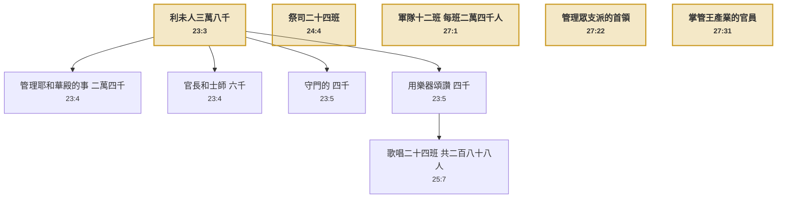
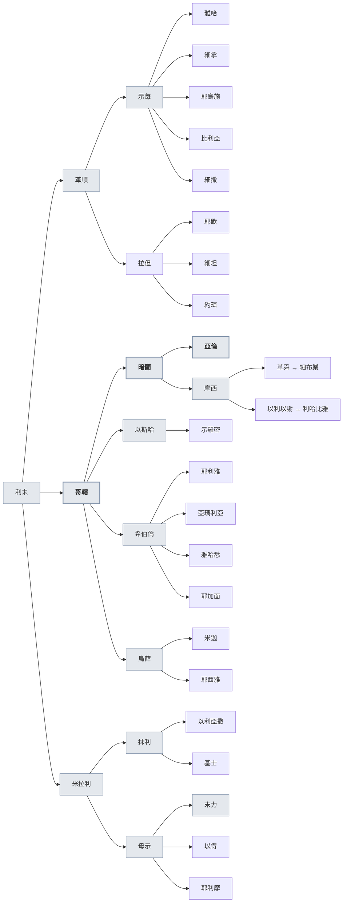
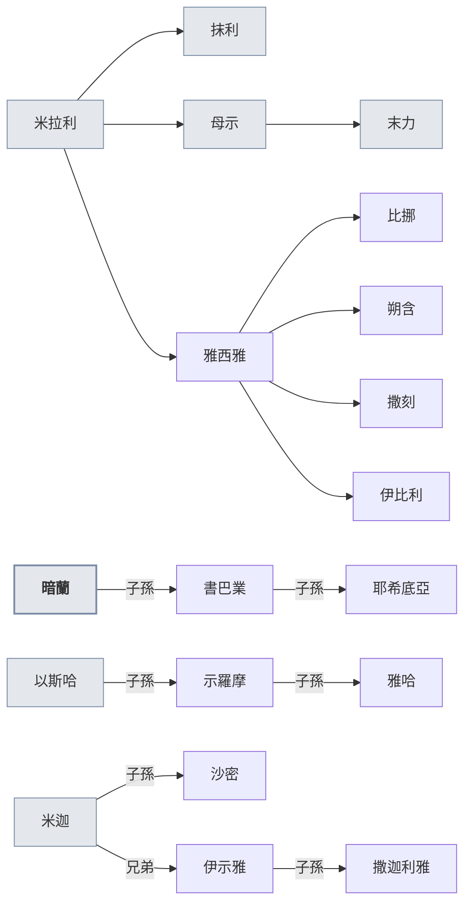
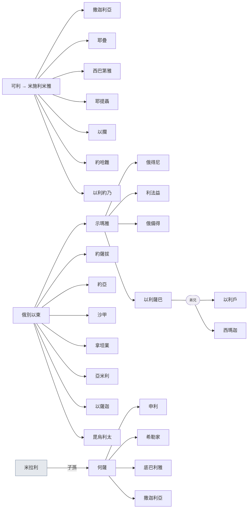
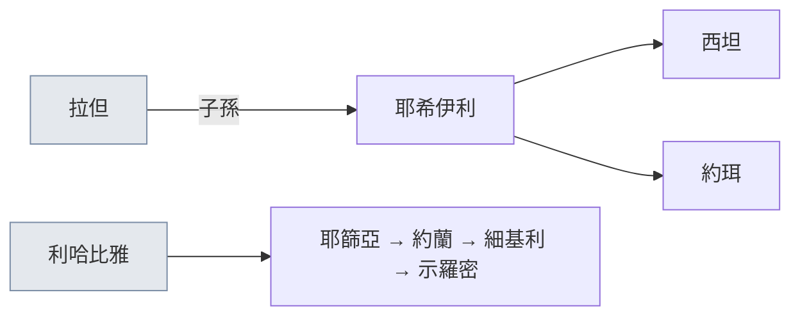

# 歷代志上 10–29 章 大衛王朝人物圖

> 歷代志人物系列：[[appendix/歷代志上的完整人物支線圖|族譜（代上 1–9）]] · **大衛王朝（代上 10–29）** · [[appendix/歷代志下的列王人物圖|猶大列王（代下）]] · [[appendix/南北國列王對照|南北國列王對照]] · [[appendix/歷代志人物總覽|總覽]]

歷代志上從第 10 章起寫大衛作王。這一部分的名單多半按職分排列：誰是大衛的勇士、誰抬約櫃、誰在聖殿歌唱和守門、誰管府庫、每個月由哪一班輪值。下面按章把這些人整理成表，人名照和合本。在 1–9 章族譜出現過的人，旁邊標出族譜頁的經節。

<!-- 本頁由 appendix/genealogy/build_genealogy.py 從 appendix/genealogy/歷代志上/ 的資料檔產生，請改資料檔，不要直接改本頁。 -->

> [!info] 怎麼讀這份圖
> - 表格的「次序」欄照經文原句，例如「第一」「正月第一班」。
> - 「又見」連到本頁其他提到同一個人的地方；「族譜見」連到 1–9 章族譜頁。
> - 圖裡的**藍灰色框**是族譜頁已出現過的人，這一段的名字接在他底下。
> - `23:6` 這樣的灰字是經節；沒寫書名的都是歷代志上。
> - 人名一律照和合本；撒母耳記寫法不同的，見文末「平行經文對照」。

## 總覽

### 大衛設立的職分



### 篇幅分給了誰

第 10–29 章各類內容佔幾節：

```text
利未人和祭司　　　　 ██████████████████████████████ 126 節
約櫃　　　　　　　　 ████████████████████ 86 節
勇士和投奔的人　　　 ███████████████████ 78 節
戰爭　　　　　　　　 ████████████ 50 節
建殿的預備　　　　　 ████████████ 49 節
軍隊和官員　　　　　 █████████ 38 節
大衛作王、所羅門登基 █████████ 37 節
數點百姓　　　　　　 ███████ 30 節
拿單傳話　　　　　　 ██████ 27 節
掃羅之死　　　　　　 ███ 14 節
```

### 目錄

- **[[#第 10 章　掃羅之死|第 10 章]]**
  - [[#掃羅和他的兒子們|掃羅和他的兒子們]]　`10:1–14`
- **[[#第 11 章　大衛作王和他的勇士|第 11 章]]**
  - [[#大衛在希伯崙受膏|大衛在希伯崙受膏]]　`11:1–9`
  - [[#三個勇士和兩位首領|三個勇士和兩位首領]]　`11:10–25`
  - [[#三十個勇士|三十個勇士]]　`11:26–47`
- **[[#第 12 章　投奔大衛的人|第 12 章]]**
  - [[#在洗革拉投奔的便雅憫人|在洗革拉投奔的便雅憫人]]　`12:1–7`
  - [[#投奔山寨的迦得人|投奔山寨的迦得人]]　`12:8–15`
  - [[#便雅憫人、猶大人和瑪拿西人|便雅憫人、猶大人和瑪拿西人]]　`12:16–22`
  - [[#到希伯崙立大衛作王的各支派|到希伯崙立大衛作王的各支派]]　`12:23–40`
- **[[#第 13 章　從基列耶琳運約櫃|第 13 章]]**
  - [[#烏撒和俄別以東|烏撒和俄別以東]]　`13:1–14`
- **[[#第 14 章　大衛在耶路撒冷|第 14 章]]**
  - [[#推羅王希蘭和大衛在耶路撒冷生的兒子|推羅王希蘭和大衛在耶路撒冷生的兒子]]　`14:1–17`
- **[[#第 15 章　抬約櫃進大衛城|第 15 章]]**
  - [[#抬約櫃的利未族長|抬約櫃的利未族長]]　`15:1–15`
  - [[#歌唱、奏樂、守門、吹號的|歌唱、奏樂、守門、吹號的]]　`15:16–29`
- **[[#第 16 章　約櫃前事奉的人|第 16 章]]**
  - [[#約櫃前常常事奉的人|約櫃前常常事奉的人]]　`16:1–43`
- **[[#第 17 章　拿單傳話|第 17 章]]**
  - [[#先知拿單|先知拿單]]　`17:1–27`
- **[[#第 18 章　大衛的戰績和臣僕|第 18 章]]**
  - [[#大衛打敗的列國君王|大衛打敗的列國君王]]　`18:1–13`
  - [[#大衛的臣僕|大衛的臣僕]]　`18:14–17`
- **[[#第 19 章　亞捫人和亞蘭人|第 19 章]]**
  - [[#亞捫王哈嫩|亞捫王哈嫩]]　`19:1–19`
- **[[#第 20 章　攻取拉巴和擊殺偉人|第 20 章]]**
  - [[#攻取拉巴|攻取拉巴]]　`20:1–3`
  - [[#擊殺迦特偉人的三個人|擊殺迦特偉人的三個人]]　`20:4–8`
- **[[#第 21 章　數點百姓|第 21 章]]**
  - [[#約押、迦得和阿珥楠|約押、迦得和阿珥楠]]　`21:1–30`
- **[[#第 22 章　為建殿預備|第 22 章]]**
  - [[#大衛囑咐所羅門建殿|大衛囑咐所羅門建殿]]　`22:1–19`
- **[[#第 23 章　利未人的班次|第 23 章]]**
  - [[#利未人的數目和職分|利未人的數目和職分]]　`23:1–5`
  - [[#革順、哥轄、米拉利三族|革順、哥轄、米拉利三族]]　`23:6–23`
  - [[#利未人的職任|利未人的職任]]　`23:24–32`
- **[[#第 24 章　祭司二十四班|第 24 章]]**
  - [[#祭司掣籤分的二十四班|祭司掣籤分的二十四班]]　`24:1–19`
  - [[#其餘的利未人|其餘的利未人]]　`24:20–31`
- **[[#第 25 章　歌唱二十四班|第 25 章]]**
  - [[#亞薩、耶杜頓、希幔的兒子|亞薩、耶杜頓、希幔的兒子]]　`25:1–7`
  - [[#歌唱的二十四班|歌唱的二十四班]]　`25:8–31`
- **[[#第 26 章　守門的、管庫的和官長|第 26 章]]**
  - [[#守門的|守門的]]　`26:1–19`
  - [[#管府庫的|管府庫的]]　`26:20–28`
  - [[#官長和士師|官長和士師]]　`26:29–32`
- **[[#第 27 章　軍隊和官員|第 27 章]]**
  - [[#十二個月班的班長|十二個月班的班長]]　`27:1–15`
  - [[#管理眾支派的首領|管理眾支派的首領]]　`27:16–24`
  - [[#掌管王產業的官員|掌管王產業的官員]]　`27:25–31`
  - [[#謀士和元帥|謀士和元帥]]　`27:32–34`
- **[[#第 28 章　大衛囑咐所羅門|第 28 章]]**
  - [[#大衛在會眾面前囑咐所羅門|大衛在會眾面前囑咐所羅門]]　`28:1–21`
- **[[#第 29 章　奉獻和所羅門登基|第 29 章]]**
  - [[#眾首領樂意奉獻|眾首領樂意奉獻]]　`29:1–9`
  - [[#所羅門登基、大衛去世|所羅門登基、大衛去世]]　`29:10–30`
- **[[#附表|附表]]**
  - [[#平行經文對照|平行經文對照]]
  - [[#同名不同人|同名不同人]]
  - [[#經文記下的人數|經文記下的人數]]

---

## 第 10 章　掃羅之死

### 掃羅和他的兒子們

`10:1–14`　歷代志上的敘事從掃羅戰死開始。掃羅家的家譜在族譜頁第 8、9 章，這一章寫他和三個兒子死在基利波山。

> [!abstract]+ 完整名單（4 人）
> - ★ 耶西　[[appendix/歷代志上的完整人物支線圖#蘭到大衛|族譜 2:10–12]]
>   - ★ 大衛（七子）　[[appendix/歷代志上的完整人物支線圖#蘭到大衛|族譜 2:13–15]]
> - ★ 掃羅　[[appendix/歷代志上的完整人物支線圖#基遍的耶利，和掃羅的家|族譜 8:33]]
>   - ★ 約拿單　[[appendix/歷代志上的完整人物支線圖#基遍的耶利，和掃羅的家|族譜 8:33]]
>   - 麥基舒亞　[[appendix/歷代志上的完整人物支線圖#基遍的耶利，和掃羅的家|族譜 8:33]]
>   - 亞比拿達　[[appendix/歷代志上的完整人物支線圖#基遍的耶利，和掃羅的家|族譜 8:33]]

[[#目錄|↑ 回到目錄]] · [[#歷代志上 10–29 章 大衛王朝人物圖|回到頂部]]

---

## 第 11 章　大衛作王和他的勇士

### 大衛在希伯崙受膏

`11:1–9`　以色列眾人到希伯崙膏大衛作王，大衛接著攻取錫安的保障。約押因為先上去攻打耶布斯人，作了元帥。

**先上去攻打耶布斯人的人**　`11:6`

| 次序 | 人名 | 經文的介紹 | 經節 |
|---|---|---|---|
| 作了元帥 | 約押<br/><small>又見 [[#大衛的臣僕\|18:15]]、[[#亞捫王哈嫩\|19:8]]、[[#攻取拉巴\|20:1]]等；族譜見 [[appendix/歷代志上的完整人物支線圖#蘭到大衛\|2:16]]</small> | 洗魯雅的兒子 | `11:6` |

[[#目錄|↑ 回到目錄]] · [[#歷代志上 10–29 章 大衛王朝人物圖|回到頂部]]

### 三個勇士和兩位首領

`11:10–25`　大衛勇士名單的開頭。先是「軍長的統領」雅朔班，和「三個勇士裡的一個」以利亞撒；接著是三個勇士冒死到伯利恆打水；最後是兩位首領：約押的兄弟亞比篩，和後來作護衛長的比拿雅。

**三個勇士和兩位首領**　`11:11–25`

| 次序 | 人名 | 經文的介紹 | 經節 |
|---|---|---|---|
| 軍長的統領 | 雅朔班 | 哈革摩尼的兒子 | `11:11` |
| 三個勇士裡的一個 | 以利亞撒 | 亞合人朵多的兒子 | `11:12` |
| 這三個勇士的首領 | 亞比篩<br/><small>又見 [[#大衛打敗的列國君王\|18:12]]、[[#亞捫王哈嫩\|19:15]]；族譜見 [[appendix/歷代志上的完整人物支線圖#蘭到大衛\|2:16]]</small> | 約押的兄弟 | `11:20` |
| 護衛長 | 比拿雅<br/><small>又見 [[#大衛的臣僕\|18:17]]、[[#十二個月班的班長\|27:5–6]]；族譜見 [[#十二個月班的班長\|27:6]]</small> | 甲薛勇士耶何耶大的兒子 | `11:22–25` |

**人物**

- **比拿雅**　他「下坑裡去殺了一個獅子」，又用棍子從埃及人手裡奪槍。所羅門作王以後，「立耶何耶大的兒子比拿雅作元帥，代替約押」。　`11:22-23, 王上 2:35`

[[#目錄|↑ 回到目錄]] · [[#歷代志上 10–29 章 大衛王朝人物圖|回到頂部]]

### 三十個勇士

`11:26–47`　「軍中的勇士」名單，多數寫出家鄉或父親。名單裡有赫人烏利亞，也有亞捫人、摩押人。

**軍中的勇士**　`11:26–47`

| 次序 | 人名 | 經文的介紹 | 人數 | 經節 |
|---|---|---|---|---|
|  | 亞撒黑<br/><small>又見 [[#十二個月班的班長\|27:7]]；族譜見 [[appendix/歷代志上的完整人物支線圖#蘭到大衛\|2:16]]</small> | 約押的兄弟 |  | `11:26` |
|  | 伊勒哈難 | 伯利恆人朵多的兒子 |  | `11:26` |
|  | 沙瑪 | 哈律人 |  | `11:27` |
|  | 希利斯<br/><small>又見 [[#十二個月班的班長\|27:10]]</small> | 比倫人 |  | `11:27` |
|  | 以拉<br/><small>又見 [[#十二個月班的班長\|27:9]]</small> | 提哥亞人益吉的兒子 |  | `11:28` |
|  | 亞比以謝<br/><small>又見 [[#十二個月班的班長\|27:12]]</small> | 亞拿突人 |  | `11:28` |
|  | 西比該<br/><small>又見 [[#擊殺迦特偉人的三個人\|20:4]]、[[#十二個月班的班長\|27:11]]</small> | 戶沙人 |  | `11:29` |
|  | 以來 | 亞合人 |  | `11:29` |
|  | 瑪哈萊<br/><small>又見 [[#十二個月班的班長\|27:13]]</small> | 尼陀法人 |  | `11:30` |
|  | 希立 | 尼陀法人巴拿的兒子 |  | `11:30` |
|  | 以太 | 便雅憫族基比亞人利拜的兒子 |  | `11:31` |
|  | 比拿雅<br/><small>又見 [[#十二個月班的班長\|27:14]]</small> | 比拉頓人 |  | `11:31` |
|  | 戶萊 | 迦實溪人 |  | `11:32` |
|  | 亞比 | 亞拉巴人 |  | `11:32` |
|  | 押斯瑪弗 | 巴路米人 |  | `11:33` |
|  | 以利雅哈巴 | 沙本人 |  | `11:33` |
|  | 哈深 | 基孫人哈深的眾子 |  | `11:34` |
|  | 約拿單 | 哈拉人沙基的兒子 |  | `11:34` |
|  | 亞希暗 | 哈拉人沙甲的兒子 |  | `11:35` |
|  | 以利法勒 | 吾珥的兒子 |  | `11:35` |
|  | 希弗 | 米基拉人 |  | `11:36` |
|  | 亞希雅 | 比倫人 |  | `11:36` |
|  | 希斯羅 | 迦密人 |  | `11:37` |
|  | 拿萊 | 伊斯拜的兒子 |  | `11:37` |
|  | 約珥 | 拿單的兄弟 |  | `11:38` |
|  | 彌伯哈 | 哈基利的兒子 |  | `11:38` |
|  | 洗勒 | 亞捫人 |  | `11:39` |
| 給洗魯雅的兒子約押拿兵器的 | 拿哈萊 | 比錄人 |  | `11:39` |
|  | 以拉 | 以帖人 |  | `11:40` |
|  | 迦立 | 以帖人 |  | `11:40` |
|  | 烏利亞 | 赫人 |  | `11:41` |
|  | 撒拔 | 亞萊的兒子 |  | `11:41` |
| 流便支派中的一個族長 | 亞第拿 | 流便人示撒的兒子 | 三十人 | `11:42` |
|  | 哈難 | 瑪迦的兒子 |  | `11:43` |
|  | 約沙法 | 彌特尼人 |  | `11:43` |
|  | 烏西亞 | 亞施他拉人 |  | `11:44` |
|  | 沙瑪 | 亞羅珥人何坦的兒子 |  | `11:44` |
|  | 耶利 | 亞羅珥人何坦的兒子 |  | `11:44` |
|  | 耶疊 | 提洗人申利的兒子 |  | `11:45` |
|  | 約哈 | 他的兄弟 |  | `11:45` |
|  | 以利業 | 瑪哈未人 |  | `11:46` |
|  | 耶利拜 | 伊利拿安的兒子 |  | `11:46` |
|  | 約沙未雅 | 伊利拿安的兒子 |  | `11:46` |
|  | 伊特瑪 | 摩押人 |  | `11:46` |
|  | 以利業 |  |  | `11:47` |
|  | 俄備得 |  |  | `11:47` |
|  | 雅西業 | 米瑣八人 |  | `11:47` |

**人物**

- **烏利亞**　拔示巴的丈夫，經文稱拔示巴是「赫人烏利亞的妻」。後來在約押攻城時，「赫人烏利亞也死了」。　`11:41, 撒下 11:3, 撒下 11:17`

[[#目錄|↑ 回到目錄]] · [[#歷代志上 10–29 章 大衛王朝人物圖|回到頂部]]

---

## 第 12 章　投奔大衛的人

### 在洗革拉投奔的便雅憫人

`12:1–7`　大衛躲避掃羅、住在洗革拉的時候，有一批便雅憫人來投奔。經文特別說他們「都是便雅憫人掃羅的族弟兄」。

**在洗革拉投奔大衛的便雅憫人**　`12:1–7`

| 次序 | 人名 | 經文的介紹 | 經節 |
|---|---|---|---|
| 為首的 | 亞希以謝 | 基比亞人示瑪的兒子 | `12:3` |
| 其次 | 約阿施 | 基比亞人示瑪的兒子 | `12:3` |
|  | 耶薛 | 亞斯瑪威的兒子 | `12:3` |
|  | 毘力 | 亞斯瑪威的兒子 | `12:3` |
|  | 比拉迦 |  | `12:3` |
|  | 耶戶 | 亞拿突人 | `12:3` |
| 在三十人中是勇士，管理他們 | 以實買雅 | 基遍人 | `12:4` |
|  | 耶利米 |  | `12:4` |
|  | 雅哈悉 |  | `12:4` |
|  | 約哈難 |  | `12:4` |
|  | 約撒拔 | 基得拉人 | `12:4` |
|  | 伊利烏賽 |  | `12:5` |
|  | 耶利摩 |  | `12:5` |
|  | 比亞利雅 |  | `12:5` |
|  | 示瑪利雅 |  | `12:5` |
|  | 示法提雅 | 哈律弗人 | `12:5` |
|  | 以利加拿 | 可拉人 | `12:6` |
|  | 耶西亞 | 可拉人 | `12:6` |
|  | 亞薩列 | 可拉人 | `12:6` |
|  | 約以謝 | 可拉人 | `12:6` |
|  | 雅朔班 | 可拉人 | `12:6` |
|  | 猶拉 | 基多人耶羅罕的兒子 | `12:7` |
|  | 西巴第雅 | 基多人耶羅罕的兒子 | `12:7` |

[[#目錄|↑ 回到目錄]] · [[#歷代志上 10–29 章 大衛王朝人物圖|回到頂部]]

### 投奔山寨的迦得人

`12:8–15`　十一位迦得人到曠野的山寨投奔大衛，經文從第一排到第十一。

**到曠野山寨投奔大衛的迦得人**　`12:8–15`

| 次序 | 人名 | 經文的介紹 | 經節 |
|---|---|---|---|
| 第一 | 以薛 |  | `12:9` |
| 第二 | 俄巴底雅 |  | `12:9` |
| 第三 | 以利押 |  | `12:9` |
| 第四 | 彌施瑪拿 |  | `12:10` |
| 第五 | 耶利米 |  | `12:10` |
| 第六 | 亞太 |  | `12:11` |
| 第七 | 以利業 |  | `12:11` |
| 第八 | 約哈難 |  | `12:12` |
| 第九 | 以利薩巴 |  | `12:12` |
| 第十 | 耶利米 |  | `12:13` |
| 第十一 | 末巴奈 |  | `12:13` |

[[#目錄|↑ 回到目錄]] · [[#歷代志上 10–29 章 大衛王朝人物圖|回到頂部]]

### 便雅憫人、猶大人和瑪拿西人

`12:16–22`　又有便雅憫人和猶大人到山寨，由亞瑪撒代表說話；後來還有七位瑪拿西的千夫長在大衛往洗革拉去的時候投奔他。

**山寨裡代表說話的人**　`12:18`

| 次序 | 人名 | 經文的介紹 | 經節 |
|---|---|---|---|
| 三十個勇士的首領 | 亞瑪撒 |  | `12:18` |

**往洗革拉去時投奔的瑪拿西千夫長**　`12:20–22`

| 人名 | 經文的介紹 | 經節 |
|---|---|---|
| 押拿 | 瑪拿西人的千夫長 | `12:20` |
| 約撒拔 | 瑪拿西人的千夫長 | `12:20` |
| 耶疊 | 瑪拿西人的千夫長 | `12:20` |
| 米迦勒 | 瑪拿西人的千夫長 | `12:20` |
| 約撒拔 | 瑪拿西人的千夫長 | `12:20` |
| 以利戶 | 瑪拿西人的千夫長 | `12:20` |
| 洗勒太 | 瑪拿西人的千夫長 | `12:20` |

[[#目錄|↑ 回到目錄]] · [[#歷代志上 10–29 章 大衛王朝人物圖|回到頂部]]

### 到希伯崙立大衛作王的各支派

`12:23–40`　各支派預備打仗的兵到希伯崙立大衛作王。這份名單記的多半是人數，只點名了耶何耶大和撒督。

**亞倫家的代表**　`12:27–28`

| 人名 | 經文的介紹 | 人數 | 經節 |
|---|---|---|---|
| 耶何耶大 | 亞倫家的首領 | 三千七百人 | `12:27` |
| 撒督 | 少年大能的勇士 | 二十二人 | `12:28` |

[[#目錄|↑ 回到目錄]] · [[#歷代志上 10–29 章 大衛王朝人物圖|回到頂部]]

---

## 第 13 章　從基列耶琳運約櫃

### 烏撒和俄別以東

`13:1–14`　大衛第一次要把約櫃從基列耶琳運到耶路撒冷。烏撒伸手扶約櫃被擊殺，約櫃改放在迦特人俄別以東家裡三個月。

**運約櫃時出現的人**　`13:7–14`

| 次序 | 人名 | 經文的介紹 | 經節 |
|---|---|---|---|
|  | 亞比拿達 | 約櫃原本放在他家裡 | `13:7` |
| 趕車 | 烏撒 |  | `13:7–10` |
| 趕車 | 亞希約 |  | `13:7` |
|  | 俄別以東 | 迦特人 | `13:13–14` |

**人物**

- **烏撒**　運約櫃時「烏撒就伸手扶住約櫃」，耶和華向他發怒，「他就死在神面前」。　`13:9-10`

[[#目錄|↑ 回到目錄]] · [[#歷代志上 10–29 章 大衛王朝人物圖|回到頂部]]

---

## 第 14 章　大衛在耶路撒冷

### 推羅王希蘭和大衛在耶路撒冷生的兒子

`14:1–17`　推羅王希蘭為大衛建宮殿。大衛在耶路撒冷所生的兒子，名單和 3:5–8 大致相同，有幾個名字寫法不同。後半章寫大衛兩次求問神、打敗非利士人。

| 人名 | 經文的介紹 | 經節 |
|---|---|---|
| 希蘭 | 推羅王 | `14:1` |

**大衛在耶路撒冷所生的兒子**　`14:4–7`

| 人名 | 經文的介紹 | 經節 |
|---|---|---|
| 沙母亞<br/><small>別處作示米亞；族譜見 [[appendix/歷代志上的完整人物支線圖#大衛的兒子\|3:5]]</small> |  | `14:4` |
| 朔罷<br/><small>族譜見 [[appendix/歷代志上的完整人物支線圖#大衛的兒子\|3:5]]</small> |  | `14:4` |
| 拿單<br/><small>族譜見 [[appendix/歷代志上的完整人物支線圖#大衛的兒子\|3:5]]</small> |  | `14:4` |
| 所羅門<br/><small>又見 [[#大衛囑咐所羅門建殿\|22:5]]、[[#利未人的數目和職分\|23:1]]、[[#大衛在會眾面前囑咐所羅門\|28:5]]等；族譜見 [[appendix/歷代志上的完整人物支線圖#大衛的兒子\|3:5]]</small> |  | `14:4` |
| 益轄<br/><small>族譜見 [[appendix/歷代志上的完整人物支線圖#大衛的兒子\|3:6]]</small> |  | `14:5` |
| 以利書亞 |  | `14:5` |
| 以法列 |  | `14:5` |
| 挪迦<br/><small>族譜見 [[appendix/歷代志上的完整人物支線圖#大衛的兒子\|3:7]]</small> |  | `14:6` |
| 尼斐<br/><small>族譜見 [[appendix/歷代志上的完整人物支線圖#大衛的兒子\|3:7]]</small> |  | `14:6` |
| 雅非亞<br/><small>族譜見 [[appendix/歷代志上的完整人物支線圖#大衛的兒子\|3:7]]</small> |  | `14:6` |
| 以利沙瑪<br/><small>族譜見 [[appendix/歷代志上的完整人物支線圖#大衛的兒子\|3:8]]</small> |  | `14:7` |
| 比利雅大 |  | `14:7` |
| 以利法列<br/><small>族譜見 [[appendix/歷代志上的完整人物支線圖#大衛的兒子\|3:8]]</small> |  | `14:7` |

[[#目錄|↑ 回到目錄]] · [[#歷代志上 10–29 章 大衛王朝人物圖|回到頂部]]

---

## 第 15 章　抬約櫃進大衛城

### 抬約櫃的利未族長

`15:1–15`　第二次運約櫃，大衛說「除了利未人之外，無人可抬神的約櫃」。利未的六個家族各由一位族長帶領弟兄，祭司撒督和亞比亞他也一同被召來。

**抬約櫃的利未族長和祭司**　`15:5–11`

| 次序 | 人名 | 經文的介紹 | 人數 | 經節 |
|---|---|---|---|---|
| 族長 | 烏列 | 哥轄子孫 | 一百二十人 | `15:5` |
| 族長 | 亞帥雅 | 米拉利子孫 | 二百二十人 | `15:6` |
| 族長 | 約珥 | 革順子孫 | 一百三十人 | `15:7` |
| 族長 | 示瑪雅 | 以利撒反子孫 | 二百人 | `15:8` |
| 族長 | 以列 | 希伯崙子孫 | 八十人 | `15:9` |
| 族長 | 亞米拿達 | 烏薛子孫 | 一百一十二人 | `15:10` |
| 祭司 | 撒督<br/><small>又見 [[#約櫃前常常事奉的人\|16:39]]、[[#大衛的臣僕\|18:16]]、[[#祭司掣籤分的二十四班\|24:3]]等；族譜見 [[appendix/歷代志上的完整人物支線圖#大祭司的家系\|6:4–15]]</small> |  |  | `15:11` |
| 祭司 | 亞比亞他<br/><small>又見 [[#謀士和元帥\|27:34]]；族譜見 [[#大衛的臣僕\|18:16]]</small> |  |  | `15:11` |

[[#目錄|↑ 回到目錄]] · [[#歷代志上 10–29 章 大衛王朝人物圖|回到頂部]]

### 歌唱、奏樂、守門、吹號的

`15:16–29`　利未人派希幔、亞薩、以探三位歌唱的領袖，其下的弟兄分別鼓瑟、彈琴；另有守門的和祭司吹號。章末是米甲從窗戶看見大衛跳舞。

> [!abstract]+ 完整名單（1 人）
> - ★ 掃羅　[[appendix/歷代志上的完整人物支線圖#基遍的耶利，和掃羅的家|族譜 8:33]]
>   - 〔女〕米甲　`15:29`

**派去歌唱的三位領袖**　`15:16–19`

| 次序 | 人名 | 經文的介紹 | 經節 |
|---|---|---|---|
| 敲銅鈸 | 希幔<br/><small>又見 [[#約櫃前常常事奉的人\|16:41–42]]、[[#亞薩、耶杜頓、希幔的兒子\|25:5]]；族譜見 [[appendix/歷代志上的完整人物支線圖#大衛派定的三位歌唱領袖\|6:33–38]]</small> | 約珥的兒子 | `15:17, 15:19` |
| 敲銅鈸 | 亞薩<br/><small>又見 [[#約櫃前常常事奉的人\|16:5]]、[[#約櫃前常常事奉的人\|16:37]]、[[#亞薩、耶杜頓、希幔的兒子\|25:6]]；族譜見 [[appendix/歷代志上的完整人物支線圖#大衛派定的三位歌唱領袖\|6:39–43]]</small> | 比利家的兒子 | `15:17, 15:19` |
| 敲銅鈸 | 以探 | 米拉利子孫裡古沙雅的兒子 | `15:17, 15:19` |

**其次的樂師**　`15:20–21`

| 次序 | 人名 | 經文的介紹 | 經節 |
|---|---|---|---|
| 鼓瑟，調用女音 | 撒迦利雅<br/><small>又見 [[#約櫃前常常事奉的人\|16:5]]</small> |  | `15:20` |
| 鼓瑟，調用女音 | 雅薛<br/><small>又見 [[#約櫃前常常事奉的人\|16:5]]</small> |  | `15:20` |
| 鼓瑟，調用女音 | 示米拉末<br/><small>又見 [[#約櫃前常常事奉的人\|16:5]]</small> |  | `15:20` |
| 鼓瑟，調用女音 | 耶歇<br/><small>又見 [[#約櫃前常常事奉的人\|16:5]]</small> |  | `15:20` |
| 鼓瑟，調用女音 | 烏尼 |  | `15:20` |
| 鼓瑟，調用女音 | 以利押<br/><small>又見 [[#約櫃前常常事奉的人\|16:5]]</small> |  | `15:20` |
| 鼓瑟，調用女音 | 瑪西雅 |  | `15:20` |
| 鼓瑟，調用女音 | 比拿雅<br/><small>又見 [[#約櫃前常常事奉的人\|16:5]]</small> |  | `15:20` |
| 領首彈琴，調用第八 | 瑪他提雅<br/><small>又見 [[#約櫃前常常事奉的人\|16:5]]</small> |  | `15:21` |
| 領首彈琴，調用第八 | 以利斐利戶 |  | `15:21` |
| 領首彈琴，調用第八 | 彌克尼雅 |  | `15:21` |
| 領首彈琴，調用第八 | 俄別以東<br/><small>又見 [[#歌唱、奏樂、守門、吹號的\|15:18]]、[[#約櫃前常常事奉的人\|16:5]]、[[#約櫃前常常事奉的人\|16:38]]等；族譜見 [[#守門的\|26:4]]</small> |  | `15:21` |
| 領首彈琴，調用第八 | 耶利<br/><small>又見 [[#歌唱、奏樂、守門、吹號的\|15:18]]、[[#約櫃前常常事奉的人\|16:5]]</small> |  | `15:21` |
| 領首彈琴，調用第八 | 亞撒西雅 |  | `15:21` |

**歌唱的弟兄中另有名字的人**　`15:18`

| 人名 | 經文的介紹 | 經節 |
|---|---|---|
| 便雅薛 |  | `15:18` |
| 俄別以東<br/><small>又見 [[#歌唱、奏樂、守門、吹號的\|15:21]]、[[#約櫃前常常事奉的人\|16:5]]、[[#約櫃前常常事奉的人\|16:38]]等；族譜見 [[#守門的\|26:4]]</small> | 守門的 | `15:18` |
| 耶利<br/><small>又見 [[#歌唱、奏樂、守門、吹號的\|15:21]]、[[#約櫃前常常事奉的人\|16:5]]</small> | 守門的 | `15:18` |

**領首的、守門的和吹號的**　`15:22–24`

| 次序 | 人名 | 經文的介紹 | 經節 |
|---|---|---|---|
| 歌唱人的首領 | 基拿尼雅 | 利未人的族長 | `15:22` |
| 約櫃前守門的 | 比利家 |  | `15:23` |
| 約櫃前守門的 | 以利加拿 |  | `15:23` |
| 在神的約櫃前吹號 | 示巴尼 | 祭司 | `15:24` |
| 在神的約櫃前吹號 | 約沙法 | 祭司 | `15:24` |
| 在神的約櫃前吹號 | 拿坦業 | 祭司 | `15:24` |
| 在神的約櫃前吹號 | 亞瑪賽 | 祭司 | `15:24` |
| 在神的約櫃前吹號 | 撒迦利雅 | 祭司 | `15:24` |
| 在神的約櫃前吹號 | 比拿亞 | 祭司 | `15:24` |
| 在神的約櫃前吹號 | 以利以謝 | 祭司 | `15:24` |
| 約櫃前守門的 | 耶希亞 |  | `15:24` |

**人物**

- **米甲**　掃羅的女兒。約櫃進大衛城時，他看見大衛跳舞，「心裡就輕視他」。撒母耳記下說他「直到死日，沒有生養兒女」。　`15:29, 撒下 6:23`

[[#目錄|↑ 回到目錄]] · [[#歷代志上 10–29 章 大衛王朝人物圖|回到頂部]]

---

## 第 16 章　約櫃前事奉的人

### 約櫃前常常事奉的人

`16:1–43`　約櫃安放在大衛搭的帳幕裡。大衛派亞薩和他的弟兄在約櫃前事奉；祭司撒督和希幔、耶杜頓則被派到基遍的帳幕前。16:8–36 是那天的頌讚詩。

**約櫃前事奉的人**　`16:4–7`

| 次序 | 人名 | 經文的介紹 | 經節 |
|---|---|---|---|
| 為首的 | 亞薩<br/><small>又見 [[#歌唱、奏樂、守門、吹號的\|15:17, 15:19]]、[[#約櫃前常常事奉的人\|16:37]]、[[#亞薩、耶杜頓、希幔的兒子\|25:6]]；族譜見 [[appendix/歷代志上的完整人物支線圖#大衛派定的三位歌唱領袖\|6:39–43]]</small> |  | `16:5` |
| 鼓瑟彈琴 | 撒迦利雅<br/><small>又見 [[#歌唱、奏樂、守門、吹號的\|15:20]]</small> |  | `16:5` |
| 鼓瑟彈琴 | 雅薛<br/><small>又見 [[#歌唱、奏樂、守門、吹號的\|15:20]]</small> |  | `16:5` |
| 鼓瑟彈琴 | 示米拉末<br/><small>又見 [[#歌唱、奏樂、守門、吹號的\|15:20]]</small> |  | `16:5` |
| 鼓瑟彈琴 | 耶歇<br/><small>又見 [[#歌唱、奏樂、守門、吹號的\|15:20]]</small> |  | `16:5` |
| 鼓瑟彈琴 | 瑪他提雅<br/><small>又見 [[#歌唱、奏樂、守門、吹號的\|15:21]]</small> |  | `16:5` |
| 鼓瑟彈琴 | 以利押<br/><small>又見 [[#歌唱、奏樂、守門、吹號的\|15:20]]</small> |  | `16:5` |
| 鼓瑟彈琴 | 比拿雅<br/><small>又見 [[#歌唱、奏樂、守門、吹號的\|15:20]]</small> |  | `16:5` |
| 鼓瑟彈琴 | 俄別以東<br/><small>又見 [[#歌唱、奏樂、守門、吹號的\|15:21]]、[[#歌唱、奏樂、守門、吹號的\|15:18]]、[[#約櫃前常常事奉的人\|16:38]]等；族譜見 [[#守門的\|26:4]]</small> |  | `16:5` |
| 鼓瑟彈琴 | 耶利<br/><small>又見 [[#歌唱、奏樂、守門、吹號的\|15:21]]、[[#歌唱、奏樂、守門、吹號的\|15:18]]</small> |  | `16:5` |
| 常在神的約櫃前吹號 | 比拿雅 | 祭司 | `16:6` |
| 常在神的約櫃前吹號 | 雅哈悉 | 祭司 | `16:6` |

**大衛派在約櫃前和基遍帳幕前的人**　`16:37–42`

| 次序 | 人名 | 經文的介紹 | 人數 | 經節 |
|---|---|---|---|---|
| 在約櫃前常常事奉耶和華 | 亞薩<br/><small>又見 [[#歌唱、奏樂、守門、吹號的\|15:17, 15:19]]、[[#約櫃前常常事奉的人\|16:5]]、[[#亞薩、耶杜頓、希幔的兒子\|25:6]]；族譜見 [[appendix/歷代志上的完整人物支線圖#大衛派定的三位歌唱領袖\|6:39–43]]</small> |  |  | `16:37` |
| 作守門的 | 俄別以東<br/><small>又見 [[#歌唱、奏樂、守門、吹號的\|15:21]]、[[#歌唱、奏樂、守門、吹號的\|15:18]]、[[#約櫃前常常事奉的人\|16:5]]等；族譜見 [[#守門的\|26:4]]</small> |  | 六十八人 | `16:38` |
| 作守門的 | 俄別以東 | 耶杜頓的兒子 |  | `16:38` |
| 作守門的 | 何薩<br/><small>又見 [[#守門的\|26:16]]；族譜見 [[#守門的\|26:10]]</small> |  |  | `16:38` |
|  | 撒督<br/><small>又見 [[#抬約櫃的利未族長\|15:11]]、[[#大衛的臣僕\|18:16]]、[[#祭司掣籤分的二十四班\|24:3]]等；族譜見 [[appendix/歷代志上的完整人物支線圖#大祭司的家系\|6:4–15]]</small> | 祭司 |  | `16:39` |
| 吹號、敲鈸 | 希幔<br/><small>又見 [[#歌唱、奏樂、守門、吹號的\|15:17, 15:19]]、[[#亞薩、耶杜頓、希幔的兒子\|25:5]]；族譜見 [[appendix/歷代志上的完整人物支線圖#大衛派定的三位歌唱領袖\|6:33–38]]</small> |  |  | `16:41–42` |
| 吹號、敲鈸 | 耶杜頓<br/><small>又見 [[#亞薩、耶杜頓、希幔的兒子\|25:6]]；族譜見 [[appendix/歷代志上的完整人物支線圖#利未人和守門的\|9:16]]</small> |  |  | `16:41–42` |

[[#目錄|↑ 回到目錄]] · [[#歷代志上 10–29 章 大衛王朝人物圖|回到頂部]]

---

## 第 17 章　拿單傳話

### 先知拿單

`17:1–27`　大衛想為耶和華建殿。神藉先知拿單告訴他，建殿的會是他的後裔，神也要為大衛「建立家室」。

| 人名 | 經文的介紹 | 經節 |
|---|---|---|
| 拿單<br/><small>又見 [[#所羅門登基、大衛去世\|29:29]]</small> | 先知 | `17:1` |

[[#目錄|↑ 回到目錄]] · [[#歷代志上 10–29 章 大衛王朝人物圖|回到頂部]]

---

## 第 18 章　大衛的戰績和臣僕

### 大衛打敗的列國君王

`18:1–13`　大衛打敗非利士、摩押、瑣巴、亞蘭和以東。這一段點名的人有瑣巴王哈大利謝、哈馬王陀烏和他的兒子哈多蘭，以及在鹽谷擊殺以東人的亞比篩。

> [!abstract]+ 完整名單（2 人）
> - 陀烏 → 哈多蘭　`18:10`

**大衛打敗的君王和戰績**　`18:3–13`

| 次序 | 人名 | 經文的介紹 | 人數 | 經節 |
|---|---|---|---|---|
|  | 哈大利謝 | 瑣巴王 |  | `18:3` |
|  | 陀烏<br/><small>族譜見 [[#大衛打敗的列國君王\|18:10]]</small> | 哈馬王 |  | `18:9` |
| 去見大衛王 | 哈多蘭<br/><small>族譜見 [[#大衛打敗的列國君王\|18:10]]</small> |  |  | `18:10` |
| 在鹽谷擊殺了以東 | 亞比篩<br/><small>又見 [[#三個勇士和兩位首領\|11:20]]、[[#亞捫王哈嫩\|19:15]]；族譜見 [[appendix/歷代志上的完整人物支線圖#蘭到大衛\|2:16]]</small> | 洗魯雅的兒子 | 一萬八千人 | `18:12` |

[[#目錄|↑ 回到目錄]] · [[#歷代志上 10–29 章 大衛王朝人物圖|回到頂部]]

### 大衛的臣僕

`18:14–17`　大衛作王時朝中的幾個主要職分。撒母耳記下 8:15–18 有同一份名單，幾處寫法不同，見文末平行經文對照。

> [!abstract]+ 完整名單（2 人）
> - 亞比亞他 → 亞希米勒　`18:16`

**大衛朝中的職分**　`18:15–17`

| 次序 | 人名 | 經文的介紹 | 經節 |
|---|---|---|---|
| 作元帥 | 約押<br/><small>又見 [[#大衛在希伯崙受膏\|11:6]]、[[#亞捫王哈嫩\|19:8]]、[[#攻取拉巴\|20:1]]等；族譜見 [[appendix/歷代志上的完整人物支線圖#蘭到大衛\|2:16]]</small> | 洗魯雅的兒子 | `18:15` |
| 作史官 | 約沙法 | 亞希律的兒子 | `18:15` |
| 作祭司長 | 撒督<br/><small>又見 [[#抬約櫃的利未族長\|15:11]]、[[#約櫃前常常事奉的人\|16:39]]、[[#祭司掣籤分的二十四班\|24:3]]等；族譜見 [[appendix/歷代志上的完整人物支線圖#大祭司的家系\|6:4–15]]</small> | 亞希突的兒子 | `18:16` |
| 作祭司長 | 亞希米勒<br/><small>又見 [[#祭司掣籤分的二十四班\|24:3]]；族譜見 [[#大衛的臣僕\|18:16]]</small> | 亞比亞他的兒子 | `18:16` |
| 作書記 | 沙威沙 |  | `18:16` |
| 統轄基利提人和比利提人 | 比拿雅<br/><small>又見 [[#三個勇士和兩位首領\|11:22–25]]、[[#十二個月班的班長\|27:5–6]]；族譜見 [[#十二個月班的班長\|27:6]]</small> | 耶何耶大的兒子 | `18:17` |

[[#目錄|↑ 回到目錄]] · [[#歷代志上 10–29 章 大衛王朝人物圖|回到頂部]]

---

## 第 19 章　亞捫人和亞蘭人

### 亞捫王哈嫩

`19:1–19`　大衛派人去安慰新登基的亞捫王哈嫩，卻被羞辱，引發和亞捫、亞蘭的戰爭。約押和亞比篩兄弟分兩路迎戰。

> [!abstract]+ 完整名單（2 人）
> - 拿轄 → 哈嫩　`19:2`

**亞捫人的君王**　`19:1–2`

| 次序 | 人名 | 經文的介紹 | 經節 |
|---|---|---|---|
|  | 拿轄<br/><small>族譜見 [[#亞捫王哈嫩\|19:2]]</small> | 亞捫人的王 | `19:1` |
| 接續他作王 | 哈嫩<br/><small>族譜見 [[#亞捫王哈嫩\|19:2]]</small> |  | `19:1–2` |

**對亞捫和亞蘭作戰的人**　`19:3–19`

| 次序 | 人名 | 經文的介紹 | 經節 |
|---|---|---|---|
| 統帶勇猛的全軍 | 約押<br/><small>又見 [[#大衛在希伯崙受膏\|11:6]]、[[#大衛的臣僕\|18:15]]、[[#攻取拉巴\|20:1]]等；族譜見 [[appendix/歷代志上的完整人物支線圖#蘭到大衛\|2:16]]</small> |  | `19:8` |
|  | 亞比篩<br/><small>又見 [[#三個勇士和兩位首領\|11:20]]、[[#大衛打敗的列國君王\|18:12]]；族譜見 [[appendix/歷代志上的完整人物支線圖#蘭到大衛\|2:16]]</small> | 約押的兄弟 | `19:15` |
|  | 朔法 | 哈大利謝的將軍 | `19:16` |

[[#目錄|↑ 回到目錄]] · [[#歷代志上 10–29 章 大衛王朝人物圖|回到頂部]]

---

## 第 20 章　攻取拉巴和擊殺偉人

### 攻取拉巴

`20:1–3`　約押圍攻亞捫人的拉巴城，將城傾覆；大衛得了亞捫人之王的金冠冕。

| 次序 | 人名 | 經文的介紹 | 經節 |
|---|---|---|---|
| 圍攻拉巴 | 約押<br/><small>又見 [[#大衛在希伯崙受膏\|11:6]]、[[#大衛的臣僕\|18:15]]、[[#亞捫王哈嫩\|19:8]]等；族譜見 [[appendix/歷代志上的完整人物支線圖#蘭到大衛\|2:16]]</small> |  | `20:1` |

[[#目錄|↑ 回到目錄]] · [[#歷代志上 10–29 章 大衛王朝人物圖|回到頂部]]

### 擊殺迦特偉人的三個人

`20:4–8`　三次和非利士人打仗，三位以色列人各殺了一個「偉人的兒子」。

> [!abstract]+ 完整名單（1 人）
> - 示米亞（三子）　[[appendix/歷代志上的完整人物支線圖#蘭到大衛|族譜 2:13–15]]
>   - 約拿單　`20:7`

**擊殺迦特偉人的三個人**　`20:4–8`

| 次序 | 人名 | 經文的介紹 | 經節 |
|---|---|---|---|
| 殺了偉人的一個兒子細派 | 西比該<br/><small>又見 [[#三十個勇士\|11:29]]、[[#十二個月班的班長\|27:11]]</small> | 戶沙人 | `20:4` |
|  | 細派 | 偉人的一個兒子 | `20:4` |
| 殺了迦特人歌利亞的兄弟拉哈米 | 伊勒哈難 | 睚珥的兒子 | `20:5` |
|  | 歌利亞 | 迦特人 | `20:5` |
|  | 拉哈米 | 歌利亞的兄弟 | `20:5` |
| 就殺了他 | 約拿單<br/><small>族譜見 [[#擊殺迦特偉人的三個人\|20:7]]</small> | 大衛的哥哥示米亞的兒子 | `20:7` |

[[#目錄|↑ 回到目錄]] · [[#歷代志上 10–29 章 大衛王朝人物圖|回到頂部]]

---

## 第 21 章　數點百姓

### 約押、迦得和阿珥楠

`21:1–30`　大衛數點百姓，約押反對卻不得不從。神藉先見迦得讓大衛選擇刑罰；瘟疫停在耶布斯人阿珥楠的禾場，大衛在那裡買地築壇。

| 人名 | 經文的介紹 | 經節 |
|---|---|---|
| 約押<br/><small>又見 [[#大衛在希伯崙受膏\|11:6]]、[[#大衛的臣僕\|18:15]]、[[#亞捫王哈嫩\|19:8]]等；族譜見 [[appendix/歷代志上的完整人物支線圖#蘭到大衛\|2:16]]</small> |  | `21:2` |
| 迦得<br/><small>又見 [[#所羅門登基、大衛去世\|29:29]]</small> | 大衛的先見 | `21:9` |
| 阿珥楠 | 耶布斯人 | `21:15` |

**人物**

- **阿珥楠**　耶布斯人。瘟疫停在他的禾場，大衛向他買地築壇，「為那塊地平了六百舍客勒金子給阿珥楠」。撒母耳記下作「耶布斯人亞勞拿」。　`21:15, 21:25, 撒下 24:18`

[[#目錄|↑ 回到目錄]] · [[#歷代志上 10–29 章 大衛王朝人物圖|回到頂部]]

---

## 第 22 章　為建殿預備

### 大衛囑咐所羅門建殿

`22:1–19`　大衛為建殿預備材料，囑咐所羅門建造，又吩咐眾首領幫助他。

| 次序 | 人名 | 經文的介紹 | 經節 |
|---|---|---|---|
| 還年幼嬌嫩 | 所羅門<br/><small>又見 [[#推羅王希蘭和大衛在耶路撒冷生的兒子\|14:4]]、[[#利未人的數目和職分\|23:1]]、[[#大衛在會眾面前囑咐所羅門\|28:5]]等；族譜見 [[appendix/歷代志上的完整人物支線圖#大衛的兒子\|3:5]]</small> |  | `22:5` |

[[#目錄|↑ 回到目錄]] · [[#歷代志上 10–29 章 大衛王朝人物圖|回到頂部]]

---

## 第 23 章　利未人的班次

### 利未人的數目和職分

`23:1–5`　大衛年老，立所羅門作王，並數點三十歲以上的利未人，共三萬八千，分成四類職分。

| 次序 | 人名 | 經文的介紹 | 經節 |
|---|---|---|---|
| 作以色列的王 | 所羅門<br/><small>又見 [[#推羅王希蘭和大衛在耶路撒冷生的兒子\|14:4]]、[[#大衛囑咐所羅門建殿\|22:5]]、[[#大衛在會眾面前囑咐所羅門\|28:5]]等；族譜見 [[appendix/歷代志上的完整人物支線圖#大衛的兒子\|3:5]]</small> |  | `23:1` |

[[#目錄|↑ 回到目錄]] · [[#歷代志上 10–29 章 大衛王朝人物圖|回到頂部]]

### 革順、哥轄、米拉利三族

`23:6–23`　大衛把利未人按革順、哥轄、米拉利三族分班。這裡的家族名單和族譜頁第 6 章接得上，但記到的人不同。



> [!abstract]- 完整名單（41 人）
> - 利未　[[appendix/歷代志上的完整人物支線圖#以色列的十二個兒子|族譜 2:1–2]]
>   - 革順　[[appendix/歷代志上的完整人物支線圖#大祭司的家系|族譜 6:1]]
>     - 示每　[[appendix/歷代志上的完整人物支線圖#利未三族的其他家系|族譜 6:17]]
>       - 雅哈　`23:10`
>       - 細拿　`23:10`
>       - 耶烏施　`23:10`
>       - 比利亞　`23:10`
>       - 細撒（次子）　`23:11`
>     - 拉但　`23:7`
>       - 耶歇（長子）　`23:8`
>       - 細坦　`23:8`
>       - 約珥　`23:8`
>   - ★ 哥轄　[[appendix/歷代志上的完整人物支線圖#大祭司的家系|族譜 6:1]]
>     - ★ 暗蘭　[[appendix/歷代志上的完整人物支線圖#大祭司的家系|族譜 6:2]]
>       - ★ 亞倫　[[appendix/歷代志上的完整人物支線圖#大祭司的家系|族譜 6:3]]
>       - 摩西　[[appendix/歷代志上的完整人物支線圖#大祭司的家系|族譜 6:3]]
>         - 革舜 → 細布業（長子）　`23:15、23:16`
>         - 以利以謝 → 利哈比雅　`23:15、23:17`
>     - 以斯哈　[[appendix/歷代志上的完整人物支線圖#大祭司的家系|族譜 6:2]]
>       - 示羅密（長子）　`23:18`
>     - 希伯倫　[[appendix/歷代志上的完整人物支線圖#大祭司的家系|族譜 6:2]]
>       - 耶利雅（長子）　`23:19`
>       - 亞瑪利亞（次子）　`23:19`
>       - 雅哈悉（三子）　`23:19`
>       - 耶加面（四子）　`23:19`
>     - 烏薛　[[appendix/歷代志上的完整人物支線圖#大祭司的家系|族譜 6:2]]
>       - 米迦（長子）　`23:20`
>       - 耶西雅（次子）　`23:20`
>   - 米拉利　[[appendix/歷代志上的完整人物支線圖#大祭司的家系|族譜 6:1]]
>     - 抹利　[[appendix/歷代志上的完整人物支線圖#利未三族的其他家系|族譜 6:19]]
>       - 以利亞撒　`23:21`
>       - 基士　`23:21`
>     - 母示　[[appendix/歷代志上的完整人物支線圖#利未三族的其他家系|族譜 6:19]]
>       - 末力　[[appendix/歷代志上的完整人物支線圖#大衛派定的三位歌唱領袖|族譜 6:44–47]]
>       - 以得　`23:23`
>       - 耶利摩　`23:23`
> - 示每　`23:9`
>   - 示羅密　`23:9`
>   - 哈薛　`23:9`
>   - 哈蘭　`23:9`

> [!note] 讀經提醒
> - 23:9 和 23:10 都寫「示每的兒子」，列出的名字不同，23:9 末句又說「這是拉但族的族長」。這裡照字面分成兩個示每。　`23:9-10`
> - 23:10 示每的第二個兒子叫「細拿」，23:11 作「細撒是次子」。　`23:10-11`

[[#目錄|↑ 回到目錄]] · [[#歷代志上 10–29 章 大衛王朝人物圖|回到頂部]]

### 利未人的職任

`23:24–32`　利未人不必再抬帳幕，改成在聖殿裡服事亞倫的子孫，並且從二十歲起就被數點。

[[#目錄|↑ 回到目錄]] · [[#歷代志上 10–29 章 大衛王朝人物圖|回到頂部]]

---

## 第 24 章　祭司二十四班

### 祭司掣籤分的二十四班

`24:1–19`　亞倫的四個兒子中只有以利亞撒、以他瑪留下後代。兩家的族長掣籤分成二十四班，以利亞撒家十六班，以他瑪家八班。

> [!abstract]+ 完整名單（4 人）
> - ★ 亞倫　[[appendix/歷代志上的完整人物支線圖#大祭司的家系|族譜 6:3]]
>   - 拿答　[[appendix/歷代志上的完整人物支線圖#大祭司的家系|族譜 6:3]]
>   - 亞比戶　[[appendix/歷代志上的完整人物支線圖#大祭司的家系|族譜 6:3]]
>   - ★ 以利亞撒　[[appendix/歷代志上的完整人物支線圖#大祭司的家系|族譜 6:3]]
>   - 以他瑪　[[appendix/歷代志上的完整人物支線圖#大祭司的家系|族譜 6:3]]

| 次序 | 人名 | 經文的介紹 | 經節 |
|---|---|---|---|
|  | 撒督<br/><small>又見 [[#抬約櫃的利未族長\|15:11]]、[[#約櫃前常常事奉的人\|16:39]]、[[#大衛的臣僕\|18:16]]等；族譜見 [[appendix/歷代志上的完整人物支線圖#大祭司的家系\|6:4–15]]</small> | 以利亞撒的子孫 | `24:3` |
|  | 亞希米勒<br/><small>又見 [[#大衛的臣僕\|18:16]]；族譜見 [[#大衛的臣僕\|18:16]]</small> | 以他瑪的子孫 | `24:3` |
| 作書記的利未人 | 示瑪雅 | 拿坦業的兒子 | `24:6` |

**掣籤分出的二十四班**　`24:7–18`

| 次序 | 人名 | 經文的介紹 | 經節 |
|---|---|---|---|
| 第一 | 耶何雅立 |  | `24:7` |
| 第二 | 耶大雅 |  | `24:7` |
| 第三 | 哈琳 |  | `24:8` |
| 第四 | 梭琳 |  | `24:8` |
| 第五 | 瑪基雅 |  | `24:9` |
| 第六 | 米雅民 |  | `24:9` |
| 第七 | 哈歌斯 |  | `24:10` |
| 第八 | 亞比雅 |  | `24:10` |
| 第九 | 耶書亞 |  | `24:11` |
| 第十 | 示迦尼 |  | `24:11` |
| 第十一 | 以利亞實 |  | `24:12` |
| 第十二 | 雅金 |  | `24:12` |
| 第十三 | 胡巴 |  | `24:13` |
| 第十四 | 耶是比押 |  | `24:13` |
| 第十五 | 璧迦 |  | `24:14` |
| 第十六 | 音麥 |  | `24:14` |
| 第十七 | 希悉 |  | `24:15` |
| 第十八 | 哈闢悉 |  | `24:15` |
| 第十九 | 毘他希雅 |  | `24:16` |
| 第二十 | 以西結 |  | `24:16` |
| 第二十一 | 雅斤 |  | `24:17` |
| 第二十二 | 迦末 |  | `24:17` |
| 第二十三 | 第來雅 |  | `24:18` |
| 第二十四 | 瑪西亞 |  | `24:18` |

[[#目錄|↑ 回到目錄]] · [[#歷代志上 10–29 章 大衛王朝人物圖|回到頂部]]

### 其餘的利未人

`24:20–31`　祭司以外其餘利未家族的族長，也同樣在大衛、撒督和亞希米勒面前掣籤。



> [!abstract]+ 完整名單（17 人）
> - 米拉利　[[appendix/歷代志上的完整人物支線圖#大祭司的家系|族譜 6:1]]
>   - 抹利　[[appendix/歷代志上的完整人物支線圖#利未三族的其他家系|族譜 6:19]]
>   - 母示　[[appendix/歷代志上的完整人物支線圖#利未三族的其他家系|族譜 6:19]]
>     - 末力　[[appendix/歷代志上的完整人物支線圖#大衛派定的三位歌唱領袖|族譜 6:44–47]]
>   - 雅西雅　`24:26`
>     - 比挪　`24:26`
>     - 朔含　`24:27`
>     - 撒刻　`24:27`
>     - 伊比利　`24:27`
> - ★ 暗蘭　[[appendix/歷代志上的完整人物支線圖#大祭司的家系|族譜 6:2]]
>   - 〔子孫〕書巴業　`24:20`
>     - 〔子孫〕耶希底亞　`24:20`
> - 利哈比雅　`23:17`
>   - 〔子孫〕伊示雅（長子）　`24:21`
> - 以斯哈　[[appendix/歷代志上的完整人物支線圖#大祭司的家系|族譜 6:2]]
>   - 〔子孫〕示羅摩　`24:22`
>     - 〔子孫〕雅哈　`24:22`
> - 米迦（長子）　`23:20`
>   - 〔子孫〕沙密　`24:24`
>   - 〔兄弟〕伊示雅　`24:25`
>     - 〔子孫〕撒迦利雅　`24:25`
> - 基士　`23:21`
>   - 〔子孫〕耶拉篾　`24:29`

[[#目錄|↑ 回到目錄]] · [[#歷代志上 10–29 章 大衛王朝人物圖|回到頂部]]

---

## 第 25 章　歌唱二十四班

### 亞薩、耶杜頓、希幔的兒子

`25:1–7`　大衛和眾首領分派亞薩、耶杜頓、希幔的子孫唱歌奏樂，各歸父親指教。希幔有十四個兒子、三個女兒。

> [!abstract]- 完整名單（24 人）
> - ★ 亞薩（革順族，「在希幔右邊供職」）　[[appendix/歷代志上的完整人物支線圖#大衛派定的三位歌唱領袖|族譜 6:39–43]]
>   - 撒刻　`25:2`
>   - 約瑟　`25:2`
>   - 尼探雅　`25:2`
>   - 亞薩利拉　`25:2`
> - 耶杜頓　[[appendix/歷代志上的完整人物支線圖#利未人和守門的|族譜 9:16]]
>   - 基大利　`25:3`
>   - 西利　`25:3`
>   - 耶篩亞　`25:3`
>   - 哈沙比雅　`25:3`
>   - 瑪他提雅　`25:3`
>   - 示每　`25:3`
> - ★ 希幔（哥轄族，站在中間）　[[appendix/歷代志上的完整人物支線圖#大衛派定的三位歌唱領袖|族譜 6:33–38]]
>   - 布基雅　`25:4`
>   - 瑪探雅　`25:4`
>   - 烏薛　`25:4`
>   - 細布業　`25:4`
>   - 耶利摩　`25:4`
>   - 哈拿尼雅　`25:4`
>   - 哈拿尼　`25:4`
>   - 以利亞他　`25:4`
>   - 基大利提　`25:4`
>   - 羅幔提‧以謝　`25:4`
>   - 約施比加沙　`25:4`
>   - 瑪羅提　`25:4`
>   - 何提　`25:4`
>   - 瑪哈秀　`25:4`

**王所命定的三位領袖**　`25:5–6`

| 次序 | 人名 | 經文的介紹 | 人數 | 經節 |
|---|---|---|---|---|
| 王所命定的 | 亞薩<br/><small>又見 [[#歌唱、奏樂、守門、吹號的\|15:17, 15:19]]、[[#約櫃前常常事奉的人\|16:5]]、[[#約櫃前常常事奉的人\|16:37]]；族譜見 [[appendix/歷代志上的完整人物支線圖#大衛派定的三位歌唱領袖\|6:39–43]]</small> |  |  | `25:6` |
| 王所命定的 | 耶杜頓<br/><small>又見 [[#約櫃前常常事奉的人\|16:41–42]]；族譜見 [[appendix/歷代志上的完整人物支線圖#利未人和守門的\|9:16]]</small> |  |  | `25:6` |
| 奉神之命作王的先見 | 希幔<br/><small>又見 [[#歌唱、奏樂、守門、吹號的\|15:17, 15:19]]、[[#約櫃前常常事奉的人\|16:41–42]]；族譜見 [[appendix/歷代志上的完整人物支線圖#大衛派定的三位歌唱領袖\|6:33–38]]</small> |  | 十四個兒子，三個女兒 | `25:5` |

[[#目錄|↑ 回到目錄]] · [[#歷代志上 10–29 章 大衛王朝人物圖|回到頂部]]

### 歌唱的二十四班

`25:8–31`　歌唱的人無論大小、為師為徒，一同掣籤分成二十四班，每班十二人。班長大多和 25:2–4 三家兒子的名字相同，另有幾個只是寫法相近。

**歌唱的二十四班**　`25:9–31`

| 次序 | 人名 | 經文的介紹 | 人數 | 經節 |
|---|---|---|---|---|
| 第一 | 約瑟<br/><small>族譜見 [[#亞薩、耶杜頓、希幔的兒子\|25:2]]</small> | 亞薩的兒子 |  | `25:9` |
| 第二 | 基大利<br/><small>族譜見 [[#亞薩、耶杜頓、希幔的兒子\|25:3]]</small> |  | 十二人 | `25:9` |
| 第三 | 撒刻<br/><small>族譜見 [[#亞薩、耶杜頓、希幔的兒子\|25:2]]</small> |  | 十二人 | `25:10` |
| 第四 | 伊洗利 |  | 十二人 | `25:11` |
| 第五 | 尼探雅<br/><small>族譜見 [[#亞薩、耶杜頓、希幔的兒子\|25:2]]</small> |  | 十二人 | `25:12` |
| 第六 | 布基雅<br/><small>族譜見 [[#亞薩、耶杜頓、希幔的兒子\|25:4]]</small> |  | 十二人 | `25:13` |
| 第七 | 耶薩利拉 |  | 十二人 | `25:14` |
| 第八 | 耶篩亞<br/><small>族譜見 [[#亞薩、耶杜頓、希幔的兒子\|25:3]]</small> |  | 十二人 | `25:15` |
| 第九 | 瑪探雅<br/><small>族譜見 [[#亞薩、耶杜頓、希幔的兒子\|25:4]]</small> |  | 十二人 | `25:16` |
| 第十 | 示每<br/><small>族譜見 [[#亞薩、耶杜頓、希幔的兒子\|25:3]]</small> |  | 十二人 | `25:17` |
| 第十一 | 亞薩烈 |  | 十二人 | `25:18` |
| 第十二 | 哈沙比雅<br/><small>族譜見 [[#亞薩、耶杜頓、希幔的兒子\|25:3]]</small> |  | 十二人 | `25:19` |
| 第十三 | 書巴業 |  | 十二人 | `25:20` |
| 第十四 | 瑪他提雅<br/><small>族譜見 [[#亞薩、耶杜頓、希幔的兒子\|25:3]]</small> |  | 十二人 | `25:21` |
| 第十五 | 耶利摩<br/><small>族譜見 [[#亞薩、耶杜頓、希幔的兒子\|25:4]]</small> |  | 十二人 | `25:22` |
| 第十六 | 哈拿尼雅<br/><small>族譜見 [[#亞薩、耶杜頓、希幔的兒子\|25:4]]</small> |  | 十二人 | `25:23` |
| 第十七 | 約施比加沙<br/><small>族譜見 [[#亞薩、耶杜頓、希幔的兒子\|25:4]]</small> |  | 十二人 | `25:24` |
| 第十八 | 哈拿尼<br/><small>族譜見 [[#亞薩、耶杜頓、希幔的兒子\|25:4]]</small> |  | 十二人 | `25:25` |
| 第十九 | 瑪羅提<br/><small>族譜見 [[#亞薩、耶杜頓、希幔的兒子\|25:4]]</small> |  | 十二人 | `25:26` |
| 第二十 | 以利亞他<br/><small>族譜見 [[#亞薩、耶杜頓、希幔的兒子\|25:4]]</small> |  | 十二人 | `25:27` |
| 第二十一 | 何提<br/><small>族譜見 [[#亞薩、耶杜頓、希幔的兒子\|25:4]]</small> |  | 十二人 | `25:28` |
| 第二十二 | 基大利提<br/><small>族譜見 [[#亞薩、耶杜頓、希幔的兒子\|25:4]]</small> |  | 十二人 | `25:29` |
| 第二十三 | 瑪哈秀<br/><small>族譜見 [[#亞薩、耶杜頓、希幔的兒子\|25:4]]</small> |  | 十二人 | `25:30` |
| 第二十四 | 羅幔提‧以謝<br/><small>族譜見 [[#亞薩、耶杜頓、希幔的兒子\|25:4]]</small> |  | 十二人 | `25:31` |

> [!note] 讀經提醒
> - 有四位班長的名字和 25:2–4 只是寫法相近，經文沒有說明是不是同一人：25:3 的西利和 25:11 的伊洗利、25:2 的亞薩利拉和 25:14 的耶薩利拉、25:4 的烏薛和 25:18 的亞薩烈、25:4 的細布業和 25:20 的書巴業。　`25:2-4, 25:11, 25:14, 25:18, 25:20`

[[#目錄|↑ 回到目錄]] · [[#歷代志上 10–29 章 大衛王朝人物圖|回到頂部]]

---

## 第 26 章　守門的、管庫的和官長

### 守門的

`26:1–19`　守門的出自可拉族和米拉利族，主要是米施利米雅、俄別以東、何薩三家。他們掣籤分守東、南、西、北四方的門和庫房。



> [!abstract]- 完整名單（29 人）
> - 可利 → 米施利米雅　`26:1`
>   - 撒迦利亞（長子）　`26:2`
>   - 耶疊（次子）　`26:2`
>   - 西巴第雅（三子）　`26:2`
>   - 耶提聶（四子）　`26:2`
>   - 以攔（五子）　`26:3`
>   - 約哈難（六子）　`26:3`
>   - 以利約乃（七子）　`26:3`
> - 俄別以東　`26:4`
>   - 示瑪雅（長子）　`26:4`
>     - 俄得尼　`26:7`
>     - 利法益　`26:7`
>     - 俄備得　`26:7`
>     - 以利薩巴　`26:7`
>       - 〔弟兄〕以利戶　`26:7`
>       - 〔弟兄〕西瑪迦　`26:7`
>   - 約薩拔（次子）　`26:4`
>   - 約亞（三子）　`26:4`
>   - 沙甲（四子）　`26:4`
>   - 拿坦業（五子）　`26:4`
>   - 亞米利（六子）　`26:5`
>   - 以薩迦（七子）　`26:5`
>   - 毘烏利太（八子）　`26:5`
> - 米拉利　[[appendix/歷代志上的完整人物支線圖#大祭司的家系|族譜 6:1]]
>   - 〔子孫〕何薩　`26:10`
>     - 申利（長子）　`26:10`
>     - 希勒家（次子）　`26:11`
>     - 底巴利雅（三子）　`26:11`
>     - 撒迦利亞（四子）　`26:11`

**掣籤分守各門**　`26:14–16`

| 次序 | 人名 | 經文的介紹 | 經節 |
|---|---|---|---|
| 守東門 | 示利米雅 |  | `26:14` |
| 守北門 | 撒迦利亞 | 精明的謀士 | `26:14` |
| 守南門 | 俄別以東<br/><small>又見 [[#歌唱、奏樂、守門、吹號的\|15:21]]、[[#歌唱、奏樂、守門、吹號的\|15:18]]、[[#約櫃前常常事奉的人\|16:5]]等；族譜見 [[#守門的\|26:4]]</small> |  | `26:15` |
| 守西門 | 書聘 |  | `26:16` |
| 守西門 | 何薩<br/><small>又見 [[#約櫃前常常事奉的人\|16:38]]；族譜見 [[#守門的\|26:10]]</small> |  | `26:16` |

[[#目錄|↑ 回到目錄]] · [[#歷代志上 10–29 章 大衛王朝人物圖|回到頂部]]

### 管府庫的

`26:20–28`　掌管神殿府庫和聖物府庫的利未人。聖物府庫裡收的，包括撒母耳、掃羅、押尼珥、約押分別為聖的物。



> [!abstract]+ 完整名單（7 人）
> - 拉但　`23:7`
>   - 〔子孫〕耶希伊利（族長）　`26:21`
>     - 西坦　`26:22`
>     - 約珥　`26:22`
> - 利哈比雅　`23:17`
>   - 耶篩亞 → 約蘭 → 細基利 → 示羅密　*（4 代）*　`26:25`

| 次序 | 人名 | 經文的介紹 | 經節 |
|---|---|---|---|
| 掌管神殿的府庫和聖物的府庫 | 亞希雅 |  | `26:20` |
| 掌管耶和華殿裡的府庫 | 西坦<br/><small>族譜見 [[#管府庫的\|26:22]]</small> |  | `26:22` |
| 掌管耶和華殿裡的府庫 | 約珥<br/><small>族譜見 [[#管府庫的\|26:22]]</small> |  | `26:22` |

**掌管府庫和聖物的人**　`26:24–28`

| 次序 | 人名 | 經文的介紹 | 經節 |
|---|---|---|---|
| 掌管府庫 | 細布業<br/><small>族譜見 [[#革順、哥轄、米拉利三族\|23:16]]</small> | 摩西的孫子、革舜的兒子 | `26:24` |
|  | 以利以謝<br/><small>族譜見 [[#革順、哥轄、米拉利三族\|23:15]]</small> | 他的弟兄 | `26:25` |
| 掌管府庫的聖物 | 示羅密<br/><small>族譜見 [[#管府庫的\|26:25]]</small> |  | `26:26` |
|  | 撒母耳<br/><small>又見 [[#所羅門登基、大衛去世\|29:29]]；族譜見 [[appendix/歷代志上的完整人物支線圖#利未三族的其他家系\|6:26–27]]</small> | 先見 | `26:28` |
|  | 掃羅<br/><small>族譜見 [[appendix/歷代志上的完整人物支線圖#基遍的耶利，和掃羅的家\|8:33]]</small> | 基士的兒子 | `26:28` |
|  | 押尼珥 | 尼珥的兒子 | `26:28` |
|  | 約押<br/><small>又見 [[#大衛在希伯崙受膏\|11:6]]、[[#大衛的臣僕\|18:15]]、[[#亞捫王哈嫩\|19:8]]等；族譜見 [[appendix/歷代志上的完整人物支線圖#蘭到大衛\|2:16]]</small> | 洗魯雅的兒子 | `26:28` |

[[#目錄|↑ 回到目錄]] · [[#歷代志上 10–29 章 大衛王朝人物圖|回到頂部]]

### 官長和士師

`26:29–32`　以斯哈族和希伯崙族的人管理以色列的「外事」，分在約旦河東西兩邊辦理神和王的事。

**官長、士師和族長**　`26:29–32`

| 次序 | 人名 | 經文的介紹 | 人數 | 經節 |
|---|---|---|---|---|
| 作官長和士師 | 基拿尼雅 | 以斯哈族 |  | `26:29` |
| 辦理耶和華與王的事 | 哈沙比雅 | 希伯倫族 | 一千七百人 | `26:30` |
| 作族長 | 耶利雅 | 希伯倫族 | 二千七百人 | `26:31–32` |

[[#目錄|↑ 回到目錄]] · [[#歷代志上 10–29 章 大衛王朝人物圖|回到頂部]]

---

## 第 27 章　軍隊和官員

### 十二個月班的班長

`27:1–15`　軍隊分十二班，每班二萬四千人，按月輪流。十二位班長多半也出現在第 11 章的勇士名單。

> [!abstract]+ 完整名單（3 人）
> - 比拿雅 → 暗米薩拔　`27:6`
> - 亞撒黑　[[appendix/歷代志上的完整人物支線圖#蘭到大衛|族譜 2:16]]
>   - 西巴第雅　`27:7`

**十二個月班的班長**　`27:2–15`

| 次序 | 人名 | 經文的介紹 | 人數 | 經節 |
|---|---|---|---|---|
| 正月第一班 | 雅朔班 | 撒巴第業的兒子 | 二萬四千人 | `27:2` |
| 二月 | 朵代 | 亞哈希人 | 二萬四千人 | `27:4` |
| 副官 | 密基羅 |  |  | `27:4` |
| 三月第三班 | 比拿雅<br/><small>又見 [[#三個勇士和兩位首領\|11:22–25]]、[[#大衛的臣僕\|18:17]]；族譜見 [[#十二個月班的班長\|27:6]]</small> | 祭司耶何耶大的兒子 | 二萬四千人 | `27:5–6` |
|  | 暗米薩拔<br/><small>族譜見 [[#十二個月班的班長\|27:6]]</small> | 他兒子 |  | `27:6` |
| 四月第四班 | 亞撒黑<br/><small>又見 [[#三十個勇士\|11:26]]；族譜見 [[appendix/歷代志上的完整人物支線圖#蘭到大衛\|2:16]]</small> | 約押的兄弟 | 二萬四千人 | `27:7` |
|  | 西巴第雅<br/><small>族譜見 [[#十二個月班的班長\|27:7]]</small> | 他兒子 |  | `27:7` |
| 五月第五班 | 珊合 | 伊斯拉人 | 二萬四千人 | `27:8` |
| 六月第六班 | 以拉<br/><small>又見 [[#三十個勇士\|11:28]]</small> | 提哥亞人益吉的兒子 | 二萬四千人 | `27:9` |
| 七月第七班 | 希利斯<br/><small>又見 [[#三十個勇士\|11:27]]</small> | 以法蓮族比倫人 | 二萬四千人 | `27:10` |
| 八月第八班 | 西比該<br/><small>又見 [[#三十個勇士\|11:29]]、[[#擊殺迦特偉人的三個人\|20:4]]</small> | 謝拉族戶沙人 | 二萬四千人 | `27:11` |
| 九月第九班 | 亞比以謝<br/><small>又見 [[#三十個勇士\|11:28]]</small> | 便雅憫族亞拿突人 | 二萬四千人 | `27:12` |
| 十月第十班 | 瑪哈萊<br/><small>又見 [[#三十個勇士\|11:30]]</small> | 謝拉族尼陀法人 | 二萬四千人 | `27:13` |
| 十一月第十一班 | 比拿雅<br/><small>又見 [[#三十個勇士\|11:31]]</small> | 以法蓮族比拉頓人 | 二萬四千人 | `27:14` |
| 十二月第十二班 | 黑玳 | 俄陀聶族尼陀法人 | 二萬四千人 | `27:15` |

> [!note] 讀經提醒
> - 正月班長雅朔班是「撒巴第業的兒子」，11:11 勇士名單的雅朔班是「哈革摩尼的兒子」，父名不同，這裡分開列。　`27:2, 11:11`

[[#目錄|↑ 回到目錄]] · [[#歷代志上 10–29 章 大衛王朝人物圖|回到頂部]]

### 管理眾支派的首領

`27:16–24`　每個支派各有一位首領。名單裡沒有迦得和亞設，卻有利未和亞倫子孫，瑪拿西分成兩半。

**管理眾支派的首領**　`27:16–22`

| 次序 | 人名 | 經文的介紹 | 經節 |
|---|---|---|---|
| 管流便人的 | 以利以謝 | 細基利的兒子 | `27:16` |
| 管西緬人的 | 示法提雅 | 瑪迦的兒子 | `27:16` |
| 管利未人的 | 哈沙比雅 | 基母利的兒子 | `27:17` |
| 管亞倫子孫的 | 撒督<br/><small>又見 [[#抬約櫃的利未族長\|15:11]]、[[#約櫃前常常事奉的人\|16:39]]、[[#大衛的臣僕\|18:16]]等；族譜見 [[appendix/歷代志上的完整人物支線圖#大祭司的家系\|6:4–15]]</small> |  | `27:17` |
| 管猶大人的 | 以利戶 | 大衛的一個哥哥 | `27:18` |
| 管以薩迦人的 | 暗利 | 米迦勒的兒子 | `27:18` |
| 管西布倫人的 | 伊施瑪雅 | 俄巴第雅的兒子 | `27:19` |
| 管拿弗他利人的 | 耶利摩 | 亞斯列的兒子 | `27:19` |
| 管以法蓮人的 | 何細亞 | 阿撒細雅的兒子 | `27:20` |
| 管瑪拿西半支派的 | 約珥 | 毘大雅的兒子 | `27:20` |
| 管基列地瑪拿西那半支派的 | 易多 | 撒迦利亞的兒子 | `27:21` |
| 管便雅憫人的 | 雅西業 | 押尼珥的兒子 | `27:21` |
| 管但人的 | 亞薩列 | 耶羅罕的兒子 | `27:22` |

| 次序 | 人名 | 經文的介紹 | 經節 |
|---|---|---|---|
| 動手數點 | 約押<br/><small>又見 [[#大衛在希伯崙受膏\|11:6]]、[[#大衛的臣僕\|18:15]]、[[#亞捫王哈嫩\|19:8]]等；族譜見 [[appendix/歷代志上的完整人物支線圖#蘭到大衛\|2:16]]</small> | 洗魯雅的兒子 | `27:24` |

[[#目錄|↑ 回到目錄]] · [[#歷代志上 10–29 章 大衛王朝人物圖|回到頂部]]

### 掌管王產業的官員

`27:25–31`　管府庫、田地、葡萄園、橄欖樹、牛群、駝群、驢群、羊群的十二個人。

**掌管王產業的十二個人**　`27:25–31`

| 次序 | 人名 | 經文的介紹 | 經節 |
|---|---|---|---|
| 掌管王府庫的 | 押斯馬威 | 亞疊的兒子 | `27:25` |
| 掌管田野城邑村莊保障之倉庫的 | 約拿單 | 烏西雅的兒子 | `27:25` |
| 掌管耕田種地的 | 以斯利 | 基綠的兒子 | `27:26` |
| 掌管葡萄園的 | 示每 | 拉瑪人 | `27:27` |
| 掌管葡萄園酒窖的 | 撒巴底 | 實弗米人 | `27:27` |
| 掌管高原橄欖樹和桑樹的 | 巴勒哈南 | 基第利人 | `27:28` |
| 掌管油庫的 | 約阿施 |  | `27:28` |
| 掌管沙崙牧放牛群的 | 施提賚 | 沙崙人 | `27:29` |
| 掌管山谷牧養牛群的 | 沙法 | 亞第賚的兒子 | `27:29` |
| 掌管駝群的 | 阿比勒 | 以實瑪利人 | `27:30` |
| 掌管驢群的 | 耶希底亞 | 米崙人 | `27:30` |
| 掌管羊群的 | 雅悉 | 夏甲人 | `27:30` |

[[#目錄|↑ 回到目錄]] · [[#歷代志上 10–29 章 大衛王朝人物圖|回到頂部]]

### 謀士和元帥

`27:32–34`　大衛身邊的謀士、師傅和元帥。亞希多弗和戶篩也在這份名單裡。

> [!abstract]+ 完整名單（2 人）
> - 比拿雅 → 耶何耶大　`27:34`

**謀士、師傅和元帥**　`27:32–34`

| 次序 | 人名 | 經文的介紹 | 經節 |
|---|---|---|---|
| 作謀士 | 約拿單 | 大衛的叔叔 | `27:32` |
| 作王眾子的師傅 | 耶歇 | 哈摩尼的兒子 | `27:32` |
| 作王的謀士 | 亞希多弗 |  | `27:33` |
| 作王的陪伴 | 戶篩 | 亞基人 | `27:33` |
| 接續他作謀士 | 耶何耶大<br/><small>族譜見 [[#謀士和元帥\|27:34]]</small> | 比拿雅的兒子 | `27:34` |
| 接續他作謀士 | 亞比亞他<br/><small>又見 [[#抬約櫃的利未族長\|15:11]]；族譜見 [[#大衛的臣僕\|18:16]]</small> |  | `27:34` |
| 作王的元帥 | 約押<br/><small>又見 [[#大衛在希伯崙受膏\|11:6]]、[[#大衛的臣僕\|18:15]]、[[#亞捫王哈嫩\|19:8]]等；族譜見 [[appendix/歷代志上的完整人物支線圖#蘭到大衛\|2:16]]</small> |  | `27:34` |

**人物**

- **亞希多弗**　大衛的謀士。押沙龍造反時，「亞希多弗也在叛黨之中，隨從押沙龍」；後來他的計謀沒被採用，就「吊死了」。　`27:33, 撒下 15:31, 撒下 17:23`
- **戶篩**　經文稱他「作王的陪伴」，撒母耳記下稱他「大衛的朋友戶篩」。押沙龍的人說：「亞基人戶篩的計謀比亞希多弗的計謀更好」。　`27:33, 撒下 15:37, 撒下 17:14`

[[#目錄|↑ 回到目錄]] · [[#歷代志上 10–29 章 大衛王朝人物圖|回到頂部]]

---

## 第 28 章　大衛囑咐所羅門

### 大衛在會眾面前囑咐所羅門

`28:1–21`　大衛召集各級首領，在他們面前把建殿的樣式交給所羅門。

| 次序 | 人名 | 經文的介紹 | 經節 |
|---|---|---|---|
| 坐耶和華的國位 | 所羅門<br/><small>又見 [[#推羅王希蘭和大衛在耶路撒冷生的兒子\|14:4]]、[[#大衛囑咐所羅門建殿\|22:5]]、[[#利未人的數目和職分\|23:1]]等；族譜見 [[appendix/歷代志上的完整人物支線圖#大衛的兒子\|3:5]]</small> |  | `28:5` |

[[#目錄|↑ 回到目錄]] · [[#歷代志上 10–29 章 大衛王朝人物圖|回到頂部]]

---

## 第 29 章　奉獻和所羅門登基

### 眾首領樂意奉獻

`29:1–9`　大衛獻上自己積蓄的金銀，眾首領跟著樂意奉獻；寶石交給革順人耶歇送入府庫。

| 次序 | 人名 | 經文的介紹 | 經節 |
|---|---|---|---|
| 還年幼嬌嫩 | 所羅門<br/><small>又見 [[#推羅王希蘭和大衛在耶路撒冷生的兒子\|14:4]]、[[#大衛囑咐所羅門建殿\|22:5]]、[[#利未人的數目和職分\|23:1]]等；族譜見 [[appendix/歷代志上的完整人物支線圖#大衛的兒子\|3:5]]</small> |  | `29:1` |
| 送入耶和華殿的府庫 | 耶歇 | 革順人 | `29:8` |

[[#目錄|↑ 回到目錄]] · [[#歷代志上 10–29 章 大衛王朝人物圖|回到頂部]]

### 所羅門登基、大衛去世

`29:10–30`　會眾再膏所羅門作王，又膏撒督作祭司。大衛作王四十年後去世，他的事蹟寫在撒母耳、拿單、迦得的書上。

> [!abstract]+ 完整名單（1 人）
> - ★ 耶西　[[appendix/歷代志上的完整人物支線圖#蘭到大衛|族譜 2:10–12]]
>   - ★ 大衛（七子）　[[appendix/歷代志上的完整人物支線圖#蘭到大衛|族譜 2:13–15]]

**再膏所羅門和撒督**　`29:22`

| 次序 | 人名 | 經文的介紹 | 經節 |
|---|---|---|---|
| 作王 | 所羅門<br/><small>又見 [[#推羅王希蘭和大衛在耶路撒冷生的兒子\|14:4]]、[[#大衛囑咐所羅門建殿\|22:5]]、[[#利未人的數目和職分\|23:1]]等；族譜見 [[appendix/歷代志上的完整人物支線圖#大衛的兒子\|3:5]]</small> |  | `29:22` |
| 作祭司 | 撒督<br/><small>又見 [[#抬約櫃的利未族長\|15:11]]、[[#約櫃前常常事奉的人\|16:39]]、[[#大衛的臣僕\|18:16]]等；族譜見 [[appendix/歷代志上的完整人物支線圖#大祭司的家系\|6:4–15]]</small> |  | `29:22` |

**記載大衛事蹟的先見和先知**　`29:29`

| 人名 | 經文的介紹 | 經節 |
|---|---|---|
| 撒母耳<br/><small>又見 [[#管府庫的\|26:28]]；族譜見 [[appendix/歷代志上的完整人物支線圖#利未三族的其他家系\|6:26–27]]</small> | 先見 | `29:29` |
| 拿單<br/><small>又見 [[#先知拿單\|17:1]]</small> | 先知 | `29:29` |
| 迦得<br/><small>又見 [[#約押、迦得和阿珥楠\|21:9]]</small> | 先見 | `29:29` |

[[#目錄|↑ 回到目錄]] · [[#歷代志上 10–29 章 大衛王朝人物圖|回到頂部]]

---

## 附表

### 平行經文對照

同一件事或同一個人，在別處經文的寫法不同：

| 項目 | 歷代志上 | 對照經文 | 說明 |
|---|---|---|---|
| 勇士首領一次擊殺的人數 | 一時舉槍殺了三百人　`11:11` | 一時擊殺了八百人　`撒下 23:8` |  |
| 革順的兒子 | 革順的子孫有拉但和示每　`23:7` | 革順的兒子名叫立尼、示每　`代上 6:17` | 同一卷內兩處寫法 |
| 米拉利族歌唱的以探 | 米拉利子孫裡古沙雅的兒子以探　`15:17` | 米拉利的子孫／以探是基示的兒子　`代上 6:44` | 兩處父名不同，經文沒有說明是不是同一人 |
| 大衛勇士的首領 | 哈革摩尼的兒子雅朔班／他是軍長的統領　`11:11` | 他革捫人約設巴設／他是軍長的統領　`撒下 23:8` |  |
| 勇士希利斯的家鄉 | 比倫人希利斯　`11:27` | 帕勒提人希利斯　`撒下 23:26` |  |
| 勇士押斯瑪弗的家鄉 | 巴路米人押斯瑪弗　`11:33` | 巴魯米人押斯瑪弗　`撒下 23:31` |  |
| 勇士約拿單的父親 | 哈拉人沙基的兒子約拿單　`11:34` | 雅善兒子中的約拿單　`撒下 23:32` |  |
| 勇士亞希暗的父親 | 哈拉人沙甲的兒子亞希暗　`11:35` | 哈拉人沙拉的兒子亞希暗　`撒下 23:33` |  |
| 大衛在耶路撒冷所生的兒子（第一位） | 沙母亞　`14:4` | 示米亞　`3:5` |  |
| 大衛在耶路撒冷所生的兒子 | 比利雅大　`14:7` | 以利雅大　`3:8` |  |
| 大衛在耶路撒冷所生的兒子 | 比利雅大　`14:7` | 以利雅大　`撒下 5:16` |  |
| 大衛的書記 | 沙威沙作書記　`18:16` | 西萊雅作書記　`撒下 8:17` |  |
| 被西比該殺的偉人之子 | 偉人的一個兒子細派　`20:4` | 偉人的一個兒子撒弗　`撒下 21:18` |  |
| 伊勒哈難的父親和他殺的人 | 睚珥的兒子伊勒哈難／歌利亞的兄弟拉哈米　`20:5` | 雅雷俄珥金的兒子伊勒哈難／迦特人歌利亞　`撒下 21:19` |  |
| 迦特偉人之子的人數 | 這三個人是迦特偉人的兒子　`20:8` | 這四個人是迦特偉人的兒子　`撒下 21:22` |  |
| 烏撒死的禾場 | 基頓　`13:9` | 拿艮的禾場　`撒下 6:6` |  |
| 賣地給大衛的耶布斯人 | 耶布斯人阿珥楠的禾場　`21:15` | 耶布斯人亞勞拿的禾場　`撒下 24:18` |  |
| 瑣巴王 | 瑣巴王哈大利謝　`18:3` | 瑣巴王利合的兒子哈大底謝　`撒下 8:3` |  |

[[#目錄|↑ 回到目錄]] · [[#歷代志上 10–29 章 大衛王朝人物圖|回到頂部]]

### 同名不同人

名字相同的不同人，看他掛在誰底下來分辨：

| 名字 | 各是誰 |
|---|---|
| 亞希雅（2 人） | 比倫人　`11:36`<br/>掌管神殿的府庫和聖物的府庫　`26:20` |
| 亞薩列（2 人） | 可拉人　`12:6`<br/>耶羅罕的兒子　`27:22` |
| 以利亞撒（2 人） | 抹利的兒子　`23:21`<br/>亞合人朵多的兒子　`11:12` |
| 以利以謝（3 人） | 摩西的兒子　`23:15`<br/>祭司　`15:24`<br/>細基利的兒子　`27:16` |
| 以利加拿（2 人） | 可拉人　`12:6`<br/>約櫃前守門的　`15:23` |
| 以利戶（3 人） | 以利薩巴的弟兄　`26:7`<br/>瑪拿西人的千夫長　`12:20`<br/>大衛的一個哥哥　`27:18` |
| 以利押（2 人） | 第三　`12:9`<br/>鼓瑟，調用女音　`15:20` |
| 以利業（3 人） | 瑪哈未人　`11:46`<br/>見 11:47　`11:47`<br/>第七　`12:11` |
| 以利薩巴（2 人） | 示瑪雅的兒子　`26:7`<br/>第九　`12:12` |
| 以拉（2 人） | 提哥亞人益吉的兒子　`11:28`<br/>以帖人　`11:40` |
| 伊勒哈難（2 人） | 伯利恆人朵多的兒子　`11:26`<br/>睚珥的兒子　`20:5` |
| 伊示雅（2 人） | 利哈比雅的子孫　`24:21`<br/>米迦的兄弟　`24:25` |
| 俄備得（2 人） | 示瑪雅的兒子　`26:7`<br/>見 11:47　`11:47` |
| 俄別以東（3 人） | 經文沒有寫父親　`26:4`<br/>迦特人　`13:13-14`<br/>耶杜頓的兒子　`16:38` |
| 哈沙比雅（3 人） | 耶杜頓的兒子　`25:3`<br/>希伯倫族　`26:30`<br/>基母利的兒子　`27:17` |
| 基拿尼雅（2 人） | 利未人的族長　`15:22`<br/>以斯哈族　`26:29` |
| 拿單（2 人） | 見 14:4　`14:4`<br/>先知　`17:1` |
| 拿坦業（2 人） | 俄別以東的兒子　`26:4`<br/>祭司　`15:24` |
| 撒刻（2 人） | 雅西雅的兒子　`24:27`<br/>亞薩的兒子　`25:2` |
| 撒督（2 人） | 少年大能的勇士　`12:28`<br/>祭司　`15:11` |
| 撒迦利亞（3 人） | 米施利米雅的兒子　`26:2`<br/>何薩的兒子　`26:11`<br/>精明的謀士　`26:14` |
| 撒迦利雅（3 人） | 伊示雅的子孫　`24:25`<br/>鼓瑟，調用女音　`15:20`<br/>祭司　`15:24` |
| 書巴業（2 人） | 暗蘭的子孫　`24:20`<br/>第十三　`25:20` |
| 比拿雅（5 人） | 經文沒有寫父親　`27:6`<br/>經文沒有寫父親　`27:34`<br/>比拉頓人　`11:31`<br/>鼓瑟，調用女音　`15:20`<br/>祭司　`16:6` |
| 沙瑪（2 人） | 哈律人　`11:27`<br/>亞羅珥人何坦的兒子　`11:44` |
| 瑪他提雅（2 人） | 耶杜頓的兒子　`25:3`<br/>領首彈琴，調用第八　`15:21` |
| 示每（3 人） | 經文沒有寫父親　`23:9`<br/>耶杜頓的兒子　`25:3`<br/>拉瑪人　`27:27` |
| 示法提雅（2 人） | 哈律弗人　`12:5`<br/>瑪迦的兒子　`27:16` |
| 示瑪雅（3 人） | 俄別以東的兒子　`26:4`<br/>以利撒反子孫　`15:8`<br/>拿坦業的兒子　`24:6` |
| 示羅密（3 人） | 示每的兒子　`23:9`<br/>以斯哈的兒子　`23:18`<br/>細基利的兒子　`26:25` |
| 約哈難（3 人） | 米施利米雅的兒子　`26:3`<br/>見 12:4　`12:4`<br/>第八　`12:12` |
| 約拿單（4 人） | 示米亞的兒子　`20:7`<br/>哈拉人沙基的兒子　`11:34`<br/>烏西雅的兒子　`27:25`<br/>大衛的叔叔　`27:32` |
| 約撒拔（3 人） | 基得拉人　`12:4`<br/>瑪拿西人的千夫長　`12:20`<br/>瑪拿西人的千夫長　`12:20` |
| 約沙法（3 人） | 彌特尼人　`11:43`<br/>祭司　`15:24`<br/>亞希律的兒子　`18:15` |
| 約珥（5 人） | 拉但的兒子　`23:8`<br/>耶希伊利的兒子　`26:22`<br/>拿單的兄弟　`11:38`<br/>革順子孫　`15:7`<br/>毘大雅的兒子　`27:20` |
| 約阿施（2 人） | 基比亞人示瑪的兒子　`12:3`<br/>掌管油庫的　`27:28` |
| 細布業（2 人） | 革舜的兒子　`23:16`<br/>希幔的兒子　`25:4` |
| 耶何耶大（2 人） | 比拿雅的兒子　`27:34`<br/>亞倫家的首領　`12:27` |
| 耶利（2 人） | 亞羅珥人何坦的兒子　`11:44`<br/>領首彈琴，調用第八　`15:21` |
| 耶利摩（4 人） | 母示的兒子　`23:23`<br/>希幔的兒子　`25:4`<br/>見 12:5　`12:5`<br/>亞斯列的兒子　`27:19` |
| 耶利米（3 人） | 見 12:4　`12:4`<br/>第五　`12:10`<br/>第十　`12:13` |
| 耶利雅（2 人） | 希伯倫的兒子　`23:19`<br/>希伯倫族　`26:31-32` |
| 耶希底亞（2 人） | 書巴業的子孫　`24:20`<br/>米崙人　`27:30` |
| 耶歇（4 人） | 拉但的兒子　`23:8`<br/>鼓瑟，調用女音　`15:20`<br/>哈摩尼的兒子　`27:32`<br/>革順人　`29:8` |
| 耶疊（3 人） | 米施利米雅的兒子　`26:2`<br/>提洗人申利的兒子　`11:45`<br/>瑪拿西人的千夫長　`12:20` |
| 耶篩亞（2 人） | 耶杜頓的兒子　`25:3`<br/>利哈比雅的兒子　`26:25` |
| 西巴第雅（3 人） | 米施利米雅的兒子　`26:2`<br/>亞撒黑的兒子　`27:7`<br/>基多人耶羅罕的兒子　`12:7` |
| 雅哈（2 人） | 示每的兒子　`23:10`<br/>示羅摩的子孫　`24:22` |
| 雅哈悉（3 人） | 希伯倫的兒子　`23:19`<br/>見 12:4　`12:4`<br/>祭司　`16:6` |
| 雅朔班（3 人） | 哈革摩尼的兒子　`11:11`<br/>可拉人　`12:6`<br/>撒巴第業的兒子　`27:2` |
| 雅西業（2 人） | 米瑣八人　`11:47`<br/>押尼珥的兒子　`27:21` |

[[#目錄|↑ 回到目錄]] · [[#歷代志上 10–29 章 大衛王朝人物圖|回到頂部]]

### 經文記下的人數

| 誰 | 數目 | 經文原句 | 經節 |
|---|---:|---|---|
| 猶大支派拿盾牌和槍預備打仗的 | 6,800 | 六千八百人 | `12:24` |
| 西緬支派能上陣大能的勇士 | 7,100 | 七千一百人 | `12:25` |
| 利未支派 | 4,600 | 四千六百人 | `12:26` |
| 跟從亞倫家首領耶何耶大的 | 3,700 | 三千七百人 | `12:27` |
| 同著少年勇士撒督的族長 | 22 | 二十二人 | `12:28` |
| 便雅憫支派（掃羅的族弟兄） | 3,000 | 三千人 | `12:29` |
| 以法蓮支派大能的勇士 | 20,800 | 二萬零八百人 | `12:30` |
| 瑪拿西半支派冊上有名的 | 18,000 | 一萬八千人 | `12:31` |
| 以薩迦支派的族長 | 200 | 二百族長 | `12:32` |
| 西布倫支派能上陣打仗的 | 50,000 | 五萬人 | `12:33` |
| 拿弗他利支派的軍長 | 1,000 | 一千軍長 | `12:34` |
| 跟從拿弗他利軍長、拿盾牌和槍的 | 37,000 | 三萬七千人 | `12:34` |
| 但支派能擺陣的 | 28,600 | 二萬八千六百人 | `12:35` |
| 亞設支派能上陣打仗的 | 40,000 | 四萬人 | `12:36` |
| 約但河東流便、迦得、瑪拿西半支派拿兵器打仗的 | 120,000 | 十二萬人 | `12:37` |
| 哥轄子孫族長烏列的弟兄 | 120 | 一百二十人 | `15:5` |
| 米拉利子孫族長亞帥雅的弟兄 | 220 | 二百二十人 | `15:6` |
| 革順子孫族長約珥的弟兄 | 130 | 一百三十人 | `15:7` |
| 以利撒反子孫族長示瑪雅的弟兄 | 200 | 二百人 | `15:8` |
| 希伯崙子孫族長以列的弟兄 | 80 | 八十人 | `15:9` |
| 烏薛子孫族長亞米拿達的弟兄 | 112 | 一百一十二人 | `15:10` |
| 俄別以東的弟兄 | 68 | 六十八人 | `16:38` |
| 大衛擊殺的亞蘭人（大馬色來幫助瑣巴王的） | 22,000 | 亞蘭人二萬二千 | `18:5` |
| 大衛從哈大利謝奪得的馬兵 | 7,000 | 馬兵七千 | `18:4` |
| 大衛從哈大利謝奪得的步兵 | 20,000 | 步兵二萬 | `18:4` |
| 亞比篩在鹽谷擊殺的以東人 | 18,000 | 以東一萬八千人 | `18:12` |
| 大衛擊殺的亞蘭步兵 | 40,000 | 四萬步兵 | `19:18` |
| 約押報上的以色列人（拿刀的） | 1,100,000 | 一百一十萬 | `21:5` |
| 約押報上的猶大人（拿刀的） | 470,000 | 四十七萬 | `21:5` |
| 瘟疫中死的以色列人 | 70,000 | 七萬 | `21:14` |
| 三十歲以外被數點的利未人 | 38,000 | 三萬八千 | `23:3` |
| 管理耶和華殿的事的利未人 | 24,000 | 二萬四千人 | `23:4` |
| 作官長和士師的利未人 | 6,000 | 六千人 | `23:4` |
| 作守門的利未人 | 4,000 | 四千人 | `23:5` |
| 用樂器頌讚耶和華的利未人 | 4,000 | 四千人 | `23:5` |
| 希幔的兒子 | 14 | 十四個兒子 | `25:5` |
| 希幔的女兒 | 3 | 三個女兒 | `25:5` |
| 善於歌唱的利未人 | 288 | 二百八十八人 | `25:7` |
| 歌唱每一班的人數 | 12 | 共十二人 | `25:9` |
| 俄別以東的子孫 | 62 | 共六十二人 | `26:8` |
| 米施利米雅的兒子和弟兄 | 18 | 共十八人 | `26:9` |
| 何薩的兒子並弟兄 | 13 | 共十三人 | `26:11` |
| 每日東門的利未人 | 6 | 東門有六個利未人 | `26:17` |
| 每日北門的利未人 | 4 | 北門有四個 | `26:17` |
| 每日南門的利未人 | 4 | 南門有四個 | `26:17` |
| 每日庫房的利未人 | 2 | 庫房有兩個 | `26:17` |
| 輪班替換的利未人 | 2 | 又有兩個輪班替換 | `26:17` |
| 西面街道上的利未人 | 4 | 西面街道上有四個 | `26:18` |
| 遊廊上的利未人 | 2 | 在遊廊上有兩個 | `26:18` |
| 哈沙比雅和他弟兄（約但河西） | 1,700 | 一千七百人 | `26:30` |
| 耶利雅的弟兄 | 2,700 | 二千七百人 | `26:32` |
| 軍隊每一班 | 24,000 | 每班是二萬四千人 | `27:1` |

[[#目錄|↑ 回到目錄]] · [[#歷代志上 10–29 章 大衛王朝人物圖|回到頂部]]
