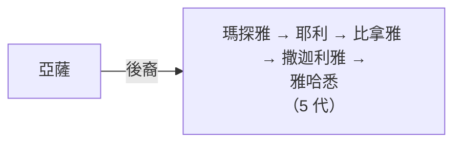
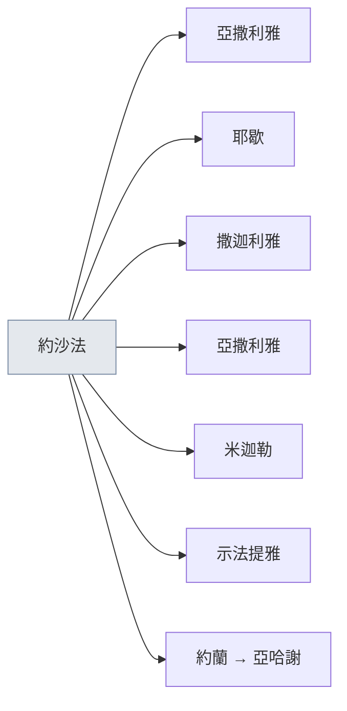
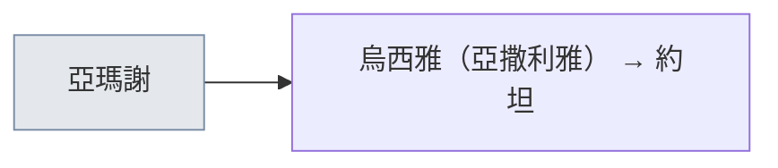

# 歷代志下 猶大列王人物圖

> 歷代志人物系列：[[appendix/歷代志上的完整人物支線圖|族譜（代上 1–9）]] · [[appendix/歷代志上的大衛王朝人物圖|大衛王朝（代上 10–29）]] · **猶大列王（代下）** · [[appendix/南北國列王對照|南北國列王對照]] · [[appendix/歷代志人物總覽|總覽]]

歷代志下從所羅門寫到猶大亡國，幾乎只寫猶大的王；北國以色列的王只在和猶大有往來的地方出現。下面每位王一張卡片，列出經文寫的父親、母親、登基年歲、在位年數、評語和葬在哪裡，再列出這位王在位時出現的人。人名照和合本。

<!-- 本頁由 appendix/genealogy/build_genealogy.py 從 appendix/genealogy/歷代志下/ 的資料檔產生，請改資料檔，不要直接改本頁。 -->

> [!info] 怎麼讀這份圖
> - 卡片的記號：● 行正、●但 行正另有但書、◐ 好轉壞、◑ 壞轉好、○ 行惡、— 沒有評語；※ 表示歷代志和列王紀的寫法不同。分類照經文評語的原句，詳見南北國列王對照。
> - 卡片的年代照 Thiele 年表，數字前面加「約」；經文本身沒有公元年份。
> - `12:13` 這樣的灰字是經節；沒寫書名的都是歷代志下。
> - 人名一律照和合本；列王紀寫法不同的，見文末「平行經文對照」。

## 總覽

### 從所羅門到被擄

```mermaid
flowchart LR
  s0["所羅門<br/><small>1–9 章</small>"]
  s1["羅波安 → 亞比雅 → 亞撒 → 約沙法<br/><small>10–20 章</small>"]
  s0 --> s1
  s2["約蘭 → 亞哈謝 → 亞他利雅 → 約阿施<br/><small>21–24 章</small>"]
  s1 --> s2
  s3["亞瑪謝 → 烏西雅 → 約坦 → 亞哈斯<br/><small>25–28 章</small>"]
  s2 --> s3
  s4["希西家 → 瑪拿西 → 亞們 → 約西亞<br/><small>29–35 章</small>"]
  s3 --> s4
  s5["約哈斯 → 約雅敬 → 約雅斤 → 西底家<br/><small>36:1–21</small>"]
  s4 --> s5
  s6["古列的詔書<br/><small>36:22–23</small>"]
  s5 --> s6
  classDef main fill:#d4a82e44,stroke:#c9971c,stroke-width:2px,font-weight:bold
  classDef none fill:#80808018,stroke:#999,stroke-dasharray:4 3
  class s0,s1,s2,s3,s4,s5,s6 main
```



### 篇幅分給了誰

每位王在歷代志下佔幾節：

```text
所羅門　　 ██████████████████████████████ 201 節
希西家　　 █████████████████ 117 節
約沙法　　 ███████████████ 102 節
約西亞　　 █████████ 60 節
羅波安　　 █████████ 58 節
亞撒　　　 ███████ 47 節
亞瑪謝　　 ████ 28 節
約阿施　　 ████ 27 節
亞哈斯　　 ████ 27 節
亞他利雅　 ████ 24 節
亞比雅　　 ███ 23 節
烏西雅　　 ███ 23 節
瑪拿西　　 ███ 20 節
約蘭　　　 ███ 19 節
西底家　　 ██ 11 節
亞哈謝　　 █ 9 節
約坦　　　 █ 9 節
亞們　　　 █ 5 節
約哈斯　　 █ 4 節
約雅敬　　 █ 4 節
約雅斤　　 █ 2 節
古列的詔書 █ 2 節
```

### 目錄

- **[[#所羅門（1–9 章）|所羅門（1–9 章）]]**
  - [[#所羅門|所羅門]]　`1:1–17`
  - [[#建殿的人|建殿的人]]　`2:1–5:1`
  - [[#約櫃入殿和奉獻聖殿|約櫃入殿和奉獻聖殿]]　`5:2–7:22`
  - [[#所羅門的國事和示巴女王|所羅門的國事和示巴女王]]　`8:1–9:31`
- **[[#羅波安（10–12 章）|羅波安（10–12 章）]]**
  - [[#羅波安和王國分裂|羅波安和王國分裂]]　`10:1–11:4`
  - [[#羅波安的城邑和家室|羅波安的城邑和家室]]　`11:5–23`
  - [[#埃及王示撒攻打耶路撒冷|埃及王示撒攻打耶路撒冷]]　`12:1–16`
- **[[#亞比雅（13 章）|亞比雅（13 章）]]**
  - [[#亞比雅|亞比雅]]　`13:1–14:1`
- **[[#亞撒（14–16 章）|亞撒（14–16 章）]]**
  - [[#亞撒|亞撒]]　`14:2–16:14`
- **[[#約沙法（17–20 章）|約沙法（17–20 章）]]**
  - [[#約沙法強盛|約沙法強盛]]　`17:1–19`
  - [[#約沙法和亞哈結親|約沙法和亞哈結親]]　`18:1–19:3`
  - [[#設立審判官|設立審判官]]　`19:4–11`
  - [[#摩押人和亞捫人來攻|摩押人和亞捫人來攻]]　`20:1–30`
  - [[#約沙法晚年|約沙法晚年]]　`20:31–21:1`
- **[[#約蘭（21 章）|約蘭（21 章）]]**
  - [[#約蘭|約蘭]]　`21:2–20`
- **[[#亞哈謝和亞他利雅（22–23 章）|亞哈謝和亞他利雅（22–23 章）]]**
  - [[#亞哈謝|亞哈謝]]　`22:1–9`
  - [[#亞他利雅和耶何耶大|亞他利雅和耶何耶大]]　`22:10–23:21`
- **[[#約阿施（24 章）|約阿施（24 章）]]**
  - [[#約阿施|約阿施]]　`24:1–27`
- **[[#亞瑪謝（25 章）|亞瑪謝（25 章）]]**
  - [[#亞瑪謝|亞瑪謝]]　`25:1–28`
- **[[#烏西雅和約坦（26–27 章）|烏西雅和約坦（26–27 章）]]**
  - [[#烏西雅|烏西雅]]　`26:1–23`
  - [[#約坦|約坦]]　`27:1–9`
- **[[#亞哈斯（28 章）|亞哈斯（28 章）]]**
  - [[#亞哈斯|亞哈斯]]　`28:1–27`
- **[[#希西家（29–32 章）|希西家（29–32 章）]]**
  - [[#希西家潔淨聖殿|希西家潔淨聖殿]]　`29:1–36`
  - [[#守逾越節|守逾越節]]　`30:1–27`
  - [[#管理奉獻的祭司和利未人|管理奉獻的祭司和利未人]]　`31:1–21`
  - [[#亞述王西拿基立圍城|亞述王西拿基立圍城]]　`32:1–33`
- **[[#瑪拿西和亞們（33 章）|瑪拿西和亞們（33 章）]]**
  - [[#瑪拿西|瑪拿西]]　`33:1–20`
  - [[#亞們|亞們]]　`33:21–25`
- **[[#約西亞（34–35 章）|約西亞（34–35 章）]]**
  - [[#約西亞的改革和律法書|約西亞的改革和律法書]]　`34:1–33`
  - [[#約西亞守逾越節和戰死|約西亞守逾越節和戰死]]　`35:1–27`
- **[[#末後的四王和古列的詔書（36 章）|末後的四王和古列的詔書（36 章）]]**
  - [[#約哈斯|約哈斯]]　`36:1–4`
  - [[#約雅敬|約雅敬]]　`36:5–8`
  - [[#約雅斤|約雅斤]]　`36:9–10`
  - [[#西底家和耶路撒冷陷落|西底家和耶路撒冷陷落]]　`36:11–21`
  - [[#古列的詔書|古列的詔書]]　`36:22–23`
- **[[#附表|附表]]**
  - [[#平行經文對照|平行經文對照]]
  - [[#同名不同人|同名不同人]]
  - [[#經文記下的人數|經文記下的人數]]
  - [[#歷代志引用的史書|歷代志引用的史書]]
  - [[#先知與祭司|先知與祭司]]

---

## 所羅門（1–9 章）

### 所羅門

`1:1–17`　所羅門登基後到基遍的會幕獻祭。神在夜間向他顯現，他求智慧，神應許也賜他資財和尊榮。

> [!example] 所羅門　◐※ 好轉壞　約主前 970–931（推估）
> | 項目 | 內容 | 經節 |
> |---|---|---|
> | 父親 | 大衛 | `1:1` |
> | 母親 | 拔示巴 | `王上 2:13` |
> | 在位 | 四十年 | `9:30` |
> | 先知、先見、祭司 | 先知拿單、先見易多 | `9:29` |
> | 葬在哪裡 | 「葬在他父大衛城裡」 | `9:31` |
> | 列王紀 | 王上 2:12–11:43 | `王上 2:12` |
> | 年代 | 約主前 970–931（推估） |  |
>
> 南北國對照：[[appendix/南北國列王對照#所羅門|所羅門]]

> [!abstract]+ 完整名單（2 人）
> - 大衛 → 所羅門　`1:1`

| 人名 | 經文的介紹 | 經節 |
|---|---|---|
| 比撒列 | 戶珥的孫子、烏利的兒子 | `1:5` |

[[#目錄|↑ 回到目錄]] · [[#歷代志下 猶大列王人物圖|回到頂部]]

### 建殿的人

`2:1–5:1`　所羅門請推羅王希蘭供應木料和匠人，希蘭差來一位巧匠，經文稱他戶蘭。殿從所羅門作王第四年二月開工。

| 人名 | 經文的介紹 | 經節 |
|---|---|---|
| 希蘭<br/><small>又見 [[#建殿的人\|2:11]]、[[#所羅門的國事和示巴女王\|8:2]]、[[#所羅門的國事和示巴女王\|8:18]]</small> | 推羅王 | `2:3` |
| 希蘭<br/><small>又見 [[#建殿的人\|2:3]]、[[#所羅門的國事和示巴女王\|8:2]]、[[#所羅門的國事和示巴女王\|8:18]]</small> | 推羅王 | `2:11` |

**希蘭的父親**　`2:13`

| 人名 | 經文的介紹 | 經節 |
|---|---|---|
| 希蘭 | 我父親 | `2:13` |

| 次序 | 人名 | 經文的介紹 | 經節 |
|---|---|---|---|
|  | 阿珥楠 | 耶布斯人 | `3:1` |
| 做完了神殿的工 | 戶蘭<br/><small>又見 [[#建殿的人\|4:16]]</small> |  | `4:11` |
|  | 戶蘭<br/><small>又見 [[#建殿的人\|4:11]]</small> | 巧匠 | `4:16` |

[[#目錄|↑ 回到目錄]] · [[#歷代志下 猶大列王人物圖|回到頂部]]

### 約櫃入殿和奉獻聖殿

`5:2–7:22`　祭司和利未人把約櫃抬進至聖所，雲彩充滿了殿。所羅門跪在會眾面前禱告，火從天降下，耶和華的榮光充滿了殿。

**站在壇東邊歌唱的利未人**　`5:12`

| 人名 | 經文的介紹 | 經節 |
|---|---|---|
| 亞薩<br/><small>又見 [[#希西家潔淨聖殿\|29:30]]、[[#約西亞守逾越節和戰死\|35:15]]；族譜見 [[#摩押人和亞捫人來攻\|20:14]]</small> | 歌唱的利未人 | `5:12` |
| 希幔<br/><small>又見 [[#約西亞守逾越節和戰死\|35:15]]</small> | 歌唱的利未人 | `5:12` |
| 耶杜頓<br/><small>又見 [[#約西亞守逾越節和戰死\|35:15]]</small> | 歌唱的利未人 | `5:12` |

[[#目錄|↑ 回到目錄]] · [[#歷代志下 猶大列王人物圖|回到頂部]]

### 所羅門的國事和示巴女王

`8:1–9:31`　所羅門建造城邑、按大衛所定的派祭司和利未人的班次。示巴女王來訪，看見他的智慧和財富。他作王四十年，死後葬在大衛城。

> [!abstract]+ 完整名單（1 人）
> - 所羅門　`1:1`
>   - 羅波安　`9:31`

| 人名 | 經文的介紹 | 經節 |
|---|---|---|
| 希蘭<br/><small>又見 [[#建殿的人\|2:3]]、[[#建殿的人\|2:11]]、[[#所羅門的國事和示巴女王\|8:18]]</small> |  | `8:2` |
| 大衛<br/><small>族譜見 [[#所羅門\|1:1]]</small> | 神人 | `8:14` |
| 希蘭<br/><small>又見 [[#建殿的人\|2:3]]、[[#建殿的人\|2:11]]、[[#所羅門的國事和示巴女王\|8:2]]</small> |  | `8:18` |
| 示巴女王 |  | `9:1` |

**記載所羅門事蹟的先知和先見**　`9:29`

| 人名 | 經文的介紹 | 經節 |
|---|---|---|
| 拿單<br/><small>又見 [[#希西家潔淨聖殿\|29:25]]</small> | 先知 | `9:29` |
| 亞希雅<br/><small>又見 [[#羅波安和王國分裂\|10:15]]</small> | 示羅人 | `9:29` |
| 易多<br/><small>又見 [[#埃及王示撒攻打耶路撒冷\|12:15]]、[[#亞比雅\|13:22]]</small> | 先見 | `9:29` |
| 耶羅波安<br/><small>族譜見 [[#羅波安和王國分裂\|10:2]]</small> | 尼八兒子 | `9:29` |

[[#目錄|↑ 回到目錄]] · [[#歷代志下 猶大列王人物圖|回到頂部]]

---

## 羅波安（10–12 章）

### 羅波安和王國分裂

`10:1–11:4`　羅波安在示劍不聽老年人的勸告，北方的支派就跟從耶羅波安。他要出兵，神人示瑪雅傳耶和華的話攔阻了他。

> [!example] 羅波安　◐※ 好轉壞　約主前 931–913
> | 項目 | 內容 | 經節 |
> |---|---|---|
> | 父親 | 所羅門 | `10:6` |
> | 母親 | 「羅波安的母親名叫拿瑪，是亞捫人」 | `12:13` |
> | 登基年歲 | 四十一歲 | `12:13` |
> | 在位 | 十七年 | `12:13` |
> | 先知、先見、祭司 | 先知示瑪雅、先見易多 | `12:15` |
> | 葬在哪裡 | 「葬在大衛城裡」 | `12:16` |
> | 列王紀 | 王上 14:21–31 | `王上 14:21` |
> | 轉變 | 「羅波安的國堅立，他強盛的時候就離棄耶和華的律法」 | `代下 12:1` |
> | 轉變 | 「王自卑的時候，耶和華的怒氣就轉消了」 | `代下 12:12` |
> | 評語 | 「羅波安行惡，因他不立定心意尋求耶和華」 | `代下 12:14` |
> | 年代 | 約主前 931–913（Thiele） |  |
>
> 南北國對照：[[appendix/南北國列王對照#羅波安|羅波安]]

> [!abstract]+ 完整名單（2 人）
> - 尼八 → 耶羅波安　`10:2`

| 人名 | 經文的介紹 | 經節 |
|---|---|---|
| 亞希雅<br/><small>又見 [[#所羅門的國事和示巴女王\|9:29]]</small> | 示羅人 | `10:15` |
| 哈多蘭 | 掌管服苦之人 | `10:18` |
| 示瑪雅<br/><small>又見 [[#埃及王示撒攻打耶路撒冷\|12:5]]、[[#埃及王示撒攻打耶路撒冷\|12:15]]</small> | 神人 | `11:2` |

[[#目錄|↑ 回到目錄]] · [[#歷代志下 猶大列王人物圖|回到頂部]]

### 羅波安的城邑和家室

`11:5–23`　羅波安修築猶大的堅固城，北國的祭司和利未人投奔猶大。他娶了十八個妻、立了六十個妾，最愛押沙龍的女兒瑪迦，立瑪迦的兒子亞比雅作太子。

> [!abstract]+ 完整名單（7 人）
> - 羅波安　`9:31`
>   - 耶烏施　`11:18–19`
>   - 示瑪利雅　`11:18–19`
>   - 撒罕　`11:18–19`
>   - *瑪迦所生*
>     - 亞比雅　`11:20–21`
>     - 亞太　`11:20–21`
>     - 細撒　`11:20–21`
>     - 示羅密　`11:20–21`

**羅波安娶的妻**　`11:18`

| 人名 | 經文的介紹 | 經節 |
|---|---|---|
| 瑪哈拉 | 大衛兒子耶利摩的女兒 | `11:18` |
| 亞比孩 | 耶西兒子以利押的女兒 | `11:18` |

**羅波安後來娶的妻**　`11:20`

| 人名 | 經文的介紹 | 經節 |
|---|---|---|
| 瑪迦<br/><small>又見 [[#亞撒\|15:16]]</small> | 押沙龍的女兒 | `11:20` |

| 次序 | 人名 | 經文的介紹 | 經節 |
|---|---|---|---|
| 作太子 | 亞比雅<br/><small>族譜見 [[#羅波安的城邑和家室\|11:20–21]]</small> |  | `11:22` |

[[#目錄|↑ 回到目錄]] · [[#歷代志下 猶大列王人物圖|回到頂部]]

### 埃及王示撒攻打耶路撒冷

`12:1–16`　羅波安強盛以後離棄耶和華的律法，埃及王示撒攻破猶大的堅固城。先知示瑪雅傳話後，王和首領自卑。

| 人名 | 經文的介紹 | 經節 |
|---|---|---|
| 示撒 | 埃及王 | `12:2` |
| 示瑪雅<br/><small>又見 [[#羅波安和王國分裂\|11:2]]、[[#埃及王示撒攻打耶路撒冷\|12:15]]</small> | 先知 | `12:5` |

**羅波安的母親**　`12:13`

| 次序 | 人名 | 經文的介紹 | 經節 |
|---|---|---|---|
| 羅波安的母親 | 拿瑪 | 亞捫人 | `12:13` |

**記載羅波安事蹟的先知和先見**　`12:15`

| 人名 | 經文的介紹 | 經節 |
|---|---|---|
| 示瑪雅<br/><small>又見 [[#羅波安和王國分裂\|11:2]]、[[#埃及王示撒攻打耶路撒冷\|12:5]]</small> | 先知 | `12:15` |
| 易多<br/><small>又見 [[#所羅門的國事和示巴女王\|9:29]]、[[#亞比雅\|13:22]]</small> | 先見 | `12:15` |

[[#目錄|↑ 回到目錄]] · [[#歷代志下 猶大列王人物圖|回到頂部]]

---

## 亞比雅（13 章）

### 亞比雅

`13:1–14:1`　亞比雅和耶羅波安在洗瑪臉山交戰。亞比雅向以色列人喊話，猶大人倚靠耶和華得勝。

> [!example] 亞比雅　○※ 行惡　約主前 913–911
> | 項目 | 內容 | 經節 |
> |---|---|---|
> | 父親 | 羅波安 | `12:16` |
> | 母親 | 「他母親名叫米該亞【又作瑪迦】，是基比亞人烏列的女兒」 | `13:2` |
> | 在位 | 三年 | `13:2` |
> | 先知、先見、祭司 | 先知易多 | `13:22` |
> | 葬在哪裡 | 「葬在大衛城裡」 | `14:1` |
> | 列王紀 | 王上 15:1–8 | `王上 15:1` |
> | 年代 | 約主前 913–911（Thiele） |  |
>
> 南北國對照：[[appendix/南北國列王對照#亞比雅|亞比雅]]

> [!abstract]+ 完整名單（1 人）
> - 亞比雅　`11:20–21`
>   - 亞撒　`14:1`

**亞比雅的母親**　`13:2`

| 次序 | 人名 | 經文的介紹 | 經節 |
|---|---|---|---|
| 他母親 | 米該亞 | 基比亞人烏列的女兒 | `13:2` |

| 人名 | 經文的介紹 | 經節 |
|---|---|---|
| 易多<br/><small>又見 [[#所羅門的國事和示巴女王\|9:29]]、[[#埃及王示撒攻打耶路撒冷\|12:15]]</small> | 先知 | `13:22` |

[[#目錄|↑ 回到目錄]] · [[#歷代志下 猶大列王人物圖|回到頂部]]

---

## 亞撒（14–16 章）

### 亞撒

`14:2–16:14`　亞撒除掉外邦的祭壇，打敗古實人謝拉；先知亞撒利雅勸勉他，他就與百姓立約尋求耶和華。晚年他倚靠亞蘭王，責備他的先見哈拿尼被他囚在監裡。

> [!example] 亞撒　◐※ 好轉壞　約主前 911–870
> | 項目 | 內容 | 經節 |
> |---|---|---|
> | 父親 | 亞比雅 | `14:1` |
> | 祖母 | 瑪迦 | `15:16` |
> | 在位 | 四十一年 | `16:13` |
> | 先知、先見、祭司 | 先知亞撒利雅、先見哈拿尼 | `15:8, 16:7` |
> | 葬在哪裡 | 「葬在大衛城自己所鑿的墳墓裡」 | `16:14` |
> | 列王紀 | 王上 15:9–24 | `王上 15:9` |
> | 評語 | 「亞撒行耶和華─他神眼中看為善為正的事」 | `代下 14:2` |
> | 轉變 | 「因你仰賴亞蘭王，沒有仰賴耶和華─你的神」 | `代下 16:7` |
> | 轉變 | 「病的時候沒有求耶和華，只求醫生」 | `代下 16:12` |
> | 年代 | 約主前 911–870（Thiele） |  |
>
> 南北國對照：[[appendix/南北國列王對照#亞撒|亞撒]]

| 人名 | 經文的介紹 | 經節 |
|---|---|---|
| 謝拉 | 古實王 | `14:9` |
| 亞撒利雅<br/><small>又見 [[#亞撒\|15:8]]</small> | 俄德的兒子 | `15:1` |
| 亞撒利雅<br/><small>又見 [[#亞撒\|15:1]]</small> | 先知 | `15:8` |
| 瑪迦<br/><small>又見 [[#羅波安的城邑和家室\|11:20]]</small> | 祖母 | `15:16` |
| 巴沙 | 以色列王 | `16:1` |
| 便哈達 | 亞蘭王 | `16:2` |
| 哈拿尼<br/><small>族譜見 [[#約沙法和亞哈結親\|19:2]]</small> | 先見 | `16:7` |

[[#目錄|↑ 回到目錄]] · [[#歷代志下 猶大列王人物圖|回到頂部]]

---

## 約沙法（17–20 章）

### 約沙法強盛

`17:1–19`　約沙法差派首領、利未人和祭司帶著律法書到猶大各城教訓百姓。這一章也列出他在耶路撒冷的軍長和兵數。

> [!example] 約沙法　●但 行正，另有但書　約主前 870–848（約主前 872 起共治）
> | 項目 | 內容 | 經節 |
> |---|---|---|
> | 父親 | 亞撒 | `17:1` |
> | 母親 | 「他母親名叫阿蘇巴，乃示利希的女兒」 | `20:31` |
> | 登基年歲 | 三十五歲 | `20:31` |
> | 在位 | 二十五年 | `20:31` |
> | 先知、先見、祭司 | 祭司以利沙瑪、約蘭，先見哈拿尼，大祭司亞瑪利雅 | `17:8, 19:2, 19:11` |
> | 葬在哪裡 | 「葬在大衛城他列祖的墳地裡」 | `21:1` |
> | 列王紀 | 王上 22:41–50 | `王上 22:41` |
> | 評語 | 「行耶和華眼中看為正的事」 | `代下 20:32` |
> | 但書 | 「只是邱壇還沒有廢去」 | `代下 20:33` |
> | 年代 | 約主前 870–848（約主前 872 起共治）（Thiele） |  |
>
> 南北國對照：[[appendix/南北國列王對照#約沙法|約沙法]]

> [!abstract]+ 完整名單（1 人）
> - 亞撒　`14:1`
>   - 約沙法　`17:1`

**差去教訓百姓的臣子**　`17:7`

| 人名 | 經文的介紹 | 經節 |
|---|---|---|
| 便亥伊勒 | 臣子 | `17:7` |
| 俄巴底 | 臣子 | `17:7` |
| 撒迦利雅 | 臣子 | `17:7` |
| 拿坦業 | 臣子 | `17:7` |
| 米該亞 | 臣子 | `17:7` |

**同去的利未人和祭司**　`17:8`

| 人名 | 經文的介紹 | 經節 |
|---|---|---|
| 示瑪雅 | 利未人 | `17:8` |
| 尼探雅 | 利未人 | `17:8` |
| 西巴第雅 | 利未人 | `17:8` |
| 亞撒黑 | 利未人 | `17:8` |
| 示米拉末 | 利未人 | `17:8` |
| 約拿單 | 利未人 | `17:8` |
| 亞多尼雅 | 利未人 | `17:8` |
| 多比雅 | 利未人 | `17:8` |
| 駝巴多尼雅 | 利未人 | `17:8` |
| 以利沙瑪 | 祭司 | `17:8` |
| 約蘭 | 祭司 | `17:8` |

**約沙法的軍長和兵數**　`17:14–18`

| 次序 | 人名 | 經文的介紹 | 人數 | 經節 |
|---|---|---|---|---|
| 為首 | 押拿 | 千夫長 | 三十萬 | `17:14` |
| 其次 | 約哈難 | 千夫長 | 二十八萬 | `17:15` |
| 其次 | 亞瑪斯雅 | 細基利的兒子 | 二十萬 | `17:16` |
| 便雅憫族 | 以利雅大 | 大能的勇士 | 二十萬 | `17:17` |
| 其次 | 約薩拔 |  | 十八萬 | `17:18` |

[[#目錄|↑ 回到目錄]] · [[#歷代志下 猶大列王人物圖|回到頂部]]

### 約沙法和亞哈結親

`18:1–19:3`　約沙法和亞哈結親，一同上基列的拉末。四百個先知都說可以上去，只有米該雅說亞哈必敗。亞哈中箭而死，約沙法回來，被先見耶戶責備。

> [!abstract]+ 完整名單（2 人）
> - 哈拿尼 → 耶戶　`19:2`

| 人名 | 經文的介紹 | 經節 |
|---|---|---|
| 亞哈 | 以色列王 | `18:3` |
| 米該雅 | 音拉的兒子 | `18:7` |
| 西底家<br/><small>又見 [[#約沙法和亞哈結親\|18:23]]</small> | 基拿拿的兒子 | `18:10` |
| 西底家<br/><small>又見 [[#約沙法和亞哈結親\|18:10]]</small> | 基拿拿的兒子 | `18:23` |

**受命看守米該雅的人**　`18:25`

| 人名 | 經文的介紹 | 經節 |
|---|---|---|
| 亞們 | 邑宰 | `18:25` |
| 約阿施 | 王的兒子 | `18:25` |

[[#目錄|↑ 回到目錄]] · [[#歷代志下 猶大列王人物圖|回到頂部]]

### 設立審判官

`19:4–11`　約沙法在猶大各城設立審判官，又在耶路撒冷派利未人、祭司和族長審判，由大祭司亞瑪利雅和西巴第雅分管。

**約沙法所派管理審判的人**　`19:11`

| 人名 | 經文的介紹 | 經節 |
|---|---|---|
| 亞瑪利雅 | 大祭司 | `19:11` |
| 西巴第雅 | 猶大支派的族長以實瑪利的兒子 | `19:11` |

[[#目錄|↑ 回到目錄]] · [[#歷代志下 猶大列王人物圖|回到頂部]]

### 摩押人和亞捫人來攻

`20:1–30`　摩押、亞捫和米烏尼人來攻，約沙法宣告禁食。耶和華的靈臨到利未人雅哈悉，他說「勝敗不在乎你們，乃在乎神」。敵軍彼此自相擊殺。



> [!abstract]+ 完整名單（6 人）
> - 亞薩　`20:14`
>   - 〔後裔〕瑪探雅 → 耶利 → 比拿雅 → 撒迦利雅 → 雅哈悉　*（5 代）*　`20:14`

[[#目錄|↑ 回到目錄]] · [[#歷代志下 猶大列王人物圖|回到頂部]]

### 約沙法晚年

`20:31–21:1`　約沙法作王二十五年。他和以色列王亞哈謝合夥造船，先知以利以謝說船必破壞，後來船果然破壞了。

**約沙法的母親**　`20:31`

| 次序 | 人名 | 經文的介紹 | 經節 |
|---|---|---|---|
| 他母親 | 阿蘇巴 | 示利希的女兒 | `20:31` |

| 人名 | 經文的介紹 | 經節 |
|---|---|---|
| 亞哈謝 | 以色列王 | `20:35` |
| 以利以謝 | 瑪利沙人、多大瓦的兒子 | `20:37` |

[[#目錄|↑ 回到目錄]] · [[#歷代志下 猶大列王人物圖|回到頂部]]

---

## 約蘭（21 章）

### 約蘭

`21:2–20`　約沙法有七個兒子，約蘭登基以後把兄弟都殺了。他娶亞哈的女兒為妻，行亞哈家的道。以利亞寫信給他，宣告他要患腸病。

> [!example] 約蘭　○ 行惡　約主前 848–841（約主前 853 起共治）
> | 項目 | 內容 | 經節 |
> |---|---|---|
> | 父親 | 約沙法 | `21:1` |
> | 登基年歲 | 三十二歲 | `21:5` |
> | 在位 | 八年 | `21:5` |
> | 先知、先見、祭司 | 先知以利亞 | `21:12` |
> | 葬在哪裡 | 「眾人葬他在大衛城，只是不在列王的墳墓裡」 | `21:20` |
> | 列王紀 | 王下 8:16–24 | `王下 8:16` |
> | 評語 | 「行耶和華眼中看為惡的事」 | `代下 21:6` |
> | 年代 | 約主前 848–841（約主前 853 起共治）（Thiele） |  |
>
> 南北國對照：[[appendix/南北國列王對照#約蘭（猶大）|約蘭]]



> [!abstract]+ 完整名單（8 人）
> - 約沙法　`17:1`
>   - 亞撒利雅　`21:2`
>   - 耶歇　`21:2`
>   - 撒迦利雅　`21:2`
>   - 亞撒利雅　`21:2`
>   - 米迦勒　`21:2`
>   - 示法提雅　`21:2`
>   - 約蘭（長子） → 亞哈謝（21:16–17 起作約哈斯；22:6 作亞撒利雅；小兒子）　`21:2–3、21:16–17`

| 人名 | 經文的介紹 | 經節 |
|---|---|---|
| 以利亞 | 先知 | `21:12` |

[[#目錄|↑ 回到目錄]] · [[#歷代志下 猶大列王人物圖|回到頂部]]

---

## 亞哈謝和亞他利雅（22–23 章）

### 亞哈謝

`22:1–9`　亞哈謝聽從母親亞他利雅和亞哈家的計謀，去探望以色列王約蘭時，被耶戶殺了。

> [!example] 亞哈謝　○ 行惡　約主前 841
> | 項目 | 內容 | 經節 |
> |---|---|---|
> | 父親 | 約蘭 | `22:1` |
> | 母親 | 「他母親名叫亞他利雅，是暗利的孫女」 | `22:2` |
> | 登基年歲 | 四十二歲 | `22:2` |
> | 在位 | 一年 | `22:2` |
> | 葬在哪裡 | 「將他葬埋」 | `22:9` |
> | 列王紀 | 王下 8:25–9:28 | `王下 8:25` |
> | 評語 | 「他行耶和華眼中看為惡的事，像亞哈家一樣」 | `代下 22:4` |
> | 年代 | 約主前 841（Thiele） |  |
>
> 南北國對照：[[appendix/南北國列王對照#亞哈謝（猶大）|亞哈謝]]

**亞哈謝的母親**　`22:2`

| 次序 | 人名 | 經文的介紹 | 經節 |
|---|---|---|---|
| 他母親 | 亞他利雅<br/><small>又見 [[#亞他利雅和耶何耶大\|22:10]]</small> | 暗利的孫女 | `22:2` |

| 人名 | 經文的介紹 | 經節 |
|---|---|---|
| 約蘭<br/><small>又見 [[#亞哈謝\|22:6]]</small> | 以色列王亞哈的兒子 | `22:5` |
| 哈薛 | 亞蘭王 | `22:5` |
| 約蘭<br/><small>又見 [[#亞哈謝\|22:5]]</small> | 亞哈的兒子 | `22:6` |
| 耶戶 | 寧示的孫子 | `22:7` |

[[#目錄|↑ 回到目錄]] · [[#歷代志下 猶大列王人物圖|回到頂部]]

### 亞他利雅和耶何耶大

`22:10–23:21`　亞他利雅剿滅王室，自己作王。約示巴把亞哈謝的兒子約阿施藏在殿裡六年；第七年，祭司耶何耶大和百夫長立約阿施作王，殺了亞他利雅。

> [!example] 亞他利雅　— 沒有評語　約主前 841–835
> | 項目 | 內容 | 經節 |
> |---|---|---|
> | 在位 | 六年 | `22:12` |
> | 先知、先見、祭司 | 祭司耶何耶大、巴力的祭司瑪坦 | `22:11, 23:17` |
> | 列王紀 | 王下 11:1–20 | `王下 11:1` |
> | 年代 | 約主前 841–835（Thiele） |  |
>
> 南北國對照：[[appendix/南北國列王對照#亞他利雅|亞他利雅]]

> [!abstract]+ 完整名單（1 人）
> - 亞哈謝（21:16–17 起作約哈斯；22:6 作亞撒利雅；小兒子）　`21:16–17`
>   - 約阿施　`22:11`

| 人名 | 經文的介紹 | 經節 |
|---|---|---|
| 亞他利雅<br/><small>又見 [[#亞哈謝\|22:2]]</small> | 亞哈謝的母親 | `22:10` |

**救出約阿施的人**　`22:11`

| 人名 | 經文的介紹 | 經節 |
|---|---|---|
| 約示巴 | 約蘭王的女兒，亞哈謝的妹子，祭司耶何耶大的妻 | `22:11` |
| 耶何耶大<br/><small>又見 [[#約阿施\|24:2]]、[[#約阿施\|24:6]]；族譜見 [[#約阿施\|24:20]]</small> | 祭司 | `22:11` |

**耶何耶大召來立約的百夫長**　`23:1`

| 次序 | 人名 | 經文的介紹 | 經節 |
|---|---|---|---|
| 百夫長 | 亞撒利雅 | 耶羅罕的兒子 | `23:1` |
| 百夫長 | 以實瑪利 | 約哈難的兒子 | `23:1` |
| 百夫長 | 亞撒利雅 | 俄備得的兒子 | `23:1` |
| 百夫長 | 瑪西雅 | 亞大雅的兒子 | `23:1` |
| 百夫長 | 以利沙法 | 細基利的兒子 | `23:1` |

| 人名 | 經文的介紹 | 經節 |
|---|---|---|
| 瑪坦 | 巴力的祭司 | `23:17` |

[[#目錄|↑ 回到目錄]] · [[#歷代志下 猶大列王人物圖|回到頂部]]

---

## 約阿施（24 章）

### 約阿施

`24:1–27`　約阿施在耶何耶大在世的時候重修聖殿。耶何耶大死後，他聽從眾首領，並吩咐人打死責備他的撒迦利雅。

> [!example] 約阿施　◐※ 好轉壞　約主前 835–796
> | 項目 | 內容 | 經節 |
> |---|---|---|
> | 父親 | 亞哈謝 | `22:11` |
> | 母親 | 「他母親名叫西比亞，是別是巴人」 | `24:1` |
> | 登基年歲 | 七歲 | `24:1` |
> | 在位 | 四十年 | `24:1` |
> | 先知、先見、祭司 | 大祭司耶何耶大 | `24:6` |
> | 葬在哪裡 | 「葬他在大衛城，只是不葬在列王的墳墓裡」 | `24:25` |
> | 列王紀 | 王下 11:21–12:21 | `王下 11:21` |
> | 評語 | 「約阿施行耶和華眼中看為正的事」 | `代下 24:2` |
> | 轉變 | 「耶何耶大死後，猶大的眾首領來朝拜王；王就聽從他們」 | `代下 24:17` |
> | 年代 | 約主前 835–796（Thiele） |  |
>
> 南北國對照：[[appendix/南北國列王對照#約阿施（猶大）|約阿施]]

> [!abstract]+ 完整名單（3 人）
> - 耶何耶大 → 撒迦利亞　`24:20`
> - 約阿施　`22:11`
>   - 亞瑪謝　`24:27`

**約阿施的母親**　`24:1`

| 次序 | 人名 | 經文的介紹 | 經節 |
|---|---|---|---|
| 他母親 | 西比亞 | 別是巴人 | `24:1` |

| 人名 | 經文的介紹 | 經節 |
|---|---|---|
| 耶何耶大<br/><small>又見 [[#亞他利雅和耶何耶大\|22:11]]、[[#約阿施\|24:6]]；族譜見 [[#約阿施\|24:20]]</small> | 祭司 | `24:2` |
| 耶何耶大<br/><small>又見 [[#亞他利雅和耶何耶大\|22:11]]、[[#約阿施\|24:2]]；族譜見 [[#約阿施\|24:20]]</small> | 大祭司 | `24:6` |

**背叛約阿施的人**　`24:26`

| 人名 | 經文的介紹 | 經節 |
|---|---|---|
| 撒拔 | 亞捫婦人示米押的兒子 | `24:26` |
| 約薩拔 | 摩押婦人示米利的兒子 | `24:26` |

[[#目錄|↑ 回到目錄]] · [[#歷代志下 猶大列王人物圖|回到頂部]]

---

## 亞瑪謝（25 章）

### 亞瑪謝

`25:1–28`　亞瑪謝打敗以東，卻把以東的神像帶回來敬拜。他向以色列王約阿施挑戰，被擒；後來逃到拉吉被殺。

> [!example] 亞瑪謝　◐※ 好轉壞　約主前 796–767
> | 項目 | 內容 | 經節 |
> |---|---|---|
> | 父親 | 約阿施 | `24:27` |
> | 母親 | 「他母親名叫約耶但，是耶路撒冷人」 | `25:1` |
> | 登基年歲 | 二十五歲 | `25:1` |
> | 在位 | 二十九年 | `25:1` |
> | 葬在哪裡 | 「葬在猶大京城他列祖的墳地裡」 | `25:28` |
> | 列王紀 | 王下 14:1–20 | `王下 14:1` |
> | 評語 | 「亞瑪謝行耶和華眼中看為正的事」 | `代下 25:2` |
> | 但書 | 「只是心不專誠」 | `代下 25:2` |
> | 轉變 | 「亞瑪謝殺了以東人回來，就把西珥的神像帶回」 | `代下 25:14` |
> | 年代 | 約主前 796–767（Thiele） |  |
>
> 南北國對照：[[appendix/南北國列王對照#亞瑪謝|亞瑪謝]]

**亞瑪謝的母親**　`25:1`

| 次序 | 人名 | 經文的介紹 | 經節 |
|---|---|---|---|
| 他母親 | 約耶但 | 耶路撒冷人 | `25:1` |

| 次序 | 人名 | 經文的介紹 | 經節 |
|---|---|---|---|
|  | 約阿施 | 耶戶的孫子、約哈斯的兒子、以色列王 | `25:17` |
| 所看守神殿裡的一切金銀 | 俄別以東 |  | `25:24` |

[[#目錄|↑ 回到目錄]] · [[#歷代志下 猶大列王人物圖|回到頂部]]

---

## 烏西雅和約坦（26–27 章）

### 烏西雅

`26:1–23`　烏西雅在撒迦利雅在世的時候定意尋求神。他強盛以後進殿燒香，八十個祭司攔阻他，他額上發出大痲瘋。

> [!example] 烏西雅　◐※ 好轉壞　約主前 767–740（約主前 792 起共治）
> | 項目 | 內容 | 經節 |
> |---|---|---|
> | 父親 | 亞瑪謝 | `26:1` |
> | 母親 | 「他母親名叫耶可利雅，是耶路撒冷人」 | `26:3` |
> | 登基年歲 | 十六歲 | `26:3` |
> | 在位 | 五十二年 | `26:3` |
> | 先知、先見、祭司 | 祭司亞撒利雅、先知以賽亞 | `26:17, 26:22` |
> | 葬在哪裡 | 「葬在王陵的田間他列祖的墳地裡」 | `26:23` |
> | 列王紀 | 王下 14:21–15:7 | `王下 14:21` |
> | 評語 | 「烏西雅行耶和華眼中看為正的事」 | `代下 26:4` |
> | 轉變 | 「他既強盛，就心高氣傲，以致行事邪僻」 | `代下 26:16` |
> | 年代 | 約主前 767–740（約主前 792 起共治）（Thiele） |  |
>
> 南北國對照：[[appendix/南北國列王對照#烏西雅|烏西雅]]



> [!abstract]+ 完整名單（2 人）
> - 亞瑪謝　`24:27`
>   - 烏西雅（26:1 作亞撒利雅） → 約坦　`26:1、26:21`

**烏西雅的母親**　`26:3`

| 次序 | 人名 | 經文的介紹 | 經節 |
|---|---|---|---|
| 他母親 | 耶可利雅 | 耶路撒冷人 | `26:3` |

| 人名 | 經文的介紹 | 經節 |
|---|---|---|
| 撒迦利亞 | 通曉神默示 | `26:5` |

**數點軍兵的人**　`26:11`

| 人名 | 經文的介紹 | 經節 |
|---|---|---|
| 耶利 | 書記 | `26:11` |
| 瑪西雅 | 官長 | `26:11` |
| 哈拿尼雅 | 王的一個將軍 | `26:11` |

| 人名 | 經文的介紹 | 經節 |
|---|---|---|
| 亞撒利雅<br/><small>又見 [[#烏西雅\|26:20]]</small> | 祭司 | `26:17` |
| 亞撒利雅<br/><small>又見 [[#烏西雅\|26:17]]</small> | 大祭司 | `26:20` |
| 以賽亞<br/><small>又見 [[#亞述王西拿基立圍城\|32:20]]、[[#亞述王西拿基立圍城\|32:32]]</small> | 亞摩斯的兒子先知 | `26:22` |

[[#目錄|↑ 回到目錄]] · [[#歷代志下 猶大列王人物圖|回到頂部]]

### 約坦

`27:1–9`　約坦建立耶和華殿的上門，打敗亞捫人，「行正道，以致日漸強盛」。

> [!example] 約坦　●但 行正，另有但書　約主前 740–732（約主前 750 起共治）
> | 項目 | 內容 | 經節 |
> |---|---|---|
> | 父親 | 烏西雅 | `26:23` |
> | 母親 | 「他母親名叫耶路沙，是撒督的女兒」 | `27:1` |
> | 登基年歲 | 二十五歲 | `27:1` |
> | 在位 | 十六年 | `27:1` |
> | 葬在哪裡 | 「葬在大衛城裡」 | `27:9` |
> | 列王紀 | 王下 15:32–38 | `王下 15:32` |
> | 評語 | 「約坦行耶和華眼中看為正的事」 | `代下 27:2` |
> | 但書 | 「只是不入耶和華的殿」 | `代下 27:2` |
> | 年代 | 約主前 740–732（約主前 750 起共治）（Thiele） |  |
>
> 南北國對照：[[appendix/南北國列王對照#約坦|約坦]]

> [!abstract]+ 完整名單（1 人）
> - 約坦　`26:21`
>   - 亞哈斯　`27:9`

**約坦的母親**　`27:1`

| 次序 | 人名 | 經文的介紹 | 經節 |
|---|---|---|---|
| 他母親 | 耶路沙 | 撒督的女兒 | `27:1` |

[[#目錄|↑ 回到目錄]] · [[#歷代志下 猶大列王人物圖|回到頂部]]

---

## 亞哈斯（28 章）

### 亞哈斯

`28:1–27`　亞哈斯拜巴力，又被亞蘭王和以色列王比加打敗。以色列擄走猶大人，先知俄德勸他們把俘虜送回。亞哈斯向亞述王求助，又封鎖耶和華殿的門。

> [!example] 亞哈斯　○ 行惡　約主前 732–716（約主前 735 起共治）
> | 項目 | 內容 | 經節 |
> |---|---|---|
> | 父親 | 約坦 | `27:9` |
> | 登基年歲 | 二十歲 | `28:1` |
> | 在位 | 十六年 | `28:1` |
> | 先知、先見、祭司 | 先知俄德 | `28:9` |
> | 葬在哪裡 | 「葬在耶路撒冷城裡，沒有送入以色列諸王的墳墓中」 | `28:27` |
> | 列王紀 | 王下 16:1–20 | `王下 16:1` |
> | 評語 | 「不像他祖大衛行耶和華眼中看為正的事」 | `代下 28:1` |
> | 年代 | 約主前 732–716（約主前 735 起共治）（Thiele） |  |
>
> 南北國對照：[[appendix/南北國列王對照#亞哈斯|亞哈斯]]

> [!abstract]+ 完整名單（1 人）
> - 亞哈斯　`27:9`
>   - 希西家　`28:27`

| 人名 | 經文的介紹 | 經節 |
|---|---|---|
| 比加 | 利瑪利的兒子 | `28:6` |

**以法蓮勇士細基利所殺的人**　`28:7`

| 人名 | 經文的介紹 | 經節 |
|---|---|---|
| 細基利 | 以法蓮中的勇士 | `28:7` |
| 瑪西雅 | 王的兒子 | `28:7` |
| 押斯利甘 | 管理王宮的 | `28:7` |
| 以利加拿 | 宰相 | `28:7` |

| 人名 | 經文的介紹 | 經節 |
|---|---|---|
| 俄德 | 耶和華的一個先知 | `28:9` |

**攔擋出兵回來的以法蓮族長**　`28:12`

| 次序 | 人名 | 經文的介紹 | 經節 |
|---|---|---|---|
| 以法蓮人的幾個族長 | 亞撒利雅 | 約哈難的兒子 | `28:12` |
| 以法蓮人的幾個族長 | 比利家 | 米實利末的兒子 | `28:12` |
| 以法蓮人的幾個族長 | 耶希西家 | 沙龍的兒子 | `28:12` |
| 以法蓮人的幾個族長 | 亞瑪撒 | 哈得萊的兒子 | `28:12` |

| 人名 | 經文的介紹 | 經節 |
|---|---|---|
| 提革拉毘尼色 | 亞述王 | `28:20` |

[[#目錄|↑ 回到目錄]] · [[#歷代志下 猶大列王人物圖|回到頂部]]

---

## 希西家（29–32 章）

### 希西家潔淨聖殿

`29:1–36`　希西家登基第一年正月就開了殿門，召利未人自潔，把殿裡的污穢搬出去。這一章點名了各家族起來潔淨聖殿的利未人。

> [!example] 希西家　●但※ 行正，另有但書　約主前 716–687
> | 項目 | 內容 | 經節 |
> |---|---|---|
> | 父親 | 亞哈斯 | `28:27` |
> | 母親 | 「他母親名叫亞比雅，是撒迦利雅的女兒」 | `29:1` |
> | 登基年歲 | 二十五歲 | `29:1` |
> | 在位 | 二十九年 | `29:1` |
> | 先知、先見、祭司 | 大祭司亞撒利雅、先知以賽亞 | `31:10, 32:20` |
> | 葬在哪裡 | 「葬在大衛子孫的高陵上」 | `32:33` |
> | 列王紀 | 王下 18:1–20:21 | `王下 18:1` |
> | 評語 | 「希西家行耶和華眼中看為正的事」 | `代下 29:2` |
> | 但書 | 「因他心裡驕傲」 | `代下 32:25` |
> | 年代 | 約主前 716–687（Thiele） |  |
>
> 南北國對照：[[appendix/南北國列王對照#希西家|希西家]]

**希西家的母親**　`29:1`

| 次序 | 人名 | 經文的介紹 | 經節 |
|---|---|---|---|
| 他母親 | 亞比雅 | 撒迦利雅的女兒 | `29:1` |

**起來潔淨聖殿的利未人（哥轄、米拉利、革順）**　`29:12`

| 次序 | 人名 | 經文的介紹 | 經節 |
|---|---|---|---|
| 哥轄的子孫 | 瑪哈 | 亞瑪賽的兒子 | `29:12` |
| 哥轄的子孫 | 約珥 | 亞撒利雅的兒子 | `29:12` |
| 米拉利的子孫 | 基士 | 亞伯底的兒子 | `29:12` |
| 米拉利的子孫 | 亞撒利雅 | 耶哈利勒的兒子 | `29:12` |
| 革順的子孫 | 約亞 | 薪瑪的兒子 | `29:12` |
| 革順的子孫 | 伊甸 | 約亞的兒子 | `29:12` |

**起來潔淨聖殿的利未人（以利撒反、亞薩）**　`29:13`

| 次序 | 人名 | 經文的介紹 | 經節 |
|---|---|---|---|
| 以利撒反的子孫 | 申利 |  | `29:13` |
| 以利撒反的子孫 | 耶利 |  | `29:13` |
| 亞薩的子孫 | 撒迦利雅 |  | `29:13` |
| 亞薩的子孫 | 瑪探雅 |  | `29:13` |

**起來潔淨聖殿的利未人（希幔、耶杜頓）**　`29:14`

| 次序 | 人名 | 經文的介紹 | 經節 |
|---|---|---|---|
| 希幔的子孫 | 耶歇 |  | `29:14` |
| 希幔的子孫 | 示每 |  | `29:14` |
| 耶杜頓的子孫 | 示瑪雅 |  | `29:14` |
| 耶杜頓的子孫 | 烏薛 |  | `29:14` |

**大衛所吩咐的先見和先知**　`29:25`

| 人名 | 經文的介紹 | 經節 |
|---|---|---|
| 迦得 | 先見 | `29:25` |
| 拿單<br/><small>又見 [[#所羅門的國事和示巴女王\|9:29]]</small> | 先知 | `29:25` |

| 人名 | 經文的介紹 | 經節 |
|---|---|---|
| 亞薩<br/><small>又見 [[#約櫃入殿和奉獻聖殿\|5:12]]、[[#約西亞守逾越節和戰死\|35:15]]；族譜見 [[#摩押人和亞捫人來攻\|20:14]]</small> | 先見 | `29:30` |

[[#目錄|↑ 回到目錄]] · [[#歷代志下 猶大列王人物圖|回到頂部]]

### 守逾越節

`30:1–27`　希西家打發人走遍以色列和猶大，請眾人到耶路撒冷守逾越節。有人戲笑那些傳信的人，也有人自卑來到耶路撒冷。

| 人名 | 經文的介紹 | 經節 |
|---|---|---|
| 摩西 | 神人 | `30:16` |

[[#目錄|↑ 回到目錄]] · [[#歷代志下 猶大列王人物圖|回到頂部]]

### 管理奉獻的祭司和利未人

`31:1–21`　百姓把奉獻的物積成堆，希西家派利未人分管庫房，再按班次分給眾祭司和利未人。

| 人名 | 經文的介紹 | 經節 |
|---|---|---|
| 亞撒利雅 | 撒督家的大祭司 | `31:10` |

**掌管倉房供物的利未人**　`31:12`

| 次序 | 人名 | 經文的介紹 | 經節 |
|---|---|---|---|
| 掌管這事 | 歌楠雅 | 利未人 | `31:12` |
| 為副管 | 示每 | 他兄弟 | `31:12` |

**歌楠雅和示每手下的督理**　`31:13`

| 次序 | 人名 | 經文的介紹 | 經節 |
|---|---|---|---|
| 督理 | 耶歇 |  | `31:13` |
| 督理 | 亞撒細雅 |  | `31:13` |
| 督理 | 拿哈 |  | `31:13` |
| 督理 | 亞撒黑 |  | `31:13` |
| 督理 | 耶利末 |  | `31:13` |
| 督理 | 約撒拔 |  | `31:13` |
| 督理 | 以列 |  | `31:13` |
| 督理 | 伊斯瑪基雅 |  | `31:13` |
| 督理 | 瑪哈 |  | `31:13` |
| 督理 | 比拿雅 |  | `31:13` |
|  | 亞撒利雅 | 管理神殿的 | `31:13` |

| 次序 | 人名 | 經文的介紹 | 經節 |
|---|---|---|---|
| 守東門的利未人 | 可利 | 音拿的兒子 | `31:14` |

**可利手下分發供物的人**　`31:15`

| 次序 | 人名 | 經文的介紹 | 經節 |
|---|---|---|---|
| 在他手下 | 伊甸 |  | `31:15` |
| 在他手下 | 珉雅珉 |  | `31:15` |
| 在他手下 | 耶書亞 |  | `31:15` |
| 在他手下 | 示瑪雅 |  | `31:15` |
| 在他手下 | 亞瑪利雅 |  | `31:15` |
| 在他手下 | 示迦尼雅 |  | `31:15` |

[[#目錄|↑ 回到目錄]] · [[#歷代志下 猶大列王人物圖|回到頂部]]

### 亞述王西拿基立圍城

`32:1–33`　亞述王西拿基立攻打猶大，希西家堵塞水源、修築城牆。他和先知以賽亞禱告，耶和華差使者滅了亞述營中的人。

> [!abstract]+ 完整名單（1 人）
> - 希西家　`28:27`
>   - 瑪拿西　`32:33`

| 人名 | 經文的介紹 | 經節 |
|---|---|---|
| 西拿基立 | 亞述王 | `32:1` |
| 以賽亞<br/><small>又見 [[#烏西雅\|26:22]]、[[#亞述王西拿基立圍城\|32:32]]</small> | 亞摩斯的兒子先知 | `32:20` |
| 以賽亞<br/><small>又見 [[#烏西雅\|26:22]]、[[#亞述王西拿基立圍城\|32:20]]</small> | 亞摩斯的兒子先知 | `32:32` |

[[#目錄|↑ 回到目錄]] · [[#歷代志下 猶大列王人物圖|回到頂部]]

---

## 瑪拿西和亞們（33 章）

### 瑪拿西

`33:1–20`　瑪拿西行惡、被擄到巴比倫，在急難中自卑，耶和華使他回到耶路撒冷。

> [!example] 瑪拿西　◑※ 壞轉好　約主前 687–643（約主前 697 起共治）
> | 項目 | 內容 | 經節 |
> |---|---|---|
> | 父親 | 希西家 | `32:33` |
> | 母親 | 「他母親名叫協西巴」 | `王下 21:1` |
> | 登基年歲 | 十二歲 | `33:1` |
> | 在位 | 五十五年 | `33:1` |
> | 葬在哪裡 | 「葬在自己的宮院裡」 | `33:20` |
> | 列王紀 | 王下 21:1–18 | `王下 21:1` |
> | 評語 | 「他行耶和華眼中看為惡的事」 | `代下 33:2` |
> | 轉變 | 「他在急難的時候，就懇求耶和華─他的神」 | `代下 33:12` |
> | 轉變 | 「瑪拿西這才知道惟獨耶和華是神」 | `代下 33:13` |
> | 年代 | 約主前 687–643（約主前 697 起共治）（Thiele） |  |
>
> 南北國對照：[[appendix/南北國列王對照#瑪拿西|瑪拿西]]

> [!abstract]+ 完整名單（1 人）
> - 瑪拿西　`32:33`
>   - 亞們　`33:20`

| 人名 | 經文的介紹 | 經節 |
|---|---|---|
| 何賽 |  | `33:19` |

[[#目錄|↑ 回到目錄]] · [[#歷代志下 猶大列王人物圖|回到頂部]]

### 亞們

`33:21–25`　亞們作王兩年，被臣僕殺害。

> [!example] 亞們　○ 行惡　約主前 643–641
> | 項目 | 內容 | 經節 |
> |---|---|---|
> | 父親 | 瑪拿西 | `33:20` |
> | 母親 | 「他母親名叫米舒利密，是約提巴人哈魯斯的女兒」 | `王下 21:19` |
> | 登基年歲 | 二十二歲 | `33:21` |
> | 在位 | 二年 | `33:21` |
> | 葬在哪裡 | 「亞們葬在烏撒的園內自己的墳墓裡」 | `王下 21:26` |
> | 列王紀 | 王下 21:19–26 | `王下 21:19` |
> | 評語 | 「他行耶和華眼中看為惡的事」 | `代下 33:22` |
> | 年代 | 約主前 643–641（Thiele） |  |
>
> 南北國對照：[[appendix/南北國列王對照#亞們|亞們]]

> [!abstract]+ 完整名單（1 人）
> - 亞們　`33:20`
>   - 約西亞　`33:25`

[[#目錄|↑ 回到目錄]] · [[#歷代志下 猶大列王人物圖|回到頂部]]

---

## 約西亞（34–35 章）

### 約西亞的改革和律法書

`34:1–33`　約西亞年幼就尋求神，潔淨猶大和耶路撒冷。修殿時找到律法書，他差人去問女先知戶勒大，又召聚眾人立約。

> [!example] 約西亞　● 行正　約主前 641–609
> | 項目 | 內容 | 經節 |
> |---|---|---|
> | 父親 | 亞們 | `33:25` |
> | 母親 | 「他母親名叫耶底大，是波斯加人亞大雅的女兒」 | `王下 22:1` |
> | 登基年歲 | 八歲 | `34:1` |
> | 在位 | 三十一年 | `34:1` |
> | 先知、先見、祭司 | 大祭司希勒家、女先知戶勒大 | `34:9, 34:22` |
> | 葬在哪裡 | 「葬在他列祖的墳墓裡」 | `35:24` |
> | 列王紀 | 王下 22:1–23:30 | `王下 22:1` |
> | 評語 | 「他行耶和華眼中看為正的事」 | `代下 34:2` |
> | 年代 | 約主前 641–609（Thiele） |  |
>
> 南北國對照：[[appendix/南北國列王對照#約西亞|約西亞]]

**約西亞差去修殿的人**　`34:8`

| 人名 | 經文的介紹 | 經節 |
|---|---|---|
| 沙番<br/><small>又見 [[#約西亞的改革和律法書\|34:15]]</small> | 亞薩利雅的兒子 | `34:8` |
| 瑪西雅 | 邑宰 | `34:8` |
| 約亞 | 約哈斯的兒子史官 | `34:8` |

| 人名 | 經文的介紹 | 經節 |
|---|---|---|
| 希勒家<br/><small>又見 [[#約西亞的改革和律法書\|34:14]]、[[#約西亞守逾越節和戰死\|35:8]]</small> | 大祭司 | `34:9` |

**督工和督催的利未人**　`34:12`

| 次序 | 人名 | 經文的介紹 | 經節 |
|---|---|---|---|
| 督工的 | 雅哈 | 米拉利的子孫 | `34:12` |
| 督工的 | 俄巴底 | 米拉利的子孫 | `34:12` |
| 督催的 | 撒迦利亞 | 哥轄的子孫 | `34:12` |
| 督催的 | 米書蘭 | 哥轄的子孫 | `34:12` |

| 人名 | 經文的介紹 | 經節 |
|---|---|---|
| 希勒家<br/><small>又見 [[#約西亞的改革和律法書\|34:9]]、[[#約西亞守逾越節和戰死\|35:8]]</small> | 祭司 | `34:14` |
| 沙番<br/><small>又見 [[#約西亞的改革和律法書\|34:8]]</small> | 書記 | `34:15` |

**王派去求問耶和華的人**　`34:20`

| 人名 | 經文的介紹 | 經節 |
|---|---|---|
| 亞希甘 | 沙番的兒子 | `34:20` |
| 亞比頓 | 米迦的兒子 | `34:20` |
| 亞撒雅 | 王的臣僕 | `34:20` |

**女先知戶勒大和她的丈夫**　`34:22`

| 次序 | 人名 | 經文的介紹 | 經節 |
|---|---|---|---|
| 女先知 | 戶勒大 | 掌管禮服沙龍的妻 | `34:22` |
| 掌管禮服 | 沙龍 | 哈斯拉的孫子、特瓦的兒子 | `34:22` |

[[#目錄|↑ 回到目錄]] · [[#歷代志下 猶大列王人物圖|回到頂部]]

### 約西亞守逾越節和戰死

`35:1–27`　約西亞守逾越節，眾首領和利未族長捐出牛羊。後來他出去攔阻埃及王尼哥，在米吉多平原中箭。耶利米為他作哀歌。

**捐牲畜給祭司的管理神殿的人**　`35:8`

| 人名 | 經文的介紹 | 經節 |
|---|---|---|
| 希勒家<br/><small>又見 [[#約西亞的改革和律法書\|34:9]]、[[#約西亞的改革和律法書\|34:14]]</small> | 管理神殿的 | `35:8` |
| 撒迦利亞 | 管理神殿的 | `35:8` |
| 耶歇 | 管理神殿的 | `35:8` |

**捐牲畜給利未人的族長**　`35:9`

| 人名 | 經文的介紹 | 經節 |
|---|---|---|
| 歌楠雅 | 利未人的族長 | `35:9` |
| 示瑪雅 | 他兩個兄弟 | `35:9` |
| 拿坦業 | 他兩個兄弟 | `35:9` |
| 哈沙比雅 |  | `35:9` |
| 耶利 |  | `35:9` |
| 約撒拔 |  | `35:9` |

**站在自己地位上的歌唱者所照著吩咐的人**　`35:15`

| 人名 | 經文的介紹 | 經節 |
|---|---|---|
| 亞薩<br/><small>又見 [[#約櫃入殿和奉獻聖殿\|5:12]]、[[#希西家潔淨聖殿\|29:30]]；族譜見 [[#摩押人和亞捫人來攻\|20:14]]</small> |  | `35:15` |
| 希幔<br/><small>又見 [[#約櫃入殿和奉獻聖殿\|5:12]]</small> |  | `35:15` |
| 耶杜頓<br/><small>又見 [[#約櫃入殿和奉獻聖殿\|5:12]]</small> | 王的先見 | `35:15` |

| 人名 | 經文的介紹 | 經節 |
|---|---|---|
| 撒母耳 | 先知 | `35:18` |
| 尼哥<br/><small>又見 [[#約哈斯\|36:4]]</small> | 埃及王 | `35:20` |
| 耶利米<br/><small>又見 [[#西底家和耶路撒冷陷落\|36:12]]、[[#西底家和耶路撒冷陷落\|36:21]]、[[#古列的詔書\|36:22]]</small> |  | `35:25` |

[[#目錄|↑ 回到目錄]] · [[#歷代志下 猶大列王人物圖|回到頂部]]

---

## 末後的四王和古列的詔書（36 章）

### 約哈斯

`36:1–4`　國民立約西亞的兒子約哈斯作王，三個月後埃及王廢了他，把他帶到埃及。

> [!example] 約哈斯　○※ 行惡　約主前 609
> | 項目 | 內容 | 經節 |
> |---|---|---|
> | 父親 | 約西亞 | `36:1` |
> | 母親 | 「他母親名叫哈慕他，是立拿人耶利米的女兒」 | `王下 23:31` |
> | 登基年歲 | 二十三歲 | `36:2` |
> | 在位 | 三個月 | `36:2` |
> | 列王紀 | 王下 23:30–34 | `王下 23:30` |
> | 年代 | 約主前 609（Thiele） |  |
>
> 南北國對照：[[appendix/南北國列王對照#約哈斯（猶大）|約哈斯]]

> [!abstract]+ 完整名單（2 人）
> - 約西亞　`33:25`
>   - 約哈斯　`36:1`
>   - 約雅敬（36:4 作以利雅敬；約哈斯的哥哥）　`36:4`

| 人名 | 經文的介紹 | 經節 |
|---|---|---|
| 尼哥<br/><small>又見 [[#約西亞守逾越節和戰死\|35:20]]</small> | 埃及王 | `36:4` |

[[#目錄|↑ 回到目錄]] · [[#歷代志下 猶大列王人物圖|回到頂部]]

### 約雅敬

`36:5–8`　埃及王立約哈斯的哥哥以利雅敬作王，給他改名約雅敬。巴比倫王尼布甲尼撒上來攻擊他，用銅鍊鎖著他要帶到巴比倫。

> [!example] 約雅敬　○ 行惡　約主前 609–598
> | 項目 | 內容 | 經節 |
> |---|---|---|
> | 父親 | 約西亞 | `王下 23:34` |
> | 母親 | 「他母親名叫西布大，是魯瑪人毘大雅的女兒」 | `王下 23:36` |
> | 登基年歲 | 二十五歲 | `36:5` |
> | 在位 | 十一年 | `36:5` |
> | 列王紀 | 王下 23:34–24:6 | `王下 23:34` |
> | 評語 | 「行耶和華─他神眼中看為惡的事」 | `代下 36:5` |
> | 年代 | 約主前 609–598（Thiele） |  |
>
> 南北國對照：[[appendix/南北國列王對照#約雅敬|約雅敬]]

> [!abstract]+ 完整名單（1 人）
> - 約雅敬（36:4 作以利雅敬；約哈斯的哥哥）　`36:4`
>   - 約雅斤　`36:8`

| 人名 | 經文的介紹 | 經節 |
|---|---|---|
| 尼布甲尼撒<br/><small>又見 [[#約雅斤\|36:10]]、[[#西底家和耶路撒冷陷落\|36:13]]</small> | 巴比倫王 | `36:6` |

[[#目錄|↑ 回到目錄]] · [[#歷代志下 猶大列王人物圖|回到頂部]]

### 約雅斤

`36:9–10`　約雅斤作王三個月零十日，尼布甲尼撒差人把他和殿裡的寶器帶到巴比倫。

> [!example] 約雅斤　○ 行惡　約主前 598–597
> | 項目 | 內容 | 經節 |
> |---|---|---|
> | 父親 | 約雅敬 | `36:8` |
> | 母親 | 「他母親名叫尼護施他，是耶路撒冷人以利拿單的女兒」 | `王下 24:8` |
> | 登基年歲 | 八歲 | `36:9` |
> | 在位 | 三個月零十天 | `36:9` |
> | 列王紀 | 王下 24:8–16 | `王下 24:8` |
> | 評語 | 「行耶和華眼中看為惡的事」 | `代下 36:9` |
> | 年代 | 約主前 598–597（Thiele） |  |
>
> 南北國對照：[[appendix/南北國列王對照#約雅斤|約雅斤]]

> [!abstract]+ 完整名單（1 人）
> - 約雅斤　`36:8`
>   - 〔叔叔〕西底家　`36:10`

| 人名 | 經文的介紹 | 經節 |
|---|---|---|
| 尼布甲尼撒<br/><small>又見 [[#約雅敬\|36:6]]、[[#西底家和耶路撒冷陷落\|36:13]]</small> |  | `36:10` |

[[#目錄|↑ 回到目錄]] · [[#歷代志下 猶大列王人物圖|回到頂部]]

### 西底家和耶路撒冷陷落

`36:11–21`　西底家不在耶利米面前自卑，又背叛巴比倫王。迦勒底人焚燒聖殿，拆毀耶路撒冷的城牆，把剩下的人擄到巴比倫。

> [!example] 西底家　○ 行惡　約主前 597–586
> | 項目 | 內容 | 經節 |
> |---|---|---|
> | 母親 | 「他母親名叫哈慕他，是立拿人耶利米的女兒」 | `王下 24:18` |
> | 登基年歲 | 二十一歲 | `36:11` |
> | 在位 | 十一年 | `36:11` |
> | 先知、先見、祭司 | 先知耶利米 | `36:12` |
> | 列王紀 | 王下 24:17–25:21 | `王下 24:17` |
> | 評語 | 「行耶和華─他神眼中看為惡的事」 | `代下 36:12` |
> | 年代 | 約主前 597–586（Thiele） |  |
>
> 南北國對照：[[appendix/南北國列王對照#西底家|西底家]]

| 人名 | 經文的介紹 | 經節 |
|---|---|---|
| 耶利米<br/><small>又見 [[#約西亞守逾越節和戰死\|35:25]]、[[#西底家和耶路撒冷陷落\|36:21]]、[[#古列的詔書\|36:22]]</small> | 先知 | `36:12` |
| 尼布甲尼撒<br/><small>又見 [[#約雅敬\|36:6]]、[[#約雅斤\|36:10]]</small> |  | `36:13` |
| 耶利米<br/><small>又見 [[#約西亞守逾越節和戰死\|35:25]]、[[#西底家和耶路撒冷陷落\|36:12]]、[[#古列的詔書\|36:22]]</small> |  | `36:21` |

[[#目錄|↑ 回到目錄]] · [[#歷代志下 猶大列王人物圖|回到頂部]]

### 古列的詔書

`36:22–23`　歷代志下最後兩節：波斯王古列元年，下詔讓耶和華的子民上耶路撒冷建殿。

| 人名 | 經文的介紹 | 經節 |
|---|---|---|
| 古列<br/><small>又見 [[#古列的詔書\|36:23]]</small> | 波斯王 | `36:22` |
| 耶利米<br/><small>又見 [[#約西亞守逾越節和戰死\|35:25]]、[[#西底家和耶路撒冷陷落\|36:12]]、[[#西底家和耶路撒冷陷落\|36:21]]</small> |  | `36:22` |
| 古列<br/><small>又見 [[#古列的詔書\|36:22]]</small> | 波斯王 | `36:23` |

[[#目錄|↑ 回到目錄]] · [[#歷代志下 猶大列王人物圖|回到頂部]]

---

## 附表

### 平行經文對照

同一件事或同一個人，在別處經文的寫法不同：

| 項目 | 歷代志下 | 對照經文 | 說明 |
|---|---|---|---|
| 亞哈謝登基的年歲 | 年四十二歲　`22:2` | 年二十二歲　`王下 8:26` |  |
| 約雅斤登基的年歲 | 年八歲　`36:9` | 年十八歲　`王下 24:8` |  |
| 亞比雅的名字 | 亞比雅　`13:1` | 亞比央　`王上 15:1` |  |
| 亞比雅的母親 | 米該亞／基比亞人烏列的女兒　`13:2` | 瑪迦／押沙龍的女兒　`王上 15:2` |  |
| 亞比雅的母親 | 米該亞／基比亞人烏列的女兒　`13:2` | 瑪迦／押沙龍的女兒　`11:20` | 同一卷內兩處寫法 |
| 烏西雅的名字 | 烏西雅【又名亞撒利雅】　`26:1` | 亞撒利雅【又名烏西雅】　`王下 14:21` |  |
| 希西家的母親 | 亞比雅／撒迦利雅的女兒　`29:1` | 亞比／撒迦利雅的女兒　`王下 18:2` |  |
| 約雅敬的原名 | 以利雅敬　`36:4` | 以利亞敬　`王下 23:34` |  |
| 立約雅敬作王的人 | 埃及王尼哥　`36:4` | 法老尼哥　`王下 23:34` |  |
| 西底家的原名 | 約雅斤的叔叔（原文是兄）西底家　`36:10` | 約雅斤的叔叔瑪探雅／改名叫西底家　`王下 24:17` |  |
| 亞哈謝的別名 | 約哈斯【又名亞哈謝】　`21:17` | 亞撒利雅【即亞哈謝】　`22:6` | 同一卷內兩處寫法 |
| 巧匠母親的支派 | 但支派一個婦人的兒子　`2:14` | 拿弗他利支派中一個寡婦的兒子　`王上 7:14` |  |
| 謀害約阿施的臣僕 | 示米押的兒子撒拔／示米利的兒子約薩拔　`24:26` | 示米押的兒子約撒甲／朔默的兒子約薩拔　`王下 12:21` |  |

[[#目錄|↑ 回到目錄]] · [[#歷代志下 猶大列王人物圖|回到頂部]]

### 同名不同人

名字相同的不同人，看他掛在誰底下來分辨：

| 名字 | 各是誰 |
|---|---|
| 亞比雅（2 人） | 羅波安的兒子　`11:20-21`<br/>撒迦利雅的女兒　`29:1` |
| 耶戶（2 人） | 哈拿尼的兒子　`19:2`<br/>寧示的孫子　`22:7` |
| 瑪探雅（2 人） | 亞薩的後裔　`20:14`<br/>亞薩的子孫　`29:13` |
| 耶利（4 人） | 瑪探雅的兒子　`20:14`<br/>書記　`26:11`<br/>以利撒反的子孫　`29:13`<br/>見 35:9　`35:9` |
| 比拿雅（2 人） | 耶利的兒子　`20:14`<br/>督理　`31:13` |
| 撒迦利雅（4 人） | 比拿雅的兒子　`20:14`<br/>約沙法的兒子　`21:2`<br/>臣子　`17:7`<br/>亞薩的子孫　`29:13` |
| 約蘭（3 人） | 約沙法的兒子　`21:2-3`<br/>祭司　`17:8`<br/>以色列王亞哈的兒子　`22:5` |
| 亞撒利雅（10 人） | 約沙法的兒子　`21:2`<br/>約沙法的兒子　`21:2`<br/>俄德的兒子　`15:1`<br/>耶羅罕的兒子　`23:1`<br/>俄備得的兒子　`23:1`<br/>祭司　`26:17`<br/>約哈難的兒子　`28:12`<br/>耶哈利勒的兒子　`29:12`<br/>撒督家的大祭司　`31:10`<br/>管理神殿的　`31:13` |
| 耶歇（4 人） | 約沙法的兒子　`21:2`<br/>希幔的子孫　`29:14`<br/>督理　`31:13`<br/>管理神殿的　`35:8` |
| 亞哈謝（2 人） | 約蘭的兒子　`21:16-17`<br/>以色列王　`20:35` |
| 約阿施（3 人） | 亞哈謝的兒子　`22:11`<br/>王的兒子　`18:25`<br/>耶戶的孫子、約哈斯的兒子、以色列王　`25:17` |
| 撒迦利亞（4 人） | 耶何耶大的兒子　`24:20`<br/>通曉神默示　`26:5`<br/>哥轄的子孫　`34:12`<br/>管理神殿的　`35:8` |
| 亞們（2 人） | 瑪拿西的兒子　`33:20`<br/>邑宰　`18:25` |
| 西底家（2 人） | 約雅斤的叔叔　`36:10`<br/>基拿拿的兒子　`18:10` |
| 希蘭（2 人） | 推羅王　`2:3`<br/>我父親　`2:13` |
| 示瑪雅（5 人） | 神人　`11:2`<br/>利未人　`17:8`<br/>耶杜頓的子孫　`29:14`<br/>在他手下　`31:15`<br/>他兩個兄弟　`35:9` |
| 米該亞（2 人） | 基比亞人烏列的女兒　`13:2`<br/>臣子　`17:7` |
| 俄巴底（2 人） | 臣子　`17:7`<br/>米拉利的子孫　`34:12` |
| 拿坦業（2 人） | 臣子　`17:7`<br/>他兩個兄弟　`35:9` |
| 西巴第雅（2 人） | 利未人　`17:8`<br/>猶大支派的族長以實瑪利的兒子　`19:11` |
| 亞撒黑（2 人） | 利未人　`17:8`<br/>督理　`31:13` |
| 約薩拔（2 人） | 其次　`17:18`<br/>摩押婦人示米利的兒子　`24:26` |
| 亞瑪利雅（2 人） | 大祭司　`19:11`<br/>在他手下　`31:15` |
| 瑪西雅（4 人） | 亞大雅的兒子　`23:1`<br/>官長　`26:11`<br/>王的兒子　`28:7`<br/>邑宰　`34:8` |
| 瑪哈（2 人） | 亞瑪賽的兒子　`29:12`<br/>督理　`31:13` |
| 約亞（2 人） | 薪瑪的兒子　`29:12`<br/>約哈斯的兒子史官　`34:8` |
| 伊甸（2 人） | 約亞的兒子　`29:12`<br/>在他手下　`31:15` |
| 示每（2 人） | 希幔的子孫　`29:14`<br/>他兄弟　`31:12` |
| 歌楠雅（2 人） | 利未人　`31:12`<br/>利未人的族長　`35:9` |
| 約撒拔（2 人） | 督理　`31:13`<br/>見 35:9　`35:9` |

[[#目錄|↑ 回到目錄]] · [[#歷代志下 猶大列王人物圖|回到頂部]]

### 經文記下的人數

| 誰 | 數目 | 經文原句 | 經節 |
|---|---:|---|---|
| 所羅門的馬兵 | 12,000 | 馬兵一萬二千名 | `1:14` |
| 所羅門挑選的扛抬的人 | 70,000 | 七萬扛抬的 | `2:2` |
| 所羅門挑選的在山上鑿石頭的人 | 80,000 | 八萬在山上鑿石頭的 | `2:2` |
| 所羅門挑選的督工 | 3,600 | 三千六百督工的 | `2:2` |
| 所羅門數點的住在以色列地的寄居外邦人 | 153,600 | 共有十五萬三千六百名 | `2:17` |
| 約櫃入殿時吹號的祭司 | 120 | 一百二十個祭司吹號 | `5:12` |
| 所羅門監管工人的督工 | 250 | 二百五十督工的 | `8:10` |
| 所羅門的馬兵 | 12,000 | 馬兵一萬二千 | `9:25` |
| 羅波安招聚的猶大家和便雅憫家的戰士 | 180,000 | 共十八萬人 | `11:1` |
| 羅波安娶的妻 | 18 | 十八個妻 | `11:21` |
| 羅波安立的妾 | 60 | 六十個妾 | `11:21` |
| 羅波安的兒子 | 28 | 二十八個兒子 | `11:21` |
| 羅波安的女兒 | 60 | 六十個女兒 | `11:21` |
| 示撒帶來攻打耶路撒冷的馬兵 | 60,000 | 馬兵六萬 | `12:3` |
| 亞比雅挑選的兵 | 400,000 | 挑選的兵四十萬 | `13:3` |
| 耶羅波安挑選的大能勇士 | 800,000 | 大能的勇士八十萬 | `13:3` |
| 以色列人仆倒死亡的精兵 | 500,000 | 精兵有五十萬 | `13:17` |
| 亞比雅的妻妾 | 14 | 妻妾十四個 | `13:21` |
| 亞比雅的兒子 | 22 | 二十二個兒子 | `13:21` |
| 亞比雅的女兒 | 16 | 十六個女兒 | `13:21` |
| 亞撒軍兵裡猶大拿盾牌拿槍的 | 300,000 | 三十萬人 | `14:8` |
| 亞撒軍兵裡便雅憫拿盾牌拉弓的 | 280,000 | 二十八萬人 | `14:8` |
| 古實王謝拉率領的軍兵 | 1,000,000 | 軍兵一百萬 | `14:9` |
| 千夫長押拿率領的勇士 | 300,000 | 三十萬 | `17:14` |
| 千夫長約哈難率領的勇士 | 280,000 | 二十八萬 | `17:15` |
| 亞瑪斯雅率領的勇士 | 200,000 | 二十萬 | `17:16` |
| 以利雅大率領的便雅憫勇士 | 200,000 | 二十萬 | `17:17` |
| 約薩拔率領預備打仗的 | 180,000 | 十八萬 | `17:18` |
| 以色列王招聚的先知 | 400 | 先知四百人 | `18:5` |
| 亞瑪謝數點的猶大和便雅憫精兵 | 300,000 | 精兵共有三十萬 | `25:5` |
| 亞瑪謝從以色列招募的勇士 | 100,000 | 十萬大能的勇士 | `25:6` |
| 亞瑪謝在鹽谷殺的西珥人 | 10,000 | 殺了西珥人一萬 | `25:11` |
| 猶大人生擒的西珥人 | 10,000 | 生擒了一萬 | `25:12` |
| 被打發回去的軍兵在猶大各城殺的人 | 3,000 | 殺了三千人 | `25:13` |
| 烏西雅軍中的族長和大能勇士 | 2,600 | 共有二千六百人 | `26:12` |
| 烏西雅族長手下的軍兵 | 307,500 | 共有三十萬七千五百人 | `26:13` |
| 跟隨亞撒利雅攔阻烏西雅的祭司 | 80 | 祭司八十人 | `26:17` |
| 比加一日殺的猶大人 | 120,000 | 殺了猶大人十二萬 | `28:6` |
| 以色列人擄走的猶大婦人和兒女 | 200,000 | 共有二十萬 | `28:8` |

[[#目錄|↑ 回到目錄]] · [[#歷代志下 猶大列王人物圖|回到頂部]]

### 歷代志引用的史書

| 王 | 經文原句 | 經節 |
|---|---|---|
| 所羅門 | 「先知拿單的書上和示羅人亞希雅的預言書上，並先見易多論尼八兒子耶羅波安的默示書上」 | `9:29` |
| 羅波安 | 「先知示瑪雅和先見易多的史記上」 | `12:15` |
| 亞比雅 | 「先知易多的傳上」 | `13:22` |
| 亞撒 | 「猶大和以色列諸王記上」 | `16:11` |
| 約沙法 | 「哈拿尼的兒子耶戶的書上，也載入以色列諸王記上」 | `20:34` |
| 約阿施 | 「列王的傳上」 | `24:27` |
| 亞瑪謝 | 「猶大和以色列諸王記上」 | `25:26` |
| 烏西雅 | 「亞摩斯的兒子先知以賽亞所記的」 | `26:22` |
| 約坦 | 「以色列和猶大列王記上」 | `27:7` |
| 亞哈斯 | 「猶大和以色列諸王記上」 | `28:26` |
| 希西家 | 「亞摩斯的兒子先知以賽亞的默示書上和猶大、以色列的諸王記上」 | `32:32` |
| 瑪拿西 | 「以色列諸王記上」 | `33:18` |
| 瑪拿西 | 「何賽的書上」 | `33:19` |
| 約西亞 | 「以色列和猶大列王記上」 | `35:27` |
| 約雅敬 | 「以色列和猶大列王記上」 | `36:8` |

[[#目錄|↑ 回到目錄]] · [[#歷代志下 猶大列王人物圖|回到頂部]]

### 先知與祭司

| 人 | 職稱原句 | 在誰的時候 | 經節 |
|---|---|---|---|
| 拿單 | 「先知拿單」 | 所羅門 | `9:29` |
| 亞希雅 | 「示羅人亞希雅的預言書」 | 所羅門 | `9:29` |
| 易多 | 「先見易多」 | 所羅門 | `9:29` |
| 示瑪雅 | 「神人示瑪雅」 | 羅波安 | `11:2` |
| 示瑪雅 | 「先知示瑪雅」 | 羅波安 | `12:5` |
| 易多 | 「先見易多」 | 羅波安 | `12:15` |
| 易多 | 「先知易多」 | 亞比雅 | `13:22` |
| 亞撒利雅（俄德的兒子） | 「先知亞撒利雅」 | 亞撒 | `15:8` |
| 哈拿尼 | 「先見哈拿尼」 | 亞撒 | `16:7` |
| 以利沙瑪、約蘭 | 「祭司以利沙瑪、約蘭」 | 約沙法 | `17:8` |
| 亞瑪利雅 | 「大祭司亞瑪利雅」 | 約沙法 | `19:11` |
| 以利以謝 | 「向約沙法預言說」 | 約沙法 | `20:37` |
| 以利亞 | 「先知以利亞」 | 約蘭 | `21:12` |
| 耶何耶大 | 「祭司耶何耶大」 | 亞他利雅 | `22:11` |
| 瑪坦 | 「巴力的祭司瑪坦」 | 亞他利雅 | `23:17` |
| 耶何耶大 | 「大祭司耶何耶大」 | 約阿施 | `24:6` |
| 亞撒利雅（烏西雅時） | 「祭司亞撒利雅」 | 烏西雅 | `26:17` |
| 亞撒利雅（烏西雅時） | 「大祭司亞撒利雅」 | 烏西雅 | `26:20` |
| 以賽亞 | 「亞摩斯的兒子先知以賽亞」 | 烏西雅 | `26:22` |
| 俄德 | 「耶和華的一個先知，名叫俄德」 | 亞哈斯 | `28:9` |
| 迦得 | 「先見迦得」 | 希西家（大衛時） | `29:25` |
| 拿單 | 「先知拿單」 | 希西家（大衛時） | `29:25` |
| 亞薩 | 「先見亞薩」 | 希西家（大衛時） | `29:30` |
| 亞撒利雅（撒督家） | 「撒督家的大祭司亞撒利雅」 | 希西家 | `31:10` |
| 以賽亞 | 「亞摩斯的兒子先知以賽亞」 | 希西家 | `32:20` |
| 希勒家 | 「大祭司希勒家」 | 約西亞 | `34:9` |
| 希勒家 | 「祭司希勒家」 | 約西亞 | `34:14` |
| 戶勒大 | 「女先知戶勒大」 | 約西亞 | `34:22` |
| 耶杜頓 | 「王的先見耶杜頓」 | 約西亞（大衛時） | `35:15` |
| 撒母耳 | 「先知撒母耳」 | 約西亞（撒母耳時） | `35:18` |
| 耶利米 | 「先知耶利米」 | 西底家 | `36:12` |

[[#目錄|↑ 回到目錄]] · [[#歷代志下 猶大列王人物圖|回到頂部]]
